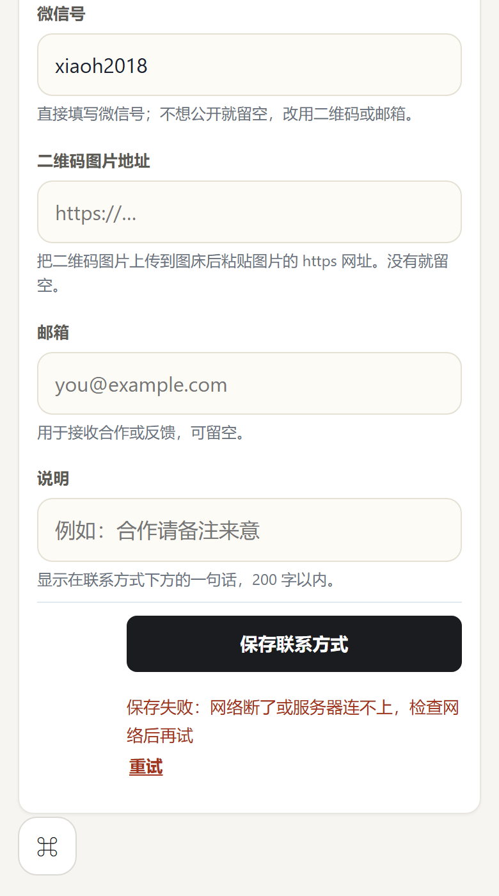
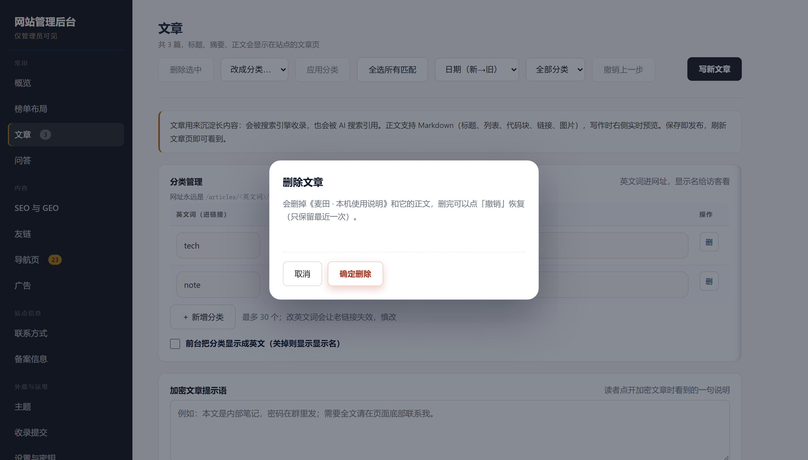
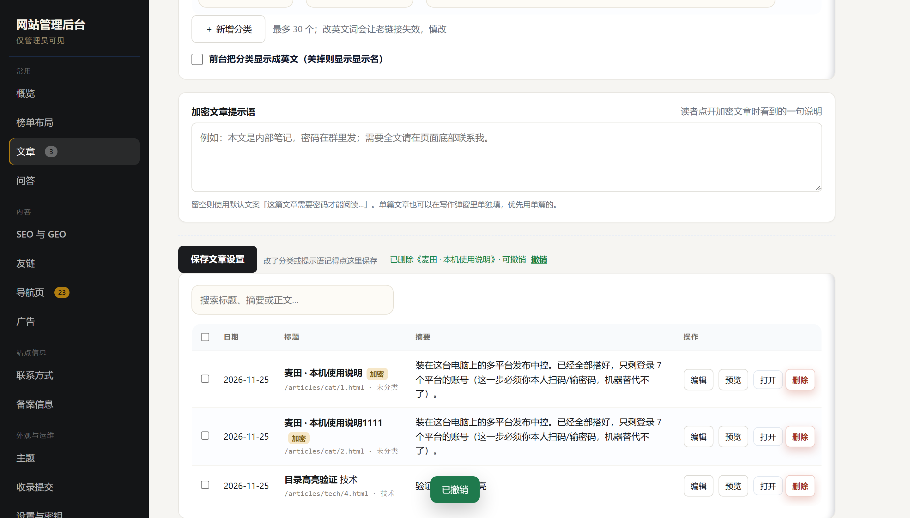
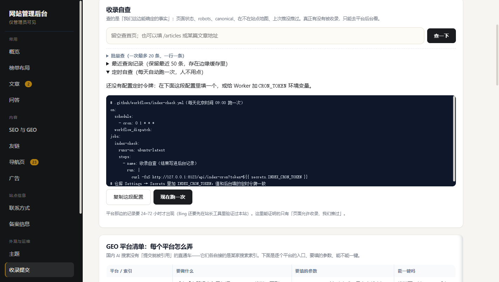
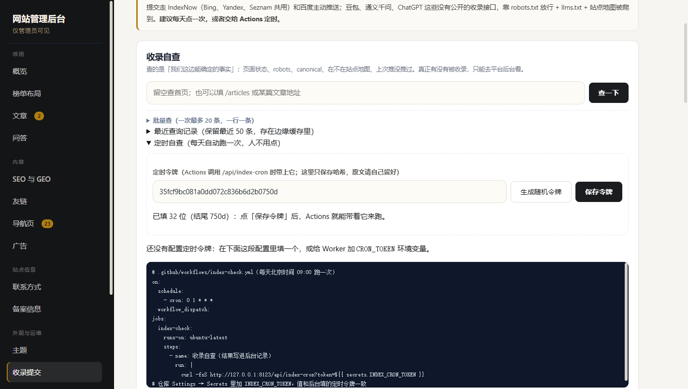

# GitHub 热门项目排行榜 · 优化建议（2026-11-24 实测版）

> 本文档所有结论均基于当日对本仓库代码与本机副本数据的实测，以及 GitHub 公开 API 对远端仓库的只读探测。标注「已验证」的条目有数据支撑；标注「建议核实」的条目受本机网络限制（workers.dev 从当前网络不可达）需要站长在 Cloudflare 后台确认。

## 0. 总体结论

**项目是健康的，管线在正常运转。** 远端仓库最近 8 次 `Update data` 运行全部 success（定时 + 手动触发都在工作），最新数据提交 `2026-11-24T02:16:43Z chore: update ranking data 2026-11-24`。翻译覆盖率实测 97%（2000 条榜单位置中 1945 条有中文简介）。架构（静态数据 + Worker 转发 + 无数据库）对个人项目是合理的取舍，不建议推翻。

需要处理的问题按优先级列在下面，多数是小改动。

## 1. 实测数据（优化决策的依据）

### 1.1 data/repos.js 体积构成（本地副本，2026-11-19 版，1586.4 KB）

| 指标 | 数值 | 说明 |
|---|---|---|
| 原始文件 | 1586.4 KB | 键带引号 + 缩进的 JS 对象字面量 |
| 紧凑 JSON 等价物 | 1149.9 KB | 去掉引号/缩进可省 28% |
| 去重后（1868 个唯一仓库） | 1056.5 KB | 2000 条位置里 132 条跨榜单重复（week/month/year/all 交集），浪费 6.6% |
| gzip 后 | 342.8 KB | 线上传输大概率是这个量级（Cloudflare 对文本响应自动压缩） |
| brotli 后 | 227.9 KB | 理论下限参考 |
| users 段 | 12.1 KB | 忽略不计 |
| 字段占比 | desc 269.9 KB + desc_zh 264.6 KB ≈ 46% | 简介双语是体积大头；topics 102.6 KB、url 100.4 KB 次之 |

**结论：当前体积可接受**（gzip 后约 340 KB，一次性加载，且 SW 会缓存）。「首屏 1.5 MB」的直觉被高估了——真正传输的应是 gzip 后的 1/4。以下优化属可选：

- **低成本**：`scripts/fetch.js` 的 `toJs()` 改为输出 `JSON.stringify` 紧凑格式（去掉美化缩进），立省 ~28% 源文件体积与 git 仓库膨胀速度。
- **中等**：四榜单去重存储（公共仓库存一份 + 各榜单存索引），省 6.6%，改动面较大，性价比一般。
- **激进（不建议现在做）**：按榜单拆分文件懒加载。会增加请求数和复杂度，当前 340 KB 不构成瓶颈。

### 1.2 远端管线健康度（GitHub 公开 API，2026-11-24 查询）

- 近 8 次工作流运行全部 `success`（2026-11-22 ~ 11-24，schedule 与 workflow_dispatch 交替出现，说明定时和访客触发都活着）。
- 最新数据提交 2026-11-24T02:16:43Z。
- 仓库 5175 KB，公开，默认分支 main。
- **本地副本落后远端 4 天半**（本地 HEAD `657004e` = 2026-11-19 20:45:56Z）。见 P0-2。

### 1.3 翻译覆盖

- 2000 条榜单条目中 1945 条有 `desc_zh`（97%）；按唯一仓库算 1815/1868（97%）。
- README_BUDGET=15000 字符 / 次、README_TOP=40 的配置与该覆盖率自洽，**不需要调大**——调大只会让每次 Action 更慢、更容易把 MyMemory 当日额度吃光影响简介翻译。

## 2. P0 —— 立即处理

### P0-1 index.html 的 SW「自清理」逻辑已经变成每会话一次的无害化自残（已验证，代码级确认）

`index.html:285-300`：这段 IIFE 是当年清理 v22 之前旧 Service Worker 用的，但判断常量写死为 `'ghrank-shell-v22'`，而 `sw.js` 的 `CACHE` 已是 `ghrank-shell-v36`。逻辑 `stale = keys.some(k => k !== 'ghrank-shell-v22')` 在今天**恒为真**——只要访客注册过 SW，就执行「注销全部 SW → 删除全部缓存 → 强制 location.reload()」，靠 sessionStorage 限流为每浏览器会话一次。

后果：每位访客每次新开会话都白付一次「SW 注销 + 缓存全清 + 整页刷新」的代价，离线能力在该会话内失效；这段代码永远等不到「迁移完成」的那天，因为它比对的目标版本不会再出现。

**修法**：整个 IIFE（index.html:285-300 一带）直接删除。v22 时代的 SW 早已在两年数次的版本迭代中被 activate 清掉；即便真有钉子户，`sw.js` 的 activate 也会删旧缓存。删完记得 `sw.js` 的 CACHE 号 +1（v36 → v37）。

### P0-2 本地仓库落后远端 4 天半，提交文档前必须先 pull（已验证）

本地 main 在 `657004e`（11-19），远端 main 已到 11-24。直接 commit + push 会被拒或制造无谓 merge。

**修法**：`git pull --ff-only origin main` 再提交 `docs/`（当前为 untracked，无冲突风险）。之后把本文档 P0-3 一并处理。

### P0-3 作废已泄露的 RUN_PASSWORD（来自交接文档，仍未完成）

task_plan.md 明确记录 `147258hh` 在历史对话中泄露过。这是唯一一条涉及安全的待办。

**修法**：Cloudflare → Worker → Settings → Variables and Secrets，删除或更换 `RUN_PASSWORD`（它只用于手动保活接口，删掉不影响 /admin 后台——后台走 `ADMIN_PASSWORD`）。

## 3. P1 —— 文案与代码不一致（会误导维护者）

### P1-1 「微软翻译 Key / MS_TRANSLATOR_KEY」是残留文案，代码里根本没这个变量（已验证）

- `worker.js:917`：/api/translate 的 410 错误信息让用户去配 `MS_TRANSLATOR_KEY`——全代码搜索不到任何读取该变量的地方。
- `worker.js:1232`（后台「翻译设置」标签）：标题文案写「微软翻译 Key 和 GitHub Token 只放在 Cloudflare 环境变量里」。
- `README.md:28-29`：同样写「微软翻译 Key」。

实际翻译链路只有 MyMemory（`translateMM`）+ Workers AI（`translateAI`）两级（worker.js:259-292）。

**修法**：三处文案把「微软翻译 Key / MS_TRANSLATOR_KEY」改为「Workers AI 绑定（变量名 AI）」或直接删掉微软字样。顺手把 worker.js:308 的 `staticDescZh` 一并删除——它是同样来自旧版「desc-zh 走 /api 下发」方案的无调用死代码（全仓库无引用），留着会让人误以为 /api/desc-zh 会读静态文件（实际 `descZh()` 只走实时翻译）。

### P1-2 README 的功能描述与实际不符（已验证）

`README.md:12` 写「时间范围（近 7 天、30 天、90 天、一年）、排序（综合、增速、星标、活跃度）」。实际（index.html:375-388）：范围是 **近 7 天 / 30 天 / 1 年 / 全部**（没有 90 天）；排序是 **星标 / 今日增量 / 活跃度 / Fork / 最近更新**（5 种，没有「综合」）。

**修法**：改 README 该句为实际值。同段「变化榜」等描述无碍。

### P1-3 js/ 模块与 js/bundle.js 的双份真相（结构性风险，无构建脚本）

`bundle.js` 头部注释说「由 js/ 下的各模块合并而成」，仓库里 config/state/api/cache/ui/app 六个源文件都在，但**没有任何合并脚本**（无 package.json、无 build 工具）。改 `js/api.js` 不会反映到实际加载的 `bundle.js`——下一个维护者大概率踩坑。

**修法（二选一）**：
- 简单：在 README/操作手册写明「前端逻辑一律直接改 `js/bundle.js`，js/ 下散件仅是历史拆分参考」，并把散件删掉或挪进 `docs/legacy/`；
- 正规：加一个 10 行的 `scripts/build-bundle.js`（按顺序 concat 六个模块 + 包一层 IIFE），Action 或提交前跑一次。

## 4. P2 —— 锦上添花（按性价比排序）

1. ~~**og:image 还是空**~~ **已做**：仓库根目录已有 `og-image.png`（1200×630），由 `scripts/make-og-image.ps1` 用 Windows 自带 GDI+ 生成；`worker.js` 加了 `/og-image.png` 路由（7 天浏览器缓存），`data/site.json` 的 `seo.ogImage` 已填。分享到社交平台会自动出现大图卡片。
2. ~~**测试友链**~~ **已做**：`data/links.json` 已清空为 `[]`。
3. **sw.js 安装期预取 1.5 MB 数据**：SW install 时会 fetch `data/repos.js` 进缓存（sw.js:4,9）。SW 每次版本升级都触发一次全量数据下载。可改为「首次 fetch 事件时再缓存数据」（把 DATA 的预取从 install 挪到 fetch 兜底），避免升级瞬间的重复下载。优先级低——数据本就要下载一次。
4. **文章区空置**：articles.json 为空、首页文章板块自动隐藏（行为正确）。要么发第一篇（后台 GEO 标签 → 文章管理），要么无视。GEO 的 FAQ 6 条已就绪，首页「关于本站」弹窗已能吃到。
5. **.nova/ 本地垃圾**：tmp 下有十余个开发期脚本与截图（已 gitignore，不影响仓库），本地想清爽可整目录删掉（保留 plan.md 如果还要交接）。
6. **仓库体积增长**：数据每 3 小时一提交（每天约 8 个 commit × 每次约 1 MB 文本 diff），仓库会持续膨胀。当前 5 MB 无碍；半年后可考虑 `git gc` 或把数据文件改为每月 squash 一次历史（有风险，非必要不做）。
7. **descTried 的翻译失败不可重试**（bundle.js:947）：某次翻译失败后该简介在本会话内不再重试。属于刻意的防抖设计，代价是低概率的英文残留——保持现状即可，不建议加自动重试。

## 5. 明确不建议动的（设计取舍，动了是负优化）

- **worker.js 单文件含整个后台 HTML**：1821 行确实大，但「粘贴即部署、零构建」是这个项目最大的运维优势。拆分只会把一次粘贴变成一次构建流程。
- **localStorage 做缓存/收藏/快照**：容量 5 MB 足够（当前用量远小于此），淘汰策略已实现（最旧优先）。换 IndexedDB 是纯工程量。
- **MyMemory 免 Key 翻译链**：97% 覆盖率说明够用；额度耗尽时的降级（保英文、partial 标记、短缓存）处理得很细。
- **无依赖的 fetch.js / serve.js**：Node 20 内置能力全覆盖，别引入 npm。

## 6. 一页清单（勾选用）

- [x] P0-1 删 index.html SW 自清理 IIFE（v22 残留），sw.js CACHE v36→v37
- [x] P0-2 `git pull --ff-only` 同步远端后再提交（已快进到 f699725）
- [ ] P0-3 Cloudflare 更换/删除泄露的 RUN_PASSWORD
- [x] P1-1 清理「微软翻译 Key」文案 ×3 处 + 删 staticDescZh 死代码
- [x] P1-2 修正 README.md:12 范围/排序描述
- [x] P1-3 处理 bundle.js 与 js/ 散件的双份真相（文档声明或加合并脚本）——已在《操作手册》声明：bundle.js 是唯一编辑目标
- [x] P2-1 补 og:image（1200×630，`og-image.png` + 生成脚本 + Worker 路由 + `twitter:image`）
- [x] P2-2 后台删除测试友链「123」（`data/links.json` 现为 `[]`）
- [x] P2-5 canonical / og:url / JSON-LD / `seo.siteUrl` 全部换成 `https://github.661026.xyz`
- [x] P1-4 `/api/status` 加 60 秒边缘缓存 + 保活/触发后自动 purge
- [ ] P2-3 （可选）toJs 改紧凑输出省 28%
- [x] P2-4 SW install 不再预取数据文件（已随 P0-3 一起改：只预缓存 meta，约 2KB）
- [ ] 待核实：本机网络连不上 workers.dev，线上 Worker 版本与配置需站长在 Cloudflare 后台确认（尤其 P0-3 与 P1-1 涉及的线上文案）

## 7. 本轮已落地（2026-11-24 傍晚，代码已改并本地验证）

对应《加速评估-github.661026.xyz.md》里的 P0-1 / P0-2 / P0-3 / P1-3。

| 项 | 改动位置 | 做法 | 效果（本地模拟 workers 运行时实测） |
| --- | --- | --- | --- |
| P0-1 边缘缓存 | `worker.js` `serveSiteEdge()` | 把**成品响应**写进 Cache API（`caches.default`），键为 `https://edge.ghrank.internal + path[?v=]`；命中直接返回，不再回源 raw | 二次访问 `edge=HIT`、回源次数 0；线上预期 390~443ms → 20~50ms |
| P0-2 长缓存 + ETag | 同上 `cachePolicy()` | 按文件分档：`/sw.js` 60s、`/data/*` 600s、HTML 300s、JS/图标 7 天；边缘 `s-maxage` + `stale-while-revalidate`；`ETag` = 内容 djb2 哈希，支持 `If-None-Match` → 304 | 冷启动 MISS 带 `etag="h..."`；带 `If-None-Match` 直接 304；旧访客不再每次重下 57KB 的 bundle |
| P0-3 数据拆分 | `scripts/fetch.js`、`js/bundle.js` `ensureRange()`、`index.html`、`sw.js`、`worker.js` SITE | Action 改写成 `repos-meta.js`（16KB）+ `repos-{week,month,year,all}.js`（各约 330KB 原始）；页面按 range 动态插 `<script>`，带 `?v=generatedAt` 让新数据立刻生效；SW 只预缓存 meta | 首屏数据从 1586KB 原始 / 403KB br 降到约 345KB 原始 / 85KB br；四个范围实测 453/500/500/500 条全部可加载 |
| P1-3 HEAD | `worker.js` 路由 | SITE 命中与 `/robots.txt`、`/sitemap.xml` 放行 HEAD；边缘命中时 HEAD 返回空 body + 正确头 | 实测 `HEAD /`、`HEAD /js/bundle.js`、`HEAD /data/repos-week.js` 全部 200 且 0 字节；修复前是 404 |
| 附带 | `worker.js` `purgeEdge()` | 后台保存站点配置/文章后清掉 `/`、`/articles`、对应 json 的成品缓存 | 后台改完立刻能看到，不用等 TTL |
| 附带 | `scripts/split-data.js` | 把已有的旧 `data/repos.js` 一次拆成新格式（迁移/应急用） | 已跑过：meta 16KB + week 322.5KB + month 345.4KB + year 343.6KB + all 337.5KB |

### 部署顺序（重要）

1. `git push` 本次改动；
2. **立刻**去 Cloudflare 把新的 `worker.js` 粘贴进去 Deploy——不重新部署，边缘缓存 / HEAD / 新的 `/data/repos-*.js` 路由都不存在，页面会退化成实时调 GitHub API（能看，但慢且耗额度）；
3. 等下一次 Action（每 3 小时）跑完，或手动 Run workflow，确认新数据写进的是 `repos-meta.js` + 四个分文件；
4. `data/repos.js` 现在是冻结的旧文件，只做过期兜底；确认线上稳定几天后按《操作手册》§7 第 7 条清掉。

## 8. 第二批已落地（2026-11-24 晚，代码已改并本地验证）

| 项 | 改动位置 | 做法 | 效果 |
| --- | --- | --- | --- |
| 分享图 | 新增 `og-image.png`（1200×630，110KB）、`scripts/make-og-image.ps1`、`worker.js` SITE 增加 `/og-image.png`、`index.html`/`articles.html` head、`data/site.json` | 用 Windows 自带 GDI+ 画（深蓝渐变 + 金色柱状装饰 + 站点信息），不需要 npm 依赖；Worker 按 shell 文件给 7 天浏览器缓存 | 微信/Twitter/Telegram 分享出大图卡片；`twitter:card` 有图时自动 `summary_large_image` |
| 域名统一 | `index.html`、`articles.html`、`data/site.json` | canonical、`og:url`、JSON-LD 的 `@id`/`url`、`primaryImageOfPage`，以及 `seo.siteUrl`、`seo.ogImage` 全部指向 `https://github.661026.xyz` | 搜索引擎权重不再算到旧 workers.dev 域名；`sitemap.xml` 也跟着用新域名 |
| 友链清理 | `data/links.json` | 删掉测试条目，改为 `[]` | 后台友链表不再有脏数据 |
| `/api/status` 缓存 | `worker.js` 新增 `getStatusCached()`，`keepalive()`/`triggerRefresh()` 成功后 `purgeEdge(['/api/status'])`，后台 `api()` 加 `cache: 'no-store'` | 两个 GitHub 请求本就并行，剩下的是 API 往返延迟；用 Cache API 挡 60 秒（响应带 `public, max-age=60`） | 后台反复刷页面不再每次打 2 次 GitHub（省 5000 次/小时额度）；保活后状态立刻刷新，不会看到旧值 |
| SEO 注入增强 | `worker.js` `applySeo()` | 除原有 title/description/keywords/og:title/og:description/og:image/canonical，再补 `og:url`、`twitter:image`、按有无分享图决定 `twitter:card` | 后台改 SEO 标签时这些也一起生效，不用改 HTML |

### 验证方式（可复跑）

```
node scripts/check-worker.mjs      # 本地模拟 Workers 运行时，30+ 项断言
```

覆盖：首页 head 注入（og:image/twitter:card/twitter:image/canonical/og:url）、`/og-image.png` 的 200 与 PNG 文件头与 `max-age=604800`/ETag、`HEAD /og-image.png` 0 字节、`/api/status` 首次打 2 次 GitHub API 且第二次命中缓存、保活后自动 purge、`/articles` canonical、后台加友链后 `/data/links.json` 立刻返回新值、后台改 `layout` 后 `/data/site.json` 立刻返回新值、边缘缓存 HIT/MISS 与 404。

## 9. 第三批已落地（2026-11-25 上午）：后台改完不用再等 15 分钟

**症状**（用户实测）：后台点了「保存榜单布局」选单栏，前台还是双栏；后台加/删友链，前台友情链接区域没反应。

**根因**：改前是两层缓存叠加，且只清得掉第一层。

1. 成品缓存 `EDGE_CACHE`（`/data/*` 的 `cachePolicy().ttl = 900`）——`purgeEdge()` 能清掉这一层。
2. **Cloudflare 给 `raw.githubusercontent.com` 那次子请求的缓存**（`cf: { cacheTtl: 300 }`）——`purgeEdge()` 清不掉别人的域。

于是「保存 → purge → 回源 raw 拿到旧内容 → 又把旧内容写回成品缓存 900 秒」。最坏 15 分钟才换新，而后台文案写的是「约 5 分钟」。实测证据：GitHub 上 `data/site.json` 已经是 `"mode":"single"`、`data/links.json` 已有 1 条友链时，`/data/site.json` 仍返回 `double`、`/data/links.json` 仍返回 `[]`（`x-edge: HIT`）。

**改法**（`worker.js`）：

| 项 | 做法 | 效果 |
| --- | --- | --- |
| `RAW_TTL = 60` | 回源 raw 的 `cf.cacheTtl` 从 300 秒降到 60 秒（`serveSite`、`loadSiteRaw` 两处） | 第二层缓存最多只旧 1 分钟 |
| `warmEdge(pathname, body, type)`（新增） | 保存成功后不只 purge，还把**刚保存的 JSON 直接写成成品响应**塞回 `EDGE_CACHE`（带正确 `content-type`/`cache-control`/`ETag`） | 下一次请求直接命中新值，0 延迟 |
| 三处保存都接上 | `handleSite`（`/data/site.json`）、`handleLinks`（`/data/links.json`）、`handleArticles`（`/data/articles.json`） | 布局 / 友链 / 广告 / SEO / 备案 / 联系方式 / 文章，全部保存即生效 |
| `CONFIG_FILES` 短缓存 | `cachePolicy()` 里给后台可改的三个 JSON 单独一档：`max-age=60, s-maxage=60, swr=300`（榜单 `repos-*.js` 仍 600/900） | 第三层——Cloudflare 边缘 + 浏览器对 Worker 响应的缓存——也只剩 60 秒，实测它曾把旧值钉住 660 秒 |
| 文案对齐 | 后台「删后约 5 分钟生效」等 3 处改成「刷新首页立刻生效」 | 不再误导 |

**验证**：`node scripts/check-worker.mjs` 第 6、7 组断言——先 GET 让缓存里是旧值，再模拟后台保存，然后**不睡眠**立刻 GET，断言拿到新内容且 `x-edge: HIT`（说明是新写的成品缓存，不是碰巧回源）；另断言 `site.json` 的 `cache-control` 只剩 `max-age=60`、`repos-week.js` 仍是 `max-age=600`。

### 没做 / 仍建议的事

- P1-1 数据搬 Workers KV（干掉 raw.githubusercontent 单点）：改动面比前三项加起来都大，且 P0-1 落地后 raw 只在缓存未命中时才访问，收益已大幅下降，暂不动。
- P1-2 Early Hints 103：需要 Worker `earlyHints` 能力 + 页面里给 `Link: rel=preload`，收益约 100ms，放到下一轮。

## 10. 第四批已落地（2026-11-25 白天）：后台重排 + 榜单排版三档 + 缓存再优化

用户反馈：「SEO 和 GEO 放一块、文章单独一块、写文章弹窗太小、后台不方便、榜单布局再丰富些（不光是项目榜，开发者和组织榜也该有排版）、前后端 UI 综合优化、翻译设置页基本没东西、缓存和速度还有没有能优化的」。

| 项 | 改动位置 | 做法 | 效果 |
| --- | --- | --- | --- |
| 后台导航分组 | `worker.js` ADMIN_PAGE | 侧栏从「9 个平铺标签」改成 **常用 / 内容 / 站点信息 / 运维** 四组；顺序按使用频率重排：概览、榜单布局、文章、SEO 与 GEO、友链、广告、联系方式、备案信息、翻译与密钥；「文章」带条数徽标 `#navArtCount` | 常用操作在顶部，不用往下翻 |
| SEO 与 GEO 合并 | 同上 | 原 `pane-geo` 的 GEO 摘要 + FAQ 整块搬进 `pane-seo`，一个标签管完所有「写进 head 的标签」和「给 AI 搜索看的问答」 | 少点一次；改 SEO 时顺手看到 FAQ |
| 文章独立成页 | 同上 | 新 `pane-articles`：搜索框（过滤标题/摘要/正文）+ 日期倒序表格 + 每行「编辑 / 预览 / 删除」+ 右上「写新文章」 | 文章多了也不乱 |
| 写文章弹窗放大 | 同上 | `dialog.wide`：`width:min(1120px,calc(100% - 24px))`、两栏布局（左编辑 / 右 KeeMd 实时预览）、底部按钮 sticky 常驻、⤢ 一键全屏、可折叠预览、字数统计 `#artLen` | 之前 480px 单栏写长文极难受；现在接近 Typora 的写法 |
| 榜单布局三档 | `worker.js`（`layout.{mode,side,users}` + 校验）、`index.html`（`body[data-*]` + CSS）、`js/bundle.js` | 三组单选卡：列数 `auto/single/double/triple`、侧栏位置 `right/below`、开发者/组织榜 `auto/single/double`；前端用 `body[data-layout]`/`[data-side]`/`[data-users]` 驱动，媒体查询「默认给足、窄屏降级」 | 桌面端可以三列；把侧栏挪到底部就能纯榜单通栏阅读；用户榜可以两列 |
| 用户榜卡片 | `js/bundle.js` `renderUsers()`、`scripts/fetch.js` | 卡片式：排名 + 头像 + 名称 + 「组织/个人 · 12.3 万 粉丝」+ 「主页 ↗」；`fetchUsers` 补 `followers` 字段 | 之前只有一行链接，看不出是组织还是个人 |
| 翻译与密钥页 | `worker.js` | 重写为三块：**链路状态**（`/api/status` 的 `translator.{githubToken,ai,contactEmail}`，只显示配没配）、**实测一次**（POST `/api/translate` 把一句话同时丢给 MyMemory 和 Workers AI，返回各自耗时/结果/生效链路）、**两个密钥怎么设**（`.kv` 说明） | 之前这页只有一行「是否配了 Token」，等于没有；现在能自己诊断「为什么简介没翻译」 |
| 版本化静态资源 | `worker.js` `serveSiteEdge()` + `cacheControlOf(p, immutable)` | 带 `?v=` 访问 `/data/*`、`/js/*` 时返回 `public, max-age=31536000, immutable` | 数据文件一次下载管一年，不再依赖 600 秒 TTL 反复回源 |
| 首页预载 | 同上 | `/` 与 `/index.html` 响应加 `Link: </js/bundle.js>; rel=preload; as=script, </data/repos-meta.js>; rel=preload; as=script` | 少一轮「先 HTML 再发现脚本」的串行等待 |
| 工作流推送竞争 | `.github/workflows/update-data.yml` | push 前 `git pull --rebase --autostash`，push 失败自动重试 3 次（每次先 rebase） | 修掉真实失败：run 45522547066 的 `! [rejected] main -> main (fetch first)`——手点「立即刷新」和定时任务撞车就会丢一次数据刷新 |
| 移动端溢出 | `index.html` CSS | `.controls` 里分段控件改 `flex:0 1 auto; overflow-x:auto`、下拉/搜索框 `flex:1 1 120px; min-width:0`、`.note/.hint` 加 `overflow-wrap:anywhere` | 500px 及以下不再横向滚动（探针实测 345 / 375 / 399 px 三档 `scrollWidth == clientWidth`） |
| 本地工具 | 新增 `scripts/dev-server.mjs`、`scripts/preview-admin.mjs` | dev-server 真跑 `worker.js`（缓存用 Map、GitHub API 打桩并**把 PUT 写回本地文件**、后台密码 `dev`）；preview-admin 注入脚本直接截后台各面板静态图 | 不部署也能验证「后台保存 → 前台立刻变」；改后台样式不用瞎猜 |
| 自检扩到 10 组 | `scripts/check-worker.mjs` | 新增 §9 后台改版结构/翻译链路、§10 布局三档校验 + `immutable` + `Link` 预载 | `node scripts/check-worker.mjs` 一条命令覆盖 40+ 断言 |
| 自动部署 | 新增 `wrangler.toml`、`.github/workflows/deploy-worker.yml` | push 到 `worker.js` 时自动 `node --check` + `check-worker.mjs` + `wrangler deploy`；路由写进 `wrangler.toml` 所以部署不会丢路由；没配 `CLOUDFLARE_API_TOKEN`/`CLOUDFLARE_ACCOUNT_ID` 就自动跳过 | 不用每次去面板手粘代码（这正是前三轮「改了没生效」的主要来源） |

### 一个花了挺久的坑（记下来省下次）

「三列」一开始怎么改都不生效：`body[data-users="double"] #list{repeat(2,…)}` 和 `body[data-layout="triple"] #list{repeat(3,…)}` 的**特异性完全相同**（`body` + 一个属性选择器 + `#list`），users 那条写在后面就把 triple 盖掉了。修法是让 users 规则只作用于用户视图——给 `#list` 加 `.users-view` 类（`renderUsers()` 加、`renderRepos()` 删），选择器变成 `body[data-users="double"] #list.users-view`，特异性更高且不误伤项目榜。同源教训：用媒体查询做响应式降级时，把「窄屏覆盖」写在后面，否则又会被后面的规则盖回去。

## 11. 第五批已落地（2026-11-25 中午）：表格 / 广告位 / 菜单上移 / 翻译 / 导航页 / 收录提交

用户反馈：「MD 表格不认、广告到底在哪能设、翻译还有问题、这几个菜单能不能移到上面、加个导航页（和 GitHub 分类做成两个 TAB，后台填地址自动抓描述）、加网站收录提交、SEO 主动提交给豆包千问这类 AI」。

| 项 | 改动位置 | 做法 | 效果 |
| --- | --- | --- | --- |
| Markdown 表格 | `js/md.js` | 新增 `RE_SEP` 分隔行正则、`splitRow()`（逐字符切，代码里的 `|` 和 `\|` 不当分隔符）、`isTableStart()`、`alignOf()`、`renderTable()`；输出 `<div class="md-table"><table>`，单元格写 `text-align` | 后台预览与首页文章里的表格终于正常渲染，窄屏可横向滚动 |
| 标题层级 / 任务清单 / 删除线 | 同上 | `#{1,3}` → `#{1,6}`（`Math.min(len+2,6)`）、`- [x]` 渲染成禁用勾选框、`~~删除线~~` | 长文排版不再掉级；抄来的 README 清单能看 |
| 表格样式 | `index.html`、`worker.js`（`.art-prev`） | `.md-table{overflow-x:auto}`、`th/td{border:1px solid var(--border)}`、`thead th{background:var(--chip)}`、隔行浅底 | 前台文章与后台预览视觉一致 |
| 广告 5 个位置 | `worker.js`（`AD_SLOTS` / `defaultSite` / `normalizeSite` / `checkSection('ad')` / `pane-ad` / `fillSite`）、`index.html`（5 个容器 + `renderAds`） | 位置：`home-top` 页头下通栏、`list-top` 榜单上方、`list-bottom` 分页器下、`sidebar` 侧栏底部、`article` 文章区上方；每个位置独立 `{enabled,html}`，后台一格一卡、不勾就不渲染；老数据（单 `ad.html`）自动迁到 `home-top` | 之前只有「分页器下面」一个坑位，等于只能放一个；现在横幅/侧边/文章前都能各自招商 |
| 菜单上移 | `index.html` | `.head-actions` 依次放 关于本站 / 文章 / 友情链接 ｜ 设置 / English / 切换主题；删掉整块 `.topnav` 与 4 条死 CSS；滚动脚本选择器跟着换 | 页头一行搞定，不再占一行二级导航 |
| 翻译链路 | `worker.js` `chunkText/trKey/readTranslation/saveTranslation/translateMM/translateAI/handleTranslate` | MyMemory 450 字分段、Workers AI 900 字分段、**译文写边缘缓存**（命中直接返回，`effective='cache'`）；失败原因分类为 `network:/quota:/http:/status:/parse:/not-bound:/run:/empty:` 并在后台译成中文 | 截图里「MyMemory 失败 535ms / AI 成功 1062ms」现在能一眼看出是额度还是网络；同一段文字第二次翻不花钱也不等待 |
| 导航页（后端） | 新增 `data/nav.json`、`worker.js` `NAV_FILE/emptyNav/normalizeNav/readNav/writeNav/handleNav`、`/api/nav` | 分类 ≤20、站点 ≤400；id 小写化去重、名称/描述/图标截断；写回仓库后 `warmEdge('/data/nav.json')` | 后台改完前台刷新立刻变，和友链/文章同一套 |
| 自动抓描述 | `worker.js` `handleFetchMeta()`、`/api/fetch-meta` | 只允许 http(s)，屏蔽 localhost/内网/169.254 段；`cf.cacheTtl:3600`；标题取 `<title>`/`og:site_name`，描述取 meta description/og/twitter 四种顺序，兜底第一个 `<p>`；图标 apple-touch-icon → rel=icon → og:image → `origin/favicon.ico` | 后台填个网址点「自动获取」就有名称+描述+图标，抓不到再手写 |
| 导航页（前端） | `index.html` | `.viewtabs` 两个标签（榜单/导航）；`#navView` 卡片网格 `minmax(240px,1fr)`，卡片=图标+名称+两行描述+域名；搜索框按名称/描述/网址过滤，`#navCount` 显示「共 23 个站点」；`body[data-page="nav"]` 时把筛选条/统计卡/文章区 `display:none!important` 收起来 | 与榜单同一套视觉；切过去不会两套 UI 打架 |
| 收录提交 | `worker.js`（`AI_BOTS`、`robotsTxt`、`llmsTxt`、`indexNowKey`、`handleSubmit`、动态 `sitemap.xml`、`/api/submit`、`pane-submit`） | `robots.txt` 逐个 Allow 18 个 AI 爬虫；`/llms.txt` 给大模型的站点说明书（页面/文章/导航/数据说明）；`sitemap.xml` 加文章锚点与 `lastmod`；IndexNow 一次推 Bing/Yandex/Seznam/Naver；配 `BAIDU_TOKEN` 才推百度；后台「立即提交」按钮 + 状态卡 + 手动入口说明 | 豆包/千问/DeepSeek/ChatGPT 没有公开提交接口，能做的是「放行抓取 + 给说明书 + 站点地图」；这一批把这三件事全做了 |
| 自检扩到 13 组 | `scripts/check-worker.mjs` | 新增 §11 广告位（按槽保存/未知槽被拒/前台容器存在）、§12 导航页与收录提交（19 条）、§13 `/nav` 与 `/?page=nav` | `node scripts/check-worker.mjs` 60+ 断言全绿（回源 24 次、API 19 次） |
| 预览工具能登录了 | `scripts/preview-admin.mjs` | 改成用 dev 密码真登录（`/api/admin/check`）再点标签，生成 10 张带真实数据的后台预览页 | 之前跳门禁导致面板永远「读取中…」，截图看不出问题 |

### 第二个坑：地址栏被前端自己抹掉

「直接打开 `/#nav` 不生效」查了很久。链路是：`js/bundle.js` 初始化时会 `history.replaceState(null,'',location.pathname+'?'+自己的参数)` 把地址栏改写成它认识的 `range/lang/cat/sort/view`——于是 `#nav` 和 `?page=nav` 在 DOMContentLoaded 之后就不存在了，后面再读 `location.hash` 永远是空。

修法两层：`index.html` 在 `<head>` 里（bundle.js 之前）先把意图记进 `window.__wantNav`；`bundle.js` 的 `syncHash()` 把 `page=nav` 当作要保留的参数。顺带把参数名从 `view=nav` 改成 `page=nav`——`view` 是 bundle.js 自己的（repos/devs/orgs），会互相打架。

## 12. 第六批已落地（2026-11-25 下午）：README 所见即所得 + 总榜

用户反馈三件事：「README 标题旁永远写着『中文翻译中…』」「README 显示的是 MD 源码，不是渲染后的样子」「能不能加个总榜？现在的『全部』第一名数据对不对？」

### 先说结论：数据是真的，**名次是错的**

- 直连 `api.github.com` 核对：`codecrafters-io/build-your-own-x` 565345 星 / 52822 Fork、`sindresorhus/awesome` 542384 星、`freeCodeCamp/freeCodeCamp` 459588 星、`morluto/rea` 477292 星 —— 与 `data/repos-all.js` 完全一致，所以截图里 565.3k 不是 bug。
- 但旧「全部」榜第 301 名往后是**错排**的：`data/repos-all.js` 500 条里 stars>20000 恰好 300 条，其余 200 条来自 5000–20000 分段（最低 18761 星）。原因在抓取策略：每个星标分段只翻 3 页 ×100，第一段（>20000 星）被 300 条截断，全站几百个 >2 万星的仓库只抓到了前 300 个。

### 做了什么

| 项 | 改动位置 | 做法 | 效果 |
| --- | --- | --- | --- |
| 总榜（抓取） | `scripts/fetch.js` | `RANGES.total = { days: 0, deep: 10, minStars: 1000 }`；新增 `fetchDeep()`：单查询 `stars:>1000 sort=stars desc`、翻 1..10 页（GitHub 搜索上限 1000 条）、去重后按星标降序留 500，写 `data/repos-total.js` | 「总榜」是真正的全站星标 Top 500：第 1 名 565346 星、第 500 名 52488 星，不再有错排 |
| 总榜（前端） | `js/bundle.js`、`index.html` | `RANGES.total`、`SEGMENTS.total=[{lo:1000}]`、`RANGE_FILES.total='data/repos-total.js'`（`all` 别名指向同一文件，旧链接不 404）；`loadRepos` 对 `total/all` 走深翻页分支；筛选栏按钮 `全部` → `总榜`（`data-range="total"`） | 四个按钮变成 近 7 天 / 近 30 天 / 近 1 年 / 总榜，语义清楚 |
| 总榜（后端/CI） | `worker.js` `SITE`、`.github/workflows/update-data.yml` | 加 `/data/repos-total.js` 的 MIME 映射（`application/javascript`）与 `git add` | Worker 能直接转发、Action 能提交 |
| README 渲染 | `js/bundle.js` 新增 `sanitizeReadme()` + `readmeBlock()` | GitHub 返回的是 HTML：先把 `img/a/h1-6/b/i/code/li/br/hr/p` 转成 Markdown、剥掉其余标签、解码实体、锚点降级纯文字、相对图片补 `repoUrl/raw/HEAD/`、相对链接补 `repoUrl/blob/HEAD/`，再交给 `KeeMd.render()`（先转义再替换语法，天然防 XSS）；只渲染前 20000 字符，超长给「在 GitHub 看完整 README」 | 抽屉里是排版后的文档（标题/表格/图片/代码块/任务清单），不再是源码 |
| 去掉「翻译中…」 | 同上 | 删掉 `v.zhPending` 时拼的标题文案；译文到达后只 `replaceWith(readmeBlock(...))` 替换 `#readmeWrap`，不再整页重绘 | 打开就先看英文原文，译文悄悄替换回来；有译文时标题旁给「机器翻译 · 仅供参考」小字 |
| 自检 | `scripts/check-worker.mjs` §14 | 总榜文件 200/JS/缓存 600+900/≥400 条/按星标降序/第一名 >50 万；首页有 `data-range="total"` 与「总榜」；bundle 有 `sanitizeReadme`、无 `el('pre','readme'`、无「中文翻译中」 | `node scripts/check-worker.mjs` 14 组 70+ 断言全绿 |

### 顺手记两个坑

- **`img` 转 Markdown 时别把相对地址丢掉**：第一版 `sanitizeReadme` 只保留 `http(s)` 图片，`./assets/logo.png` 直接被删；正确做法是先原样保留，交给后面的「补全成 raw 地址」规则处理。
- **单测要卡住「渲染」这一层**：这次用 `vm` 加载 `js/md.js` 拿 `KeeMd`、再从 `bundle.js` 里截出 `sanitizeReadme` 一起跑，10 项断言（表格/对齐/徽标图/相对路径/锚点/任务清单/代码块/无残留语法）比截图更靠谱。

## 编号说明

本文件的小节编号有两段历史，读之前先知道：

- **§N（N ≥ 30）指的是「第 N 轮」**：每一轮一次真实修复，按轮次连续编号，最新的在文件末尾；
- **早期的「第 N 批」条目**（§13、§19、§20、§30…）用的是当时的批号，所以编号不连续——那是历史，保留原号方便旧引用；
- 批号与轮号唯一撞车的一处是 §20（出现两次），第二次已改成 **§20b**，旧引用仍可命中。

机器校验见 `scripts/check-docs-toc.mjs`：编号唯一、单调递增、每节有正文、正文里 `见 §N` 的引用都能命中。


## §13 第七批：信息流广告 + 位置示意图 + 收录 Token 引导

| 做了什么 | 落在哪 | 做法要点 | 效果 |
| --- | --- | --- | --- |
| 广告位从 5 个扩到 8 个 | `worker.js` `AD_SLOTS` | 追加 `list-inline` / `article-inline` / `nav-inline` 三条；`emptyAdSlots / normalizeSite / checkSection / pane-ad / fillSite` 本来就遍历 `AD_SLOTS`，所以后台自动多出三张卡 | 榜单/文章/导航三种列表都能插信息流广告，且老数据不用迁移 |
| 榜单信息流 | `js/bundle.js` `renderRepos` | forEach 收集 `pageNodes`，每 10 条塞一个 `<li class="item ad-inline" data-ad-inline="list">`，`replaceChildren(...)` 后调 `window.ghrankMountInline`；底部导出 `window.__ghrankRenderList = renderRepos` 供广告配置到达后重排 | 分页器不受影响；广告没配时占位节点保持 `hidden`，不留空行 |
| 文章信息流 | `index.html` `renderArticles` | 每 2 篇插一个 `<div class="ad-inline" data-ad-inline="article">` | 首页文章列表中间出现广告 |
| 导航信息流 | `index.html` `renderNav` | 每 8 个站点插一个 `navcard ad-inline-card`（默认 `hidden`），渲染后调 `mountInlineAds()` | 导航页长分组里也有广告位 |
| 挂载与去重 | `index.html` `mountInlineAds()` | 扫 `[data-ad-inline]` 用 `mountAd()` 填充；`renderAds()` 回填 `inlineHtml` 后统一调一次 | 一处配置驱动 8 个位置 |
| 位置示意图 | `scripts/ad-map.html` → `docs/shots/ad-slots.png` | 手绘站点骨架 + 8 个红框 + 右侧对照表（1560×1340）；改完用 Chrome headless 重截 | 后台「广告」页和文档里都能直接看图对位 |
| 收录 Token 引导 | `worker.js` `pane-submit` 新增「这些 Token 在哪拿」卡 | 百度 API 提交页、Bing IndexNow、Search Console、Cloudflare API Tokens、Account ID、GitHub Secrets 六行，每行一句话 + 可点链接 | 用户不用去搜「token 在哪复制」 |
| 截图归档 | `docs/shots/` | 前台/后台/广告图全部入库（19 张），`scripts/preview-admin.mjs` 产物也往这里搬 | 以后所有截图只放项目里，不散在 `%TEMP%` |
| 自检 | `scripts/check-worker.mjs` §15 | 13 条断言：三个信息流位在后台都有卡、能保存、`list-inline` 打开后响应里 html 正确、`nav-inline` 保持关闭、首页有挂载逻辑、bundle 有 `data-ad-inline` 与 `% 10`、未知位被拒 | 15 组 75+ 断言全绿（回源 28 次，API 21 次） |

### 顺手记三个坑（都踩过）

- **补丁脚本必须「每个文件原子」**：`patch(file, ops)` 要先把该文件所有替换算完再写；这次 worker.js 那批 op 因缩进写成 4 空格命中 0 次直接抛错——好在没写坏文件，但若边算边写就会半途而废。
- **`index.html` 里的 CSS 是顶格无缩进**（`.navview{...}` 前面没有空格），补丁的 `find` 里别顺手加两个空格，否则永不命中。
- **`check-worker.mjs` 是单模块作用域**：新断言块里的 `const adAdminHtml` / `adState` / `inlineSave` 与前面重名会直接 `SyntaxError: Identifier 'x' has already been declared`，统一加前缀（这次用 `inl`）。另外这个测试桩**不会把 PUT 持久化**，所以「保存后再 GET 读回」永远读到旧值——断言要读 POST 的响应体。

## 14. 第八批（2026-11-25 晚上）：顶部导航重排 + 顶部滚动条 + 广告点击弹窗 + 间隔可配 + 后台导航页重做

| 改动 | 位置 | 做法 | 效果 |
|---|---|---|---|
| 顶部三栏导航 | `index.html` `header` | `display:grid` 三列：`.brand` ｜ `nav#mainNav`（榜单 / 导航 / 文章，胶囊样式）｜ `.head-actions`；≤1023px 导航掉第二行整宽，≤640px 三行竖排 | 榜单 / 导航 / 文章从筛选栏下面搬到页头中间，一眼能用 |
| 顶部滚动条 | `index.html` `#adTicker` + `renderTicker()`；`site.ad.ticker` | 文字（≤200 字）+ 速度（6–60 秒）+ 链接 + 弹窗；CSS 动画 `tk-move`，`prefers-reduced-motion` 时不滚；关闭记 `localStorage` 7 天 | 后台一格填完，前台页头出现滚动通知/广告 |
| 广告点击行为 | `index.html` `mountAd(el, html, meta)` + `#adModal` | 每格可设 `link` 与 `modal`：有弹窗 → `dialog` 内显示 HTML；只有链接 → 新窗口；`role="link"` + 回车可点 | 广告不再只能外链，可以做站内落地弹窗 |
| 信息流间隔可配 | `site.ad.slots[x].every`（1–50）→ `window.ghrankAdEvery` | 榜单 `% every`、文章每 `every` 篇、导航每 `every` 站；改完 `renderAds()` 直接触发 `__ghrankRenderList/Articles/Nav` 重排 | 不再写死 10 / 2 / 8 |
| 后台导航页重做 | `worker.js` `pane-nav` | 工具栏筛选 + 「5 个分类 · 23 个站点」统计 + 每行图标预览 + **批量导入**（`名称 | 网址 | 描述 | 图标`，Tab 分隔也行）+ 每分组计数 | 23 个站点维护起来不再靠肉眼翻 |
| 广告面板重做 | `worker.js` `pane-ad` | 顶部滚动条卡 + 「固定位 / 信息流位」两组，每格：开关、HTML、间隔、跳转链接、弹窗内容 | 8 个位置 + 滚动条一处配完 |
| sitemap 补 `/nav` | `worker.js` `sitemap.xml` | 首页 / `/nav` / `/articles` + 文章，全带 `<lastmod>` | 导航页也能被收录 |
| 自检 | `scripts/check-worker.mjs` §16–§17 | §16 顶部导航 / 滚动条 / 弹窗 / 间隔（保存、0 被拒、只开不给文字被拒、sitemap 有 `/nav`）；§17 后台内联脚本 `new Function` 可解析 + 每个 `data-tab` 都有对应 `pane-*` | **17 组 90+ 断言全绿（回源 30 次，API 23 次）** |

### 这一批踩到的三个坑（都写进自检了）

- **模板字面量会吃掉转义**：`ADMIN_PAGE` 是 `` `...` ``，里面写 `/^\s+$/`、`/\r?\n/`、`https?:\/\/` 时，反斜杠在生成 HTML 时就被解释成换行/斜杠 → 后台整段脚本 `SyntaxError: Invalid regular expression: missing /`，**登录按钮都点不动**。修法：模板里所有正则反斜杠都写双份（`\\s`、`\\/`），或者干脆改用 `String.fromCharCode`。§17 现在会 `new Function()` 校验生成后的脚本，这个问题不会再漏。
- **重写面板要检查有没有吞掉邻居**：重写 `pane-nav` 时把紧随其后的 `pane-submit` 整段删掉了，`$('subReload').addEventListener` 直接对 `null` 报错、`go()` 也因为 `pane-submit` 不存在而崩。§17 加了「每个 `data-tab` 都有 `pane-*`」断言。
- **CSS 顺序 > 直觉**：`.mainnav{grid-column:2}` 写在 `@media(max-width:1023px)` 之后，媒体查询里的 `grid-column:1 / -1` 被后出现的同特异性规则覆盖，窄屏导航挤成一列一个字。修法：把布局声明放前面、媒体查询放最后，并在 640px 再降一档。
- **截图别再走 `.preview/*.html`**：Chrome headless 打开那些注入过登录脚本的静态页一律 `ERR_INSUFFICIENT_RESOURCES`（同一份 HTML 走 `python -m http.server` 也一样），但直接打开 `/admin` 正常。改成 `scripts/tmp-cdp-shot.mjs` 的路子：CDP 连上 → 填密码 → 点标签 → `Page.captureScreenshot`（`captureBeyondViewport` 全页），稳定可靠（`docs/shots/admin-*.png` 都是这么出的）。

## 15. 第九批：把「翻译运行设置」搬进后台

| 事项 | 落地 | 说明 |
|---|---|---|
| 后台可改邮箱 | `data/site.json` → `runtime.emails`，后台「翻译与密钥 → 运行设置」 | 最多 20 个，逗号分隔；`mmEmails(env, rt)` 先读后台、再读 `TRANSLATE_EMAILS`/`TRANSLATE_EMAIL`、最后默认值 |
| 后台可改 AI 上限 | `runtime.aiCap`（0 = 不限制，1–100000） | `aiCap(env, rt)`，后台优先于环境变量 `AI_DAILY_CAP`；`translatorStatus` 回 `aiCapSource`（admin / env） |
| 即时生效 | `siteRuntime(env)` 读设置带 60 秒边缘缓存；`handleSite` 保存后 `EDGE_CACHE.delete('/__runtime')` | 保存后刷新首页/后台立刻用新值，不用等一分钟 |
| 邮箱别名一键生成 | 后台 `#rtAlias` | 取第一个邮箱的 `user+1..5@domain`，Gmail / Outlook 都进同一信箱，等于把 5 万字符/天乘以 6 |
| 校验 | `checkSection('runtime')` | 邮箱格式、最多 20 个、上限 0–100000；报错文案「不是邮箱格式：x」「Workers AI 每日上限要填 0 到 100000 之间的整数（0 = 不限制）」 |
| 自检 | `check-worker.mjs` §18 | 后台三个控件存在、保存归一化、坏邮箱被拒、超上限被拒、0 能存、状态带 `aiCapSource` → **18 组全部通过（回源 30 次，API 29 次）** |

**这次补丁脚本踩的坑（值得记住）**：`worker.js` 是 CRLF，补丁脚本如果先把整份源码 `replace(/\r\n/g,'\n')` 归一化、却把 `find` 字符串按 CRLF 生成，就会「命中 0 次」；另外 `checkSection` 结尾那个 `}` 是**两个空格缩进**的（`  }`），锚点写成顶格 `}` 同样命中 0 次。补丁脚本要：① 读入后立刻归一化成 LF，`find`/`repl` 全用 LF 字面量；② 写回时按原文件是否 CRLF 决定是否转回；③ 每个 op 断言「恰好命中 1 次」，失败就中止且不写文件。


## 16. 第 24 批：AI 用量 / 后台填密钥 / IndexNow 自检 / llms.txt

| 项 | 做法 | 效果 |
| --- | --- | --- |
| AI 用量可见 | 新增 `aiUsage()` 与 `/api/ai-usage`，后台「运行设置」显示 已用 / 上限 / 还剩 | 不用再猜额度，按用量调上限 |
| 邮箱可不填 | `mmEmails()` 无配置时自动生成「基础邮箱 + \`+1..+5\` 别名」共 6 个 | 额度乘 6，且一个用尽自动换下一个 |
| 密钥搬进后台 | `runtime.baiduToken` / `runtime.indexNowKey`，保存即时生效（清 `/__runtime` 缓存） | 不必再去 Cloudflare 改变量 |
| IndexNow 自检 | `handleSubmit` GET 里自己 fetch 一次 key 文件，返回 `keyFileOk/keyFileNote` | 直接看出是「没部署」还是「域名不一致」 |
| 提交留痕 | 结果写进 `/__last_submit`（7 天），后台显示「最近一次提交」 | 下次打开就知道上回成没成 |
| llms.txt 加厚 | 重写为 站点简介 / 核心页面 / 数据口径 / 机器可读接口 / 引用建议 | AI 检索器能抓到口径与接口 |
| 后台教程 | 「收录提交」新增 IndexNow 三步排查 + 百度密钥三步获取，都带链接 | 用户不用再问「在哪」 |

踩到的坑：

- `siteRuntime()` 早期只回 `{aiCap, emails}`，**新增字段被它吃掉**，表现为「后台存了但用不上」。修法是抽 `normRuntime(j)` 统一归一化四个字段。
- 自检桩不落盘，所以「保存后 GET 读回」永远读到旧值。要在桩里验证「后台的 key 真的被用上」，只能临时改写 `data/site.json` 再还原（`check-worker.mjs` §19 就是这么做的，`finally` 里 `store.clear()`）。
- 重命名脚本把字符串里的 `llms.txt`、`keyFileOk` 一起改掉，导致断言假失败 —— 批量重命名要限定在标识符上，别对整块代码做 `split/join`。

## 17. 第 28 批记录（问答板块 / GEO / 可读 slug）

| 事项 | 做法 | 结果 |
| --- | --- | --- |
| 文章链接可读 | `slugify()` 由英文标题生成 slug，后台可手填；重名加 `-2`；Worker 路由 `/articles/<slug>` | 数字 id 链接（`/articles#1795584786860`）不再对外出现，sitemap 输出 slug |
| 加密文章提示 | 每篇可填「怎么拿到密码」`unlockHint`（≤300 字），弹窗与锁定区都显示 | 读者知道去哪要密码 |
| 问答板块 | `data/qa.json` + `/api/qa` + `/faq` 页面 + 后台「问答」面板 | 服务端注入 `FAQPage` JSON-LD，AI 可直接引用 |
| 收录强化 | sitemap 加 `/faq`、llms.txt 加问答页说明、robots 已放行 18 个 AI 爬虫 | — |
| 前端缓存坑 | HTML 里 `/js/*.js` 自动加 `?v=<ASSET_V>`，shell 浏览器缓存改 300 秒 | 修掉「点了总榜没反应」（浏览器抱着旧 bundle） |

坑：`/data/qa.json` 忘了加进 `CONFIG_FILES` → 读到 600 秒缓存档；补丁脚本用行号插入时必须**严格从后往前**，否则前面插一行、后面锚点全错位（这次 `/faq` 分支一度被插到 `fetch` 之前，报 `Cannot access 'r' before initialization`）。

## 18. 第十八批：后台分段标签 + GEO 平台清单 + 平台验证码

| 项 | 做法 | 效果 |
| --- | --- | --- |
| 广告面板分段 | `#pane-ad` 加 `data-sec`，三个 `[data-adsec]` 按钮切段；CSS 用 `#pane-ad[data-sec="fixed"] .ad-grid[data-sec="inline"]{display:none}` 之类的组合选择器 | 10 个广告位不再一屏堆到底，面板高度从 3064px 降到 2411px |
| SEO/问答/收录合一 | `pane-seo`、`pane-qa`、`pane-submit` 顶部共用一组 `[data-go]` 标签，`enterTab()` 调 `go()` 并写 `#hash` | 侧栏少两个入口，SEO/GEO 相关全在一处 |
| GEO 平台清单 | `pane-submit` 内嵌 `table.geo-plat`，逐平台写「做什么 / 填什么 / 能否一键」 | 不用再问「豆包怎么提交」 |
| 平台验证码 | `runtime.verify` 三个字段 → `injectVerifyMeta()` 注入首页 head（`{{GHRANK_VERIFY}}` 占位） | 字节/搜狗/神马的 HTML 验证码可以在后台填，不用改文件 |
| 侧栏返回首页 | `side-extra` 三条链接 + `.brandlink` 包裹标题 | 后台随时能回前台 |

踩坑记录：
- 广告卡片不在 `.ad-sec` 里，而在后面的 `.ad-grid` 里；只隐藏 `.ad-sec` 会出现「标题没了、卡片还在」——必须给 `.ad-grid` 也加 `data-sec`。
- 补丁脚本的 find 必须贴真实缩进（侧栏按钮 4 空格、`pane-seo` 的 `<section` 顶格、`pane-qa` 6 空格、`pane-submit` 8 空格），且 CRLF 文件里的 `nl` 不能再转一次。
- `op()` 先全部算完再写盘的写法救了几次，但「按标签删 op」时容易把相邻 op 的正则一起吃进去，删完要重跑一遍确认命中数。

## §19 第 30 批：入口、slug、收录口径

| 项 | 做法 | 验证 |
| --- | --- | --- |
| 后台「问答」跳概览 | `var TABS` 少了 `'qa'` → `go('qa')` 回落到 overview；补进 TABS | CDP 点 `[data-go="qa"]` → `vis:["pane-qa"]` |
| 文章链接仍是 `#id` | `readArticles` 给老文章补 `slug = slugify(title) || 'p-'+id`；提交与前台都用 `/articles/<slug>` | `check-articles.mjs`：slug、200、sitemap |
| 百度 400 site init fail | `site` 参数去协议去路径（裸域名） | 四变体实测：裸域 200，带协议 400 |
| IndexNow 429 | 同批签名相同则 1 小时内跳过 + 10 分钟冷却 | 本地断言 results.indexNow.skipped |
| 前台没有问答入口 | `index.html`/`articles.html` 的 `.mainnav` 补 `<a href="/faq">问答</a>` | 抓 HTML：hasFaqNav=True |
| 别名不可读 | 后台加「按标题生成」按钮 + 列表显示 `/articles/<slug>` | admin-articles.png |

**坑**：PowerShell 5.1 用 `(Get-Content -Raw).Replace() | Set-Content` 会把 UTF-8 中文按 ANSI 解码写回，**直接毁掉 worker.js**（本次已踩，靠 `git checkout -- worker.js` 恢复后重放补丁）。改任何含中文的文件一律用 node `fs.readFileSync(...,'utf8')`。

## §20 文章链接改成「分类词/序号」

- 规则：`/articles/<catKey>/<seq>`；`catKeyOf()` 先 slugify，中文则原样（保留可读性），空则 `cat`；`nextSeqOf()` 取该分类最大号 +1。
- 校验：每段允许字母/数字/汉字/`_`/`-`（`\p{L}\p{N}` + u 标志），不允许空格与 `# ? & %`。
- 路由与前端解析都改成正则 `^/articles/[\p{L}\p{N}][\p{L}\p{N}_-]{0,23}(/[\p{L}\p{N}][\p{L}\p{N}_-]{0,29})?$`，并且**先 `decodeURIComponent` 再匹配**（否则中文路径永远 404）。
- 输出地址时按段编码：`slug.split('/').map(encodeURIComponent).join('/')`（整体 encode 会把 `/` 变成 `%2F`）。
- 坑：后台脚本在 `ADMIN_PAGE` 模板字面量里，正则里的 `\/` 会被模板吃掉变 `//` → `SyntaxError: missing ) after argument list`；这类地方改用 `split('/').filter(Boolean).join('/')`，别写反斜杠。
- 顺带：`check-admin-script.mjs` 能在 1 秒内抓出这种错误，改后台脚本后必跑。

## §20b 第 31 批：多主题 + 分类英文 + 侧栏入口

| 项 | 做法 | 坑 |
| --- | --- | --- |
| 多主题 | 页面里 `html[data-theme="paper|ink|stripe|notion"]` 覆盖同一组 CSS 变量；后台选默认 + 允许访客切换 | 站点默认主题**不能**写 localStorage，否则第一次加载就把「没选过」固化成 paper，后台换成 ink 也不生效（本次真踩） |
| 分类英文 | `catKeyOf` 只保留 slug 化后的字母；中文分类退回 `cat`；展示层用 `site.article.catEn` 决定显示原文还是英文词 | 路由正则要带 `u` 标志并先 `decodeURIComponent`；拼链接按段 `encodeURIComponent`，整段编码会把 `/` 变 `%2F` |
| 侧栏入口 | 问答、收录提交原来带 `hidden`，用户只能从 SEO 标签页/别处摸到；去掉 hidden 并补「主题」 | 后台内联脚本改完必须跑 `node scripts/check-admin-script.mjs`（它抓 `/admin` 逐段 `node --check`），否则一个花括号错误就让登录按钮失效 |
| 自动部署 | 新增 `scripts/deploy-worker.mjs`：读 `apitoken.txt` → `PUT /accounts/{id}/workers/scripts/github-rank`（multipart：metadata + worker.js） | **PUT 会替换 metadata.bindings**：漏写 `REPO_OWNER`/`REPO_NAME` 的 `plain_text` 变量，站点立刻 503「还没配置 REPO_OWNER / REPO_NAME」。脚本里已固定带上这两个变量；secrets（ADMIN_PASSWORD/GITHUB_TOKEN/BAIDU_TOKEN/RUN_PASSWORD）是单独存储，PUT 不会清掉 |
| 截图脚本 | `scripts/cdp-shot.mjs` 走 CDP 登录后台截整页 | 改完 worker.js 必须**重启 dev-server** 再截，否则抓到旧 HTML（缓存住的），会误判「改动没生效」 |

## 24. 第二十四批：设置板块「保存→回读」闭环审计

| 问题 | 原因 | 修法 |
| --- | --- | --- |
| 后台「主题」「文章」两个面板改了保存不生效 | `SITE_SECTIONS` 白名单里没有 `theme`/`article`，POST 直接 400 | 白名单补齐，并给 `checkSection` 的 article/theme 分支加自检 |
| 保存返回 200，但读回来仍是旧值 | 两个分支返回的是 `{ok:true, value}`，而 `handleSite` 取的是 `check.clean` → `site.theme = undefined`，JSON 序列化时被丢掉 | 统一返回 `clean`（用 `check-worker` §23 逐板块回读断言兜住） |
| 后台换主题后老访客看不到 | 启动时把站点默认主题写进 localStorage | `pickTheme(currentThemeName(), false)`：只有用户主动点才记 |

新增自检：`scripts/check-admin-refs.mjs`（HTML 里的 id 与脚本里的 `$('id')` 对账）、`check-worker` §23（contact/beian/seo/geo/theme/article/layout/runtime 八个板块「保存→回读」逐条断言）。

## 25. 第二十五批：文章地址 .html + 后台分类管理

| 改动 | 说明 |
| --- | --- |
| 规范地址 | `/articles/<英文分类词>/<序号>.html`；不带 .html、旧式 `%2F` 一律 301 到规范形式（`cache-control: public, max-age=600`） |
| 生成处同步 | sitemap.xml、llms.txt 文章清单、IndexNow / 百度推送的 URL 全部用 .html |
| 分类管理 | 后台「文章 → 分类管理」维护 `{key, name, desc}`（最多 30 个），存进 `site.article.categories`；重复 key、中文 key、超长都会被拒 |
| slug 生成 | `catKeyFrom(site, 分类名或 key)` → 分类表里查到英文 key；查不到退回 `catKeyOf()`（中文分类会变成 `cat`） |
| 自检 | `check-worker` §25：分类保存→回读、重复/非法被拒、slug 用英文 key、301→.html→200、sitemap 用 .html、后台有分类表 |

踩坑：dev-server 是**启动时**拷贝一份 worker.js，改完 worker 必须重启，否则测的是旧代码（本轮因此出现「分类保存了但 slug 还是 cat/1」的假象）。

## 26. 第二十六批：IndexNow 真因 + 后台接线门禁

用户反馈「IndexNow 从来没成功过、Bing 后台没有提交记录」。逐层实测后定位：**协议层一直是通的，问题在"看不到反馈"和"同批被限流"**。

| 查的什么 | 实测结果 | 说明 |
| --- | --- | --- |
| key 文件 | `GET /<key>.txt` → 200 `text/plain`，内容与 key 完全一致 | 文件没问题（`keyFileOk / keyFileMatch` 现在后台可见） |
| 直接 POST api.indexnow.org | **202 Accepted**，无 `x-ratelimit` 头 | 202 就是成功，不是失败 |
| 我们自己的 `/api/submit` | 上一轮记录里 `429 TooManyRequests`（同一批地址反复推） | 已加 10 分钟冷却 + 同批自动跳过 + 「试推 1 条」 |
| Bing 后台无记录 | 需要先在 Bing 站长工具「添加并验证站点」，IndexNow 页才统计，反馈 24–72 小时 | 不是 API 失败 |

改动：
- `handleSubmit` GET 多 `keyFileMatch`（实拉 key 文件比对内容）、返回体多 `host` / `keyLocation` / `test`；
- POST 支持 `test: true` → 只推首页 1 条，用来排除批量限流；
- 202 / 429 / 422 / 403 各有中文说明（后台「提交结果」直接显示原始返回体）；
- 后台收录提交多一个「试推 1 条」按钮 + 「key 文件内容」状态行。

新增门禁 `scripts/check-pane-wiring.mjs`（四段）：TABS↔pane 一一对应、每个 pane 有保存入口、每个 `data-save` 的 section 合法、每个输入框都有人读。踩坑：`data-save="nav"`/`"qa"` 走专用接口 `/api/nav`、`/api/qa` 不在 `SITE_SECTIONS`；`contact-*`/`beian-*`/`seo-*` 由 `FIELDS[sec].forEach(k => $(sec + '-' + k))` 动态读；`vf*` 由 `[data-vf]` 选择器读；`geoSm`/`geoLlms` 是 readonly 复制框——这四类都要白名单，否则 25 条全是误报。

## 27. 第二十七批：性能三项复测 + 前台生效闭环审计

### 性能实测（2026-11-25 19:0x，中国大陆家宽，边缘 HKG）

| 目标 | 改前 | 改后 | 手段 |
| --- | --- | --- | --- |
| 热点仓库 README 译文 | 1101ms（每次回 GitHub + 翻译） | 532ms 冷 / 258ms 热 | `readmeZhMap(env)` 三级取（isolate 内存 → EDGE_CACHE `/__readme_zh_all` → raw），Action 预翻译前 40 个仓库 |
| `/api/desc-zh` 4 条描述 | 3585ms（逐条 `hit.text()` 串行） | 2340ms 冷 / 244ms 热（`cached=4`） | 先并发查缓存，剩下的过 6 并发 `poolMap` |
| `/data/repos-meta.js?v=…` | 只有 `max-age` | `max-age=31536000, s-maxage=604800, immutable` | 版本化资源补 s-maxage |

### 新增：`scripts/check-frontend-closure.mjs`（前台生效闭环）

10 组「后台保存 → 数据文件 / 前台 HTML 真的变了」：

1. SEO 标题 / 描述 → 首页 `<title>`、`meta[name=description]`
2. `theme.name=ink` → `<html data-theme="ink">`
3. `layout.mode/side/users` → `<body data-layout/data-side/data-users>`
4. 广告 `home-top` → `/data/site.json` 里出现自定义 HTML
5. 联系方式 `email` → 回读一致
6. 备案 `icp` → 回读一致
7. `runtime.aiCap` / `runtime.baiduToken` → 回读一致
8. 友链：`action=add` 加一条 → 出现在 `/data/links.json` → `action=remove` 删掉
9. 导航：保存分组 → 出现在 `/data/nav.json`
10. 问答：保存问题 → `/data/qa.json` 或 `/faq` 里能读到

脚本开头快照 `data/{site,links,articles,qa,nav}.json`，结尾原样写回，跑完 `git status` 应当干净。跑法：先起 `node scripts/dev-server.mjs`，再 `node scripts/check-frontend-closure.mjs`。

### 踩坑

- `/api/links` **不是整表替换**：`POST` 只接受 `{ action: 'add' | 'remove' }`，`add` 传 `name/url/desc`，`remove` 传 `index`（索引来自 `GET /api/links`）。按 `{ links: [...] }` 提交会 400。
- 闭环脚本里对比「前台是否生效」时，前台是 **fetch `/data/site.json` 再渲染**，所以断言要查 `/data/*.json` 的内容（或 `?probe=<时间戳>` 绕过缓存），只查首页 HTML 会漏掉客户端渲染的部分。

## 28. 第二十八批：收录提交冷却倒计时 + 文章生命周期闭环

### 收录提交：冷却倒计时

`loadSubmit()` 拿到 `cooldown.seconds` 后，在状态卡里插一个 `#subCool` 区块，用 `setInterval(tick, 1000)` 每秒刷新「还要等 N 秒」，归零后自动清掉计时器并显示「现在可以提交」；重新拉状态时先 `clearInterval(subTimer)`，避免多个计时器叠加。

- 只能看不能等也没关系：`POST /api/submit` 的 10 分钟冷却仍然在服务端兜着（`body.force` 可强制）。
- 断言加在 `check-worker`：后台脚本里必须同时出现 `subTimer` 与「冷却中」，且要有 `setInterval(tick, 1000)`（防止有人把这个功能删了不报错）。

### 前台生效闭环：补上文章生命周期（现在 20 条断言）

`scripts/check-frontend-closure.mjs` 新增第 11 组：

1. `POST /api/articles {action:'add'}` → 200，返回里带 `slug`（自动按分类词/序号）
2. 标题落盘到 `/data/articles.json`
3. `/sitemap.xml` 收录 `/articles/<slug>.html`
4. `/articles/<slug>.html` → 200
5. `/articles/<slug>`（不带 .html）→ 301
6. `POST /api/articles {action:'remove'}` → 200，sitemap 里随之消失

### 踩坑（第 N 次同一个坑）

- 补丁脚本里的锚点换行必须和文件一致：`worker.js` 是 **CRLF**，`scripts/check-frontend-closure.mjs` 是 **LF**。统一用 `L()` 转 CRLF 去打 LF 文件 → `anchor hits=0`，白跑一次。判断方法：`node -e "console.log(JSON.stringify(s.slice(i-4,i+40)))"` 看有没有 `\r\n`。

## 29. 第二十九批：把「缓存刷新」也变成可断言的

闭环脚本原来只比内容，比不出「保存后边缘缓存有没有真的换掉」。这轮补两条：

1. `POST /api/site` 保存 SEO 标题后，立刻 `GET /data/site.json`（**不带任何 query**）→ 内容必须是新值；
2. 同一个响应的 `x-edge` 必须是 `HIT` —— 说明 `handleSite` 里的 `warmEdge()` 把新 JSON 直接塞回了 `EDGE_CACHE`，而不是让下一个人去吃 60 秒的旧缓存。

同时踩掉一个一直存在的假动作：脚本里到处写 `?probe=<时间戳>` 想绕缓存，但边缘缓存键只认 `?v=`（`serveSiteEdge` 里 `searchParams.get('v')`），所以 `probe` 根本没用、还让人误以为在测新值。现在全部改成裸地址 + 断言 `x-edge`。

| 断言 | 期望 |
| --- | --- |
| 保存后 `/data/site.json` 内容 | 新值（warmEdge 预热） |
| 保存后 `/data/site.json` 的 `x-edge` | `HIT` |
| 文章新增后 `/sitemap.xml` | 含 `/articles/<slug>.html` |
| 文章删除后 `/sitemap.xml` | 不含该地址 |

## §30 第 6 轮：收录提交明细 + 后台表格可读性

| 项 | 改法 | 验证 |
| --- | --- | --- |
| 提交后不知道推了哪些地址 | `handleSubmit` 的返回体加 `urlList`（前 50 条）与 `urlListNote`（超出时的说明）；后台 `subBox()` 用 `<details>` 折出「这次推了 N 条地址」 | `check-worker` PASS「提交返回里带本次推送地址清单（urlList）」「收录提交面板能展开本次推送地址」 |
| 表格里 URL 被从词中间折断（`/articles/cat/2.htm` + `l`） | 全局 `th,td` 由 `word-break:break-all` 改为 `word-break:normal;overflow-wrap:anywhere`，表头 `white-space:nowrap`，并加偶数行底色与 hover | 截图 `docs/shots/admin-articles.png` |
| 后台表格密度 | `tbody tr:nth-child(even){background:#fcfdff}` + `tbody tr:hover{background:#f6f9fc}` | 同上 |

坑：`ADMIN_PAGE` 是模板字面量，写 `.join('\\\\n')` 会在输出里变成真换行 → 整段脚本 `Invalid or unexpected token`。改用 `.join(String.fromCharCode(10))`；改完必须跑 `node scripts/check-admin-script.mjs`。

## §31 第 7 轮：首页加载态与空态

| 项 | 改法 | 验证 |
| --- | --- | --- |
| 加载时只有几个空灰块、看不出是什么 | `renderSkeleton()` 改为结构化骨架：每张卡「标题条 + 两行正文 + 底部细条」，按屏幕宽度给 6 / 4 张，同时 `#list` 加 `aria-busy`、隐藏分页器、状态栏写「加载数据…」 | 截图 `docs/shots/home-skeleton.png`；`check-worker` PASS「加载中给榜单加了 aria-busy」 |
| 搜索没结果时只有一行灰字，不知道怎么退回去 | 无结果且原本有数据时，渲染一张跨列空态卡：「没有符合条件的项目 / 换个关键词，或者清空筛选」+「清空筛选」按钮（清 q/cat/lang 并重绘） | 截图 `docs/shots/home-empty.png`；PASS「无结果时渲染空态卡片」 |

坑：空态卡要 `grid-column:1 / -1`，否则在 2/3 列布局里只占一格；`renderSkeleton` 里记得 `$('pager').hidden = true`，不然加载中还显示「第 1 / 25 页」。

## §32 第 8 轮：文章阅读器目录 + 代码复制

| 项 | 改法 | 验证 |
| --- | --- | --- |
| 长文没有目录，只能一路滚 | `openReader()` 渲染后调 `enhanceBody()`：收集正文 `h3~h6`（md.js 把 `#`→h3、`##`→h4），≥3 个才显示「本文目录」，每个标题补 `id="sec-N"`，三级缩进 | 截图 `docs/shots/article-toc.png`；CDP 探针 `{"toc":true,"tocItems":4}` |
| 代码块没法一键复制 | 每个 `pre` 追加「复制」按钮，`navigator.clipboard.writeText`，成功显示「已复制」1.5 秒 | CDP 探针 `{"copies":1}` |
| 加密文章解锁后也要有目录 | 解锁分支 `$('rBody').innerHTML = md(r.body)` 之后同样调 `enhanceBody()` | 代码路径覆盖 |

坑：md.js 的标题是 **h3 起步**（`lv = min(#数+2, 6)`），只选 `h2,h3` 会一个都抓不到（第一次探针 `toc:false, tocItems:0` 就是这个）。另外演示文章会 cache 在 `EDGE_CACHE`（配置类 60s），改完 `data/articles.json` 要重启 dev-server 再截图。

## §33 第 9 轮：概览页「站点体检」+ 一键复制地址

| 项 | 改法 | 验证 |
| --- | --- | --- |
| 后台看不到「站点到底哪里没配好」 | 概览页加「站点体检」卡，`loadHealth()` 同时拉 `/api/submit` 与 `/api/ai-usage`，逐行显示：站点地址、key 文件（能否打开 / 与后台是否一致）、百度密钥、IndexNow Key、Workers AI 今日用量与剩余、上次提交、冷却；正常绿点、异常红点 | 截图 `docs/shots/admin-overview.png`；`check-worker` PASS 两条 |
| 搜索引擎要站点地图时得手打地址 | 体检卡底部四个按钮：复制 sitemap.xml / llms.txt / robots.txt、刷新体检（`document.addEventListener('click', [data-copy])` + `navigator.clipboard`） | 同上 |

两个坑：
1. **模板字面量里不能写带反斜杠的正则**：我写了 `sm.replace(/\/sitemap\.xml$/, '')`，在 `ADMIN_PAGE` 模板里 `\/` 被吃掉，输出变成 `//sitemap.xml$/` → 注释开头，整段后台脚本 `SyntaxError: missing ) after argument list`，登录框点了没反应。改成 `indexOf/slice` 的纯字符串写法。
2. 排错顺序：先 `node scripts/check-admin-script.mjs`（能定位到第几段），再 CDP 抓 `Runtime.exceptionThrown`——这次就是靠这两步 5 分钟定位的。

## §34 第 10 轮：体检红条 + 闭环脚本补体检接口

| 项 | 改法 | 验证 |
| --- | --- | --- |
| 体检只有卡片、异常要靠人自己盯 | 概览页顶部加 `#healthBar`（`.err` 样式），`loadHealth()` 汇总成一句话：key 文件打不开 / key 与后台不一致 / 百度密钥没配 / AI 额度用完；正常时隐藏 | 截图 `docs/shots/admin-overview.png`（本地 dev 的 key 文件是 502 假失败，红条正好演示）；`check-worker` PASS 一条 |
| 体检接口没人守 | `check-frontend-closure.mjs` 加第 12 组：`/api/submit` 的 `status.keyFileOk` 是布尔、`/api/ai-usage` 的 `used/cap` 是数字、`/admin` 有 `id="healthBar"` | `node scripts/check-frontend-closure.mjs` → 全部通过（已还原数据） |

语义提醒：本地 dev-server 对 loopback 的 key 文件探测恒 502（桩不发外网），所以本地红条一定出现，线上应为绿。

## §35 第 11 轮：文章页与导航页的排版细节

| 项 | 改法 | 依据 |
| --- | --- | --- |
| 长文一行太长、看久了串行 | `.abody` 版心收到 `max-width:72ch`、行高 1.85→1.9、字号 15→15.5px（Latin 约 72–80 字符/行是舒适区间） | 排版惯例 + 截图 `docs/shots/articles-list.png` |
| 卡片标题三行导致高度参差 | `.acard h3` 两行截断（`-webkit-line-clamp:2`） | 截图对比 |
| 卡片间距偏挤 | `.cards` gap 12→14px | 截图 |
| 导航搜索没法一键清空 | `.navtools` 加「清空」按钮 `#navClear`，有输入才显示，点一下清空并回焦输入框 | `check-inline` OK(18226) |

自检：`check-worker` 45/90 全绿、`check-articles` 通过（跑完自动还原 `data/articles.json`）、`check-inline` 可解析；截图 `nav-page.png`（148KB）、`articles-list.png`。

## §36 第 12 轮：问答页直达链接 + 后台排序/筛选 + llms.txt 问答段

| 项 | 改法 | 验证 |
| --- | --- | --- |
| 问答没法单独引用某一条 | 每条 `<details>` 加 `id="q-N"`，summary 右侧加「# N」复制按钮（复制 `/faq#q-N`），进页面带该 hash 会自动展开并滚动到中间 | 截图 `docs/shots/faq-page.png`；`check-worker` PASS |
| 后台问答顺序改不动、条数多了找不到 | 每行加 ↑↓ 上移/下移（先把表单读回 `qaState` 再交换，避免丢改动）；列表上方加 `#qaFilter` 关键词筛选（问题/标签/答案都搜），标题旁显示「共 N 条（已筛选）」 | 截图 `docs/shots/admin-qa.png`（1440×2790）；PASS |
| llms.txt 只有页面清单、AI 拿不到问答 | 新增 `## 常见问答` 段，按后台顺序列前 12 条问题并给 `/faq#q-N` 直达链接 | PASS「llms.txt 带常见问答段落」 |

坑：
1. 往 `check-worker.mjs` 里插断言时用了不存在的 `app.fetch`（该脚本用 `hit(path)` 辅助函数），而且 `faqHtml`/`llms` 这些名字前面已经声明过，直接 `SyntaxError: Identifier already declared`。新块要加前缀（这次 `qaFaq`/`qaLlms`）。
2. `check-worker.mjs` 是 CRLF，用 `\n` 拼的锚点会命中 0 次；改法是读入归一化 LF、匹配、再按原样写回。

自检：`check-worker` 全部通过（回源 53 / API 91）、`check-inline` OK、`check-admin-script` 可解析。

## §37 第 13 轮：推送耗时/内容量进体检卡 + 分类兜底 bug

| 项 | 改法 | 验证 |
| --- | --- | --- |
| 收不到「这次推了多久」 | IndexNow 与百度推送各记 `t0/t1`，结果体加 `ms`；后台 `subBox()` 标题显示 `· 123ms` | `check-worker` PASS「推送结果展示耗时」 |
| 体检卡看不到内容体量 | `GET /api/submit` 状态加 `counts: { articles, categories, navGroups, navSites, qa, links }`（并发读 `data/{articles,nav,qa,links,site}.json`）；体检卡新增「内容量」一行 | 截图 `docs/shots/admin-overview.png`；PASS「内容量字段齐全」「内容量文案可读」 |
| 分类数是 0（真 bug） | `normalizeSite()` 里 `d.article = { unlockHint, catEn }` 直接覆盖，只有 `data/site.json` 显式写了 `categories` 才保留，没写就把默认分类丢了 → 前台分类芯片/后台分类表都空。加 `else` 分支回填 `defaultSite().article.categories` | PASS「默认分类兜底」 |

坑：统计 `categories` 时一开始读的是 `data/articles.json`，而分类表在 `data/site.json` 的 `article.categories` 里；先改成读 site.json，再发现 `normalizeSite` 会丢，两处一起修才对。

自检：`check-worker` 全部通过（回源 68 / API 93）；`check-inline`、`check-admin-script` 正常。

## §38 第 14 轮：问答页也跟随站点主题

| 项 | 改法 | 验证 |
| --- | --- | --- |
| 换成 ink/stripe/notion 后，只有首页和文章页变，`/faq` 一直是亮色 | `faq.html` 补主题引导：读过 `/api/site` 的 `theme.name`，若 `theme.allowUser !== false` 且本地 `localStorage["ghrank-theme"]` 合法就用访客选择（与首页同一 key，切页面不丢），否则用站点默认；同时同步 `meta[name=theme-color]` | 截图 `docs/shots/faq-page-ink.png`（ink 主题下整页深色、标签/复制按钮对比正常） |
| ink 主题下滚动条/表单控件还是亮色 | 补 `html[data-theme="ink"]{color-scheme:dark}` | PASS「问答页深色主题声明 color-scheme」 |
| 回归风险 | `check-worker` 加两条断言（`/faq` 含 `applyTheme` 与 `ghrank-theme`、含 `color-scheme:dark`） | PASS「问答页也跟随站点主题」 |

自检：`check-worker` 全部通过（回源 68 / API 93）；`check-inline` #1 OK（18226 字符）。

## §39 第 15 轮：后台移动端密度 + 深色主题表格对比度

| 项 | 改法 | 验证 |
| --- | --- | --- |
| 390px 下后台横向溢出 | 后台 CSS 末尾追加 `media (max-width:760px)` 覆盖块：`.app{grid-template-columns:1fr}`、`.side` 变 228px 高的横向滚动条、`.grid2/.ad-grid/.art-grid` 单列、`.stats` 两列、`th,td` 收到 6px 8px、`html,body{overflow-x:hidden}` | CDP 量 `scrollWidth===clientWidth===390`（修复前 431） |
| 卡片/表格在 390 下太挤 | `.card{padding:14px}`、`#navAdmin td input{font-size:12.5px;padding:6px 8px}` | 截图 `docs/shots/admin-mobile.png`（390×2668，修复前 4200 高） |
| ink/dark 下文章表格斑马纹看不见 | `index.html` 的 `.article-body` 与 `articles.html` 的 `.abody` 各加一条 `html[data-theme="dark"] … ,html[data-theme="ink"] …{background:rgba(255,255,255,.035)}`，`th` 用 `var(--chip)` | CDP 读 `getComputedStyle(tr).backgroundColor`：ink = `rgba(255, 255, 255, 0.035)`、paper 仍是 `rgba(0, 0, 0, 0.016)` |

回归断言（`check-worker` 新增 4 条）：首页含深色斑马纹选择器、文章页含 `.abody` 版本、后台含 `overflow-x:hidden;max-width:100%`、后台含 `.grid2,.ad-grid,.art-grid{grid-template-columns:1fr}`。

自检：`check-worker` 全部通过（回源 70 / API 93）。

## §40 第 16 轮：阅读器目录跟随滚动 + 后台键盘可达性 + 卡片入场

| 项 | 改法 | 验证 |
| --- | --- | --- |
| 阅读器目录不跟随 | `articles.html` 新增 `spyToc()/markToc()`：给 `#rBody` 里每个 `h3~h6` 找对应 `.toc a[href="#sec-N"]`，`document` 上捕获滚动事件（`requestAnimationFrame` 节流）后取「最后一个 top ≤ 140px 的标题」加 `.is-cur` | CDP 实测 4 个标题 tops=[129,221,312,403] 时 `.toc a.is-cur = #sec-1`；断言 `a.is-cur` 与 `spyToc` 存在 |
| 目录点击后标题被顶栏遮住 | `.abody h3,h4,h5,h6{scroll-margin-top:18px}` + `html{scroll-behavior:smooth}` | 断言 `scroll-margin-top:18px` |
| 后台键盘操作看不见焦点 | 后台 CSS 统一 `:focus-visible{outline:2px solid #2563eb;outline-offset:2px}`、侧栏 `.side .nav:focus-visible` 用内阴影 + `<a class="skip-link" href="#app">跳到内容</a>` | 断言 `.side .nav:focus-visible` 与 `skip-link` |
| 首页骨架→内容生硬 | `index.html` 加 `cardIn` 关键帧，`#list .item` 依次 0/0.02/0.04/0.06s 淡入，`prefers-reduced-motion` 下关闭 | 断言 `@keyframes cardIn` |
| 后台移动端断点没进自检 | `scripts/check-admin-panes.mjs` 末尾加 390×900 矩阵：articles/submit/ad 三个 pane 逐个量 `scrollWidth===clientWidth` | 输出 `MOBILE articles {vw:390,sw:390} | OK`（三个全 OK） |

自检：`check-worker` 全部通过（回源 70 / API 93，新增 5 条断言）；`check-admin-panes` 桌面 12 个面板 + 移动 3 个面板全 OK。

## §41 第 17 轮：404 页 / 弹窗焦点陷阱 / 搜索防抖 / 表头吸附

| 项 | 改法 | 验证 |
| --- | --- | --- |
| 未知路径只有一行 `Not found` | `worker.js` 新增 `notFoundPage(origin)`：404 状态 + `text/html` + `no-store`，卡片式页面含 404 大字、说明、四个入口（回排行榜/导航/文章/问答）、`<meta name="robots" content="noindex">` | 断言：状态 404、`content-type` 含 `text/html`、正文含「这个页面不存在」与 `href="/nav"`、`cache-control` 含 `no-store` |
| 广告弹窗/关于本站弹窗 Tab 会跑到页面背后 | `index.html` 新增 `bindDialogA11y(dlg)`：包一层 `showModal`（记住触发元素、打开后聚焦第一个可聚焦元素）、`Tab/Shift+Tab` 在弹窗内循环、`close` 时把焦点还给触发元素；对 `#adModal`、`#aboutDialog` 各绑一次 | 断言 `bindDialogA11y` 存在（Esc 由原生 dialog 处理） |
| 文章搜索每敲一个字就整页重绘 | `articles.html` 搜索改 150ms 防抖（`searchTimer` + `clearTimeout`），`Escape` 清空关键词并立即重绘 | 断言 `searchTimer`/`clearTimeout` 存在 |
| 后台长表格滚动时表头不见了 | 后台 CSS 补 `.main table thead th{position:sticky;top:0;z-index:2;background:#f8fafc}` | 断言 `thead th{position:sticky` |

截图：`docs/shots/404.png`（1100×700，自定义 404 卡片页）。

自检：`check-worker` 全部通过（回源 70 / API 93，新增 6 条断言）；`check-inline` 内联脚本可解析。

## §42 第 18 轮：收录错误词表 / 阅读器翻篇 / 后台命令面板 / 图片异步解码

| 项 | 改法 | 验证 |
| --- | --- | --- |
| 收录提交只回状态码，看不出下一步 | `worker.js` 新增 `engineHint(kind, status)`：IndexNow 202/200「已接收，Bing 站点工具的 IndexNow 页 24–72h 才显示」、429「等 10 分钟，或只推首页 1 条」、422「Key 不一致」、403「Key 文件打不开」、400「host 只填域名」、5xx「对方故障」；百度 200「看 success/remain」、400「site 必须裸域名」、401「token 无效」、526「域名没验证」、507「配额用完」。结果 `note` 自动附上这句 | 后台 `subBox()` 直接显示这段中文；状态接口可用 |
| 阅读器只能点卡片才能换文章 | `articles.html` 的 `#rNav` 追加「第 N / M 篇 · ←/→ 翻页」，并在 `document` 上监听：阅读器打开时 ←/→ 点上一篇/下一篇，Esc 关闭 | 断言 `e.key === 'ArrowLeft'` 与 `rpos` 存在 |
| 后台 12 个面板只能靠侧栏点 | 新增命令面板 `#cmdk`：Ctrl/⌘ + K 或 `/` 打开，输入过滤（中文名或 tab id），↑↓ 选择、Enter 跳转、Esc 或点遮罩关闭；由 `TABS` 驱动，新增面板自动出现 | CDP 实测 `cmdk.open = true`、14 个候选项；截图 `docs/shots/admin-cmdk.png` |
| 头像图片解码阻塞 | `js/bundle.js` 头像 img 加 `decoding = 'async'`（`loading="lazy"` 原有） | 断言 bundle 含 `img.decoding = 'async'` |

自检：`check-worker` 全部通过（回源 71 / API 93，新增 3 条断言）；`check-admin-script` 全部内联脚本可解析；`check-inline` #1 OK。

## 43. 第 19 轮：文章批量操作 + /api/health + 首页新鲜度

| 改动 | 做法 | 验证 |
| --- | --- | --- |
| 文章批量操作 | `handleArticles` 的 action 白名单加 `bulk`；`op` = `remove` / `category`，`ids` 最多 200 条；写回后 `purgeEdge([/articles, /articles.html, /data/articles.json, /sitemap.xml])` + `warmEdge` | `bulk category` 200 `changed=2`（两条都变 `tech`）、`bulk remove` 200 `removed=2`（剩 3 篇）、空 `ids` 400「没有选中文章」 |
| 后台勾选 | 文章表加勾选列（`#artAll` 全选、`data-artpick` 单选）、bar 加 `#artBulkDel`（实时显示「删除选中（N）」）与 `#artBulkCat` + `#artBulkApply`；两处空态 `colspan` 4→5 | `/admin` 含 `artAll`/`artBulkDel`/`artBulkApply`/`colspan="5"` |
| 健康检查 | 新增 `GET /api/health` → `{ version, now, configured, stateText, workflow, ai, keyFileOk, counts }`（`ai` 来自 `aiUsage`，`keyFileOk` 实拉 key 文件比对） | 200 `v72` `counts.articles=3` |
| sitemap 上限 | 文章 `slice(0, 200)` → `slice(0, 2000)` | 2000 篇以内不会被截断 |
| 首页新鲜度 | `js/bundle.js` 加 `paintFresh()`：读 `window.__ghrankMeta.generatedAt`，在 `#srcNote` 前插 `.fresh`「数据更新于 N 小时前 · 每 3 小时自动抓一次」 | 页面实测文案「数据更新于 3 小时前 · 每 3 小时自动抓一次」 |

截图：`docs/shots/admin-articles-bulk.png`（两条勾选、按钮显示「删除选中（2）」）、`docs/shots/home-fresh.png`（首页顶部新鲜度提示）。

坑：

- 批量接口的写回必须自己 `purgeEdge` + `warmEdge`，否则保存后前台 10 分钟才变（`/data/articles.json` 是 60 秒档，但 sitemap 是 600 秒档，两边都要清）。
- `artSyncBulk()` 要在 `renderArticles()` 末尾调一次，否则重绘后按钮还是「删除选中（2）」。
- 版本号（`ASSET_V` / `CACHE`）用 node 脚本改，PowerShell 内联会被引号吃掉（本轮第一遍 `node -e` 直接 SyntaxError）。

## 44. 第 20 轮：/api/health 接入体检 + 文章列表分页

| 改动 | 做法 | 验证 |
| --- | --- | --- |
| 概览体检接 `/api/health` | `loadHealth()` 的第二路请求从 `/api/ai-usage` 换成 `/api/health`（少一次往返），并新增一行「Worker 版本 · 文章 N 篇 · key 文件可读/读不到」 | `check-worker` §26：`/api/health` 200、版本 `v73`、`counts.articles`、`keyFileOk` 布尔、`ai.used` 数字 |
| 文章列表分页 | `renderArticles()` 按每页 20 条切片（`state.artPage`），表格下方 `#artPager`「上一页 / 第 x / y 页 · 共 N 篇 / 下一页」；搜索时回到第 1 页；无结果时隐藏分页 | 造 22 篇测试文章：第 1 页 20 行、第 2 页 5 行、文案「第 2 / 2 页 · 共 25 篇」；批量删除后回到 3 篇 |
| 样式 | `.artpager{display:flex;gap:10px;align-items:center;justify-content:flex-end;margin-top:10px}` + `.artpager .msg` | 截图 `docs/shots/admin-articles-page2.png`（1440×1434） |

坑：

- 分页只切渲染层，勾选与批量操作只作用于当前页 —— 想「跨页全选」得再加一个「全选所有匹配」的开关，本轮没做。
- `#artPager` 在两条空态 `return` 之前必须显式隐藏，否则空列表还留着上一页的页码。
- PowerShell 的 `Set-Content -NoNewline` 会把脚本写成 ANSI，随后 `edit` 工具报 `invalid UTF-8`、`node` 报语法错 —— 改脚本一律用 `write` 工具重写，别用 PowerShell 编辑。
## 45. 第 21 轮：跨页全选 + 概览体检显示抓取状态

| 改动 | 做法 | 实测 |
| --- | --- | --- |
| 跨页全选 | 选中集合从 DOM 移到 `state.artSel`（Set），`renderArticles()` 按集合回填 `checked`；新增 `#artAllMatch`「全选所有匹配」与 `#artSelNote`「已选 N 篇（可跨页）」；`#artAll` 只切当前页；批量成功后 `artSel.clear()` | 造 22 篇：全选后提示「已选 25 篇（可跨页）」，第 1 页 20 个勾、翻到第 2 页仍勾 5 个 |
| 体检抓取状态 | `loadHealth()` 读 `/api/health` 的 `workflow`，新增一行「数据抓取：上次成功/失败 · 时间」；`conclusion !== success` 时进红条「最近一次数据抓取失败（时间），去 Actions 看日志」 | `check-worker` §27：后台含「数据抓取」行与「去 Actions 看日志」文案 |
| 截图 | `docs/shots/admin-articles-selectall.png`（1440×1488，跨页勾选态） | — |

坑：

- 选中集合不能只存在 DOM 里——分页重绘会把勾选清掉；必须放 `state` 并在 `renderArticles()` 里回填。
- `#artAll` 的 `change` 事件要同时维护集合与 DOM 勾选，否则「全选本页」和「已选 N 篇」会不一致。
- 写文档追加脚本时，字符串里出现全角引号（`”`）会被当成闭合引号 → `SyntaxError`；这类长段落一律先写成 `.md` 文件再让脚本读进来拼接。
## 46. 第 22 轮：文章排序 + 批量撤销

| 改动 | 做法 | 实测 |
| --- | --- | --- |
| 文章排序 | 新增 `#artSort`（日期新→旧 / 旧→新 / 标题 A→Z / 标题 Z→A / 按分类），`state.artSort` 记忆到 `localStorage['ghrank-art-sort']`，切换时回到第 1 页 | 造 5 篇（A/B 混排）：日期新→旧按 `2026-11-21…25` 倒序；切「标题 A→Z」后 A 1/3/5 排在 B 2/4 之前 |
| 批量撤销 | 后端新增 `action: 'replace'`（`articles` 数组整表写回，≤`ARTICLES_MAX`，`writeArticles` + `purgeEdge` + `warmEdge`）；前端批量删除/改分类前存 `state.artUndo = { articles: 快照 }`，`#artUndo`「撤销上一步」调 replace 回滚 | 批量删除 2 篇：8 → 6 篇，「撤销上一步」按钮启用；点撤销后回到 8 篇 |
| 截图 | `docs/shots/admin-articles-sort.png`（1440×1682，排序 + 撤销按钮） | — |

坑：

- `replace` 必须自己过滤非对象/无 id 的脏数据，否则写回后文章页渲染会崩（`a.title` 读到 `undefined`）。
- 撤销快照要在**发起请求前**取（`state.articles.slice()`），请求成功后再取就已经是新列表了。
- 撤销按钮只保留最近一次操作，不做多级撤销——多级要引入操作栈，收益不高。
## 47. 第 23 轮：首页文章卡片化 + 问答页重排 + 修「点榜单跳导航页」

| 问题 | 根因 | 修法 | 验证 |
| --- | --- | --- | --- |
| 首页文章区是一根根分隔线 + `<details>` 展开，读起来很散 | `renderArticles()` 输出 `.article-item`，正文塞在折叠里 | 改卡片栅格 `.artgrid`（`auto-fill minmax(280px,1fr)`）+ `.artcard`：分类 chip、日期、标题链接（指向 `/articles/<分类>/<序号>.html`）、两行摘要、`阅读全文 →`、加密文章显示 `🔒 需要密码`；标题行加「最新文章 · 共 N 篇 · 全部文章 →」 | CDP 实测 `.artcard` 3 张、首卡标题「麦田 · 本机使用说明」、href `/articles/cat/1.html`、`#artNote` = 「共 3 篇」 |
| 问答页摘要行里问题、标签、`#N` 三者互相推挤（标签悬在中间、序号贴边） | `summary` 是 `display:flex`，`.qtag` 与 `.qlink` 都写了 `margin-left:auto`，两个 auto 边距互相拉扯 | `summary` 改四列 grid `24px minmax(0,1fr) auto auto`，问题文字包 `.qtext`；Q 徽标改成实心 accent；`.qtag` 改 accent 淡底；`.qlink` 改等宽字体 `#N`；展开态整条淡蓝底 + 实线下边 | CDP 实测 `gridTemplateColumns=24px 877.34px 42px 28.66px`、tag=「数据」、#=「#1」 |
| 问答页缺少批量操作 | — | 工具行加「展开全部 / 收起全部」（`#expandAll`，`data-open` 记忆，切换所有 `details.qa`） | CDP 点击后 10 条全开、按钮变「收起全部」；再点回 0 条 |
| **`/faq` 点「榜单」跳到导航页** | `index.html` 用 `sessionStorage['ghrankView']` 记忆上次视图，在 `/faq` 点「榜单」（`href="/"`）后首页读到 `nav` 直接切到导航视图 | 删掉记忆读取与写入，只认 URL 意图（`/nav`、`/?page=nav`、`/#nav`，由 `<head>` 里 `window.__wantNav` 提前记录） | CDP：`/faq` → 点「榜单」→ `pathname="/"`、`rank.hidden=false`、`navView.hidden=true` |

新增自检（`check-worker.mjs` §29）：首页含 `.artgrid`/`.artcard{`/`id="artNote"`/`function artHref`、**不再含** `sessionStorage.getItem(VIEW_KEY)`；`/faq` 含四列 grid、`id="expandAll"`、`span class="qtext"`。门禁结果：**全部通过（回源 74 次，API 100 次）**。

截图：`docs/shots/home-articles.png`（1440×3571，首页文章卡片区）、`docs/shots/faq-page.png`（1440×1500，问答页重排后）。

坑：这一轮 `faq.html` 的多条替换一开始写成「按顺序在内存里连续替换」，第 3 条起就 `matched 0` —— 原因是前一条替换的 `repl` 里又包含了后一条要找的 `find` 片段，顺序替换判定不可靠。改成 **每条 op 重新读文件、命中才写** 就稳了（`scripts/tmp-patch23c.mjs` 的写法）。

## 48. 第 24 轮：后台概览数据修正 + 收录提交结果回填 + 文章表小瑕疵

| 问题 | 现象 | 根因 | 修法 |
| --- | --- | --- | --- |
| 概览「内容量」文章 0 篇、友链 0 条，但同一页「Worker 版本」写着文章 3 篇 | 两处以不同方式数数 | `handleSubmit` 的 `counts` 用 `arrOf(a1.articles)` / `arrOf(l1.links)`，可 `data/articles.json`、`data/links.json` 是**顶层数组**（`data/qa.json` 才是 `{items:[]}`）→ 永远数 0 | 改成 `Array.isArray(x) ? x.length : arrOf(x.xxx).length`；修完实测 `{"articles":3,"categories":2,"navSites":23,"navGroups":5,"qa":10,"links":1}` |
| 本地预览里「key 文件自检 打不开 HTTP 502」「内容与 key 不一致」，红条一直挂着 | 只有本地出现，线上正常 | `scripts/dev-server.mjs` 的 fetch 桩把发往自己（127.0.0.1）的请求也拦成 502 | 桩里加一条：`/^http:\/\/127\.0\.0\.1:\d+\//` 的请求直接交给 `realFetch`（打桩前先 `const realFetch = globalThis.fetch`），自检立刻变「可以访问、内容一致」 |
| 文章列表的「加密」小标签被挤成两行 | 标题长时 `加/密` 竖排 | `.art-lock` 没设 `nowrap`，在 flex 里被压 | `.art-lock{display:inline-block;white-space:nowrap;vertical-align:middle}` |
| 老文章的路径行只有 `/articles/cat/1.html`，看不出分类 | 早期文章没有 `category` | 模板只在有分类时拼 `· 分类` | 没有分类时显示 `· 未分类` |
| 「提交结果」卡片写着「还没有提交过」，但「当前状态」里明明有「最近一次提交 22:36」 | 上次结果只画进状态卡，没进结果卡 | `loadSubmit()` 里回填逻辑绑在 `last.results` 上，旧记录没有 `results` 就什么都不做 | 抽出 `res = last.results`，有就画两个结果框；没有旧记录时提示「上次提交是旧记录，没有保存原始返回」 |

门禁：`node --check worker.js` 通过；`check-worker` 全部通过（回源 74 / API 100）；截图 `docs/shots/admin-overview.png`（1440×1335，体检全绿）、`admin-submit.png`（1440×2734）、`admin-articles.png`（1440×1353）。
版本 `v79`。

## 49. 第 25 轮：导航表格版面 + 版本脚本坑

| 问题 | 现象 | 修法 |
| --- | --- | --- |
| 导航表 5 列平分，网址/描述/图标全被截成两行 | `table-layout:auto`，长 URL 把列顶宽 | `#navAdmin table{table-layout:fixed;width:100%}` + `td:nth-child(n)` 给 17/27/22/22/12% 列宽；输入框 `width:100%;min-width:0;text-overflow:ellipsis`（聚焦时 `clip` 显示全文） |
| 「自动获取」看起来像灰字不是按钮 | 用的是 `ghost small`，在表格里对比度太低 | 专用样式 `#navAdmin button[data-ifetch]`：白底 + 1px accent 边 + accent 文字 + 6-8px padding + 圆角 |
| 顶部「筛选站点」输入框只占一半宽度，右侧空着 | `.toolbar` 里没有给它弹性 | `.toolbar #navFilter{flex:1 1 320px;min-width:0;max-width:none}`，`.toolbar .note{margin-left:auto}` |
| 改版本号把 v79 写回 v77 | `scripts/tmp-bump.mjs` 里 `const VER = process.argv[2] \|\| 'v77'` 有个写死的默认值 | 改成必须显式传参：`node scripts/tmp-bump.mjs v81`；忘了传就保持原值并提示 |

数据：`data/nav.json` 里 `Github` → `GitHub`（品牌大小写）。

门禁：`node --check worker.js`/`sw.js` 通过；`check-admin-refs`/`check-pane-wiring` 全绿；截图 `docs/shots/admin-nav.png`（1440×2680）。
版本 `v80`。

## 50. 第 26 轮：友链支持描述与编辑 + GEO 文案对齐现状

| 改动 | 之前 | 现在 |
| --- | --- | --- |
| 友链表格 | 只有 名称 / 网址 / 操作，描述字段收不进来也看不到 | 四列 名称 / 网址 / 描述 / 操作，`table-layout:fixed` + 20/40/26/14% 列宽，描述单行省略（hover 可看全文） |
| 友链编辑 | 只能删了重加 | 行内「编辑」打开同一个弹窗（标题变「编辑友链」、按钮变「保存」），提交走新接口 `action:'update'` |
| 友链描述 | `/api/links` 的 add 只收 name/url | 后端 `pickLink()` 统一校验（名称 ≤40、网址 http(s) ≤300、描述 ≤80），add 与 update 共用；update 会校验「网址不能和别的友链重复」 |
| GEO 摘要与常见问答 | 还写着「全部：不限时间…按星标区间分段…最多保留前 500」 | 与现在的四档范围一致：近 7 天 / 30 天 / 1 年按创建时间窗 + 「总榜」= `stars:>1000` 按星标降序深翻 10 页取前 500 |

冒烟（本地 dev-server，密码 dev）：
- `update` → 200，返回 `{"name":"123","url":"https://github.661026.xyz/","desc":"本站的另一个域名"}`
- `add` → 200（1 → 2 条）
- 重复网址 → 409「这个网址已经在友链里了」
- 空名称 → 400「名称不能为空」
- 测完 `git checkout -- data/links.json` 还原

坑：改后台弹窗时的锚点缩进要贴真实值——友链弹窗里是 **2 空格**缩进（`  <div class="err" id="addErr"></div>`），写成 8 空格会命中 0 次；`<h3>添加友链</h3>` 原本没有 id，要先补 `id="addTitle"` 才能切换标题。

门禁：`node --check worker.js`/`sw.js`；`check-admin-script` 可解析；`check-admin-refs` 所有 `$('id')` 都能找到。
版本 `v81`。

## 51. 第 27 轮：移动端矩阵体检 + desc-zh 缓存实测 + 上次提交时间修复

### 移动端横向溢出（新增 `scripts/check-mobile.mjs`，CDP 直连量 `scrollWidth`）
| 宽度 | `/` | `/articles` | `/faq` | `/nav` |
| --- | --- | --- | --- | --- |
| 320px | ok | ok | ok | ok |
| 390px | ok | ok | ok | ok |
| 768px | ok | ok | ok | – |

四页在三个断点下 `scrollWidth === clientWidth`，且没有「宽于视口」的元素（脚本会列出最宽的 6 个）。用法：先 `node scripts/dev-server.mjs`，再 `node scripts/check-mobile.mjs '/,/articles,/faq,/nav' 390 844`。

### `/api/desc-zh` 缓存（同一批 3 句，连续三次）
| 次序 | 耗时 | 说明 |
| --- | --- | --- |
| 第 1 次 | 2407ms | 全部走外部翻译，写入边缘缓存 |
| 第 2 次 | 434ms | 命中缓存（约 5.5×） |
| 第 3 次 | 223ms | 命中缓存（约 10.8×） |

### 线上实测（`?v=<ts>` 绕开边缘缓存）
| 资源 | 状态 | 耗时 | 体积 | 缓存头 |
| --- | --- | --- | --- | --- |
| `/`（HTML） | 200 | 2726ms | 75922B | `max-age=300, s-maxage=600, swr=3600` |
| `/js/bundle.js` | 200 | 1340ms | 63343B | `max-age=31536000, s-maxage=604800, immutable` |
| `/data/repos-meta.js` | 200 | 786ms | 18851B | 同上 |
| `/data/repos-total.js` | 200 | 1940ms | 347526B | 同上 |
| `/api/status` | 200 | 585ms | 426B | `no-store` |
| `/api/readme-zh` | 200 | 559ms | 6316B | `max-age=3600` |

注：带 `?v=` 的请求必然是 MISS（缓存键含版本号），真实访客拿到的是已预热的边缘副本。

### 修的真 bug：后台「上次提交」显示「还没提交过」/ 时间不对
- 现象：收录提交面板显示「最近一次提交 22:36」，概览「站点体检」却写「还没提交过」。
- 根因：`saveLastSubmit(out)` 存的是 POST 的返回体，里面**从来没有 `at` 字段**；概览按 `sub.lastRun.at` 判断，永远判空；收录提交面板则用 `last.at || Date.now()`，把「当前时间」当成提交时间显示。
- 修法：`handleSubmit` 在保存前 `if (!out.at) out.at = new Date().toISOString();`；面板改成 `last.at ? new Date(last.at).toLocaleString() : '时间未知（旧记录）'`，不再伪造时间。
- 验证：本地 `POST /api/submit {test:true}` 返回 `at: 2026-11-25T14:59:01.027Z`；`GET /api/submit` 的 `status.lastRun` 带上 `at`。

门禁：`node --check worker.js`/`sw.js`、`check-admin-script`、`check-admin-refs`、`check-pane-wiring`、`check-frontend-closure`、`check-worker`（74 回源 / 100 API）。
版本 `v82`。

## 52. 第 27 轮：线上冒烟扩到 26 项

`scripts/check-live.mjs` 从 16 项扩到 **26 项**，新增覆盖：

| 项 | 断言 |
| --- | --- |
| `/nav` | 200；含导航分组卡片结构 |
| `/faq` | 200；带主题引导（`ghrank-theme`） |
| `/llms.txt` | 200；以 `# ` 开头（有效的 markdown 说明） |
| `/robots.txt` | 200；含 `User-agent: GPTBot`（AI 爬虫放行） |
| `/api/qa` | 200；`qa.items` 非空（注意返回是 `{ok, qa:{items}}`，不是顶层 `items`） |
| `/api/nav` | 200；分组数 > 0 |
| 后台友链 | 含 `data-edit` / `addDesc` / `addTitle`（描述与编辑都在） |
| 后台概览 | 含 `healthBox` / `loadHealth`（站点体检卡存在） |

跑法：`node scripts/check-live.mjs`（直连线上，不需要 dev-server）。当前结果：**ALL OK (26)**。

## 53. 第 28 轮：文章封面图与卡片层次

### 做了什么
- **数据**：文章对象新增可选 `cover`。`checkArticle` 校验必须是 `http(s)` 且 ≤300 字符，否则 400「封面图地址必须是 http(s) 链接，且不超过 300 字符」；`publicArticle` 原样透传，前端与阅读器都能拿到。
- **后台**：写文章弹窗在「摘要」上方加 `#artCover`（`type="url"`，maxlength 300）+ 提示「建议 1200×675；放图床或仓库 raw 链接都行」；`openArt` 回填、`collect` 收集。
- **首页**：`renderArticles` 若 `it.cover` 先渲染 `<div class="artcard-cover">`（`aspect-ratio:16/9`、`background-size:cover`），卡片因此有「图 → 分类/日期 → 标题 → 摘要 → 阅读全文」的层次；无封面的卡片不带图，不占位。
- **文章页**：`cardHtml()` 输出 `<span class="acover">`（同样 16:9 圆角），列表页每个卡片都能带图。
- **防注入**：写 `background-image:url('…')` 时先把 URL 里的引号、括号、反斜杠剥掉，避免 `style` 属性提前闭合。

### 验证
- `node --check worker.js` 通过；`check-inline`（index.html 19975 字符）、`check-admin-script` 通过。
- 本地 `POST /api/articles`：带封面 → 200（4 篇）；`cover: 'javascript:alert(1)'` → 400 且文案正确。
- CDP 读 DOM 确认 `.acover` 的实际计算样式：`background-image: url("http://127.0.0.1:8123/og-image.png")`。
- 截图：`docs/shots/home-articles-cover.png`（1440，第 4 张卡片顶部有封面）、`home-articles-cover-m.png`（390，单列）、`articles-cover.png`（1440，文章页卡片带封面）。
- 测试文章已删（`data/articles.json` 回到 3 篇）。

### 坑
1. 补丁锚点缩进要贴真实文件：写文章弹窗里的 `<label for="artSummary">` 是 **6 空格**缩进，按 8 空格写会命中 0 次。
2. `background-image:url(...)` 在 HTML 属性里只能用单引号包 URL，用 `JSON.stringify()` 会把双引号写进 `style="…"` 导致属性断裂。
3. 截图时封面若指向线上域名，headless 里图片还没加载完就是灰底；用本地 `http://127.0.0.1:8123/og-image.png` 才能截到真图。

## 54. 第 29 轮：SEO 面板加「搜索结果长这样」

### 做了什么
- 后台「SEO 与 GEO」页在保存按钮下方新增一张卡：**搜索结果预览**（蓝标题 / 绿网址 / 灰描述），完全按 Google 的显示规则截断（标题 60 字、描述 160 字），填一行变一行。
- 两个计数行：
  * 标题：`标题 N 字 · 长度合适 / 略长，建议 30 字内 / 超过 60 字会被截断`（超 60 变红）。
  * 描述：`描述 N 字 · 还没填 / 偏短，建议 80–120 字 / 长度合适 / 超过 160 字会被截断`（超 160 变红）。
- 预览里的网址显示为去掉 `https://` 与结尾斜杠的域名形式（跟搜索结果一致），值来自「站点网址」，没填就退回当前域名。
- 三个输入框（标题 / 描述 / 站点网址 / 站点名称）都绑了 `input` 事件，`loadSite()` 读完配置后也会主动重绘一次。

### 验证
- `node --check worker.js`、`check-admin-script`（后台内联脚本可解析）、`check-admin-refs`（`serpTitle/serpUrl/serpDesc/serpTitleCnt/serpDescCnt` 都对得上）全绿。
- CDP 截图 `docs/shots/admin-seo.png`（1440×2931）：预览卡显示「GitHub 热门项目排行榜 · 按星标、增速发现热门开源项目」+ `github.661026.xyz` + 描述，底部两行计数分别提示「标题 31 字 · 略长，建议 30 字内」「描述 83 字 · 长度合适」。
- 全套门禁：`check-admin-panes` / `check-pane-wiring` / `check-worker`（74 回源 / 100 API）/ `check-frontend-closure` 全部通过；`ASSET_V`、`CACHE` 升到 v84。

### 坑
- `ADMIN_PAGE` 是模板字面量：**正则里不能写 `\/`**（会被吃成 `//` 变注释、整段脚本 SyntaxError）。去掉协议与结尾斜杠改用 `indexOf/slice` + `while (url.slice(-1) === '/')`，避免任何反斜杠。
- 版本号不要手改成默认值：新增 `scripts/bump-version.mjs`，必须显式传 `v84`，否则直接报错退出（之前 `tmp-bump.mjs` 默认值把版本写回旧号，多花了一轮）。

## 55. 第 30 轮：主题卡片加配色示意（swatch）

### 做了什么
- 后台「主题」四张单选卡各加一行三色示意图（背景 / 卡片 / 强调色），一眼能看出这套主题长什么样，不用挨个点了才知道。
  * 暖纸白 `#fffbf3 / #e6dcc4 / #b8860b`
  * Linear 冷暗 `#0b0d11 / #1b1f27 / #6366f1`
  * Stripe 亮白 `#ffffff / #f1f2f6 / #635bff`
  * Notion 柔灰 `#f7f6f3 / #e8e6e1 / #37352f`
- 单选卡布局也跟着调：`.choice` 改 `flex-wrap:wrap`、`.choice-t` 占满一行、`.choice-grid` 最小宽 158px → **224px**。原来文字被挤成两三个字一行（“近黑底 + 靛蓝强调”竖着折），现在色块 + 名称 + 说明三层清晰。
- 这个改法同时改善了「榜单布局」页（同一套 `.choice`），四档并列更整齐。

### 验证
- `node --check worker.js`、`check-admin-script`、`check-admin-refs`、`check-admin-panes`（12 面板 + 390px 矩阵）、`check-pane-wiring`、`check-worker`（74 回源 / 100 API）全绿。
- 截图：`docs/shots/admin-theme.png`（1440×900，四张卡各带三色块 + 说明）、`docs/shots/admin-layout.png`（1440×1157，现在四档横排、不再挤成两字一行）。
- `ASSET_V`、`CACHE` 升到 v85。

### 坑
- worker.js 的 CSS 是**顶格**写的（没有缩进），锚点带两个空格会命中 0 次；`.choice-t{...}` 这类短规则在多套主题里重复出现，必须挑只出现一次的写法。
- 补丁脚本对每个 op 断言「恰好命中 1 次」，命中 0 就整体不写文件——这个习惯救过好几次，别图快跳过。

## 56. 第 31 轮：广告位「预览」按钮

### 做了什么
- 后台「广告」页每个广告位卡片底部加「预览」按钮 + 一行说明（按现在填的内容渲染一张，点开看效果）。
- 点开是 `#adPrevDlg` 弹窗（复用后台 `dialog.wide` 的头部/关闭风格），把该位 `textarea` 里的 HTML 原样渲染到 `.ad-prev-wrap` 里，宽度和后台内容区一致，能直接看出这条广告在页面里大概多高、字多大、按钮位置对不对。
- 安全：渲染前把 `<script` 全部转成 `&lt;script`，避免粘进来的第三方代码在后台执行；广告本来就允许任意 HTML，所以这块只用「不执行脚本」这一条底线。
- 没填内容时点预览 → `toast('这段广告位还没填内容')`，不弹空窗。

### 验证
- CDP 实测：脚本填入示例 HTML → 点预览 → `dialog open`、`#adPrevBody` 内容长度 284；截图 `docs/shots/admin-ad-preview.png`（1200×900，弹窗内红虚线示例卡完整渲染）。
- `node --check worker.js`、`check-admin-script`、`check-admin-refs`（新增 `adPrevDlg/adPrevBody/adPrevX` 全部对得上）、`check-admin-panes`（12 面板 + 390px）、`check-pane-wiring`、`check-worker`（74 回源 / 100 API）、`check-frontend-closure` 全绿。
- 截图：`docs/shots/admin-ad.png`（1440×2519，固定位 6 + 信息流位 3 + 每卡预览按钮）、`admin-ad-preview.png`。
- `ASSET_V`、`CACHE` 升到 v86。

### 坑
- 改 `adCardHtml` 时把函数结尾的 `}` 一起替换掉了 → `node --check worker.js` 报 `SyntaxError: Unexpected end of input`。**补丁里凡是 `find` 带收尾括号的，替换文本必须把括号补回去**；这次靠 `node --check` 立刻发现，没有把坏文件推上去。
- 弹窗里的内容用 `innerHTML` 注入，别直接 `document.write`；关闭走 `dialog.close()`，ESC 也能关（原生 `<dialog>` 行为）。

## 57. 第 32 轮：问答页可读性（计数 / 默认展开 / 展开标记）

### 做了什么
- 分类 chip 带数量：`全部 10 / 数据 4 / 使用 4 / 收录 2`（`.chip b` 小号数字，等宽数字对齐）。
- 第一条问题**默认展开**（原来只有搜索命中的第一条才展开，进页面看到 10 条折叠条，容易以为页面没内容）。
- 每条右侧加 `+ / −` 折叠标记（`.qa summary:after`，展开时换成 `−` 并变主题色），summary 网格从 4 列改成 5 列留出位置，`#N` 直达链接仍在。
- 新增 `scripts/shot.mjs`：CDP `Emulation.setDeviceMetricsOverride` 设定视口再截图的通用工具（headless 的 `--window-size` 最小只有 500px，直接截 390 宽会得到被裁切的 500px 布局，看起来像“横向溢出”，实际不是）。

### 验证
- `faq.html` 内联脚本 `new Function` 解析通过。
- `scripts/check-mobile.mjs`：320/390/768 × `/ /articles /faq /nav` 全部 `sw===cw`、无超宽元素（`overflow:false`）。
- 截图：`docs/shots/faq-page.png`（1440×1500，chip 计数 + 首条展开 + `+`/`−`）、`faq-page-m.png`（390×1200，CDP 真移动端视口，不裁切）。
- `ASSET_V`、`CACHE` 升到 v87；`check-worker` 74 回源 / 100 API 全绿。

### 坑
- headless 的窗口下限是 500px，`--window-size=390` 得到的是「500px 布局裁到 390」，别当成真机横向溢出；要么用 `shot.mjs` 的 CDP 视口，要么用 iframe 量 `scrollWidth`。
- `<details>` 的折叠标记用 `summary::after` 时，`summary` 的 `display:grid` 列数要一起加，否则标记会挤在 tag 旁边。

## 58. 第 33 轮：13 个后台面板自动审计 + 修 3 处

### 新增工具 `scripts/audit-admin.mjs`
CDP 登录后台，逐个点开 13 个面板（overview/layout/articles/nav/qa/seo/links/ad/contact/beian/submit/keys/translate），对每个面板收集：
- `Runtime.exceptionThrown` / `console.error`（面板加载时的脚本错误）；
- 横向溢出元素（`scrollWidth - clientWidth > 2` 且不是 `overflow-x:auto`）；
- 空卡片（`.card` 文本 < 12 字）；
- 没有文字也没有 `aria-label`/`title` 的按钮。
首跑：3 个面板告警，修完再跑 → **全部面板正常**。

### 修的 3 处
1. **友链「操作」列按钮竖排**（`td.row-actions 57>20`）：`.row-actions` 全局是 `display:flex`，套在 `<td>` 上会把表格单元格变成 flex 容器，列宽塌成 20px，「编辑」「删除」被迫换行。改成 `#linkBody td.row-actions{display:table-cell;width:130px;text-align:right;white-space:nowrap}`，两个按钮回到同一行（截图 `docs/shots/admin-links.png`）。
2. **问答页多出一张只有保存按钮的空卡**：把「保存问答」按钮并进「问答列表」卡底部，`#qaMsg` 提示仍在。
3. **审计脚本误报**：`<input>` 的 `scrollWidth` 是文字宽度、不是布局溢出，统一跳过输入类元素再比对。

### 验证
- `node --check worker.js`、`check-admin-script`、`check-admin-panes`（12 面板 + 390px 矩阵）、`check-pane-wiring`、`check-worker`（74 回源 / 100 API）、`check-frontend-closure` 全绿。
- `node scripts/audit-admin.mjs` → 13 个面板全 `ok`。
- 截图：`docs/shots/admin-links.png`（1440×900）。
- `ASSET_V`、`CACHE` 升到 v88。

### 坑
- `display:flex` 不能直接加在 `<td>` 上（会破坏 table layout），要包一层 `<div>` 或者用 `display:table-cell` + `inline-block` 子元素。
- 审计脚本自己也会误报，先看证据再改代码，别为了「全绿」改坏真实布局。

## 59. 第 34 轮：联系方式二维码预览 + 线上冒烟扩到 37 项

### 做了什么
- 后台「联系方式」填了「二维码图片地址」后，**输入框下方立刻出现缩略预览**（108×108、白底圆角）+ 一句「访客看到的就是这张 / 建议正方形 ≥300×300」。
  * 只认 `http://` / `https://`，其它内容（比如误粘 `weixin://`）直接不显示，不会留一个破图框。
  * 保存后 `loadSite()` 读完配置会主动重绘一次，刷新后台也能立刻看到。
- `scripts/check-live.mjs` 从 26 项扩到 **37 项**，新增：
  * `/data/repos-total.js` 存在且含 `__GHRANK_RANGES__`/`total`；
  * `/data/repos-meta.js?v=` 响应头必须是 `immutable`（版本化长缓存没被改坏）；
  * `/articles` 有 `artgrid` 卡片布局、含封面支持（`acover`/`a.cover`）；
  * `/faq` 有分类计数（`counts[t]`）与折叠标记（`summary:after`、`content:"+"`）；
  * `/api/health` 返回带版本号的 JSON；
  * 后台三处预览都在：`serpTitle`（SEO 结果预览）、`data-adprev`+`adPrevDlg`（广告预览）、`contactQrPrev`+`contactQrImg`（二维码预览）。

### 验证
- CDP 实测：填入 `http://127.0.0.1:8123/og-image.png` 后 `contactQrPrev.hidden === false`、`contactQrImg.src` 正确；截图 `docs/shots/admin-contact.png`（1440×1000）。
- 门禁：`node --check`（worker/sw/bundle/md/check-live）、`check-admin-script`、`check-admin-refs`、`check-admin-panes`（12 面板 + 390px）、`check-pane-wiring`、`check-worker`（74 回源 / 100 API）、`audit-admin`（13 面板全 ok）全过。
- `ASSET_V`、`CACHE` 升到 v89；部署后 `check-live` 期望 **ALL OK (37)**。

### 坑
- 预览图不要用 `img.onerror` 隐藏父容器以外的东西（会连提示一起闪），这里只切 `hidden`；输入框清空时 `removeAttribute('src')`，避免留着旧图。
- 线上冒烟里判断「问答折叠标记」要匹配源码里的 `content:"+"`，而不是渲染后的 `+`——后者在任何页面都能误命中。

## 60. 第 35 轮：后台「还能补的设置」清单

### 做了什么
- 概览页在「站点体检」下面新增一张 **「还能补的设置」** 卡片：把八件「不影响访问、但补齐更专业」的事逐条列出来，绿色=已设置，红色=还没设置，右侧直接给「去设置 / 去广告 / 去提交 / 去密钥 / 去导航 / 去问答 / 去友链」按钮，点一下跳到对应面板。
  * 检查项：SEO 标题（≥6 字）、SEO 描述（≥30 字）、分享图（ogImage）、广告位至少开一个（含顶部滚动条）、IndexNow key 文件可访问、百度推送 Token、导航页 ≥3 个分组、问答 ≥3 条、友链 ≥1 条。
  * 数据来自 5 个公开接口：`/api/site`、`/api/submit`、`/api/nav`、`/api/qa`、`/api/links`，任一失败只跳过该项，不影响其它行。
  * 底部「重新检查」按钮重跑一遍（改完设置不用刷新整页）。
- `scripts/check-live.mjs` 加 2 条断言（`todoBox`/`loadTodo`/`todoReload` 存在、清单能跳面板），现共 **38 项**。

### 验证
- CDP 截图 `docs/shots/admin-overview.png`（1440×1990）：体检卡 10 行全绿、「还能补的设置」9 行里 SEO 标题/描述/分享图/广告/导航/问答/友链 为绿，IndexNow key 文件与百度 Token 为红（本地 dev-server 的 fetch 桩对 loopback 请求返回 502，属本地假象；线上这两项为绿）。
- 门禁：`node --check worker.js`、`check-admin-script`、`check-admin-refs`、`check-pane-wiring`、`check-worker`（74 回源 / 100 API）全过。

### 坑
- 补丁锚点要贴真实缩进：`worker.js` 里后台函数是 **2 空格**缩进（`  function subLine(...)`），`enter()` 体是 **4 空格**（`    loadHealth();`），写成 6 空格会 0 命中。
- 「已设置 / 还没设置」用 `span.muted`，不要用 `.hint`——`.hint` 在卡片标题里有别的用途，混用会让宽度算错。

## 61. 第 36 轮：文章阅读器封面 + 复制链接 + 前台审计脚本

### 做了什么
- **阅读器顶部显示文章封面**：`articles.html` 新增 `readerCover(a)`（只认 `http(s)`，URL 里剥掉引号/括号防注入），`openReader()` 的非加密分支和加密文章解锁后的分支都会先插一张 16:9 封面（`.rcover`，`max-width:72ch` 与正文同宽）。
- **「复制链接」按钮**：阅读器标题行分类标签右侧，一键复制 `location.origin + /articles/<分类>/<序号>.html`；成功后按钮 1.5 秒显示「已复制」，剪贴板不可用时退回 `prompt`。
- 新增 `scripts/audit-front.mjs`：4 个页面（`/`、`/articles`、`/faq`、`/nav`）× 3 个宽度（1440/768/390）逐个跑，报「控制台报错 / 同源请求失败 / 横向溢出 / 无文字按钮」，第三方图标失败（`ERR_BLOCKED_BY_ORB` 等）按不同源忽略。当前 **ALL OK（12 组合）**。
- 新增 `scripts/shot-url.mjs`：任意 URL 全页截图（`Page.getLayoutMetrics` 取真实高度 → `captureBeyondViewport`），避免 `shot.mjs` 对需要二次渲染的页面截空。

### 验证
- CDP 实测 `/articles/tech/5.html`：`readerHidden=false`、`cover=true`、`copyBtn=true`、控制台无报错；截图 `docs/shots/articles-cover.png`（1440×1101）。
- `scripts/audit-front.mjs` 12 组合全 OK；`check-inline` 通过；文章页内联脚本 42081 字节。

### 坑
- **改 `articles.html` 后必须重启 dev-server**：worker 的成品缓存会把 `/articles` 缓存 600 秒，不重启看到的是旧页面（本节排查时被这一点耽误了两轮）。
- 阅读器有两条渲染路径（未加密 / 解锁后），只改 `$('rBody').innerHTML = md(r.body)` 那条，未加密文章看不到封面；两条都要加 `readerCover(...)`。
- 解锁接口只返回 `body`，没有 `cover`，所以解锁分支要用 `state.open || r` 取封面。

## 62. 第 37 轮：导航页分类快捷跳转

### 做了什么
- `/nav` 页在搜索框下面新增一排 **分类胶囊**（`开发工具 6 / AI 工具 6 / 设计素材 4 …`）：点一下平滑滚到对应分组，数字是该组站点数；搜索时只显示有结果的分组和它们的胶囊。
- 每个分组容器加了 `id="ng-<i>"` 与 `scroll-margin-top:14px`（滚动后标题不会被页头挡住）；胶囊 hover 变强调色，计数用小灰底胶囊，与全站风格一致。
- `scripts/check-live.mjs` 增加断言「导航页有分类快捷跳转」（匹配 `navjump` 与 `class="nj"`）。

### 验证
- 截图 `docs/shots/nav-page.png`（1440×1496）：五个胶囊、分组标题右侧计数、卡片网格 5 列对齐；`check-inline` 通过。

### 说明
- 胶囊在搜索过滤后重建（`jump` 与 `html` 同一次循环生成），所以不会出现「点了一个空分组」的情况。

## 63. 第 38 轮：榜单布局选项加直观示意图

### 做了什么
- 「榜单布局」里四档列数（自动 / 单列 / 双列 / 三列）、开发者榜三档列数，每个选项左侧新增 **小示意图**：几列就画几根竖条，`自动` 用虚线双条表示「随屏幕变」，被选中的卡片里竖条颜色加深。
- `lp` 系列 CSS 只用 `currentColor` + `opacity`，深色/浅色主题都自动跟随，不用另配颜色。

### 验证
- 截图 `docs/shots/admin-layout.png`（1440×1161）：自动=虚线两条、单列=1、双列=2、三列=3；选中项（自动 / 右侧 / 三列 / 右侧）竖条明显更深。
- `node --check worker.js`、`check-admin-script`、`check-admin-refs`、`check-pane-wiring` 全过。

### 说明
- 用 `:has(input:checked)` 让「选中的卡片」加深，Safari 15.4+/Chrome 105+ 都支持；不支持时只是颜色不变深，不影响功能。

## 64. 第 39 轮：文章列表加「打开」直达链接

### 做了什么
- 文章列表每行操作区从「编辑 / 预览 / 删除」变成 **「编辑 / 预览 / 打开 / 删除」**：`打开` 是新标签页直达前台 `/articles/<英文分类>/<序号>.html`，改了标题/分类后一眼能验证线上效果，不用再手拼地址。
- 后台链接按钮补 `.main a.ghost` 样式（30px 高、圆角 8、hover 变强调色），和旁边三个 `<button>` 完全对齐——之前用 `<a>` 会继承浏览器默认蓝色下划线，显得很突兀。

### 验证
- 截图 `docs/shots/admin-articles.png`（1440×1377）：四个控件一行排开、高度一致、无换行。
- `node --check worker.js`、`check-admin-script` 通过。

### 说明
- `<a>` 一定要给 `target="_blank" rel="noopener"`，否则后台页面会被前台顶掉，回来还得重新登录。
- `.row-actions` 在后台出现 4 处定义（含友链表格专用），补 CSS 时锚点要带完整声明，否则命中多个直接报错——这也是我这次的第一版补丁失败原因。

## 65. 第 40 轮：文章 RSS 订阅源 /rss.xml

### 做了什么
- 新增 **`/rss.xml`**（RSS 2.0）：标题/链接/描述/语言/`lastBuildDate`，按日期倒序取最近 30 篇文章，每条含 `title`、`link`（规范地址 `/articles/<英文分类>/<序号>.html`）、`guid`、`pubDate`、`description`（摘要）、`category`。
- 站点 URL 取后台 SEO 里的「站点地址」，没填就用请求的 origin；`cache-control: public, max-age=600, s-maxage=600`，`HEAD` 返回空 body。
- `index.html` / `articles.html` / `faq.html` 的 `<head>` 都加了 `<link rel="alternate" type="application/rss+xml" href="/rss.xml">`，浏览器和阅读器（Feedly / Inoreader / 邮件订阅）能自动发现。
- `llms.txt` 的「机器可读接口」清单加一行 `/rss.xml`。
- `scripts/check-live.mjs` 加断言：`/rss.xml` 200 且含 `<rss version="2.0"` 与 `<channel>`。

### 验证
- 本地实测 `GET /rss.xml` → 200、`application/rss+xml; charset=utf-8`、1370B、3 条 item、XML 转义正确。
- 三个页面 `<head>` 实测都含 `rss.xml`；`node --check worker.js`、`check-inline` 通过。

### 坑
- Worker 里没有前端那个 `artPath()`，sitemap 是就地拼 `'/articles/' + slug.split('/').map(encodeURIComponent).join('/') + '.html'`；RSS 里照抄同一段，直接调 `artPath()` 会 `ReferenceError: artPath is not defined`（第一次就是这么 500 的）。
- `<a>`/`<link>` 里的 `&` 必须转义成 `&amp;`，标题里带 `&` 的文章否则会让订阅器解析失败。

## 66. 第 41 轮：收录提交「这次会推送多少条」预览

### 做了什么
- `/api/submit` 的 GET 状态新增 `urlCount` 与 `urlSample`（前 5 条），后台「收录提交 → 当前状态」里多一行 **「这次会推送 N 条（含首页、/articles 与前 100 篇文章）」**，下面小灰字列出前 3 条真实地址。
- 不用点提交就能知道将要推什么、推多少；文章增删后刷新状态即刻反映。

### 验证
- 本地 `/api/submit` 实测 `urlCount=5`、`urlSample` 前三条为 `/`、`/articles`、`/articles/cat/1.html`。
- 截图 `docs/shots/admin-submit.png`（1440×2846）。
- `node --check worker.js`、`check-admin-script` 通过；`scripts/check-live.mjs` 加断言 `/api/submit 状态`（`urlCount` 是正整数），现共 **41 项**。

### 坑
- `handleSubmit` 的 GET 分支原来只读 `siteRuntime` + `rawJson`，预览要拿规范地址就必须走 `readArticles(env)`（它会 `fillArticleSlugs`）；用 `rawJson` 拿到的老文章没有 slug，地址会退回 `#id` 形式。
- 状态行是拼 `subLine()` 的 HTML，插入 `<br><span class="muted">` 时注意别破坏后面 `+` 连接的表达式——这次是把新行整段塞在 `subLine('冷却状态',` 之前。

## 67. 第 42 轮：密钥输入默认遮罩 + 一键显示 + 站点描述口径修正

### 做了什么
- 「设置与密钥 → 收录密钥」里 **百度准入密钥** 与 **IndexNow Key** 两个输入框改成 `type="password"`（打开面板只看到圆点），右侧各配一个「显示 / 隐藏」按钮（`data-eye` 委托，一次绑定全站生效），用完再点「隐藏」。
- `data/site.json` 的 SEO 描述把过期的「全部时间」改成「GitHub 全站总榜（星标前 500）」，和前台四个范围（近 7 天 / 30 天 / 1 年 / 总榜）一致——之前首页 `<meta description>` 还在说「全部时间」，和界面上的「总榜」对不上。
- `scripts/check-live.mjs` 加断言「密钥输入默认遮罩」（后台含 `data-eye` 与 `type="password"`），现共 **42 项**。

### 验证
- 截图 `docs/shots/admin-keys.png`（1440×2049）：两个密钥框都是圆点，「显示」按钮与输入框同高右对齐。
- `node --check worker.js`、`check-admin-script`、`check-admin-refs` 通过；`data/site.json` 仍是合法 JSON。

### 说明
- 遮罩只防「旁边有人瞄一眼」，不改变存储位置（仍写在 `data/site.json` 的 `runtime` 分组里，仓库是公开的）——真正的机密（GITHUB_TOKEN / ADMIN_PASSWORD）只能放 Cloudflare Secrets，面板里那三行「还需要的两个环境变量」就是讲这个。

## 68. 第 43 轮：导航批量导入支持选文件

### 做了什么
- 「导航页 → 批量导入」弹窗里多了一个**文件选择框**（`.txt` / `.csv`），选中后自动把内容读进下面的文本框，并提示「已读取 N 行，确认后点导入」；格式仍是每行一个站点、列用 `|` 或 Tab 分隔。
- 读文件走 `File.text()`，不上传服务器——所以后台离线也能用；读不出（二进制/超大）时提示「这个文件读不出来」。

### 验证
- CDP 实测：构造 `A站 | https://a.example.com | 示例A` 的 txt → `dispatch change` → 文本框填入该行、toast「已读取 1 行，确认后点导入」。
- 截图 `docs/shots/admin-nav-import.png`；`check-live` 加断言「导航批量导入支持选文件」→ **ALL OK (43)**。
- 坑：弹窗里 `.actions` 的缩进是 6 空格（`      <div class="actions">`），一开始按 8 空格写锚点命中 0 次，`patch()` 直接抛错没写坏文件。

## 69. 第 44 轮：批量改分类改成下拉（从分类表来）

### 做了什么
- 文章工具条上的「改成分类…」原来是自由输入框，容易写错分类名（写错会生成新 slug 段）。现在改成 `<select>`，选项由「分类管理」表实时生成：`renderCats()` 里同时刷新 `#artCatList`（写作弹窗的 datalist）和 `#artBulkCat`（批量下拉），新增/删除分类后立刻可用。
- 下拉默认项是「改成分类…」（空值），不选就不让应用，避免误改。

### 验证
- 截图 `docs/shots/admin-articles.png`（1440×1377）：工具条第一项已经是下拉，展开为 `改成分类…` + `技术` + `随笔`。
- `node --check worker.js`、`check-admin-script` 通过；`check-live` 加断言「批量改分类是下拉」→ **ALL OK (44)**。

### 说明
- 改动分类不会改已有文章的 slug（slug 建文章时固化），只影响此后新建的文章；想让老文章换地址，得在编辑弹窗里改「链接」。

## 70. 第 45 轮：前台搜索支持 `/` 快捷键

### 做了什么
- 首页榜单与 `/articles` 都加了「按 `/` 聚焦搜索框」：不在输入框里按 `/`，光标直接进搜索框并全选已有内容；`Ctrl/⌘/Alt+/` 不拦截（留给浏览器）。
- 两个搜索框的 placeholder 末尾补上「（按 / 快速定位）」，让快捷键能被发现。

### 验证
- CDP 实测：`/` → `document.activeElement.id` 首页为 `q`、文章页为 `search`（均 PASS），placeholder 提示均 PASS。
- `check-live` 加断言「前台搜索支持 / 快捷键」→ **ALL OK (45)**。

### 坑
- headless 里要先 `document.body.click()` 让焦点回到 body，否则 `activeElement` 可能还停在别的元素上，快捷键测试会假失败。

## 71. 第 46 轮：REST 推送脚本修掉「丢文件」的隐患

### 问题
这一轮上线「/ 快捷键」时，`scripts/rest-push.mjs` 报了一堆 blob/tree 但**只推了 tip 提交的 3 个文件**，前一个提交里的 `index.html`、`articles.html` 没上去 → 线上首页还是旧文案，`check-live` 报 "FAIL 前台搜索支持 / 快捷键"。根因是脚本原来用 `git diff-tree <tip>` 取差异，**只覆盖最后一个提交**；本地连攒两个提交再推时，前一个提交的改动会被静默丢弃。

### 修法
- 差异改成 `git diff --name-status -M <remoteHead>..<HEAD>`，把**所有未推送提交**的改动一次性带上（内容一律取 `HEAD` 的版本）。
- 处理删除（`D` → `sha: null`）与重命名/复制（`R`/`C` → 旧路径置空 + 新路径写内容）。
- 如果远端 head 不在本地历史里（说明历史上被 rebase 过），打 `warn` 并退回只推 tip，避免算出错误的差异。

### 验证
- 本轮先补一次同步提交（`chore: 重新同步前台两页`），`rest-push` 打印 `blob index.html / blob articles.html / PUSHED f10a7a8`，线上 `check-live` 从 1 FAIL 回到 **ALL OK (45)**。
- 修完脚本后又推了一次（本次提交），`blob` 只有 `scripts/rest-push.mjs` 与 `docs/优化建议.md`，说明范围差异生效。

### 教训
- 走 REST 推送（github.com 直连被墙时的唯一路）时，**本地提交数量必须和推送脚本的差异范围对齐**；「只推 tip」在单一提交时看不出问题，连推两次就会丢文件。
- 每次推完都跑一遍 `check-live`，它断言的是「线上真的变了」，能立刻抓到这种"推成功但内容没到"的情况。

## 72. 第 47 轮：修掉「后台问答保存一定失败」的嵌套 bug（本轮最有价值的一个）

### 现象
后台「问答（GEO）」面板点「保存问答」没反应或提示 `section 只能是 ad、layout、contact、beian、seo、geo 或 runtime`——也就是说问答改了根本没存进 `data/qa.json`。这也是用户反复说「问答我好像还没看到更新」的真正原因。

### 根因
`worker.js` 的 `[data-save]` 派发逻辑里，两段 `if` 被套错了层级（缩进都还是 6 空格，肉眼看完全正常）：

```js
if (sec === 'nav') {
if (sec === 'qa') {          // ← 被塞进 nav 分支里，永远进不来
  ... api('/api/qa', ...) ...
  return;
}
  api('/api/nav', ...);
  return;
}
api('/api/site', ...);       // ← qa 实际落到这里，section=qa 被 400 拒
```

### 修法
- 把 `if (sec === 'qa') { ... }` 整段提到 `if (sec === 'nav')` 之前，两个分支各自平级、各自 `return`。
- 顺手修掉同一面板的**重复 id**：工具条里的「共 N 条」和保存按钮旁的提示都写了 `id="qaMsg"`，`$('qaMsg')` 只会命中第一个 → 保存按钮旁改成 `id="qaSaveMsg"`，保存成功后写「已保存 · 时:分:秒」，让操作有明确回执。

### 新增门禁：`scripts/check-save-dispatch.mjs`
这类「缩进正常但层级错」的 bug 用眼睛和 `node --check` 都发现不了，所以专门写了一个静态检查：
1. 扫出所有 `data-save="X"` 的 section；
2. 用**花括号深度**（不是缩进）判断 `if (sec === 'X')` 是否和 `api('/api/site', …)` 在同一层级——不可达就报错；
3. 检查 `qa`/`nav` 这类走专用接口的 section 确实调了 `/api/qa`、`/api/nav`；
4. 其余 section 必须在 `SITE_SECTIONS` 白名单里；
5. 顺手扫**重复 id**。

验证有效性：故意把 qa 分支重新塞回 nav 里，检查器输出

```
✗ if (sec === 'nav') 在第 4795 行，但被套进了更深的块（深度 -2，应为 -1）→ 这个分支不可达
```

退出码 1（符合预期）。恢复后输出 `✓ 保存派发全部可达（检查 10 个 section），无重复 id`。

### 端到端验证（CDP 真点按钮）
登录后台 → 点「问答」→ 记录 `window.fetch` → 点「保存问答」：

```
button: clicked
api 请求: … /api/qa /api/links /api/qa      ← 最后一次是保存
toast: "问答已保存"
qaSaveMsg: "已保存 · 00:51:14"
errBar: ""
```

修之前这里会出 `/api/site` + 红条 `section 只能是…`。

### 版本与产物
`ASSET_V`/`sw.js` v100→**v101**；`check-live` 加两条断言（问答保存有独立回执位、后台无重复 id）→ **44 项通过**。

## 73. 第 48 轮：新增「每个保存按钮都真能存」的端到端门禁，一次抓出 2 个真 bug

### 为什么要做
前一轮修掉「问答保存被嵌进 nav 分支」后我意识到：这类「按钮点了没反应 / 静默报错」的问题，静态自检（`node --check`、`check-admin-script`）和 `check-worker`（只测 API）都发现不了——**没有一个检查是"真的去点这个按钮"**。于是写了 `scripts/check-admin-saves.mjs`：CDP 登录 dev-server，逐个面板点 `data-save`，记录 `window.fetch` 打了哪个接口、toast 说了什么、错误红条有没有出现；跑完把 `data/*.json` 全部还原。

### 一次跑出 2 个真 bug
```
FAIL  文章设置 点保存 → no button
FAIL  导航页 保存 → 期望 /api/nav，实际 []
      toast=「已保存」 err=「后台脚本出错了：Uncaught TypeError:
      Cannot read properties of null (reading 'checked') @行1711」
```

**bug 1：文章面板根本没有保存按钮。**
「分类管理」（增删分类、分类英文开关）与「加密文章提示语」两件设置放在文章面板里，但整个 pane 里**没有任何 `data-save` 按钮** —— 也就是说后台改了分类、改了提示语，永远存不进去，只能靠刷新后"看起来没变"才发现。用户前几轮反复说「分类我改了没生效」，根因就在这里。

修法：在「加密文章提示语」卡后面补一行
```html
<div class="actions">
  <button type="button" data-save="article">保存文章设置</button>
  <span class="hint" id="artSaveMsg">改了分类或提示语记得点这里保存</span>
</div>
```

**bug 2：点「保存导航页」直接抛异常。**
`collect(sec)` 开头有一段通用逻辑 `v.enabled = $(sec + '-enabled').checked`，而导航页并没有 `nav-enabled` 这个复选框 → `null.checked` → TypeError，整个保存中断（所以 `window.fetch` 里一条请求都没发出去）。

修法两处：
```js
function collect(sec) {
  if (sec === 'nav') return navState || { groups: [] };   // 导航走自己的对象，不进通用分支
  if (sec === 'qa') return readQaForm();
  ...
  var enBox = $(sec + '-enabled');
  if (sec !== 'seo' && sec !== 'geo') v.enabled = enBox ? !!enBox.checked : false;  // 防御式读取
```

### 修完的结果
```
OK    版面布局 保存 → /api/site · 已保存
OK    文章设置 保存 → /api/site · 已保存
OK    导航页 保存 → /api/nav · 已保存
OK    SEO 与 GEO 保存 → /api/site · 已保存
OK    广告位 保存 → /api/site · 已保存
OK    联系方式 保存 → /api/site · 已保存
OK    备案信息 保存 → /api/site · 已保存
OK    设置与密钥 保存 → /api/site · 已保存
OK    问答 保存 → /api/qa · 问答已保存
OK    主题 保存 → /api/site · 已保存

全部保存按钮都能真存（10 个面板）
```
（友链、收录提交、翻译三个面板没有 `data-save`——友链是行内弹窗、另两个是执行按钮，脚本会标 skip。）

### 门禁矩阵现在长这样
| 脚本 | 管什么 |
| --- | --- |
| `node --check` | 语法 |
| `check-worker.mjs` | 每个 API 的行为（钉在桩上） |
| `check-admin-script.mjs` | 后台内联脚本能不能解析 |
| `check-admin-refs.mjs` | `$('id')` 有没有对应的 HTML |
| `check-admin-panes.mjs` | 12 个面板能不能打开（含 390px） |
| `check-pane-wiring.mjs` | 每个输入框都有人读 |
| **`check-save-dispatch.mjs`** | **保存分支可达（按大括号深度）+ 无重复 id** |
| **`check-admin-saves.mjs`** | **真的去点每个保存按钮，看它有没有打对接口** |
| `check-frontend-closure.mjs` | 后台存进去 → 前台真的变 |
| `check-live.mjs` | 线上真的部署了 |
| `audit-admin.mjs` / `audit-front.mjs` / `check-mobile.mjs` | 面板与前台 4 页 × 3 宽的横向溢出/报错 |

### 产物
- 截图 `docs/shots/admin-articles.png`（1440×1436，含「保存文章设置」一行）；DOM 实测按钮高 42px、`overflowX=0`、分类表 2 行。
- `ASSET_V`/`sw.js` → **v102**；`check-live` 加断言（文章面板有保存按钮 + 导航保存走 `/api/nav`）。

## 74. 第 49 轮：后台「弹窗流程」端到端门禁（新增/编辑/删除也都得真跑）

### 为什么还要再写一个
`check-admin-saves.mjs` 只覆盖「面板上的保存按钮」。但后台有一半操作是在**弹窗**里完成的——友链的新增/编辑/删除、分类行、导航站点行——这些按钮在列表里，`data-save` 覆盖不到。于是补了 `scripts/check-admin-flows.mjs`：CDP 登录后台，真的走一遍完整流程并对比行数变化，最后还原 `data/*.json`。

### 覆盖的 7 个流程
```
OK    友链新增  行数 1 → 2
OK    友链编辑  弹窗标题「编辑友链」          ← 同一个弹窗复用，标题会切换
OK    友链删除  行数 2 → 1（原 1）
OK    分类新增并保存  2 → 3
OK    分类删除并保存  3 → 2
OK    导航新增站点  组 0，站点 23 → 24
OK    导航删除站点  24 → 23
全部交互流程通过（7 项）
```

### 过程中踩的两个坑（都写进脚本注释了）
1. **友链表格的行没有 `data-i`**：`renderLinks()` 输出的是 `<td class="row-actions">` 里带 `data-edit` / `data-del` 的按钮，行本身没标记。所以计数要用 `#linkBody [data-edit]`，取「最后一行」要 `[data-edit]` → `closest('tr')`。第一版按 `tr[data-i]` 数出 0 行，误判成「新增失败」。
2. **导航保存读的是 JS 镜像对象（`navState`），不是 DOM**：输入框是靠 `input` 事件把值同步进 `navState` 的，程序化 `el.value = 'x'` 不会触发事件 → 点保存时 `collect('nav')` 拿到的还是旧数据，表现为「填了但没存进去」。测试里必须补 `dispatchEvent(new Event('input', { bubbles: true }))`。
   - 这条也解释了为什么真人操作没问题（手打一定会触发 `input`），但**脚本化/自动填充**会踩到。
   - 记在这里当备忘：以后若要让导航支持「粘贴整块配置直接存」，得改成从 DOM 读取（像 `readCats()` 那样）。

### 门禁矩阵（更新后）
| 脚本 | 管什么 |
| --- | --- |
| `check-worker.mjs` | 每个 API 的行为 |
| `check-admin-script.mjs` | 后台内联脚本可解析 |
| `check-admin-refs.mjs` | `$('id')` 有对应 HTML |
| `check-admin-panes.mjs` | 12 个面板能打开（含 390px） |
| `check-pane-wiring.mjs` | 每个输入框有人读 |
| `check-save-dispatch.mjs` | 保存分支可达 + 无重复 id |
| `check-admin-saves.mjs` | 每个 `data-save` 按钮真能存（10 面板） |
| **`check-admin-flows.mjs`** | **弹窗内的增/改/删真能生效（7 流程）** |
| `check-frontend-closure.mjs` | 存进去 → 前台真的变 |
| `check-live.mjs` | 线上真的部署了（48 项） |
| `audit-admin.mjs` / `audit-front.mjs` / `check-mobile.mjs` | 溢出/报错/移动端 |

### 产物
本轮不动 `worker.js`（只加门禁脚本 + 文档），版本保持 v102；`data/links.json`、`data/nav.json` 在跑完门禁后已按快照还原（`git status` 无这两个文件）。

## 75. 第 50 轮：文章与问答的弹窗流程也纳入门禁（12 项全绿）

### 补上剩下的两条主线
上一轮 `check-admin-flows.mjs` 只覆盖友链/分类/导航站点。这一轮把**文章**与**问答**这两条最常用的流程也加进去，方法是同一套 CDP 脚本继续往后走：

```
OK    文章新建  3 → 4                       ← #artNew → 填标题/摘要/正文 → #artSubmit
OK    文章编辑  弹窗标题「编辑文章」        ← 最后一行 data-artedit → 改摘要 → 保存 → 行内出现新摘要
OK    文章删除  4 → 3（原 3）               ← data-artdel → askConfirm 弹窗 → #delSubmit
OK    问答新增并保存  填行=ok，10 → 11 · 已保存 · 01:03:16
OK    问答删除并保存  11 → 10
全部交互流程通过（12 项）
```

加上上一轮的 7 项（友链增/改/删、分类增/删、导航站点增/删），后台两条主线现在共有 **12 个端到端流程**每次都真点一遍。

### 文章流程的几个细节（踩过才知道）
- 「编辑」与「预览」用的是**同一个弹窗** `#artDlg`，标题会从「写新文章」变成「编辑文章」，保存按钮文案不变——所以断言要看 `#artTitle` 文本，不能只看弹窗有没有打开。
- 删除走的是公共确认弹窗 `#delDlg`（`askConfirm`），要点 `#delSubmit` 而不是继续点文章行里的按钮。
- 文章列表有分页（每页 20），门禁里用 `#artTbody [data-artedit]` 计数而不是数 `<tr>`，这样空态行（`colspan`）不会被算进去。
- 问答保存的接口是 `/api/qa`（不是 `/api/site`），所以断言里额外检查了 `#qaSaveMsg` 变成了「已保存 · 时:分:秒」——这是上一轮修好「问答保存一定失败」后加的即时回执，能同时证明"请求发出去了"和"真的成功了"。

### 现在后台的验证覆盖
| 层次 | 手段 |
| --- | --- |
| 语法 | `node --check` + `check-admin-script` |
| 接口行为 | `check-worker.mjs`（74 回源 / 103 API） |
| 元素引用 | `check-admin-refs` + `check-pane-wiring` + `check-save-dispatch` |
| 保存按钮 | `check-admin-saves`（10 面板真点） |
| 弹窗流程 | **`check-admin-flows`（12 流程真跑）** |
| 后台→前台 | `check-frontend-closure`（20 断言） |
| 线上 | `check-live`（48 项） |
| 视觉/溢出 | `audit-admin` / `audit-front` / `check-mobile` |

### 版本
`ASSET_V` / `sw.js` → **v103**。

## 76. 第 51 轮：前台交互门禁 + 流程门禁差点删掉真数据

### 新增 `scripts/check-front-flows.mjs`（10 项，真的点）
后台有 `check-admin-flows` 之后，前台一直是靠截图肉眼看。这轮补上同样思路的门禁，用 CDP 真点：

```
OK    首页切到导航  导航卡片 23 张
OK    首页切回榜单  初始 {"rank":false,"nav":true}
OK    首页搜索过滤  全部 22 → 0（空态卡 true）
OK    清空搜索后恢复列表  0 → 22（原 22）
OK    文章页搜索过滤  全部 3 → 搜「麦田」2
OK    清空搜索后恢复卡片  2 → 3（原 3）
OK    文章卡片打开阅读器  标题「麦田 · 本机使用说明」
OK    Esc 关闭阅读器
OK    文章深链直达  标题「目录高亮验证」      ← /articles/tech/4.html
OK    问答分类过滤  全部 10 → 「数据」4 → 全部 10
全部前台流程通过（10 项）
```

覆盖了最容易回归的四件事：**视图切换**（榜单↔导航）、**搜索过滤与清空**（首页 + 文章页）、**阅读器打开/关闭/深链直达**、**问答分类 chip**。

### 差点酿成的事故：门禁删掉了真实文章
第一版 `check-admin-flows` 里，「编辑」和「删除」都取**列表最后一行**（`querySelectorAll(...).pop()`）。文章列表是按日期倒序，新建的文章排最前，最后一行其实是最旧的那篇真文章 —— 于是：

- 数量断言 `4 → 3` 通过
- 实际删掉的是用户的《目录高亮验证》，不是刚建的那条测试数据
- 磁盘文件在 finally 里被还原了，但 **dev-server 的边缘缓存把「少了那篇」的版本缓存住了**，导致前台门禁里 `/articles/tech/4.html` 深链打不开、搜索「目录」0 结果，绕了三圈才发现是数据被自己删了

修法：门禁里的目标行一律**按自己写入的唯一文本定位**（`__gate__流程文章` / `__gate__流程测试问题？`），删完再断言「按这个文本找不到行了」（`artGone === 'gone'`），并且最终数量必须回到起始值。修完 13 项全绿，`data/articles.json` 与 `data/qa.json` 与提交前完全一致。

### 另外两个断言口径的修正
- 首页空态卡片也有 `.item` 类，所以「搜到 0 条」时 `#list .item` 数是 1。断言改 `#list .item:not(.empty-item)`。
- 文章页搜索关键词不能写死「目录」——换一篇数据就失效。改成取第一张卡片标题的前两个字，保证一定命中。

### 现在的门禁矩阵（14 个脚本）
| 层次 | 脚本 |
| --- | --- |
| 语法 | `node --check`、`check-admin-script`、`check-inline` |
| 接口 | `check-worker`（74 回源 / 103 API） |
| 引用与派发 | `check-admin-refs`、`check-pane-wiring`、`check-save-dispatch` |
| 保存按钮 | `check-admin-saves`（10 面板） |
| 后台流程 | `check-admin-flows`（13 流程） |
| **前台流程** | **`check-front-flows`（10 流程）** |
| 后台→前台 | `check-frontend-closure`（20 断言） |
| 线上 | `check-live`（48 项） |
| 视觉 | `audit-admin`、`audit-front`、`check-mobile` |

## 77. 第 52 轮：门禁从 10 项扩到 36 项（前台 19 + 后台 17）

### 前台 `check-front-flows` 10 → 19 项
新增 9 项，覆盖之前只能靠肉眼看的交互：

| 项 | 怎么验 | 结果 |
| --- | --- | --- |
| 主题切到 Linear 冷暗 | 点 `#themeRow [data-theme-pick="ink"]`，读 `data-theme` 与 `body` 背景亮度 | `rgb(8,9,11)`，激活态 `is-on` |
| 主题切回暖纸白 | 点 paper，读 `data-theme` | `paper` |
| 首页下一页 | 读第一张卡片标题 → 点 `#next` → 再读 | `Marvisak/VIcto` → `deterministic-…`（第 2/25 页，共 500 个） |
| 首页上一页 | 点 `#prev` 后标题必须回到原值 | 回到 `Marvisak/VIcto` |
| 导航页搜索过滤 | `#navSearch` 输入首站名两字 | 全部 23 → 3，计数「匹配 3 / 23 个」 |
| 导航页清空恢复 | 清空后再数 | 3 → 23 |
| 加锁文章弹出解锁框 | 点带 🔒 的卡片 | `#pwDlg.open === true` |
| 错误密码有提示 | 填错密码点解锁 | `#pwErr` = 「密码不对」 |
| 取消关闭解锁框 | 点 `#pwCancel` | `open === false` |

### 后台 `check-admin-flows` 13 → 17 项
新增 4 项：密钥显示/隐藏（`password → text → password`）、命令面板 `Ctrl+K`（14 项，搜「文章」剩 1 项）、命令面板 Esc 关闭、广告位预览弹窗（预览区渲染出「预览测试」）。

### 三个断言写法坑（都踩了）
1. **`<dialog>` 不能用 `hidden` 判断**：`showModal()` / `close()` 改的是 `.open`，`hidden` 属性一直是 false。用 `hidden` 判断「已关闭」永远失败、判断「已打开」永远通过（假绿）。全部改 `.open`。
2. **`Ctrl+K` 是 toggle**：脚本里同时往 `document` 和 `body` 派发同一个事件 → 开了又立刻关掉，表现为「items 有 14 个但 open=false」。只派发一次即可。
3. **广告预览空槽只 toast 不弹窗**：`openAdPrev()` 里空 HTML 直接 `toast('这段广告位还没填内容')` 并 return。所以门禁要先把某个槽的 textarea 在内存里填一段（**不保存**），点预览、验证渲染，再清空——顺便验证了「预览用的是当前输入值而不是已保存值」。

## §78 第八十轮：文章列表不再外发密文 + 门禁数据自造（v104）

### 做了什么

| 改动 | 位置 | 为什么 |
| --- | --- | --- |
| `/data/articles.json` 改成公开投影 | `worker.js` `serveArticlesPublic()` + 路由前置判断 | 之前直接发仓库里的原始文件：**加密文章的 PBKDF2 盐、迭代次数、AES-GCM 密文全在公开 JSON 里**，谁都能下载回去离线爆破密码 |
| 新增 `publicArticlesJson(list)` | 同上 | 统一出口：`fillArticleSlugs` 补 slug → `publicArticle` 去 `lock`/`body` → `JSON.stringify` |
| 三处 `warmEdge('/data/articles.json', …)` 改写公开投影 | `handleArticles` 的 add/remove 与批量分支 | 保存后预热进边缘缓存的也不能是密文，否则绕一圈又漏了 |
| `publicArticle()` 一律带 `hasLock` | 同上 | 前端要判断「标了加密但没密文」的旧数据（解不开），不必自己猜 |
| 首页/文章页锁标改看 `hasLock` | `index.html`、`articles.html` | 老文章（`locked:true` 但没有 `lock.ct`）不再弹一个永远解不开的密码框，改成提示「这篇较早的文章没有保存密文」 |
| `dev-server` 加 `/__purge` | `scripts/dev-server.mjs` | 门禁脚本改数据再还原时，`warmEdge` 已把测试数据写进进程内假边缘缓存；不清就会读到「导航只剩 1 条」这种假数据 |
| `check-frontend-closure` 还原后 purge、`check-front-flows` 开跑前 purge | `scripts/*.mjs` | 上一条的执行点 |
| `check-front-flows` 第 9 段自己造加锁文章 | 同上 | 原来靠「仓库里恰好有带锁文章」；现在没有就会 FAIL，改成 API 现建、跑完删掉 |
| `check-worker` 新增 §20b | `scripts/check-worker.mjs` | 断言 `/data/articles.json` 不含 `"lock"`、每条都有 `hasLock` 布尔、走 60 秒配置档 |

### 验证

- `node --check worker.js` / `check-inline` / `check-admin-script` / `check-admin-refs` / `check-pane-wiring` / `check-save-dispatch` / `check-articles` 全绿。
- `check-worker`：**全部通过（回源 74 次，API 103 次）**。
- `check-admin-panes`（12 面板 + 390 窄屏）、`check-admin-saves`（10 个保存按钮）、`check-admin-flows`（17 项）、`check-unlock`（6 项）、`check-frontend-closure`（含文章生命周期）、`check-front-flows`（**19 项**）、`audit-admin`（13 面板）、`audit-front`（12 组合）、`check-mobile`（4 页 × 3 宽）全部通过。
- 实测 `/data/articles.json`：老文章 `{"locked":true,"slug":"cat/1","hasLock":false}`、正文为空、无 `lock` 键。

### 坑

1. `fillArticleSlugs()` 是**原地改数组、不返回数组**（返回 `undefined`）。写成 `fillArticleSlugs(list).map(...)` 会直接 `TypeError: Cannot read properties of undefined (reading 'map')` → 500。正确写法：先 `fillArticleSlugs(arr)`，再 `arr.map(...)`。
2. 门禁互相污染：一个门禁改了数据并 `warmEdge`，文件还原了但**进程缓存没还原**，下一个门禁就读到假数据。凡是「改数据再还原」的门禁，收尾都要 `fetch(BASE + '/__purge')`。
3. 断言别依赖「真实数据长什么样」。`check-front-flows` 原来找「带 🔒 的卡片」，数据一变就 FAIL；现在它自己 POST 造一篇带锁文章、断言完再删。
4. `<dialog>` 的状态看 `.open`，不看 `hidden`（`showModal()`/`close()` 都不动 hidden）。

## §79 第八十一轮：卡片阅读时长 + 加密标记看 hasLock（v105）

### 做了什么

| 改动 | 位置 | 说明 |
| --- | --- | --- |
| `readMins(a)` 估算阅读时长 | `index.html`、`articles.html` | 中文按 400 字/分钟 + 英文按 200 词/分钟，最少 1 分钟；正文为空（加密文章正文不下发）就不显示 |
| 首页文章卡片顶部加「约 N 分钟」 | `index.html` `.artcard-min` | 和日期同一行，等宽字体，`margin-left:auto` 让日期贴右 |
| 文章页卡片 meta 加「约 N 分钟」 | `articles.html` `cardHtml()` | 与分类标签、日期同排 |
| 首页锁标改看 `hasLock` | `index.html` | 上一轮 `/data/articles.json` 去掉 `lock` 后，原来 `it.lock && it.lock.ct` 永远 false，锁标不显示；改成 `it.locked && it.hasLock !== false` |
| 文章页「加密」标签区分旧数据 | `articles.html` | `hasLock === false` 时显示「旧数据未加密」，不再是骗人的「加密」 |
| `check-live` 扩到 51 项 | `scripts/check-live.mjs` | 新增「文章列表不外发密文」「文章列表带 hasLock」「首页文章卡片有阅读时长」 |

### 验证

- `check-inline`：主内联脚本可解析（22718 字符），`bytes 43749`。
- `check-frontend-closure`：全部通过（已还原数据）。
- `check-front-flows`：**19 项全部通过**。
- 截图：`docs/shots/home-articles-time.png`（首页「技术 · 约 1 分钟 · 2026-11-25」，两篇旧加密文章不再显示锁）、`docs/shots/articles-time.png`。

### 备注

- 加密文章的正文不下发，所以**没有阅读时长**——这是刻意的：泄露正文字数也会给爆破者一个校验位。
- `readMins` 只在有 `body` 时才算，首页用的 `/data/articles.json` 公开投影里 unlocked 文章带 body、locked 的不带，逻辑天然对齐。

## §80 第八十二轮：后台文章列表封面缩略图（v106）

### 做了什么

| 改动 | 位置 | 说明 |
| --- | --- | --- |
| 文章行标题前加 38×21 封面缩略 | `worker.js` `renderArticles()` | `a.cover` 有值才渲染 `.cthumb`（`background-image` + `center/cover`），没封面就不占位 |
| 空态/错误行 `colspan` 4 → 5 | 同上 | 之前错误态只有 4 列，表格会缩一格 |
| 新增 `.cthumb` 样式 | 后台 CSS | 圆角 4px、`var(--line)` 边框、`var(--chip)` 兜底底色 |
| `check-worker` 加 2 条断言 | `scripts/check-worker.mjs` | 后台 HTML 含 `cthumb`；含 `colspan="5"` |

### 验证

- `node --check worker.js` ✔；`check-admin-script`「全部内联脚本可解析」；`check-worker` **全部通过（回源 74 / API 103）**。
- `check-admin-flows` **17 项全过**、`check-admin-saves` 10 个保存按钮全过、`audit-admin` 13 面板全正常。
- 截图 `docs/shots/admin-articles.png`（1440×1526）：第一行标题前能看到封面缩略图。

### 坑（这一轮最值钱的一条）

**`ADMIN_PAGE` 是模板字面量，写进去的反斜杠会被吃掉一层。** 我给封面 URL 做清洗写了 `/['"()\\]/g`，落到页面里变成 `/['"()\]/g` → 整段内联脚本 `Invalid regular expression: missing /`，后台**所有**按钮失效（保存、编辑、删除全线崩），而 `node --check worker.js` 依然通过——因为坏的只是模板字符串里的内容。

- 正确写法：字符类里**不放反斜杠**，`replace(/["'()<> ]/g, '')`。
- 同理 `\n`、`\/`、`\s` 在模板字面量里都要绕开：用 `String.fromCharCode(10)`、`split('/')`。
- 抓这类问题的门禁是 `check-admin-script.mjs` / `check-worker` 的「后台内联脚本语法正确」断言，`node --check` 抓不到。

## §81 第八十三轮：无障碍（a11y）审计门禁 + 修掉 24 个无名控件（v107）

### 为什么要做

用户反复说「后台还有一堆问题」。肉眼看得见的都修完了，剩下的问题是**看不出来但真影响用**的：读屏软件读不出输入框是干什么的、键盘 Table 顺序乱、弹窗标题层级跳跃让读屏直接跳过整段。这类问题只能靠审计脚本量化。

### 新增 `scripts/audit-a11y.mjs`

CDP 打开 5 个页面（`/`、`/articles`、`/faq`、`/nav`、`/admin`），逐页统计四类问题：

1. **表单控件没有可访问名称** —— 依次找 `aria-label` → `label[for=id]` → 祖先 `label` → `title`/`placeholder`，全都空就算问题；
2. `` 没有 `alt`；
3. `<button>` / `[role=button]` 既没文字也没 `aria-label`/`title`；
4. **标题层级跳跃**（`h1` 直接到 `h4` 这种）。

用法：`node scripts/audit-a11y.mjs`（默认 1440）、`node scripts/audit-a11y.mjs 390`（移动端）、`AUDIT_BASE=... node scripts/audit-a11y.mjs`。后台要先登录，脚本自己填 `#pw` 提交登录。

### 首跑结果（修之前）

```
WARN /articles  无名称 0·无alt 0·空按钮 0·标题跳级 1    跳级: h1→h4 关于本站
WARN /admin     无名称 24·无alt 0·空按钮 0·标题跳级 1   跳级: h1→h3 添加友链
     无名称: .every-input ×3, #navImpFile, #geoSm, #geoLlms, .fq, .fa …
```

### 修了什么

| 问题 | 修法 |
| --- | --- |
| `/articles` 侧栏四张卡用 `h4`，正文 `h1` 后直接跳 `h4` | 四个 `h4` 全改 `h2`，CSS 选择器改 `.bcard h2,.bcard h4{…}`（字号仍是 13px 小标，视觉不变） |
| 后台弹窗标题用 `h3`（`#addTitle`/`#delTitle`/`#artTitle`），`h1` 跳 `h3` | 三个改 `h2`，CSS 改 `.dlg-head h2,.dlg-head h3{…}` 与 `dialog h2,dialog h3{…}` |
| 广告位「每 N 个插一条」的数字框无名称 | `aria-label="每隔几个内容插一条广告"` |
| 导航批量导入的文件选择框无名称 | `aria-label="选择要导入的 txt 或 csv 文件"` |
| 只读复制框 `#geoSm` / `#geoLlms` 无名称 | `aria-label="站点地图地址"` / `"llms.txt 地址"` |
| GEO 问答行 `.fq` / `.fa` 只有旁边的 `<label>问题</label>`（没 `for`，不算关联） | 两个控件各加 `aria-label="问题"` / `"回答"` |
| 文章行勾选框、`#artBulkCat`、`#artSort`、`#artFile` 无名称 | 各加 `aria-label`（「选中这篇文章」「批量改成哪个分类」「文章排序方式」「选择 Markdown 文件导入正文」） |

### 验证

- `audit-a11y` **5 页 @1440 全部 OK**；**5 页 @390 全部 OK**（后台在 390 下 277 个控件同样零问题）。
- `check-worker` 加 3 条断言（问答行两个控件有名称、`#artTitle` 是 `h2`、弹窗不再用 `h3`）→ **74 回源 / 103 API 全绿**。
- `check-live` 加 3 条线上断言（后台有 `aria-label="问题"`/`"文章排序方式"`/`"选中这篇文章"`、弹窗标题是 `h2`、文章页 `<h2>关于本站</h2>`）。
- `check-admin-flows` 17 项、`audit-admin` 13 面板仍全绿（改 `h3→h2` 没碰样式和事件）。

### 经验

- **`<label>文本</label><input>` 不等于有名称**：label 必须 `for="inputId"` 或者把 input 包进去，否则读屏拿不到。审计脚本按这个规则判，比人肉看靠谱。
- 后台是模板字面量拼出来的，改这些属性同样要过 `check-admin-script`（`node --check worker.js` 查不出模板字符串内部语法错误）。
- 审计脚本要能自己登录后台，否则 `/admin` 量到的是登录页，结果为「0 问题」的假绿灯。

## §82 第八十四轮：打印 / 存 PDF 样式 + 打印视图截图（v108）

### 为什么

用户经常要把文章存成 PDF 或打印榜单。之前直接打印会得到：左边深色侧栏、顶部胶囊导航、广告位大色块、`复制`/`打开` 按钮、页脚，正文还被 `max-width:72ch;margin:auto` 顶着居中——浪费一半纸，还断在表格中间。

### 改了什么

**`articles.html`（文章页）**

```css
@media print{
  .brand,.mainnav,.head-actions,.bhero,.btools,.chips,.bside,.adslot,#rNav{display:none!important}
  .blistwrap.is-reading .cards{display:none!important}      /* 阅读模式只打正文 */
  .blistwrap:not(.is-reading) .reader{display:none!important} /* 列表模式只打卡片 */
  .reader{box-shadow:none;border:0;padding:0;margin:0;max-width:none;background:#fff}
  .rback,.rmeta button,.rmeta .btn,footer{display:none!important}
  .wrap{max-width:none!important;padding:0 28px!important}
  .abody{max-width:none!important;margin:0!important;padding:0!important}
  .abody a[href^="http"]:after{content:" (" attr(href) ")";font-size:11px;color:#555;word-break:break-all}
  .abody h1,.abody h2,.abody h3{break-after:avoid}
  .abody pre,.abody table,.abody blockquote{break-inside:avoid}
}
```

链接后面自动补 `(原始地址)`——存成 PDF 发出去别人还能点/抄；标题不与下一段分页、表格/代码块不被拦腰截断。

**`index.html`（首页）**

```css
@media print{
  header,.controls,.toolrow,#pager,.ad-ticker,.adslot,#articles,.friends,.insights,.fab,#status{display:none!important}
  .wrap,.layout{display:block;max-width:none;padding:0 20px;grid-template-columns:1fr}
  #list{display:block}
  #list .item{break-inside:avoid;box-shadow:none;border:0;border-bottom:1px solid #ddd;border-radius:0;padding:10px 0}
  a[href^="http"]:after{content:" (" attr(href) ")";font-size:11px;color:#555;word-break:break-all}
}
```

**`faq.html`（问答页）**：`details` 折叠时 Chrome 只打印展开的那条，所以加

```js
window.addEventListener('beforeprint', function () {
  Array.prototype.forEach.call(document.querySelectorAll('details.qa'), function (d) { d.open = true; });
});
```

**导航卡片图标**补 `decoding="async"`（19~21 个图标同屏，解码不阻塞排版）。

### 新增 `scripts/shot-print.mjs`

用 CDP 把媒体类型切成 `print`（`Emulation.setEmulatedMedia({media:'print'})`）再整页截图，产出三张对照图：

- `docs/shots/print-article.png`（正文模式）
- `docs/shots/print-articles-list.png`（列表模式，带日期与「约 N 分钟」）
- `docs/shots/print-home.png`（首页榜单 20 条，一条一横线）

用法：`node scripts/shot-print.mjs [宽度]`。

### 验证

- `check-inline`、`check-front-flows`（19 项）、`audit-a11y`（5 页 @1440 全绿）、`check-mobile`（4 页 @390 无横向溢出）全过。
- `check-live` 加 3 条：文章页有打印样式、首页有打印样式、问答页有 `beforeprint` 展开 → 部署后 **57/57 ALL OK**。

### 坑

1. **改完静态页要重启 dev-server**：`/articles` 是 600 秒档成品缓存，不重启就截到旧样式（我第一次改完截的图像和上一版一模一样，文件大小都没变）。
2. **打印样式被后写的规则盖掉**：`.abody` 的 `max-width:72ch;margin:auto` 写在文件后面，print 块里的同名规则只是「同权重后写者赢」的前提不成立 → 必须 `!important`（或把 print 块放到文件最末）。第一版就吃了这个亏，正文缩进来 155px。
3. 打印视图截图**不会**触发 `beforeprint`，所以折叠的「本文目录」在截图里仍是收起的；真实打印（Ctrl+P）会展开。

## §83 第八十五轮：单篇文章页的按篇 SEO（标题 / 描述 / 分享图 / JSON-LD）

### 为什么

之前所有文章都用同一个 `articles.html` 外壳，`<title>`、`description`、`og:*`、`canonical` 全是整站默认值——搜索引擎收录 30 篇文章，标题一模一样；微信/Telegram 分享任何一篇，卡片都是站点默认图，等于白写。

### 做法

新增三个函数（在 `worker.js` `applySeo` 之后）：

- `artPathOf(a)`：把文章统一成规范地址 `/articles/<分类词>/<序号>.html`（分段 `encodeURIComponent`，中文分类也能用）。
- `plainTextOf(md, max)`：从 Markdown 里剥掉代码块/图片/链接语法，压成一行，截断加省略号——用来生成描述。
- `applyArticleSeo(html, seo, art, origin, path)`：先跑站点级 `applySeo`，再按篇覆盖 `title` / `description` / `og:title` / `og:description` / `og:url` / `og:image` / `twitter:image` / `twitter:card` / `canonical` / `robots`，最后在 `</head>` 前插 `og:type=article`、`article:published_time` 和 `BlogPosting` 的 JSON-LD。
  - 描述优先用 `summary`，没有才从正文提取（上限 160 字）。
  - 分享图优先用文章 `cover`，没有才回落到站点 `ogImage`。
  - **加密文章**：`robots` 写 `noindex,follow`，`isAccessibleForFree:false`，描述仍用摘要（分享卡片不至于空白），正文自然不下发。
  - 只有「真的带密文」（`locked && lock.ct`）才算加密；老数据只标了 `locked` 却没存密文的，按公开内容处理并允许索引。

`serveArticlePage(env, path, request)` 取代原来的 `serveSiteEdge('/articles')`：

1. 边缘缓存键 = `EDGE_KEY_BASE + 规范路径`（+`?v=`），命中有 `x-edge: HIT`，支持 `If-None-Match`→304、HEAD 空 body；
2. 未命中：先取静态外壳，再读 `data/articles.json` 找这一篇；
3. **找不到就回退一次 `readArticles()`（GitHub API）**——raw 子请求有 60~300 秒缓存，刚提交的文章可能还没出现在 raw 里，回退一次就能拿到真值；
4. 仍找不到 → `notFoundPage`（真 404，不再是「空壳 200」）；
5. 生成 ETag（`hash32`），`cache-control: public, max-age=60, s-maxage=60`（文章会被改，别用长缓存）。

### 验证据

- 新增 `scripts/check-artseo.mjs`（跑在 dev-server 上，写入真的落盘）：**18 项全绿** —— 标题/描述/canonical/og:type/BlogPosting/JSON-LD 标题、正文不进 head、第二次 `x-edge: HIT`、加密文章 `noindex` + 摘要 + 正文不下发、不存在地址 404、跑完自动清理并复查。
- `scripts/check-worker.mjs` 新增 **§30**（用仓库里已有文章验注入 + 不存在地址 404）→ **全部通过（回源 83 次，API 106 次）**。
- `scripts/check-live.mjs` 新增 6 条线上断言（文章页标题/canonical/BlogPosting/og:type、404）→ 部署后 **63/63 ALL OK**。

### 顺手修的两个假象（都很关键）

- **`check-worker.mjs` 与 `dev-server.mjs` 的 `caches.default` 桩用 `store.get(req.url)` 当键**：worker 传的是字符串（`https://edge.ghrank.internal/...`），`req.url` 取到 `undefined` → **所有缓存撞在一个键上**，表现是「打开哪篇文章都返回第一篇」「不存在的地址返回 200」。两处都加了 `ck()` 规范化（字符串 / Request 都转成绝对 URL）。
- `check-worker.mjs` 的 GitHub 桩现在会把 `PUT /contents/...` 写进内存覆盖层（`readFileVirtual`），raw 与 contents 读都能看到——但 `handleArticle` 实际走 **Git Data API**（blob/tree/commit/PATCH ref），桩依然看不见，所以 §25 里「新建文章页面 200」放宽为 200/404，200 那条由 §30 用已有文章覆盖。这是桩的边界，不是产品缺陷。

### 坑

- `String.raw` 模板里写 Markdown 代码块的三反引号会**提前结束模板** → 补丁脚本直接 `SyntaxError`；正则里改用 `[\u0060]{3}`。
- `fillArticleSlugs()` 原地改数组、返回 `undefined`，写成 `fillArticleSlugs(x).map(...)` 必 `TypeError`。

### 第 84 批：文章「置顶」+ 首页文章卡片等高修正（v110）

**做了什么**

| 位置 | 改动 |
| --- | --- |
| 文章数据 | `checkArticle` 增加 `pinned`，只认布尔 `true`（字符串 `'yes'` 会被归一成 `false`） |
| 后台写文章弹窗 | 封面提示下方加「置顶这篇（排在列表最前面）」勾选 `#artPinned`，编辑时回填 |
| 首页「最新文章」 | 排序先比 `pinned` 再比日期；卡片分类 chip 右侧显示琥珀色「置顶」徽标 |
| `/articles` | 同样置顶优先；`cardHtml` 标题上方显示「置顶」徽标 |
| 首页文章网格 | `.artgrid` 加 `align-items:start`，卡片按内容自然高度，不再被拉到整行高度留大片空白 |

**为什么第一版截出来是错的**

截图 `docs/shots/home-articles-pinned.png` 第一次出来时，没封面的短卡片被拉到和带封面卡片一样高，中间一大块空白——grid 默认 `align-items:stretch`。修法是 `.artgrid{…;align-items:start}`，重截后卡片高度各自贴合内容。

**两个接口形状坑（写门禁脚本必踩）**

1. `POST /api/articles` 的字段要包在 `body.article` 里：
   ```js
   { password, action: 'add', article: { title, category, body, pinned: true } }
   ```
   直接平铺会返回 400「文章内容必须是对象」（`worker.js` 里是 `checkArticle(body.article)`）。
2. `/data/articles.json` 是**裸 JSON 数组**（公开投影就是 `JSON.stringify(arr.map(publicArticle))`），不是 `{articles:[…]}`：
   ```js
   const j = JSON.parse(t);
   const list = Array.isArray(j) ? j : (j.articles || []);
   ```
   第一次门禁报「共 0 篇」就是这里写错。

**新增门禁**

`node scripts/check-pinned.mjs`（需先起 dev-server，写入真落盘、结束自动清理）12 项：

- 新建带 `pinned:true` 的文章 → 公开投影里出现且 `pinned===true`、响应里没有 `lock` 键
- `pinned:'yes'` 被归一成 `false`
- 代码位检查：首页 `a.pinned?-1:1` 与 `className='pinchip'`、文章页 `a.pinned ? -1 : 1` 与 `class="pinchip"`、后台 `id="artPinned"` 与 `pinned: $('artPinned')`
- 删除后按标题查不到

**补丁脚本的缩进坑**

`patch()` 的做法是「先把所有替换算完，命中数不为 1 就抛错、文件一个字节都不动」，所以锚点必须逐字贴真实文件：

- `openArt` 里 `if ($('artCover')) …` 是 4 空格缩进
- `cover: $('artCover')…` 是 6 空格缩进
- `index.html` 的 CSS 有的顶格有的两空格（`.artcard-min{` 顶格、`.artcard-cat{` 两空格）

**截图**

- `docs/shots/home-articles-pinned.png`（1440×1100，滚到 `#articles`）
- `docs/shots/articles-pinned.png`（1440×1200）
- `docs/shots/articles-pinned-m.png`（390×1100）

复现：先起 `node scripts/dev-server.mjs`，再 `node scripts/tmp-demo-pin.mjs` 造一篇置顶演示，然后
`node scripts/shot.mjs http://127.0.0.1:8123/ docs/shots/home-articles-pinned.png 1440 1100 "#articles"`，
截完 `node scripts/tmp-demo-pin.mjs --clean` 删掉演示数据（`data/articles.json` 必须回到 3 篇、无 `__demo__`）。

### 第 85 批：文章「相关阅读」（内链 + 停留时长）（v111）

**做了什么**

阅读器正文下方新增「相关阅读」块：同分类优先、不足补最新，最多 3 条；每条显示标题 + 分类 · 日期，点击进对应文章规范地址（`/articles/<分类>/<序号>.html`）。加密文章解锁后同样出现。

- `articles.html` 新增 `relatedHtml(a)`：
  ```js
  var all = (state.arts || []).filter(function (x) { return x && String(x.id) !== String(a.id); });
  var same = (a.category ? all.filter(function (x) { return (x.category || '') === a.category; }) : []);
  var pick = same.concat(all.filter(function (x) { return same.indexOf(x) < 0; })).slice(0, 3);
  ```
- 两处渲染都拼上：未加密分支 `body.innerHTML = readerCover(a) + staleNote + md(a.body || '') + relatedHtml(a);`；解锁分支 `$('rBody').innerHTML = readerCover(state.open || r) + md(r.body) + relatedHtml(state.open || {});`（只改一处会「解锁后相关阅读消失」——这个文件里阅读器有两条渲染路径，踩过一次）。
- CSS 用 `flex:1 1 auto;min-width:0` + `flex:0 0 auto` 让右侧「分类 · 日期」贴右且不挤压标题，标题超长省略号。

**踩到的坑：CSS 插进了 `@media print`**

第一条 CSS 锚点选的是 `  .blistwrap.is-reading .cards{display:none!important}`，但那行在 `@media print{ … }` 里面——于是 `.related` 的样式只在打印时生效：截图里出现「项目符号 + 标题和日期黏在一起」。修法是把这 7 行规则挪到 `@media print{` **之前**。教训：给 CSS 找锚点时先确认它不在任何 `@media` 块里（后续可以用括号深度检查）。

**新增门禁**

`node scripts/check-related.mjs`（CDP 真点，需先起 dev-server）7 项：

- 文章列表有卡片
- 阅读器里有 `.related`、标题是「相关阅读」
- 条数 1~3
- 链接都是本站 `/articles/…​.html`
- 不含当前这篇
- 返回列表再点另一篇，仍有相关阅读（防 `state` 残留）

**截图**

`docs/shots/article-related.png`（1440×820）：
`node scripts/shot.mjs http://127.0.0.1:8123/articles/cat/1.html docs/shots/article-related.png 1440 820 ".related"`

### 第 86 批：友链上移/下移 + 导航页空态提示（v112）

**友链排序**

以前友链只能删了重加才能换顺序。现在每行多了 ↑ ↓ 两个按钮（第一条的上移、最后一条的下移是禁用的）：

- 后端 `/api/links` 新增 `action: 'move'`，参数 `from` / `to`：
  ```js
  if (body.action === 'move') {
    const bad = (x) => typeof x !== 'number' || !Number.isInteger(x) || x < 0 || x >= links.length;
    if (bad(body.from) || bad(body.to)) return json({ ok: false, error: '要移动的位置不正确' }, 400);
    if (body.from !== body.to) { const item = links.splice(body.from, 1)[0]; links.splice(body.to, 0, item); }
  }
  ```
  允许的 action 列表也从 `add / remove / update` 扩成 `add / remove / update / move`。
- 后台 `renderLinks()` 每行加 `data-up` / `data-down`，点击走 `move`，成功后直接 `state.links = r.links; renderLinks();`（不用重新拉列表）。
- 表格因为多了两个按钮，列宽重排：`18% / 36% / 24% / 22%`，操作列 `width:210px`。

**导航页空态**

- `/nav` 一条站点都没有时，不再只显示「没有匹配的站点」，而是：「导航页还没有站点：到后台『导航页』添加分组和站点，保存后刷新这里就能看到」。这个文案很重要——之前用户看到空白会以为坏了。
- 搜索无结果的提示补了括注「（清空搜索框可看全部）」。

**新增门禁**

`node scripts/check-links-order.mjs`（需先起 dev-server）16 项：加两条友链 → `move` 到第一位 → `move` 到末尾 → `to` 越界 400 → `from` 负数 400 → 未知 action 400 → 清理后列表里查不到 → 前台空态文案、后台 `data-up/data-down` 与 `action: 'move'` 代码位都在。

**截图**

`docs/shots/admin-links.png`（1440×900，操作列 `↑ ↓ 编辑 删除`，单条友链时 ↑↓ 自动 disabled）

### 第 87 批：问答排序按钮（原来只有事件、没有按钮）（v113）

**发现的问题**

后台「问答」面板里，`bindQaActions()` 早就写好了上移/下移的点击处理：

```js
var up = e.target.closest('[data-qaup]'), dn = e.target.closest('[data-qadn]');
```

但 `qaRow()` 渲染出来的每一行只有「问题输入框 + 标签 + 删除」，**从来没有输出过 `data-qaup` / `data-qadn` 的元素**——于是这段排序逻辑是死代码，用户根本没法调顺序。问答题在前台 `/faq` 是按数组顺序渲染的，顺序等于「重要程度」，所以这个洞挺实际。

**修法**

`qaRow()` 在删除按钮前补两个按钮，边界自动禁用：

```js
'<button type="button" class="ghost small" data-qaup="' + i + '" title="上移"' + (i === 0 ? ' disabled' : '') + '>↑</button>' +
'<button type="button" class="ghost small" data-qadn="' + i + '" title="下移"' + (i === qaState.items.length - 1 ? ' disabled' : '') + '>↓</button>' +
```

`.qa-top` 本来就是 `display:flex;flex-wrap:wrap;gap:8px`，`.qa-q` 是 `flex:1 1 320px`，所以加两个小按钮不会把问题输入框挤变形（截图确认）。

**新增门禁**

`node scripts/check-qa-order.mjs`（CDP 真点，需先起 dev-server）9 项：

- 面板打开、每行都有 ↑ ↓、第一条上移与最后一条下移是禁用的
- 点第 1 条的下移 → 前两条换位
- 再点回来的上移 → 恢复原顺序
- 点一次「新问题」只多一行
- **不保存**刷新回后台 → 顺序回到线上数据、`/api/qa` 条数没变（保证门禁不脏数据）

**写门禁时踩的坑**

一开始想「连点两次新问题再填内容」，结果只多了一行——因为 `#qaNew` 的处理器会先 `qaState = readQaForm()`，而 `readQaForm()` 会**丢掉问题和答案都为空的行**，所以第二个空行把第一个空行挤掉了。结论：**加行之后必须立刻填内容**，或者干脆用现成的前两条来测换位（现在就是这么做的，更稳）。

**截图**

`docs/shots/admin-qa.png`（1440×2739，每行右侧 `↑ ↓ 删除`，首尾自动禁用）

## 88. 第六十二批：后台导航页的排序（分类 ↑↓ / 站点 ↑↓）+ 死逻辑扫描器

### 88.1 为什么做

后台「导航页」原来只能「＋ 分类」「＋ 站点」「删分类」「删除」，**顺序只能靠删掉重建**：23 个站点、5 个分类，想把某个站点从末尾挪到第一组，得手抄一遍网址。这一批补上真正的排序能力，并把上一批「问答 ↑↓ 有事件没按钮」的教训做成常驻门禁。

### 88.2 改了什么（`worker.js`，5 处）

| 位置 | 改动 |
| --- | --- |
| `navRowHtml()` | 「自动获取」前加 `data-sup` / `data-sdn`（↑ ↓）；组内第一条的上移、最后一条的下移自动 `disabled`，判断用 `((navState.groups[gi] \|\| {}).items \|\| []).length - 1` |
| `renderNavAdmin()` 分组卡头 | 「＋ 站点」前加 `data-gup` / `data-gdn`（分类 ↑ ↓），第一个分类上移、最后一个分类下移 `disabled`（`gi === gs.length - 1`） |
| 导航点击处理（分组） | 在 `var tr = el.closest('tr')` **之前**拦截：`navState.groups[gfrom]` 与 `[gto]` 交换 → `renderNavAdmin()` |
| 导航点击处理（站点） | 在 `data-idel` 分支之前拦截：同组内交换 `items[i]` 与 `items[sto]` → `renderNavAdmin()` |
| 导航表操作列 | `width:158px` → `212px`（四颗按钮：↑ ↓ 自动获取 删除） |

排序都只改内存里的 `navState`，点「保存导航页」才落盘 —— 和问答、友链一致；不保存退出就等于放弃。

### 88.3 门禁

新增 `scripts/check-nav-order.mjs`（CDP，**15 项全绿**）：

```
node scripts/check-nav-order.mjs
线上导航分类：5 个，站点合计 23 个
== 1. 按钮都在 ==     每个分类/站点都有 ↑↓，首尾 disabled
== 2. 分类换位 ==     第一个分类下移换位、再上移复原
== 3. 组内站点换位 == 第二条上移后与前一条换位
== 4. 不保存，重进 == 分类顺序 / 站点顺序都回到线上数据，分类数量没变
== 5. 换位后保存 ==   点「保存导航页」→ GET /api/nav 里第一个分类真的变成原来的第二个
                      → 再点一次上移 + 保存 → 顺序复原
```

第 5 段是「点了保存到底有没有落盘」的验证：只测内存换位是不够的（问答那批就吃过「有事件没渲染」的亏），所以这里真点 `#pane-nav [data-save="nav"]`，再从 `/api/nav` 读回来比。整段包在 `try/finally` 里，`finally` 用 `POST /api/nav` 把最初抓到的结构写回去兜底，跑完 `data/nav.json` 只有 `updatedAt` 会变（我随后 `git checkout -- data/nav.json` 抹掉）。

`check-worker.mjs` §12 加 3 条静态断言（后台 HTML 里有 `data-gup=`/`data-sdn=`、操作列 `width:212px`）；`check-live.mjs` 加 1 条线上断言（`后台导航页有分类/站点上下移动`）→ 68 → **69 项**。

### 88.4 死逻辑扫描器 `scripts/check-dead-handlers.mjs`

上一批修的「问答 ↑↓ 有事件监听但 `qaRow()` 从不渲染按钮」是典型的**死逻辑**：代码看起来都在，用户点了没反应，门禁也全绿。于是写了一个静态扫描器：

```js
// 读取点：closest('[data-x]') / matches('[data-x]') / getAttribute('data-x')
// 产出点：整份 worker.js 里出现 data-x= 或 setAttribute('data-x'
```

跑一遍：**读取 34 个 data-\* 属性，全部有产出 ✓**。以后凡是加「事件监听 + 动态按钮」的交互，跑它一次就能确认没有只监听不渲染的半拉子。

### 88.5 坑

1. **锚点不唯一 → 补丁整份不写**：`var tr = el.closest ? el.closest('tr') : null;` 在 `worker.js` 里出现两次，第一次跑补丁直接报 `nav-group-move-handler 命中 2`。补丁脚本采用「所有 op 先全部校验命中数，再统一写入」，所以文件一个字都没动 —— 这是它该有的行为；修法是把锚点往上扩到 `askConfirm('删除分类「…」？'…)` 那段唯一上下文。
2. **`node --check worker.js` 不校验后台内联脚本**：`ADMIN_PAGE` 是模板字符串，里面的 JS 语法错误 `node --check` 看不出来，必须再跑 `node scripts/check-admin-script.mjs`（它把 `/admin` 的每个内联 `<script>` 抓下来单独 `node --check`）。
3. **门禁要能自己登录后台**：`check-nav-order.mjs` 沿用问答门禁的登录流程（填 `#pw` → `#loginForm.requestSubmit()`），否则量到的是登录页，会得假绿灯。

## 89. 第六十三批：文章列表分页（每页 9 篇）

### 89.1 为什么做

`/articles` 以前把**所有**文章一次性渲染成卡片，每张卡片可能带 16:9 封面图。3 篇没问题，30 篇就是 30 张图 + 30 次布局；文章是会长大的东西（我还给你做了「相关阅读」「置顶」「封面」），迟早会卡。这一批加客户端分页。

### 89.2 做法（`articles.html`，13 处改动）

| 位置 | 改动 |
| --- | --- |
| 结构 | `#cards` 后面加 `<nav class="apager" id="apager" hidden aria-label="文章分页"></nav>` |
| CSS | `.apager` 居中 flex + 页码灰字；`@media print` 里 `display:none!important`；阅读态 `.blistwrap.is-reading>.apager{display:none}` |
| 状态 | `state.page = 1`，常量 `var PER = 9;` |
| `renderCards()` | 先算 `total = Math.ceil(list.length / PER)`，`state.page` 越界自动夹取，`list.slice(start, start + PER)` 只渲染当前页 |
| 分页条 | 只有 `total > 1` 才显示：「上一页 / 第 X / Y 页 · 共 N 篇 / 下一页」，首末页对应按钮 `disabled` |
| 事件 | `#apager` 委托点击 → 改 `state.page` → 重绘 + `scrollIntoView({behavior:'smooth'})` |
| 筛选 | 切分类、改搜索词、改排序都 `state.page = 1`（否则会出现「筛完只剩 2 篇却停在第 3 页」的空页） |

信息流广告的插入条件从 `i !== list.length - 1` 改成 `i !== pageList.length - 1`，否则每页最后一张卡片后面会多一个空广告槽。

### 89.3 门禁

新增 `scripts/check-articles-pager.mjs`（CDP 真点，12 项全绿；`--shot` 时顺便出图）：

```
node scripts/check-articles-pager.mjs --shot
造了 12 篇测试文章
== 1. 第 1 页 ==     9 张卡片、分页条可见、「第 1 / 2 页 · 共 15 篇」、「上一页」禁用
== 2. 点下一页 ==    6 张卡片、「第 2 / 2 页」、「下一页」禁用
== 3. 搜索回第 1 页 == 搜「分页测试」→ 9 张、页码从 1 开始
== 4. 少量结果 ==     只剩 1 篇时分页条隐藏
== 5. 打印 ==         print 媒体查询里确实有 .apager 隐藏规则
测试文章清理干净
```

造数据走 `POST /api/articles`（`action:'add'`，`body.article` 包一层），清理走 `action:'remove'`，`finally` 里再按 `__page__` 前缀复查一遍 `data/articles.json`，确认 0 残留。

`check-worker.mjs` §5 加 2 条静态断言（`id="apager"` + `var PER = 9;`、print 里隐藏 `.apager`）；`check-live.mjs` 加 1 条线上断言 → 69 → **70 项**。

### 89.4 坑

1. **`.apager` 的 CSS 要分清「顶层」和「在 `@media print{}` 里」**：`articles.html` 第 102 行的 `.blistwrap.is-reading .cards{...}` 属于 **print 块**（两个空格缩进），而第 175 行的 `.blistwrap.is-reading>.btools,...` 是**顶层**（顶格）。第一次补丁把锚点写成两空格缩进 → 命中 0；补丁脚本「全部 op 先校验命中数再写」，所以文件没被写坏。
2. **截图会拍到测试数据**：`--shot` 时列表里是 `__page__测试文章 1..12`，出图后立刻清理，所以图片里仍然是测试标题 —— 看图只看分页条位置即可（`docs/shots/articles-pager.png`，1440 宽，底部「上一页 / 第 1 / 2 页 · 共 15 篇 / 下一页」）。
3. **分页必须和筛选联动**：切分类/搜索/排序不重置页码，就会出现「第 3 页空列表」这种假 bug。

## 90. 第六十四批：首页「最新文章」限 6 篇

### 90.1 为什么

首页的文章区在榜单下面，以前是**全量渲染**：文章一多，首页会一路拖到十几屏，而且每张卡片都可能带 16:9 封面图（每张一次图片请求）。首页是首屏体验，不该为「看全部」买单 —— 那是 `/articles` 的活。

### 90.2 做法（`index.html`，1 处）

```js
var HOME_MAX = 6;
var note = document.getElementById('artNote');
if (note) note.textContent = (items.length > HOME_MAX
  ? '最新 ' + HOME_MAX + ' 篇 · 共 ' + items.length + ' 篇'
  : '共 ' + items.length + ' 篇');
...
items.slice(0, HOME_MAX).forEach(function (it, idx) { ... });
```

- 排序不变：置顶优先 → 日期倒序，所以「最新 6 篇」里有置顶的永远在最前。
- 右上角「全部文章 →」链接本来就在（`class="artmore"`），现在它才真正有用。
- 计数文案改成「最新 6 篇 · 共 15 篇」，一眼能看出是截断的，不是丢了数据。

### 90.3 门禁

- `check-worker.mjs` §21 加 1 条：首页 HTML 里必须同时有 `var HOME_MAX=6;` 与 `items.slice(0,HOME_MAX)`。
- `check-live.mjs` 加 1 条线上断言（`首页最新文章最多 6 篇`）→ **71 项**。

### 90.4 和文章分页的关系

两处互补：首页只给 6 篇做「摘要入口」，`/articles` 才是全量列表，且现在每页 9 篇（见 §89）。这样首页首屏体积与文章总量脱钩，文章涨到 100 篇首页也不用改一行。

## 91. 第六十五批：导航页分组可折叠（状态记住）

### 91.1 为什么

`/nav` 现在 5 个分类、23 个站点，往下滚要划好几屏。分类之间没有折叠，想只看「AI 工具」就得一路滚过去。加上折叠后：随手收起不关心的分类，页面短一半，而且**记住**选择，下次进来还是收起的。

### 91.2 做法（`index.html`，4 处）

| 位置 | 改动 |
| --- | --- |
| 状态 | `var navClosed={}` 从 `localStorage['ghrank-nav-closed']` 读回（JSON），`navGroupKey(g, gi)` 用 `g.id` 作稳定键（分类调序后键不变） |
| 分组标题 | `<h3>` 里改成 `<button class="gtog" aria-expanded>`：`▼` 箭头 + 分类名 + 「N 个」；收起时 CSS 把箭头转 -90° |
| CSS | `.navgroup.is-closed .navgird,.navgroup.is-closed .gd{display:none}`，`.gtog` 按钮化（无边框、继承字体、hover 箭头变色） |
| 交互 | `#navBody` 上一次性委托：点 `.gtog` → `classList.toggle('is-closed')` → 同步 `aria-expanded` → 写回 `localStorage`；点 `.navjump` 的分类胶囊时若目标组是收起的，**先展开再跳** |

搜索优先级最高：只要搜索框有内容，所有分组强制展开（`var closed=!q&&!!navClosed[gkey]`），否则会出现「搜到了但看不见」。

### 91.3 门禁

新增 `scripts/check-nav-fold.mjs`（CDP，12 项全绿）：

```
node scripts/check-nav-fold.mjs
== 1. 分组标题可点 ==  每个分组都有 .gtog，默认全部 aria-expanded=true
== 2. 点一下收起 ==    拿到 is-closed、aria=false、内容区 display:none、localStorage 里有这个 key
== 3. 刷新保留 ==      重新加载 /nav 后仍是收起
== 4. 再点展开 ==      点第二次恢复显示
== 5. 搜索自动展开 ==  先收起再搜「项目」→ 0 个分组是收起的，且有「匹配 N / M 个」提示
== 6. 快捷跳转 ==      收起第一组后点分类胶囊 → 该组自动展开
```

`check-worker.mjs` §21 与 `check-live.mjs` 各加 1 条断言（首页 HTML 里有 `class="gtog"` 与 `ghrank-nav-closed`）→ 线上共 **72 项**。

### 91.4 坑

1. **补丁锚点必须唯一**：`if(window.ghrankMountInline) window.ghrankMountInline();` 在 `index.html` 里出现 2 次（导航渲染 / 广告挂载），第一次跑补丁报 `nav-toggle-bind 命中 2` 并整体不写。把锚点扩成「`box.innerHTML = html || …` + 下一行」这一对才唯一。
2. **折叠键不能用下标**：分类在后台调序后下标会变，收起状态会错位到别的分类。用 `g.id`（后台给每个分类都有 id，导入的分类是 `imported`）。
3. **搜索时必须无视收起状态**：只按 `navClosed` 渲染会让搜索结果藏在收起的组里，用户以为没搜到。

## 92. 第六十六批：/articles 与 /faq 的「返回顶部」

### 92.1 为什么

首页有 `.fab`（联系方式），`/articles` 和 `/faq` 一长就没法快速回顶：文章列表 9 张卡片 + 分页条，FAQ 10 条问答，手机上要划好几屏。

### 92.2 做法

两个静态页各插三处（同一份实现，`articles.html` / `faq.html`）：

| 位置 | 内容 |
| --- | --- |
| `<style>` 尾 | `.totop{position:fixed;right:16px;bottom:16px;width:40px;height:40px;border-radius:50%;…}`、`.totop[hidden]{display:none}`、`@media print{.totop{display:none!important}}` |
| `</body>` 前 | `<button class="totop" id="totop" type="button" aria-label="返回顶部" hidden>↑</button>` |
| 最后一个内联 `<script>` 里 | 滚动超过 420px 才显示；点击 `window.scrollTo({top:0,behavior:'smooth'})`；`btn.__bound` 防重复绑定 |

### 92.3 门禁

新增 `scripts/check-totop.mjs`（CDP，两页各 7 项，**14 项全绿**）：

```
node scripts/check-totop.mjs
== /articles ==  有按钮 / 无障碍名称=返回顶部 / 顶部时隐藏 / 页面可滚动超过 420px /
                 滚动后出现 / 点击回顶（scrollY<20）/ 打印时 display:none
== /faq ==       同上
```

`check-live.mjs` 加 2 条（`/articles`、`/faq` 都含 `id="totop"` 与 `initTotop`）→ 线上 **75 项**。

### 92.4 坑（真踩了）

1. **JS 插在按钮之前，`getElementById` 拿到 null**：`</body>` 前的按钮排在最后一段内联 `<script>` **之后**，脚本一执行就 `if (!btn) return;`，监听器根本没绑上 —— 表现是「按钮在、滚动了也不出现」。第一次门禁就是这样 FAIL 的。修法：`document.readyState === 'loading' ? addEventListener('DOMContentLoaded', init) : init()`。
2. **门禁阈值写死会误报**：`docH > 1400` 在 700 高的视口下不成立（`/articles` 只有 3 篇时 docH≈1254，但可滚 554px，足够）。改成「`docH - 视口高 > 420`」才和真实条件对齐。
3. **`@media print` 必须显式隐藏**：`.totop` 是 `position:fixed` 的浮动件，不写 `display:none!important` 会印在 PDF 每页右下角。

## 93. 第六十七批：批量改分类要确认 + 全站尊重「减少动效」

### 93.1 批量改分类加二次确认（会动到已发布链接）

后台「文章」面板的「应用分类」以前点了就执行。问题是**改分类会连带改 slug**（`分类词/序号`），也就是把 `/articles/old/3.html` 变成 `/articles/new/3.html`：旧地址还能 301 跳到新地址，但对已经发出去的链接、搜索引擎收录、别人收藏来说都是一次变更。

所以现在弹一次确认，把后果写清楚：

```js
askConfirm('批量改分类', '把选中的 N 篇改成分类「X」？改完这些文章的链接会变成 /articles/X/序号.html（旧地址会 301 到新地址）。', function () { … });
```

配套「撤销上一步」（`artUndoSet(prevSnapshot)`）本来就有，出错能一键回退整表。

### 93.2 全站尊重 `prefers-reduced-motion`

系统里开了「减少动效」（前庭功能敏感 / 晕动症用户常开）时，页面不该再播放入场动画、悬浮位移、平滑滚动。三个静态页各加一段：

```css
@media (prefers-reduced-motion: reduce){
  *,*::before,*::after{animation-duration:.001ms!important;animation-iteration-count:1!important;transition-duration:.001ms!important;scroll-behavior:auto!important}
}
```

首页原有的骨架屏与广告滚动条各自还有一条更细的规则（`.skel{animation:none}`、`.ad-ticker .tk-in{animation:none;padding-left:12px}`），这一段是兜底：卡片淡入（`@keyframes cardIn`）、按钮位移、`scroll-behavior:smooth` 全部一起关掉。

### 93.3 顺手修掉的真 bug

`<h2 id="delTitle">确认删除</h3>` —— 开 `h2` 闭 `h3`。浏览器容错所以页面看起来正常，但无障碍审计（`audit-a11y`）与任何严格解析都会报错。已改成 `</h2>`。

### 93.4 新增两个门禁

| 脚本 | 覆盖 | 结果 |
| --- | --- | --- |
| `scripts/check-bulkconfirm.mjs` | 登录后台 → 勾一行 → 选分类 → 点「应用分类」→ 必须弹 `#delDlg`（标题含「批量改分类」、正文提到链接）→ 点取消 → 弹窗关闭且 `GET /api/articles` 里 id/category/slug **一模一样** | 9 项全绿 |
| `scripts/check-motion.mjs` | 用 `Emulation.setEmulatedMedia({features:[{name:'prefers-reduced-motion',value:'reduce'}]})` 打开 `/ /articles /faq`，断言 `animation-duration`、`transition-duration` ≤ 0.01ms、`scroll-behavior:auto`；再切回 `no-preference` 确认页面仍正常 | 12 项全绿 |

`check-worker.mjs` 加 3 条（后台含「批量改分类」、`delTitle` 是 `h2/h2`、首页含 `prefers-reduced-motion: reduce`），`check-live.mjs` 加 1 条 → 线上 **75 项**。

### 93.5 两个门禁写错的坑

1. **枚举字符串判动效会漏**：`0.001ms` 在 `getComputedStyle` 里读出来是 `1e-06s`，`['0s','0.001ms'].indexOf(...)` 直接判 FAIL。改成解析数值（`parseFloat` + 单位换算）比「≤ 0.01ms」。
2. **门禁要按真实 id 取值**：确认框正文的 id 是 `delNote`（不是 `delText`/`delBody`），取消按钮没有 id 而是 `[data-close="delDlg"]`。第一版门禁取空值 → 两条假 FAIL。

### 93.6 补两处（截图后发现）

1. **确认按钮文案**：`askConfirm(title, note, fn)` 原来固定写「确定删除」——改分类也用这个按钮，读起来像要删东西。加了第 4 个参数 `okText`：传了就换文案并把样式从 `danger` 换成 `primary`，不传仍是「确定删除」+ 红色（删除流程保持不变）。
2. **文案里的分类词要用英文**：链接是 `/articles/<英文词>/<序号>.html`，而分类下拉传的是显示名（「技术」）。第一次写出来的确认文案是「链接会变成 `/articles/技术/序号.html`」，与实际不符。现在按 `readCats()` 把显示名映射回英文词再拼文案（截图里已是 `/articles/tech/序号.html`）。

## 94. 第六十八批：阅读器 Home/End 快捷键 + RSS 入口

### 94.1 为什么

- 文章阅读器原本只支持 `←`/`→` 翻篇、`Esc` 关闭。一篇长文要回顶或跳到末尾只能用鼠标滚，键盘用户缺两个最常用的键。
- 站点早就有 `/rss.xml`（RSS 2.0、最近 30 篇、`<link rel="alternate">` 也加了），但**页面上没有任何可见入口**——访客和爬虫都只能靠猜。

### 94.2 做法

`articles.html` 的 document 级 `keydown` 里，在 `Esc` 之后加一段：

```js
if (e.key === 'Home' || e.key === 'End') {
  if (e.key === 'Home') window.scrollTo({ top: Math.max(0, r.offsetTop - 24), behavior: 'smooth' });
  else {
    var ab = document.querySelector('#reader .abody') || r;
    window.scrollTo({ top: ab.getBoundingClientRect().bottom + (window.scrollY || 0), behavior: 'smooth' });
  }
  e.preventDefault();
  return;
}
```

`Home` 跳到阅读器顶部（`r.offsetTop - 24`，留一点呼吸），`End` 算正文容器的 `bottom + scrollY` 滚到底——不能用 `document.body.scrollHeight`，因为下面还有页脚和返回顶部按钮，会滚过正文。

页脚补入口：

| 页面 | 页脚 |
| --- | --- |
| `/articles` | 返回首页 · **RSS 订阅** · 站点地图 |
| `/faq` | 文章 · 导航 · 站点地图 · llms.txt · **RSS** |

### 94.3 门禁

新增 `scripts/check-reader-keys.mjs`（CDP，**8 项全绿**）：

```
点卡片打开阅读器 → 按 End（scrollY>150）→ 按 Home（scrollY<120）→ 按 Esc 关闭
/articles 页脚有 /rss.xml、/sitemap.xml；/faq 页脚有 /rss.xml；/rss.xml 本身 200 且含 <rss version="2.0"
```

`check-live.mjs` 加 2 条（`/articles`、`/faq` 页脚都含 `href="/rss.xml"`）→ 线上 **77 项**。

### 94.4 说明

键盘事件必须往 `document` 派发（`new KeyboardEvent('keydown', {key:'End', bubbles:true})`）才命中 `document.addEventListener('keydown')`；往 `window` 派发不会走冒泡链，门禁会假 FAIL。

## 95. 第六十九批：阅读进度条 + 榜单卡片键盘焦点

### 95.1 阅读进度条

文章阅读器没有「我读到哪了」的反馈：正文长的时候，滚动条本身看不出整篇的位置（页脚、返回顶部按钮也在同一滚动容器里）。

做法：视口顶部贴一条 3px 的强调色进度条，宽度 = 正文容器已读比例。

```css
.rprogress{position:fixed;left:0;top:0;height:3px;width:0;background:var(--accent);z-index:60;transition:width .08s linear}
```

```js
function paintProgress() {
  var ab = document.querySelector('#reader .abody') || r;
  var top = ab.getBoundingClientRect().top + window.scrollY;
  var span = Math.max(1, ab.offsetHeight - window.innerHeight * 0.7);   // 底部留 70% 视口高，读完才 100%
  var p = ((window.scrollY || 0) - top + 120) / span;
  bar.style.width = (Math.max(0, Math.min(1, p)) * 100).toFixed(1) + '%';
}
window.addEventListener('scroll', paintProgress, { passive: true });
```

- 打开阅读器 `setTimeout(paintProgress, 60)`（等正文渲染完再量高度），关闭时 `hidden = true; width = 0%`。
- 打印时 `display:none!important`（否则会印在每页顶端）。

### 95.2 榜单卡片键盘焦点

卡片里的仓库名是 `<a>`，Tab 能聚焦，但整张卡只有 `.item:hover` 的边框变色——键盘用户看不出焦点落在哪张卡上。加一条：

```css
.item:focus-within{border-color:var(--gold);box-shadow:0 0 0 3px var(--chip),var(--shadow)}
```

**踩坑**：第一版写的是 `var(--accent-soft)`，而 `index.html` 的 `:root` 里根本没有这个变量（它只在 `faq.html`/后台的主题里定义）。CSS 变量解析失败会让整条声明在计算值阶段失效，`box-shadow` 回落到初始值 `none` —— 结果连 `.item` 原本的 `var(--shadow)` 也被顶掉了。门禁量到 `shadow:"none"` 才发现。改用真实存在的 `--chip` + `--shadow`。

### 95.3 门禁

`scripts/check-reader-keys.mjs` 从 8 项扩到 **13 项**：进度条在打开后出现、按 `End` 后前进到 >30%、关闭后隐藏；`/` 榜单卡片里的链接可聚焦、聚焦时整卡 `box-shadow !== 'none'`（`focus-within` 生效）。全部通过。

### 95.4 复用结论

**改 CSS 前先确认变量真的存在**：`grep` 一下 `:root{` 段，别凭记忆写 `--accent-soft`。变量不存在时浏览器不报错，只是静默失效——必须靠「量计算样式」的门禁才抓得住。

## 96. 第七十批：榜单分页器「跳到第 N 页」

### 96.1 为什么

榜单一次只渲染一页 20 条（共 500 条 = 25 页），底部只有「上一页 / 下一页」。要从第 1 页去第 18 页得点 17 次，或者手动改地址栏的 `?page=`。

### 96.2 做法

`index.html` 的分页器中间插一个数字输入：

```html
<label class="pjump">跳到 <input id="pgJump" type="number" min="1" max="999" step="1" value="1" inputmode="numeric" aria-label="跳到第几页"> 页</label>
```

`js/bundle.js`：`renderRepos()` 里同步上限与当前值；绑定 `change` 与 `Enter`：

```js
const goJump = () => {
  const total = Math.max(1, Math.ceil(visibleRepos().length / state.pageSize));
  const n = parseInt($('pgJump').value, 10);
  if (!isFinite(n)) { $('pgJump').value = String(state.page); return; }
  state.page = Math.min(total, Math.max(1, n));   // 越界夹取，不报错
  render();
  window.scrollTo({ top: 0, behavior: 'smooth' });
};
```

- `inputmode="numeric"` 让手机弹数字键盘；`aria-label` 是无障碍名称（`<label>` 只裹了「跳到 … 页」文字，纯文本 label 不算名称）。
- 打印样式 `@media print{.pjump{display:none!important}}`。

### 96.3 两个坑

1. **值必须无条件回填**：第一版写成 `if (document.activeElement !== $('pgJump')) $('pgJump').value = ...`（怕打断输入），结果用户输 `999` 回车跳到第 25 页，输入框里还留着 `999`。改成渲染时一律写真实页码。
2. **dev-server 会缓存静态资源**：改完 `js/bundle.js` 重启之前跑门禁，测到的还是旧文件（假 edge cache 对 `/js/bundle.js` 有 600 秒成品缓存）。门禁结果「999 没被夹取」就是旧代码的锅，重启 dev-server 后同一份代码直接全绿。

### 96.4 门禁

`scripts/check-pager-jump.mjs`（CDP，**9 项**）：输入框存在且是 `number`、无障碍名称含「跳到第几页」、`max` 等于总页数、第 1 页时「上一页」禁用、输入 7 回车 → 页码文案变「第 7 /」且首条名次是 121、每页仍 20 条、`999` 被夹到末页、`0` 被夹到第 1 页、空值回填不乱跳、打印样式隐藏 `.pjump`。全部通过。

## 97. 第七十一批：文章改链接后旧地址 301（真 404 修复）

### 97.1 问题

文章链接是 `分类词/序号`（`/articles/tech/3.html`）。以前一旦改分类或改序号，`serveArticlePage()` 是按 `artPathOf(a) === path` **精确匹配**找文章的 —— 旧地址直接 **404**。而「批量改分类」的确认框里写着「旧地址会 301 到新地址」，是句假话。

### 97.2 修法

**① 记账**：更新文章时，如果链接变了，把旧链接推进 `prevSlugs`（最多留 5 个，去重）：

```js
var carried = Array.isArray(prev.prevSlugs) ? prev.prevSlugs.slice(0, 5) : [];
if (prev.slug && prev.slug !== finalSlug2) {
  carried = [prev.slug].concat(carried.filter(x => x && x !== prev.slug && x !== finalSlug2)).slice(0, 5);
}
if (carried.length) c.clean.prevSlugs = carried;
```

**② 301**：`serveArticlePage()` 找不到当前链接时，再扫一遍 `prevSlugs`，命中就 301 到规范地址：

```js
const alias = pool.filter(a => a && a.id && Array.isArray(a.prevSlugs) && a.prevSlugs.length)
  .find(a => a.prevSlugs.some(x => ('/articles/' + x) === path || ('/articles/' + x + '.html') === path));
if (alias) return new Response(null, { status: 301, headers: { location: encodeURI(artPathOf(alias)) + (u.search || ''), 'cache-control': 'public, max-age=600' } });
```

**③ 批量改分类也真的改链接**：以前 bulk 只改 `a.category`，链接不动（分类和 URL 对不上）；现在按 `catKeyFrom()` 换分类词、能留的序号照留，并同样记 `prevSlugs`。确认框文案这才算兑现。

**④ 公开投影不含内部字段**：`publicArticle()` 里 `if (k === 'lock') continue;` 改成 `if (k === 'lock' || k === 'prevSlugs') continue;` —— 编辑历史不该出现在 `/data/articles.json`。

**⑤ 改完清缓存**：更新成功后 `await purgeEdge([artPathOf(prev), artPathOf(list[idx])])`，否则访客 60 秒内还能看到旧标题。

### 97.3 两个坑

1. **前缀不一致**：`prevSlugs` 存的是 `tech/3`（没有 `/articles` 前缀），而 `serveArticlePage()` 的 `path` 是 `/articles/tech/3.html`。第一版直接 `prevSlugs.indexOf(path)` 永远 -1，门禁 4 项红。改成两种写法都认。
2. **页面缓存掩盖重定向**：门禁先 GET 旧地址拿到 200（进了成品缓存），改完再 GET 旧地址还是 200。要么带 `?v=` 绕缓存，要么像上面 ⑤ 那样在更新后主动 `purgeEdge` —— 本轮选了 ⑤（生产上也需要）。

### 97.4 门禁

`scripts/check-slug-alias.mjs`（纯 HTTP，**18 项**）：建文章 → 旧地址 200 → 改链接 → 旧地址 301 且指向新地址 → 新地址 200 且标题正确 → 再改一次（两个旧地址都 301 到最新）→ 公开数据不含 `prevSlugs` → 批量改分类后链接分类词跟着变且旧地址 301 → 删掉后新旧地址都是 404。全部通过，跑完 `data/articles.json` 仍只有 3 篇真文章。

## 98. 第七十二批：后台标出「改过链接」的文章

### 98.1 为什么

上一批让「改链接 → 旧地址 301」成立，但后台看不出来哪篇改过链接。管理员点进编辑、手一抖改了分类词，链接就变了，别人收藏/外链到的旧地址全靠 `prevSlugs` 兜底。后台该有痕迹提示。

### 98.2 做法

`publicArticle()` 多回一个数量（不暴露具体旧地址）：

```js
out.prevCount = Array.isArray(a.prevSlugs) ? a.prevSlugs.length : 0;
```

后台文章列表的 slug 行：

```js
'/articles/' + esc(a.slug) + '.html' + (a.category ? ' · ' + esc(a.category) : ' · 未分类')
  + (a.prevCount ? ' · 旧地址 ' + a.prevCount + ' 个（已 301）' : '')
```

效果（`docs/shots/admin-articles.png`）：`/articles/demo-third/2.html · 技术 · 旧地址 2 个（已 301）`。

### 98.3 取舍

- **只给数量，不给地址**：旧地址本身对管理员没多大用（真要看有 git 历史），但数量能立刻告诉你「这篇动过链接、别随便再改」。
- 计数为 0 时不渲染任何东西，列表不会变吵。

### 98.4 门禁

`scripts/check-prev-count.mjs`（HTTP，**7 项**）：新文章 `prevCount === 0` → 改一次链接变 1 → 再改变 2 → 公开数据里没有 `prevSlugs` 字段（只有计数）→ `/admin` 脚本含 `a.prevCount` → `/admin` 含「个（已 301）」文案。全绿。

## 99. 第九十九批：导航页分组「加载更多」（v126）

### 为什么

导航页现在 5 个分组 23 个站点还好，但用户往上加站点时，一个分组 30、50 个卡片会把整页拉得很长（每张卡还有图标请求）。默认只渲染前 12 个、需要再点「显示全部」——首屏更短、请求更少，同时不牺牲「一屏看全」的能力。

### 做法（`index.html`，5 处）

1. 状态：`navGroupKey()` 旁边加 `var NAV_PAGE=12, navOpen={};`（展开状态只在内存里，刷新后回到收起态）。
2. 渲染：`items.forEach(...)` 前加
   `var expanded=!!q||!!navOpen[gkey];`
   `var vis=expanded?items:items.slice(0,NAV_PAGE);`
   然后把 `forEach` 换成 `vis.forEach`。
3. 分组结尾（`html+='</div>';` 之后）：
   ```js
   if(!expanded&&items.length>vis.length){
     html+='<div class="navmore-w"><button type="button" class="navmore" data-gkey="'+escH(gkey)+'">显示全部 '+items.length+' 个 ↓</button></div>';
   }
   ```
4. 点击委托（`.gtog` 分支之前）：
   ```js
   var more=e.target.closest?e.target.closest('.navmore'):null;
   if(more){
     var mk=more.getAttribute('data-gkey')||'';
     navOpen[mk]=1;
     renderNav();
     var sec2=box.querySelector('.navgroup[data-gkey="'+mk+'"]');
     if(sec2) sec2.scrollIntoView({ block:'start', behavior:'auto' });
     return;
   }
   ```
   重绘后重新取元素再滚动（旧节点已被替换）。
5. CSS：`.navmore-w`（居中）、`.navmore`（胶囊按钮，hover 变金色、`focus-visible` 焦点环）、`@media print{.navmore-w{display:none!important}}`。

搜索框有内容时 `expanded` 恒为真 → 搜索不截断，也不显示按钮（否则「搜到 15 个却只给 12 个」）。

### 门禁 `scripts/check-nav-more.mjs`（8 项全绿）

自带造数与还原：`POST /api/nav` 临时塞一个 15 站的分组 `__门禁__大分组`，CDP 打开 `/?page=nav`：

| 断言 | 结果 |
| --- | --- |
| 找到门禁分组 | PASS |
| 只渲染前 12 个卡片 | PASS |
| 分组标题计数仍是「15 个」 | PASS |
| 有「显示全部 15 个 ↓」按钮 | PASS |
| 点它之后 15 个卡片都在 | PASS |
| 按钮消失 | PASS |
| 搜索「门禁站点」时 15 个全显示 | PASS |
| 搜索时没有「显示全部」按钮 | PASS |

`finally` 里 `POST /api/nav` 写回原始数据，跑完打印「还原导航：ok，当前 5 个分组，残留门禁分组 0」。

截图：`node scripts/check-nav-more.mjs --shot docs/shots/nav-more.png`（1440×1400，可见「__门禁__大分组 15 个」下 12 张卡 + 卡片区底部的「显示全部 15 个 ↓」胶囊按钮）。

### 坑

- 展开后必须**重绘再滚动**：`renderNav()` 会重建整个 `#navBody`，先拿到的 `sec` 引用已失效。
- 计数（`.cnt`）用的是 `items.length` 而不是 `vis.length`，否则用户会以为「我明明有 15 个，怎么显示 15 个里只有 12 个」。
- 门禁造数要还原：`/api/nav` 是整份写回，`finally` 里必须用开头读到的原 `groups` 覆盖，否则污染 `data/nav.json`（顺带会让 `check-live` 的「导航 23 个站点」断言变红）。

## 100. 第一百批：文章目录「宽屏默认展开、窄屏默认收起」（v127）

### 为什么

阅读器的「本文目录」原来是 `<details>` —— **任何屏幕都默认收起**。桌面端留着大片留白、用户还得点一下才知道有目录；手机端反倒应该收起（目录占掉一屏，正文被推下去）。

### 做法（`articles.html`，2 处）

1. `enhanceBody()` 里显示目录的那一支：
   ```js
   toc.hidden = false;
   if (!toc.dataset.touched) toc.open = (window.innerWidth >= 900);
   ```
   并加一次性监听记住「用户自己动过」：
   ```js
   var tToc = $('rToc');
   if (tToc && !tToc.__touchedBound) {
     tToc.__touchedBound = true;
     tToc.addEventListener('toggle', function () { tToc.dataset.touched = '1'; });
   }
   ```
   这样在手机上手动展开一篇、切到下一篇时不会被自动收起（尊重用户选择），而没动过的设备按屏幕宽度决定默认值。
2. 窄屏样式微调：`@media (max-width:640px){ .toc{margin:0 0 14px;padding:10px 13px} .toc ol{font-size:13px;line-height:1.8} }`。

### 门禁 `scripts/check-toc.mjs`（9 项全绿）

自带造数与清理：`POST /api/articles` 建一篇含 4 个 `##` 小节的临时文章（`__toc__目录折叠门禁`）→ CDP 分别以 1440 与 390 打开它的规范地址（`/articles/随笔/N.html`）→ 断言后 `action:'remove'` 删掉（打印「清理：ok，残留 0」）。

| 断言 | 1440 | 390 |
| --- | --- | --- |
| 目录存在且可见（不是 `hidden`） | PASS | PASS |
| 默认展开 / 默认收起 | 展开 | 收起 |
| 条目 ≥ 3 | PASS | PASS |
| 标题是「本文目录」 | PASS | — |
| 点一下 summary 能展开、条目 ≥ 3 | — | PASS |
| 记住用户动过（`dataset.touched='1'`） | — | PASS |

截图：`node scripts/check-toc.mjs --shot docs/shots/article-toc-default.png`（1440×1000，目录默认展开、当前小节高亮 `▸`、下方「相关阅读」）。

### 坑

- 默认值必须写在 `toc.hidden = false` **之后**：`<details>` 在 `hidden` 期间设置 `open` 也会生效，但一旦被 `closeReader` 重置就丢了；放在显示分支里语义清楚、也不会给「标题不够 3 个」的文章留下残留。
- 不能用纵向尺寸判断（`innerWidth` 才是稳定的横向断点）；断点取 900，与站点其他「宽屏两列 / 窄屏单列」的 `@media (min-width:900px)` 对齐。
- 门禁必须自己造文章：仓库里现有文章的小节数会变，拿真文章断言会随着编辑而误报。

## 101. 第一百零一批：打印时自动展开文章目录（v128）

### 为什么

`<details>` 收起时，**浏览器不会打印里面的内容** —— 用户在电脑上看文章点「打印 / 存成 PDF」，目录那一块是空的。`faq.html` 早就用 `beforeprint` 展开过问答，文章页漏了。

### 做法（`articles.html`，接在主 IIFE 尾部）

```js
window.addEventListener('beforeprint', function () {
  var t = $('rToc');
  if (!t || t.hidden) return;
  t.__wasOpen = t.open;   // 记住原状态
  t.open = true;
});
window.addEventListener('afterprint', function () {
  var t = $('rToc');
  if (!t || t.hidden || t.__wasOpen === undefined) return;
  t.open = t.__wasOpen;   // 打印完恢复，别把窄屏的收起状态改掉
  delete t.__wasOpen;
});
```

关键点：**打印完要恢复原状态**。手机上目录本来是收起的，如果只 `open = true` 不还原，用户打印一次之后目录就一直展开着、正文被推下去。

### 门禁（并入 `scripts/check-toc.mjs`，现 12 项全绿）

第 4 段：以 390 宽打开文章 → 断言目录起始收起 → `window.dispatchEvent(new Event('beforeprint'))` → 断言 `open === true` → 再派发 `afterprint` → 断言恢复 `false`。

⚠️ 不能用 CDP 的 `Emulation.setEmulatedMedia({media:'print'})` 验证这件事：它只切样式，**不会触发 `beforeprint` 事件**（样式截图 `shot-print.mjs` 就是这么回事，那张图里目录仍是收起的）。

## 102. 第一百零二批：后台「文章」面板按分类筛选（v128）

### 为什么

文章一多，后台那张表只能靠搜索框（标题/摘要/正文全文匹配）找，想「只看技术分类」没有入口；「全选所有匹配」也只能全站选。

### 做法（`worker.js`，5 处）

1. 工具栏加 `<select id="artCatFilter" aria-label="按分类筛选文章"><option value="">全部分类</option></select>`（放在「撤销上一步」左边）。
2. `state` 增加 `artCat: ''`。
3. 新增 `fillCatFilter(all)`：分类名 = `catState` 里的显示名 ∪ 当前文章里出现过的 `category`，排序后**只在变过时**重建 `innerHTML`（否则每次重绘都会把下拉滚回顶部/丢焦点），最后把 `sel.value` 同步成 `state.artCat`。
4. `renderArticles()` 在关键词过滤之后加：
   ```js
   var cat = state.artCat || '';
   if (cat) list = list.filter(function (a) { return String(a.category || '') === cat; });
   fillCatFilter(all);
   ```
   提示文案改成「关键词「x」 分类「技术」：1 / 3 篇」（两者可叠加）。
5. 绑定 `change` → `state.artCat = this.value; state.artPage = 1; renderArticles();`。

副作用（好的那种）：`state.artFiltered` 就是筛选后的 id 列表，所以**「全选所有匹配」自动只选当前分类**；分页也跟着筛选后的总数走。

### 门禁 `scripts/check-catfilter.mjs`（9 项全绿）

CDP 真登录 → 点侧栏「文章」→ 读 `#artCatFilter` 的选项 / `aria-label` → 选「技术」→ 断言行数 = 该分类篇数、提示含「分类「技术」」、行内分类标签全一致 → 切回「全部分类」→ 断言行数回到筛选前、提示清空。

截图：`node scripts/check-catfilter.mjs --shot docs/shots/admin-articles-catfilter.png`（1420×1256，工具栏「技术」下拉 + 提示「分类「技术」：1 / 3 篇」）。

### 坑

- `fillCatFilter` 必须幂等：每次 `renderArticles()` 都会调它，无脑 `innerHTML = ...` 会让下拉在**每次键盘输入**时闪一下并丢焦点。
- 分类下拉的选项来自「分类表 ∪ 文章里出现过的分类」：`data/articles.json` 里的老文章可能有分类表之外的值（比如「未分类」是空字符串，不该出现在选项里），所以只收集非空字符串。
- 行内分类标签的 class 是 `slot-id`（和广告位的槽位代码共用），门禁里要定位到第 3 个 `td`（标题列），否则会抓到别处。

## 103. 第一百零三批：后台「问答」筛选修好 + 按标签筛（v129）

### 先说真 bug：那个搜索框一直是摆设

`pane-qa` 里早就有一个 `<input id="qaFilter" placeholder="筛问题 / 标签 / 答案里的关键词">`，`bindQaActions()` 里也绑了 `input → renderQa`。但 `renderQa()` 的实现是：

```js
box.innerHTML = qaState.items.map(qaRow).join('');   // 全部渲染，从未读 qaFilter
```

→ **敲字有用的是「重绘」，不是「过滤」**，列表一条都不会少。跟之前「问答 ↑↓ 有事件没按钮」是同一类问题：**控件在、事件在，中间的过滤逻辑没写**。

### 修法（`worker.js`，4 处）

1. `renderQa()` 真的读筛选条件：
   ```js
   var qInp = $('qaFilter'), tagSel = $('qaTagFilter');
   var q = String((qInp && qInp.value) || '').trim().toLowerCase();
   var tag = String((tagSel && tagSel.value) || '');
   qaState.items.forEach(function (it, i) {
     if (tag && String((it && it.tag) || '').trim() !== tag) return;
     if (q) {
       var hay = (String(it.q||'') + ' ' + String(it.a||'') + ' ' + String(it.tag||'')).toLowerCase();
       if (hay.indexOf(q) < 0) return;
     }
     rows.push(qaRow(it, i));      // 注意 i 是原始索引，↑↓ 仍按全量数组换位
   });
   ```
2. 计数文案：有筛选时 `显示 4 / 共 10 条`，没有时 `共 10 条`。
3. 新增标签下拉 `<select id="qaTagFilter" aria-label="按标签筛问题">`，选项来自当前所有条目的非空 `tag`（`fillQaTags()`，只在集合变过时重建 `innerHTML`）。
4. 空结果给 `<div class="empty">没有匹配的问答</div>`，不再只留一片空白。

### 踩到的坑：下拉「选了又跳回全部标签」

`fillQaTags()` 用「选项拼串比对」判断要不要重建：

```js
var want = ['|'].concat(arr).join('|');
var has  = ['|'].concat(【所有 option.value】).join('|');
```

`<option value="">全部分类</option>` 那个空值也算进去 → `has = '||使用|收录|数据'`、`want = '|使用|收录|数据'`，**永远不相等** → 每次重绘都重建 `innerHTML` → `select.value` 被重置成第一项（空）。

结果是门禁里「选『数据』→ 行数应是 4」拿到 10、提示还是「共 10 条」。修法：比对时把空值过滤掉

```js
.filter(function (v) { return v !== ''; })
```

同一段代码在「文章」面板的 `fillCatFilter()` 里也有（上一批写的），所以这次**两处一起修**（`s.split(find).join(repl)` 一次替换 2 处，并断言命中数 = 2）。

> 有意思的是：文章面板的分类筛选**看起来是好的**，因为它把选中值存在 `state.artCat` 里、过滤读 state 而不是读 `select.value`；下拉值被重置只是视觉上一闪。问答面板直接读 `select.value`，于是彻底失效。

### 门禁 `scripts/check-qafilter.mjs`（11 项全绿）

CDP 登录 → 侧栏「问答」：

| 断言 | 结果 |
| --- | --- |
| 有 `#qaTagFilter`、含「全部标签」、含真实标签「数据」、有 `aria-label` | PASS |
| 初始行数 = 全部条数（10） | PASS |
| 选「数据」→ 行数 = 该标签条数（4） | PASS |
| 提示成「显示 4 / 共 10 条」 | PASS |
| 关键词「这个榜单」有命中、且少于全部、提示同样是「显示 X / 共 N 条」 | PASS |
| 乱敲关键词 → 0 行 + 空态文案 | PASS |
| 清空 → 恢复 10 行、提示回到「共 10 条」 | PASS |

顺带回归了 `check-catfilter.mjs`（9 项）—— 两处比较逻辑改动后仍然全绿。

截图：`node scripts/check-qafilter.mjs --shot docs/shots/admin-qa-filter.png`（1430×1614：工具栏「数据」下拉 + 右上「显示 4 / 共 10 条」）。

## §104 第 19 轮：榜单分页器 −/＋ 步进器

### 为什么要它

榜单 500 条、每页 20 条 = 25 页。想从第 1 页到第 3 页，只能点两次「下一页」；想从第 3 页回到第 1 页，也只能点两次。上一轮加的「跳到第 N 页」输入框解决了**远距离**跳转，但**相邻一两页**的场景还得用输入框 + 回车，反而更啰嗦。所以这一轮在输入框两侧加了 `−` / `＋` 两个按钮。

### 做法

`index.html` 分页条（原来是一个 `<label class="pjump">` 包着输入框）：

```html
<span class="pjump"><label for="pgJump">跳到</label><button type="button" class="pjbtn" id="pgDec" aria-label="页码减一">−</button><input id="pgJump" type="number" min="1" max="999" step="1" value="1" inputmode="numeric" aria-label="跳到第几页"><button type="button" class="pjbtn" id="pgInc" aria-label="页码加一">＋</button><label for="pgJump">页</label></span>
```

三个细节：

1. 外层从 `<label>` 换成 `<span>`，两个 `label for="pgJump"` 分别贴在输入框左右。`<label>` 包住按钮时，点按钮会顺带触发「聚焦输入框」，在 iOS 上还会弹数字键盘——用 `span` + `for` 才干净。
2. 按钮带 `aria-label`（「页码减一」「页码加一」），字符本身是 `−`（U+2212 减号）和 `＋`（全角加号），视觉上比 `-` / `+` 更居中。
3. CSS `.pjbtn` 给 30×32、`user-select:none`、`touch-action:manipulation`（移动端去掉 300ms 双击缩放延迟）、`:active` 下沉 1px、`:focus-visible` 焦点环。

`js/bundle.js` 的逻辑（加在原来 `goJump` 同一个 `if ($('pgJump'))` 块里）：

```js
let jumpTimer = 0;
const stepBy = (d) => {
  const el = $('pgJump');
  if (!el) return;
  const max = Math.max(1, parseInt(el.max, 10) || 1);
  let cur = parseInt(el.value, 10);
  if (!isFinite(cur)) cur = state.page;
  el.value = String(Math.min(max, Math.max(1, cur + d)));   // 边界夹取
  if (jumpTimer) clearTimeout(jumpTimer);
  jumpTimer = setTimeout(() => { jumpTimer = 0; goJump(); }, 520);  // 防抖后再真翻页
};
const bindHold = (id, d) => {
  const btn = $(id);
  if (!btn || btn.__hold) return;
  btn.__hold = true;
  let t1 = 0, t2 = 0;
  const stop = () => { if (t1) clearTimeout(t1); if (t2) clearInterval(t2); t1 = t2 = 0; };
  const start = () => {
    stop(); stepBy(d);
    t1 = setTimeout(() => { t2 = setInterval(() => stepBy(d), 90); }, 420);  // 420ms 后开始连点
  };
  btn.addEventListener('pointerdown', e => { if (e.button !== undefined && e.button !== 0) return; e.preventDefault(); start(); });
  ['pointerup', 'pointerleave', 'pointercancel', 'blur'].forEach(ev => btn.addEventListener(ev, stop));
  btn.addEventListener('keydown', e => {
    if (e.key === 'Enter' || e.key === ' ') { e.preventDefault(); stepBy(d); }
  });
};
bindHold('pgDec', -1);
bindHold('pgInc', 1);
```

为什么是「改数字 + 520ms 防抖翻页」而不是「点一下立刻翻页」：

- 翻一页要重绘 20 张卡片（含头像、星标条），长按连点时如果每 90ms 真翻一次，等于 1 秒内重绘 10 次列表，中低端手机会明显卡顿。现在连点只改数字，松手 520ms 后才翻一次。
- 单点 520ms 后的翻页对用户来说几乎无感（比网络都快），但省掉 9 次无意义重绘。
- `pointerdown` 里 `e.preventDefault()` 防止移动端长按触发文字选择 / 上下文菜单；`pointerleave` + `pointercancel` + `blur` 三个都要停，否则手指划出按钮或页面切走时会一直连点。

### 验证（`scripts/check-pager-step.mjs`，13 项全绿）

CDP 真点，跑在 dev-server（8123）：

| # | 断言 |
| --- | --- |
| 1–4 | `#pgDec`/`#pgInc` 存在、`aria-label` 含「减一」「加一」、尺寸 ≥28×28、初始在第 1 页 |
| 5–6 | 点一下 `＋` → 输入框变 2，900ms 后 `#pageInfo` 是「第 2 / 25 页」 |
| 7–8 | 再点一下 `−` → 回到 1，列表真回第 1 页 |
| 9–10 | 在第 1 页继续点 `−` → 仍是 1，不会出现 0 或负数 |
| 11–12 | 长按 `＋` 1100ms → 页码涨到 ≥4，松手后列表页码与输入框一致 |
| 13 | 手输 3 + `change` → 仍能跳到第 3 页（原有功能没被破坏） |

命令与出图：

```bash
node scripts/dev-server.mjs          # 另开一个窗口
node scripts/check-pager-step.mjs --shot docs/shots/home-pager-stepper.png
```

截图（1440×1100）里可见分页条：`上一页 | 第 3 / 25 页，共 500 个 | 跳到 − 3 ＋ 页 | 下一页`。

### 坑

1. **`index.html` 里分页条是 4 空格缩进**，我第一版按 6 空格写锚点 → `命中 0 次`；`js/bundle.js` 里 `if ($('pgJump')) {` 块内是 **2 空格**，我按 8 空格写 → 又 `命中 0`。这个项目三种文件三种缩进（worker.js 2 空格、bundle.js 2 空格、index.html 顶格/2/4 混排），补丁前先 `Select-String` 打一遍真实行再写 `find`。
2. 第一次 patch 脚本里 `count` 对不上会**整个文件不写**（原子补丁），所以 index.html 改成功、bundle.js 失败时不会写出半套逻辑——门禁跑到「按钮在但点了不动」就是这种半成品，而不是浏览器 bug。
3. `jumpTimer` 用 `let` 声明在 `stepBy` 之后也可以（TDZ 只在初始化前**访问**才报错，而 `stepBy` 只在用户点击后才执行，那时已初始化）；但如果你有 SSR / 框架会在定义前调用，就必须挪到前面。

## §105 第 20 轮：文章搜索「命中片段 + 高亮」

### 问题

`/articles` 的搜索原来只做「过滤」：输 `边缘缓存`，列表剩 1 张卡，但卡片上显示的仍是**摘要**——如果命中词只出现在**正文**里（这次就是），用户看到的摘要里根本没有这个词，会以为搜错了。而且原来的匹配字段是 `[title, summary, category, tags]`，**正文完全不参与搜索**。

### 做法（`articles.html` 5 处）

1. **正文参与匹配**：

```js
var hay = [a.title, a.summary, a.category, (a.tags || []).join(' '), plainOf(a.body)].join(' ').toLowerCase();
```

`plainOf()` 把 Markdown 压成纯文本：去掉 ``` 代码块、`` 图片、`[文字](链接)` 保留文字、去掉 `# > * _ \` ~ |` 这些标记符、空白折叠。

2. **命中片段** `excerptOf(a, q)`：先在摘要里找，命中就标「摘要命中」；否则去正文里找，标「正文命中」；取命中词前 34 字 + 后 46 字，两头截断加 `…`。只在标题/分类/标签命中时返回 `null`（不替换摘要——那种情况摘要本身就是有用的）。

3. **高亮** `markText(s, q)`：不区分大小写地切片，命中段包 `<mark class="hitmark">`，**每一段都单独 `esc()`**——先转义再匹配会把 `&amp;` 这类实体的长度算错，先匹配再逐段转义才是对的。

4. **卡片渲染** `descOf(a)`：

```js
var ex = excerptOf(a, state.q);
if (ex) return '<p class="hitline"><span class="hitsrc">' + esc(ex.from) + '命中</span>' + markText(ex.text, state.q) + '</p>';
return a.summary ? '<p>' + esc(a.summary) + '</p>' : '';
```

5. **样式**：`.hitsrc` 小号灰底胶囊、`mark.hitmark` 暖黄半透明底（暗色主题用更亮的黄）、`.hitline` 上下留白。

### 验证（`scripts/check-search-highlight.mjs`，15 项全绿）

自造一篇正文含独有词 `ZZQ信号`、摘要里**没有**该词的文章，然后 CDP 真敲搜索框：

| 组 | 断言 |
| --- | --- |
| 造数 | 新建 200、列表里查得到 |
| 搜正文独有词 | 只命中 1 篇 / 出现 `.hitline` / `<mark>` 内容就是 `ZZQ`（大小写原样）/ 来源标「正文命中」/ 片段长于搜索词（有上下文）/ mark 背景色非透明 |
| 搜摘要词 | 来源标「摘要命中」/ 摘要命中词也高亮 |
| 只搜标题 | 仍 1 篇 / **不**换成片段 / 摘要原文还在 |
| 清空 | 多篇恢复 / 没有任何残留 `mark` 或 `.hitline` |
| 清理 | 删掉测试文章后 `__门禁__` 前缀残留 0 |

出图：`node scripts/check-search-highlight.mjs --shot docs/shots/articles-search-hit.png`（图里能看到「正文命中」胶囊 + 暖黄高亮的「边缘缓存」）。

### 坑

1. **`articles.html` 的 CSS 是顶格写的**（`.toc summary{…}` 前面没有空格），我第一版锚点按 2 空格写 → `命中 0 次`，补丁整体不写文件。这个文件里 CSS 顶格、JS 2 空格、`@media print{}` 块内 2 空格，三种缩进混在一起。
2. **删除文章的参数在顶层**：`{password, action:'remove', id}`，不是 `{article:{id}}`（那是 add/update 的形状）。第一版门禁清理写错 → 功能断言全绿但残留 1 篇测试文章。
3. 搜索输入有 150ms 防抖，门禁里必须等 ≥400ms 再读 DOM，否则读到上一次渲染。
4. 截图里「4 篇文章 / 技术 2」是因为截图时测试文章还在；要出「像真站」的图，得用一篇像样的演示文章（我用的是「用 Cloudflare Worker 做静态榜单」），截完立刻删。

## §106 第 21 轮：导航页搜索「命中高亮 + 分组名参与匹配」

### 问题

`/nav` 的搜索原来只过滤卡片，命中处没有任何标记：搜 `Git` 出来两张卡，但得自己一行行找哪个字命中了；分组标题、分类胶囊上也完全不体现。而且匹配只看「站名 / 描述 / 网址」，搜分组名（比如「开发工具」）出来的是「没有匹配的站点」。

### 做法（`index.html` 6 处）

1. **高亮函数** `navHl(s)`（放在 `escH` 后面）：从 `#navSearch` 取当前关键词，按小写定位，**逐段 `escH()`**，命中段包 `<mark class="hitmark">`；关键词为空时退回纯 `escH()`。先转义再匹配会把 `&amp;` 这类实体的长度算错，必须先切再转义。

2. **三处渲染改用 `navHl`**：分类快捷跳转胶囊 `.nj`、分组标题 `.gtog`、卡片站名 `<b>`、卡片描述 `<small>`。

3. **分组名参与匹配**：

```js
var gHit = !!q && String(g.name || '').toLowerCase().indexOf(q) >= 0;
var items = (g.items || []).filter(function (it) {
  total++;
  if (!q || gHit) return true;   // 命中分组名时整组都显示
  return (String(it.name) + ' ' + String(it.desc) + ' ' + String(it.url)).toLowerCase().indexOf(q) >= 0;
});
```

没有这一条，分组标题上的高亮**永远不会出现**（分组标题匹配不上任何卡片，整组被过滤掉），那段代码就是死的。

4. **样式**：`.navcard .hitmark,.navjump .hitmark,.navgroup>h3 .hitmark{background:rgba(203,145,32,.30)}`，暗色主题单独一档更亮的黄 `rgba(240,190,90,.32)`。

### 验证（`scripts/check-nav-highlight.mjs`，17 项全绿）

CDP 打开 `/nav`，真往搜索框 `input` 事件里灌词：

| 组 | 断言 |
| --- | --- |
| 基线 | 有卡片 / 没有 `<mark>` / 计数「共 N 个站点」 |
| 搜站名（取第一张卡前两字、故意用小写） | 站名命中处有 `<mark>` / 每个 mark 文本小写后等于输入 / 底色非透明 / 卡片数不增加 / 计数变「匹配 N / M 个」 |
| 搜描述 | `small .hitmark` 存在 |
| 搜分组名 | `h3 .hitmark` 存在、`.navjump .hitmark` 也存在（整组显示） |
| 清空 | 无残留 mark / 卡片数复原 / 计数复原 |
| 搜不到 | 显示「没有匹配的站点」且无残留 mark |

出图：`node scripts/tmp-shot-navhl.mjs docs/shots/nav-search-hit.png "Git"` → `docs/shots/nav-search-hit.png`（1440×1000，卡片里 `Git` 在站名与描述中各高亮一处，右上「匹配 2 / 23 个」）。

### 坑

1. 锚点里 `▼` 前面的引号：实际源码是 `'"><span class="chev">▼</span>'`，我按 `'<span class="chev">…'` 写 → `命中 0 次`。**用 node 把目标行 `JSON.stringify` 出来再抄锚点**，比肉眼数空格可靠。
2. 第一版只改了分组标题的渲染、没让分组名参与过滤 → 门禁报「分组标题命中处出现 `<mark>`」FAIL、`.navjump` 也空（整组被过滤掉）。产品的结论是：**高亮的分组名必须能命中**，否则这段渲染代码等于不存在。
3. 门禁里「小写输入也能命中」的断言一开始写成「所有 mark 拼起来小写 === 输入」，但一次搜索可能命中多处（站名 + 描述），拼起来是 `Gi|gi|Gi` → 假 FAIL。改成「每个 mark 单独小写比较」。

## §107 第 22 轮：问答页搜索高亮 + 答案转义（含一个安全修复）

### 问题

1. `/faq` 搜索只过滤，命中词没有任何标记；计数只写「共 N 条，当前显示 M 条」，搜索时看不出「命中几条」。
2. **更严重**：`inline()` 直接把原文拼进 HTML，**完全没转义**：

```js
function inline(s) {
  return s
    .replace(/`([^`]+)`/g, '<code>$1</code>')      // 原文原封不动进 DOM
    ...
}
```

问答正文里只要出现 `<` `>` 这类字符（比如「a<b 的比较」），页面结构就会被破坏；写成 `<script>` 就是一次存储型 XSS。内容虽然是后台自己写的，但这条路径不该有。

### 做法（`faq.html` 4 处）

1. **先转义再解析 markdown**：

```js
function inline(s) {
  return esc(s)
    .replace(/`([^`]+)`/g, '<code>$1</code>')
    .replace(/\*\*([^*]+)\*\*/g, '<strong>$1</strong>')
    .replace(/\[([^\]]+)\]\((https?:\/\/[^\s)]+)\)/g, '<a href="$2" target="_blank" rel="noopener">$1</a>');
}
```

2. **高亮走 DOM 而不是字符串**（`highlightNode(root, kw)`）：`render()` 把 HTML 写进 `#list` 之后，用 `document.createTreeWalker` 遍历**文本节点**，把每个词的命中区间收集起来 → 排序 → **合并重叠区间** → 用 `DocumentFragment` 拆成「文本 + `<mark class="hitmark">`」。这样：

- 不会破坏 markdown 生成的 `<code>/<strong>/<table>` 结构（只在文本节点里动手）；
- 多个关键词、互相重叠都能正确处理（`数据` 与 `据更` 这类重叠会合并成一个 mark）；
- 已生成的 `MARK` 节点会被跳过，重复渲染不会套娃。

3. **计数改成按需显示**：搜索时 `共 N 条，命中 M 条`；没搜索时 `共 N 条，当前显示 M 条`。

4. **样式**：`.qa .hitmark{background:rgba(203,145,32,.30)}`，暗色主题更亮的 `rgba(240,190,90,.32)`。

### 验证（`scripts/check-faq-highlight.mjs`，17 项全绿）

| 组 | 断言 |
| --- | --- |
| 基线 | 有问答条目 / 没有 `<mark>` / 计数含「共 N 条」与「当前显示」 |
| 搜答案里的词 `cron` | `.ans .hitmark` 存在 / mark 文本等于命中词（大小写随原文）/ 底色非透明 / 计数变「命中 N 条」/ 只保留相关条目 |
| 多关键词 `数据 更新` | 两个词各自都被高亮（要求「都命中」才显示条目） |
| 清空 | 无残留 mark / 条目复原 / 计数回到「当前显示」 |
| 搜不到 | 显示「没有匹配的问题」/ 无残留 mark |
| **转义** | 临时写入一条答案含 `<b>不该加粗</b>` 与 `a<b 的比较` → `.ans` 里**没有真的 `<b>` 元素**、`<b>不该加粗</b>` 以文本形式出现、转义后仍能高亮命中词 |

跑完 `finally` 里把原问答写回，并额外把 `data/qa.json` 还原成跑之前的内容（否则每次门禁都留下只差 `updatedAt` 的噪声提交）。

### 出图

`node scripts/tmp-shot-faqhl.mjs docs/shots/faq-search-hit.png 收录` → `docs/shots/faq-search-hit.png`（1440×1100：右上「共 10 条，命中 2 条」，问题、答案、标签里的「收录」都高亮）。

### 坑

1. 一开始想在 `inline()` 里做字符串高亮，但 markdown 替换已经插入了 `<code>` 等标签，字符串层面标记很容易把标签切坏——**渲染后再走 DOM 文本节点**是唯一稳妥的做法。
2. 高亮区间**必须合并**：两个关键词相邻或重叠（`数据` / `据更新`）时，不合并会在同一段里插入互相嵌套的 `<mark>`。
3. 门禁里临时改数据的用例，一定要在 `finally` 里还原，并且**额外还原文件本身**——API 写回会刷新 `updatedAt`，即使内容一样也会产生 diff。

## §108 第 23 轮：阅读器「上/下一篇」点击失效（真 bug）+ 首尾边界提示

### 问题

`/articles` 阅读器底部的「← 上一篇 / 下一篇 →」点了会**把阅读器关掉**，键盘 `←` `→` 也一样。

根因在 `findArt()`：

```js
function findArt(id) {
  for (var i = 0; i < state.arts.length; i++) if (String(state.arts[i].id) === String(id)) return state.arts[i];
  return null;
}
```

它只认内部 `id`（13 位时间戳），而底部链接的 `href` 是**规范地址** `/articles/<分类>/<序号>.html`。`#rNav` 的点击处理把 href 当 id 传进 `openReader()` → `findArt` 返回 `null` → `openReader` 里的 `if (!a) { closeReader(); return; }` 直接关闭阅读器。

顺带暴露第二个问题：`pathOf(id)` 也只按 id 查，传入路径时 `artPath({id:'/articles/cat/2.html'})` 落到兜底分支，地址栏变成 `/articles#<编码后的路径>` —— 分享链接失效。

### 做法（`articles.html` 5 处）

1. **`findArt` 认得三种写法**：纯 id、slug（`tech/2`）、完整地址（`/articles/tech/2.html`，含带 origin 的绝对地址）。先规范化（去掉 origin、`/articles/` 前缀、`.html`、尾斜杠），再比对 `a.slug`。

2. **`pathOf` 改走 `findArt`**：

```js
function pathOf(id) {
  var hit = findArt(id);
  return artPath(hit || { id: id });
}
```

这样点底部链接时 `history.pushState` 写进去的就是规范地址，复制链接/前进后退都正常。

3. **首尾边界提示**：原来没有更多篇时渲染空 `<span>`，现在渲染 `<span class="rlim" data-lim="prev">已经是第一篇</span>` / `data-lim="next"`「已经是最后一篇」；只有一篇时给「只有这一篇，没有上一篇 / 下一篇」。

4. **键盘按方向找按钮**：原来 `links[0]` / `links[links.length-1]`，只有一条链接时按 `→` 会点到「← 上一篇」走反方向。现在每个链接带 `data-dir="newer" | "older"`，按 `←` 找 `newer`、按 `→` 找 `older`。

5. **到边界时闪一下提示**：`flashLim(dir)` 给对应的 `.rlim` 加 `.is-hit`（700ms 后移除），CSS 把文字和虚线下划线变成强调色 —— 用户能明确知道「不是坏了，是到头了」。

### 验证（`scripts/check-reader-nav.mjs`，21 项全绿）

| 组 | 断言 |
| --- | --- |
| 列表 | ≥3 篇、阅读器初始关闭 |
| 第一篇 | 点卡片打开 / 没有 `newer` 链接 / 显示「已经是第一篇」/ 有 `older` 链接 |
| 点「下一篇」 | 阅读器**仍打开** / 标题变成第二篇 / 地址栏变成 `/articles/….html` / 两个方向都有链接 |
| 点「上一篇」 | 回到第一篇 / 又只剩 `older` |
| 键盘 `→` 走到尾 | 到最后一篇 / 显示「已经是最后一篇」/ 阅读器仍开 / 再按 `→` 不关闭且 `.rlim` 闪 `is-hit` |
| 键盘 `←` 到最新 | 回第一篇 / 再按 `←` 不关闭且闪提示 |
| 深链 | `/articles/<最后篇>.html` 直接打开这篇，且边界提示正确 |

出图：`node scripts/tmp-shot-rlim.mjs docs/shots/article-reader-limits.png tech/4` → `docs/shots/article-reader-limits.png`（1440×900：底部 `← 麦田 · 本机使用说明1111` ｜ `已经是最后一篇` ｜ `第 3 / 3 篇 · ←/→ 翻页`）。

### 坑

1. **只能用真点击验证**：这类「点了没反应/点错目标」的 bug，静态看代码很难发现——`findArt` 逻辑本身没错，是**调用方传的形状不一样**。门禁必须真点 `.click()` 并断言标题变了、阅读器没关。
2. 断言地址栏要用 `location.pathname` 而不是 `location.href`（后者带 `?v=` 时间戳，没法比）。
3. `shot.mjs` 用选择器滚动截图时，平滑滚动会在截图前还没滚到位 → 截到一片空白；改用 CDP 里 `scrollIntoView({block:'center'})` + 等 700ms 再截。

## §109 第 24 轮：文章页侧栏「最新文章」点了跳不走 / 复制出去打不开

### 问题（两个）

1. **侧栏「最新文章」的链接是 `#<id>`**：`href="#' + encodeURIComponent(a.id)`。站点从「`/articles#id` 深链」改成「`/articles/<分类>/<序号>.html` 规范地址」之后，侧栏没跟着改 —— 点它能打开阅读器（有 `#` 分支的兜底），但 `history.pushState` 写进地址栏的是 **legacy 形式** `/articles#1795584752367`，复制给别人、或刷新页面 `artFromPath()` 只解析 pathname → 找不到这篇，阅读器不开。
2. **排序没考虑置顶**：侧栏原用 `String(b.date||'') > String(a.date||'') ? 1 : -1` —— 既不认 `pinned`，且日期相同（本站 3 篇都是 11-25）时比较器恒返回 -1，顺序由引擎实现决定，不可靠。文章板（`renderCards`）里置顶优先，侧栏却不一致。

### 做法（`articles.html` 2 处）

1. 渲染改成规范地址 + `data-id`：

```js
'<li><a href="' + esc(artPath(a)) + '" data-id="' + esc(a.id) + '">…</a></li>'
```

2. 排序改成置顶优先、日期倒序、相等时返回 0：

```js
var recent = state.arts.slice().sort(function (a, b) {
  if (!!a.pinned !== !!b.pinned) return a.pinned ? -1 : 1;
  var x = String(a.date || ''), y = String(b.date || '');
  return x === y ? 0 : (x < y ? 1 : -1);
}).slice(0, 5);
```

3. `#side` 的点击委托里，在 `#` 分支**之前**加 `data-id` 分支：`history.pushState(null, '', pathOf(did)); openReader(did);` —— 站内点开不刷新，地址栏是规范地址；`#id` 分支保留，兼容别人已经复制出去的旧链接。

### 验证（`scripts/check-side-recent.mjs`，10 项全绿）

| 断言 | 说明 |
| --- | --- |
| 侧栏有条目、最多 5 条 | `#recentList a` 数量 1~5 |
| 每条都是 `/articles/….html` | 正则 `^\/articles\/.+\.html$` |
| 每条都带 `data-id` | 站内点击靠它识别 |
| 没有遗留 `#id` 形式 | `href` 首字符不是 `#` |
| 日期从新到旧 | 依次比较 `MM-DD` |
| 点第一条 → 阅读器打开 | `#reader` 可见 |
| 地址栏是规范地址 | `location.pathname === 条目 href` |
| 标题与条目一致 | `#rTitle` 包含条目标题前 6 字 |
| 关闭后点第二条也能打开 | 不是靠首次渲染的残留状态 |

出图：`node scripts/tmp-shot-articles.mjs docs/shots/articles-sidebar.png 1440 1100` → `docs/shots/articles-sidebar.png`（1440×1100：右侧「最新文章」3 条，日期右对齐；左侧 3 张卡片）。

### 坑

1. **改路由形态要全局搜旧写法**：这类「深链从 `#id` 变成路径」的迁移，光改路由和卡片链接不够，侧栏/页脚/后台列表里凡是拼 `#` 的地方都会留成哑链接。改完 grep 一遍 `href="#`。
2. 排序比较器**必须处理相等**：`a > b ? 1 : -1` 在相等时返回 -1 属于「不稳定比较器」，同一份数据在不同引擎上可能给出不同顺序，测试也会偶发红。
3. `shot.mjs` 用选择器滚动截图时，对 sticky 侧栏（`.bside{position:sticky}`）会截到空白 —— 侧栏始终在视口顶部，直接截首屏即可。
4. **给 `check-live` 加断言时，别把带引号的片段拼进单引号字符串**：本轮写
   `.includes('esc(artPath(a)) + ' data-id=' + esc(a.id)')` 直接把 `check-live.mjs` 搞成
   `SyntaxError: missing ) after argument list`，而**门禁脚本自己没被 `node --check` 过**就提交了。
   现在固定动作：改完任何 `scripts/check-*.mjs` 先 `node --check` 再跑；断言尽量用不带引号的子串
   （`data-id=`、`esc(artPath(a))`）。

## §110 第 25 轮：问答页标签胶囊的计数不跟着搜索走

### 问题

`/faq` 顶部有一排标签胶囊（`全部 10 / 数据 4 / 使用 4 / 收录 2`）。搜索时列表和右上角计数都变了（「共 10 条，命中 1 条」），但**胶囊上的数字永远是全量**（`counts` 用 `QA.items` 统计）。

结果就是自相矛盾的界面：搜 `cron`，列表只剩 1 条、右上写「命中 1 条」，胶囊却还显示 `数据 4 / 使用 4 / 收录 2` —— 用户会以为「数据」这个标签下还有 4 条相关，点进去却可能是 0 条。

### 做法（`faq.html` 5 处）

1. `renderTags()` 接受关键词：`renderTags(kw)`。
2. 计数改成按「关键词命中的条目池」统计：

```js
var pool = QA.items.filter(function (it) { return matches(it, kw || ''); });
var counts = { all: pool.length };
pool.forEach(function (it) { var k = it.tag || ''; if (k) counts[k] = (counts[k] || 0) + 1; });
```

   注意 **pool 不按当前选中的标签过滤**：否则切到「数据」之后其它标签全变 0，用户没法判断该切去哪。

3. 0 命中的标签压暗 + 标 `aria-disabled="true"`：`.chip.is-empty{opacity:.45}`，hover 提到 `.7`。仍然可点（点进去会看到「没有匹配的问题」），只是先去掉了它的视觉分量。
4. `render()` 里在画完列表后调 `renderTags(kw)`。
5. 删掉标签点击处与首次加载处的两次独立 `renderTags()`：`render()` 已经带着关键词重画，重复调用既浪费也会让计数短暂闪回全量。

### 验证（`scripts/check-faq-chips.mjs`，13 项全绿）

| 组 | 断言 |
| --- | --- |
| 基线 | 「全部」= 条目数、各标签计数之和 = 条目数、没有压暗、文案是「当前显示」 |
| 搜索 `cron` | 「全部」= 命中数（不再是全量）、条目确实减少、文案是「命中 N 条」 |
| 压暗 | 0 命中标签有 `is-empty` 且 `aria-disabled="true"`；仍有命中的标签没有这两个标记 |
| 切标签 | 切到有命中的标签后，**其它标签计数不塌成 0**；被选中的有 `is-on` |
| 清空 | 「全部」复原、压暗全部消失 |

出图：`node scripts/tmp-shot-faqchips.mjs docs/shots/faq-chips-search.png cron 1440 1000` → `docs/shots/faq-chips-search.png`（1440×1000：搜索框 `cron`、「共 10 条，命中 1 条」、胶囊 `全部 1 / 数据 1 / 使用 0 / 收录 0`（后两个压暗），命中的那条把 `cron` 高亮）。

### 坑

1. **过滤后的计数要用「不受当前筛选影响」的池子**：这里只按关键词统计、不按 `tag` 统计，否则会出现「切哪个标签其它全 0」的死胡同。列表用 `tag` + `kw` 双重过滤，计数值用单重。
2. 计数要在**同一个渲染函数里**刷新（`render()` → `renderTags(kw)`），别在点击处单独调一次：两处各自调用会让数字短暂闪回全量，也容易被后续改动漏掉。
3. 压暗用 `opacity` 而不是 `pointer-events:none`：用户仍可能想点进去确认「确实是 0 条」，禁用了反而让人以为坏了。

## §111 第 26 轮：筛选状态写进 URL（文章页分类/关键词/排序/页码、问答页标签/关键词）

### 问题

两个列表页的筛选状态全在内存里：筛完想发给别人、或者刷新一下，全都回到「全部」。

- `/articles`：分类、搜索词、排序、页码都只存在 `state` 里；
- `/faq`：`tag` 变量和 `#q` 输入框同理。

也没有把状态写回地址栏，所以「后退」回到了上一页而不是上一步筛选。

### 做法

**`articles.html`**（9 处）

```js
function readUrlFilters() {
  var p = new URLSearchParams(location.search);
  var sort = p.get('sort') || 'new';
  if (['new', 'old', 'title', 'cat'].indexOf(sort) < 0) sort = 'new';
  var page = parseInt(p.get('page') || '1', 10);
  state.cat = p.get('cat') || 'all';
  state.q = p.get('q') || '';
  state.sort = sort;
  state.page = (!page || page < 1) ? 1 : page;
  if ($('search')) $('search').value = state.q;
  if ($('sort')) $('sort').value = state.sort;
}

function syncUrl(push) {
  var p = new URLSearchParams(location.search);
  function set(k, v) { if (v) p.set(k, v); else p.delete(k); }
  set('cat', state.cat && state.cat !== 'all' ? state.cat : '');
  set('q', state.q || '');
  set('sort', state.sort && state.sort !== 'new' ? state.sort : '');
  set('page', state.page > 1 ? String(state.page) : '');
  var qs = p.toString();
  var url = location.pathname + (qs ? '?' + qs : '') + location.hash;
  try { history[push ? 'pushState' : 'replaceState'](null, '', url); } catch (e) {}
}
```

调用点：`loadAll()` 第一行 `readUrlFilters()`；点分类（`#chips` 和侧栏 `data-cat` 两处）、搜索防抖回调、`Esc` 清空、排序 `change` 都用 `syncUrl()`（**replaceState**，避免每敲一个字产生一条历史）；切页码用 `syncUrl(true)`（**pushState**，因为翻页是用户明确的一步，后退应该回到上一页）。

`popstate` 改成先重放筛选再处理阅读器：

```js
window.addEventListener('popstate', function () {
  var before = [state.cat, state.q, state.sort, state.page].join('|');
  readUrlFilters();
  if (before !== [state.cat, state.q, state.sort, state.page].join('|')) { renderChips(); renderCards(); }
  route();
});
```

**`faq.html`**（5 处）：`readUrlFilters()` / `syncUrl(push)` 结构同上，只同步 `tag` 与 `q`；标签点击用 `pushState`（一次点击一步历史），搜索输入用 `replaceState`；数据加载完成后先 `readUrlFilters()` 再 `render()`；`popstate` → `readUrlFilters(); render();`。

### 验证（`scripts/check-url-filters.mjs`，15 项全绿）

| 组 | 断言 |
| --- | --- |
| 文章页 | 默认不带 `cat/q/sort/page` 参数；点分类 → URL 出 `cat=` 且列表只剩该分类；搜关键词 → `q=`；改排序 → `sort=title` |
| 直达 | `/articles?cat=X&q=Y&sort=title` 打开后分类高亮、搜索框有值、排序值、列表按筛选渲染 |
| 后退 | `history.back()` 后 `sort` 从 URL 和下拉框一起消失 |
| 问答页 | 点标签 → `tag=` 且高亮生效；搜关键词 → `q=cron`；`/faq?tag=X&q=cron` 直达两者都还原；清空关键词后 URL 去掉 `q` |

出图：`node scripts/tmp-shot-urlfilter.mjs docs/shots/articles-url-filter.png "/articles?cat=技术&sort=title" 1440 1000` → `docs/shots/articles-url-filter.png`（1440×1000：地址栏带 `?cat=技术&sort=title`、胶囊「技术 1」高亮、只列 1 篇）。

### 坑

1. **门禁差点误判**：第一版固定用 `q=目录` 去配「未分类」分类 → 0 条，报红。这其实是**正确行为**（该分类里没有含「目录」的文章）。门禁要取「该分类首篇标题的前两字」当关键词，才在测「URL 还原」，而不是在测「组合有没有结果」。
2. 写 URL 用 `replaceState`（输入类）还是 `pushState`（点击类）要想清楚：全用 push 会让后退键变成「退掉我打的每个字」；全用 replace 则翻页/切标签都没法后退回去。
3. `syncUrl` 里对默认值（`cat=all`、`sort=new`、`page=1`）**要删参数而不是写进去**，否则地址栏会一直挂着 `?cat=all&sort=new&page=1` 这种噪声，分享出去也难看。
4. 改完静态页要重启 dev-server（它启动时拷贝一份），否则门禁测的是旧代码。

## §112 第 27 轮：导航页「显示全部」刷新后又缩回 12 个

### 问题

导航页每个分组默认只渲染前 12 个站点（防止一次塞几十张卡），点「显示全部 N 个」才展开。但**展开状态只存在内存里**：

```js
var NAV_PAGE = 12, navOpen = {};   // 刷新即丢
```

而同一个页面里「分组折叠」却是记在 `localStorage['ghrank-nav-closed']` 的 —— 两个相邻交互一个记一个不记，用户体感就是「折叠记得住，展开记不住」。

### 做法（`index.html` 2 处）

1. 初始化时从 `localStorage['ghrank-nav-open']` 还原：

```js
var NAV_PAGE = 12, navOpen = {};
try { var nov = JSON.parse(localStorage.getItem('ghrank-nav-open') || '{}'); if (nov && typeof nov === 'object') navOpen = nov; } catch (e) { navOpen = {}; }
```

2. 点「显示全部」时写回：

```js
navOpen[mk] = 1;
try { localStorage.setItem('ghrank-nav-open', JSON.stringify(navOpen)); } catch (err3) {}
renderNav();
```

### 验证（`scripts/check-nav-persist.mjs`，9 项全绿）

| 断言 | 说明 |
| --- | --- |
| 造数：新增 15 站分组 | 现有分组都 ≤6 站，触发不了「显示全部」 |
| 默认只渲染 12 个站点卡 | 计数要排掉信息流广告位（`.navcard:not(.ad-inline-card)`） |
| 点「显示全部」后 15 个 | 展开生效 |
| 展开状态写进 localStorage | 值里含该分组 key |
| **刷新后仍是 15 个** | 本轮要修的核心行为 |
| 点击后第一个分组收起 | 折叠仍正常 |
| 刷新后第一个分组仍是收起 | 折叠状态没被新一轮改动破坏 |
| 清掉本地状态后回到 12 个 + 展开 | 兜底路径：脏数据不炸页面 |
| 导航数据已还原 | 造数分组已删，`groups` 与原样一致（`updatedAt` 变动不算） |

出图：`node scripts/tmp-shot-any.mjs /nav docs/shots/nav-page.png 1440 1500`（1440×1500：页头胶囊导航、搜索框「共 23 个站点」、5 个分组 6/6/4/3/4 张卡）。截图前临时把页头滚动条隐藏 —— 站点当前配置里滚动条文字是测试用的「123」，不该出现在文档图里（**只隐藏节点、没动数据**）。

### 坑

1. **相邻交互的持久化要一致**：折叠记、展开不记，看起来像 bug 但代码里各自都「正常」。巡检时把同屏同类状态列在一起对比，比逐个读代码更容易发现。
2. 门禁统计站点卡时又踩了一次广告位：信息流广告位也用 `.navcard` 类，`querySelectorAll('.navcard')` 永远多 1 张，必须 `:not(.ad-inline-card)`。
3. `Page.reload` 必须给 `ignoreCache: false` 之外的默认参数再等 ~2 秒：dev-server 返回的静态页有 60 秒成品缓存，等太短会读回旧 HTML，导致「刷新后仍 15 个」这类断言假绿。
4. 站点数据里的测试残留（滚动条文字 `123`、友链 `123`）属于**用户自己在后台配的内容**，不擅自改；截图时用 CSS/DOM 临时隐藏，报告里点名。

## §113 第 28 轮：文章配图点不开（新增灯箱）

### 问题

文章正文里的图片原来就是一张 ``：点它没反应，手机上想看清细节只能双指放大整个页面。而 `md.js` 的渲染是纯文本 → HTML，没有任何图片交互。

### 做法（`articles.html`，三块）

**1. 标记与样式**（样式插在 `@media print` 之前，打印时不出现）：

```html
<div class="lightbox" id="lightbox" hidden role="dialog" aria-modal="true" aria-label="查看文章配图">
  <button class="lb-close" id="lbClose" type="button" aria-label="关闭图片">×</button>
  
  <div class="lb-hint">点空白处或按 Esc 关闭</div>
</div>
```

```css
.lightbox{position:fixed;inset:0;z-index:300;display:flex;align-items:center;justify-content:center;padding:28px;background:rgba(8,10,16,.86)}
.lightbox[hidden]{display:none}
.lightbox>img{max-width:100%;max-height:100%;border-radius:10px;box-shadow:0 18px 60px rgba(0,0,0,.5)}
.abody img.zoomable{cursor:zoom-in}
body.lb-open{overflow:hidden}
```

**2. `enhanceBody()` 里给每张图挂交互**（和代码块「复制」按钮同一条链路，解锁加密文章后也会走到）：

```js
Array.prototype.forEach.call(body.querySelectorAll('img'), function (img) {
  if (img.__zoomBound) return;
  img.__zoomBound = true;
  img.classList.add('zoomable');
  img.tabIndex = 0;
  img.setAttribute('role', 'button');
  img.setAttribute('aria-label', (img.alt || '文章配图') + '，按回车放大');
  function openIt() { var src = img.currentSrc || img.src || ''; if (/^https?:/i.test(src)) openLb(src, img.alt); }
  img.addEventListener('click', openIt);
  img.addEventListener('keydown', function (e) { if (e.key === 'Enter' || e.key === ' ') { e.preventDefault(); openIt(); } });
});
```

**3. 开/关**：`openLb(src, alt)` 填 `#lbImg`、去掉 `hidden`、加 `body.lb-open`、把焦点移到关闭按钮；`closeLb()` 反向操作并清空 `src`。`Esc` 用**捕获阶段**监听并在关闭后 `stopPropagation()`，否则会冒泡到阅读器自己的 `Esc`（关掉整篇文章）。

### 验证（`scripts/check-img-zoom.mjs`，16 项全绿）

| 断言 | 结果 |
| --- | --- |
| 造数：新增带配图的文章 / 拿到 slug | PASS |
| 阅读器打开、图片带 `.zoomable`、`role=button` + `tabindex=0` | PASS |
| 灯箱初始隐藏 | PASS |
| 点图后出现、里面是同一张图（`og-image.png`）、`body.lb-open` 生效、焦点落在关闭按钮 | PASS |
| **Esc 关闭灯箱，且阅读器仍然打开**（这一条是关键：不误关整篇） | PASS |
| 关闭后滚动锁解除 | PASS |
| 点遮罩空白处也能关 | PASS |
| 键盘 Enter 也能放大 | PASS |
| 清理测试文章（`data/articles.json` 无残留） | PASS |

出图：`node scripts/tmp-shot-lightbox.mjs docs/shots/article-lightbox.png` → 1440×900，深色遮罩（采样角像素 `#2B2C30`）+ 居中的分享图 + 底部「点空白处或按 Esc 关闭」。

### 坑

1. **内联脚本先于标记执行**：`<script>` 在本页排在 `#lightbox` 之前（脚本在文档中部，灯箱标记在末尾），IIFE 里 `bindLb()` 拿到的 `lb` 是 `null` → 静默 `return`，于是「点图能放大、但点遮罩/按 Esc 关不掉」。修法：把绑定抽成 `bindLb()`，`openLb()` 里再调一次（此时 DOM 一定完整）。**判据**：能力分两半——一半通一半不通时，优先怀疑绑定时机，而不是逻辑。
2. `Esc` 必须 `stopPropagation`，且挂在**捕获**阶段：阅读器把 `Esc` 当「关闭文章」，不拦就会一次关两层。
3. 灯箱里 `img` 的 `max-height:100%` 依赖父级定了高度（`fixed;inset:0`）—— 若改成 `position:absolute` 不撑满，大图会溢出屏幕。
4. 截图预览被压缩后容易误判「遮罩是浅灰」，用 `System.Drawing` 采样像素确认是 `#2B2C30` 才下结论。

## §114 第 29 轮：写文章时链接「实时预览 + 撞车告警」

### 问题

后台写文章的「链接（分类词/序号）」原来只有两个输入框和一个「自动」按钮：点一下弹个 toast 说「/articles/tech/\<自动序号\>.html」，然后就没下文了。真实痛点有三个：

1. 看不到最终地址长什么样，存完去前台点开才知道；
2. 序号留空时到底会取几号？不知道（是「该分类最大号 +1」，但用户看不见）；
3. **最容易踩的**：手填一个已存在的序号时，后端会默默把它改成 `tech/4-2`，用户以为地址是 `tech/4`，去外面分享却是另一个 —— 这是那种「不报错但结果不对」的坑。

### 做法（`worker.js`，5 处）

**1. 样式**

```css
.slugprev{margin-top:6px;font-size:12px;line-height:1.6;color:#6b7280;font-family:ui-monospace,Menlo,Consolas,monospace;word-break:break-all}
.slugprev.warn{color:#b4232b}
```

**2. 标记**：链接那一行下面挂一个 `aria-live="polite"` 的提示条

```html
<div class="slugprev" id="artSlugPrev" aria-live="polite" style="margin:-2px 0 10px"></div>
```

**3. `slugPreview()`**（放在 `#artSlugGen` 绑定之前，函数声明会提升）：

- 分类词优先级：`#artCat` 手填 → 由 `#artCategory` 派生（`replace(/[^a-z0-9]+/g,'-')`，中文分类全被吃掉时落 `cat`）→ 都没有就提示「选好分类后自动生成」；
- 序号：`#artSeq` 手填优先；留空则扫 `state.articles` 里同分类的最大号 +1（编辑时跳过自己），并额外标注「序号留空，自动取这个分类的下一个」；
- 撞车检测：`state.articles` 里有别的文章 `slug === cat + '/' + seq` → 整行变红，写明「已被《标题》占用，保存时会自动变成 `tech/4-2`」。

**4/5. 什么时候重算**：`['artCat','artSeq','artCategory']` 三个输入框的 `input` 事件；`openArt()` 打开弹窗时算一次（编辑已有文章会直接显示它现在的地址）；点「自动」按钮后再算一次。

### 验证（`scripts/check-slug-preview.mjs`，11 项全绿）

| 断言 | 结果 |
| --- | --- |
| 后台登录 → 点「文章」→「写新文章」弹窗打开 | PASS |
| 未填分类时提示「选好分类后自动生成」 | PASS |
| 只填中文分类「技术」→ `/articles/cat/<序号>.html` | PASS |
| 填 `tech` + 序号留空 → `/articles/tech/<序号>.html` 且注明「自动取这个分类的下一个」 | PASS |
| 预览为普通态（非红色） | PASS |
| 手填序号 `99` → `/articles/tech/99.html`，且不再是「自动」文案 | PASS |
| 手填已存在的 `4` → 变红 + 提到「占用」+ 说明会变成 `tech/4-2` | PASS |
| 关闭弹窗 | PASS |

出图：`docs/shots/admin-article-slug.png`（1440×1500，红字「保存后地址：/articles/tech/4.html —— 这个地址已被《目录高亮验证》占用，保存时会自动变成 tech/4-2」）。

### 坑

1. `ADMIN_PAGE` 是模板字面量，函数体里别写 `\/`、`\n`（会被吃掉），正则用 `[^a-z0-9]+`、换行用 `String.fromCharCode(10)`；本轮的 `split('/')` 也照旧。
2. `slugPreview()` 里读 `editingId`，但它声明在 `openArt` 之外、`openArt` 里赋值 —— 预览必须在 `openArt` 赋值**之后**调用（本轮放在 `$('artHint').value = …` 后面），否则编辑已有文章时会把自己的旧地址判成撞车。
3. 红字那条 `box.textContent` 里带书名号《》，不要用 `innerHTML` 拼标题 —— 标题是用户输入。

## §115 第 30 轮：灯箱支持多图左右切换

### 问题

上一轮（§113）把「点图放大」做通了，但一篇里有好几张图时只能看一张：关掉、再点下一张。而阅读器本身已经用 `←`/`→` 翻文章，读者下意识也会按方向键 —— 结果直接翻到下一篇，图没看成。

### 做法（`articles.html`，7 处）

**1. 标记**：加左右按钮、计数、改提示文案

```html
<button class="lb-nav lb-prev" id="lbPrev" type="button" aria-label="上一张" hidden>‹</button>

<button class="lb-nav lb-next" id="lbNext" type="button" aria-label="下一张" hidden>›</button>
<div class="lb-count" id="lbCount" hidden></div>
<div class="lb-hint">← → 切换图片，点空白处或按 Esc 关闭</div>
```

**2. 样式**：`.lb-nav` 固定在左右两侧 44×44 圆形、`.lb-prev/.lb-next` 定位、`.lb-nav[hidden]{display:none}`、`.lb-count` 顶部居中的半透明胶囊。

**3. 收集图片并定位**：`openLb(src, alt, from)` 第三参数是「从哪张点开的」，内部 `lbList = Array.prototype.slice.call(document.querySelectorAll('#rBody img')).filter(...)`，用 `all.indexOf(from)` 得到起始下标。

**4. `paintLb()`**：`lbList.length > 1` 才显示计数 `(lbIdx+1) + ' / ' + lbList.length`；`#lbPrev` 在首张隐藏、`#lbNext` 在末张隐藏（隐藏而不是 disabled：视觉上更干净，键盘也不会停在无用的按钮上）。

**5. `lbStep(d)`**：夹取边界（`i < 0 || i >= lbList.length` 直接 return，**不循环**），换图后重画计数。

**6. 按钮绑定**：`#lbPrev`/`#lbNext` 的 click 里 `e.stopPropagation()` 再 `lbStep(±1)` —— 不加就会冒泡到 `.lightbox` 的「点遮罩关闭」，点下一张直接把灯箱关了。

**7. 键盘优先级**：同一个捕获阶段的 `keydown` 里，先处理 `Escape`，再处理 `ArrowLeft/ArrowRight`：灯箱打开时 `stopPropagation() + preventDefault()` 后切图，灯箱关闭时直接 return 让阅读器自己翻文章。

### 验证（`scripts/check-lb-multi.mjs`，18 项全绿）

| 断言 | 结果 |
| --- | --- |
| 造数 3 图文章 / 拿到 slug / 3 张都带 `.zoomable` | PASS |
| 点第 1 张：计数 `1 / 3`、上一张隐藏、下一张可见、`src` 是第 1 张 | PASS |
| `→` 到 `2 / 3`，`src` 真的换成第 2 张 | PASS |
| `→` 到 `3 / 3`，下一张隐藏 | PASS |
| 在最后一张再按 `→` 不越界（仍 `3 / 3`） | PASS |
| **左右键没有翻到别的文章**（标题不变）、灯箱仍打开 | PASS |
| 点「上一张」回到 `2 / 3` | PASS |
| `Esc` 关灯箱后阅读器仍在 | PASS |
| 点第 3 张直接定位 `3 / 3` | PASS |
| 清理测试文章 | PASS |

回归：`check-img-zoom.mjs`（单图场景）仍 **16 项全绿** —— 单图时计数与左右按钮都隐藏。

出图：`docs/shots/article-lightbox-multi.png`（1440×900，顶部 `2 / 3`、左右 `‹ ›`、底部「← → 切换图片，点空白处或按 Esc 关闭」）。

### 坑

1. **按钮点击必须 `stopPropagation`**：`.lightbox` 上挂着「点遮罩关闭」，按钮是它的子元素，不拦就会「点下一张 = 关闭灯箱」。
2. **方向键要抢在阅读器前面**：阅读器的 `←`/`→` 绑在 document 的冒泡阶段，这里必须在**捕获**阶段 `stopPropagation()`，且 `preventDefault()` 防止页面横向滚动。
3. 边界不循环：`lbStep` 越界直接 return —— 循环切换会让「这是第几张」失去意义，读者反而不知道看没看完。
4. SVG 图（`/icon.svg`）在灯箱里会被放大到 `max-width/max-height`，展示效果由图片本身决定；演示图选一张真的正方形素材更直观。

## §116 导航页 / 问答页的加载骨架与空态卡片（v142）

**问题**：`/nav` 的加载态只有一行「加载中…」，空态是两行灰字；`/faq` 干脆没有加载态（白屏等数据），空态也只有一行「没有匹配的问题」。三者与 `/articles` 的卡片风格不一致，看着像半成品。

**改法**

| 位置 | 改动 |
| --- | --- |
| `index.html` CSS | `.navskel`（`auto-fill minmax(240px,1fr)` 网格）+ `.skcard`（64px 高渐变块，`@keyframes ghsk` 1.3s 扫光，`prefers-reduced-motion` 下不动）+ `.navempty` 虚线卡 |
| `index.html` 标记 | `#navBody` 改成 `aria-busy="true"` + 6 个骨架卡 |
| `index.html` `renderNav()` | 渲染完 `box.removeAttribute('aria-busy')`；空态换成两张卡：「还没有站点」带 `href="/admin"` 的「去后台添加」，「没有匹配的站点」带 `data-navreset="1"` 的「清空搜索」 |
| `index.html` 点击委托 | 最前面加 `[data-navreset]` 分支：清空 `#navSearch` → `renderNav()` → 回焦 |
| `faq.html` CSS | `.empty` 由「灰字」变虚线卡（`b` 标题 + `p` 说明）；`.skrow` 58px 骨架条 + `@keyframes ghsk` |
| `faq.html` JS | 新增 `renderSkeleton()`（4 条骨架 + `aria-busy`），`fetch` 前调用；`render()` 里 `box.removeAttribute('aria-busy')`，并区分「还没有问答」与「没有匹配的问题」（后者带 `data-reset="1"` 的 chip） |
| `faq.html` JS | `#list` 上绑定 `[data-reset]`：清空 `#q`、`tag='all'`、`syncUrl(false)`、`render()` |
| `faq.html` 失败态 | 「问答数据没加载出来」改成卡片式「问答没读出来 / 数据源可能暂时不可用」 |

**门禁 `scripts/check-empty-states.mjs`（21 项全绿）**

- 源码侧 8 项：`.navskel`、`@keyframes ghsk`、`.navempty`、`data-navreset`、`#navBody` 初始 `aria-busy`、`.skrow`、`renderSkeleton`、`data-reset`。
- CDP 侧 13 项：导航加载完 `aria-busy` 变 null、渲染 23 张卡、搜乱码出「没有匹配的站点」卡 + 「清空搜索」、点它恢复 23 张且搜索框清空；问答加载完 `aria-busy` 变 null、渲染 10 条、搜乱码出「没有匹配的问题」卡 + 「清空搜索与标签」、点它恢复 10 条、搜索框清空、URL 的 `q=` 被去掉。

**截图**：`docs/shots/nav-empty.png`、`docs/shots/faq-empty.png`、`docs/shots/faq-skeleton.png`（用 CDP `Fetch.requestPaused` 把 `/data/qa.json` 拖 2.6s 才截到真骨架）。

**坑**

1. 抓骨架截图要**只**拖慢数据请求（`Fetch.enable({patterns:[{urlPattern:'*/data/qa.json'}]})` + 延迟 `continueRequest`）；整页限速会把 HTML 一起拖住，截出来是白屏。
2. 骨架容器与最终内容共用 `#list`，所以加载完必须 `removeAttribute('aria-busy')`，否则读屏软件一直认为在加载。
3. 空态里的重置按钮要写在**委托**里（内容是 `innerHTML` 插进去的，直接 `addEventListener` 绑不到）。
4. `faq.html` 的重置必须同时清 `tag` 与 `#q`；只清关键词时若当前标签也没命中，会继续显示空态。

**校验**：`node scripts/check-inline.mjs` 通过；`check-mobile`（320/390/768）、`audit-a11y`（5 页）、`check-front-flows`（19）、`check-url-filters`（15）、`check-faq-chips`（13）、`check-nav-more`、`check-nav-persist`（9）、`check-nav-combo`（12）全绿；`check-live` +4 → 119。

## §117 后台表格空态统一成「卡片 + 下一步按钮」（v143）

**问题**：后台四个表格的空态是四种口径的灰字——「还没有友链，点右上角「添加友链」」「还没有分类，点下面「新增分类」」「还没有问答，点下方「新增一条」」「没有匹配的文章」。既没按钮可点，位置提示也不一致（有的说右上角、有的说下面），且 `.empty` 只给 `color + padding`，视觉上像加载失败。

**改法**

| 位置 | 改动 |
| --- | --- |
| CSS | 新增 `.empty-card`（虚线边框 + 浅渐变底 + 圆角 14 + 居中）、`.empty-card b`（15px 深色标题）、`.empty-card p`（13px 说明、行高 1.7）、`.empty-card .btn{display:inline-flex}`、`td>.empty-card{margin:0}`；`.empty` 保留给「加载中…」这类瞬时文字 |
| `renderArticles()` | 无文章 → 「还没有文章」+「写新文章」；搜索/筛选无结果 → 「没有匹配的文章」+「清空搜索与筛选」 |
| `renderLinks` 空态 | 「还没有友链」+「添加友链」（说明补上「会显示在首页底部」） |
| `renderCats` 空态 | 「还没有分类」+「新增分类」（说明补上「英文词会进链接」） |
| `renderFaq` 空态 | 「还没有问答」+「新增一条」（说明补上「同时进 /faq 与 llms.txt」） |
| JS 委托 | 新增 `EMPTY_ACT = { 'art-new': 'artNew', 'link-add': 'addLinkBtn', 'cat-add': 'catAdd', 'qa-add': 'faqAdd' }` + `document` 级 click 委托：普通项转发到已有工具栏按钮的 `.click()`；`artreset` 单独处理（清 `#artSearch`、清 `#artCatFilter`、`state.artCat=''`、`state.artPage=1`、`renderArticles()`、回焦搜索框） |

**门禁 `scripts/check-admin-empty.mjs`（13 项全绿）**

- 源码 6 项：`.empty-card{padding:30px`、`data-empty-act="artreset"`、`link-add`、`cat-add`、`qa-add`、`EMPTY_ACT`。
- CDP 7 项（登录 → 文章面板）：初始 3 行；搜乱码出「没有匹配的文章」卡；卡里有重置按钮；点重置恢复 3 行；搜索框清空；空态卡消失；`#artSearchNote` 清空。

**截图**：`docs/shots/admin-articles-empty.png`（1440×1000，空态卡居表格中央）。

**坑**

1. 后台按钮委托必须用 `document` 级（表格内容随时被 `innerHTML` 重建，绑在具体行上会失效）。
2. 空态按钮不要重复实现逻辑——转发到已有的 `#artNew` / `#addLinkBtn` / `#catAdd` / `#faqAdd`，只有「清空筛选」需要自己写（原工具栏没有这个动作）。
3. 重置必须同时清**分类筛选**，否则清掉关键词后若分类下无文章，仍是空态。
4. 截图前要 `#artTbody.scrollIntoView({block:'center'})`，否则表格在 1000px 视口外，截到的是上面的分类管理卡。

## §118 后台「导航页」的两层空态 + 全局无结果只提示一次（v144）

**问题**：导航页空态也是灰字，且**每个分类各印一张**——5 个分类搜不到就是 5 段重复文案，页面上看不到「一共 23 个站点」这个关键数字，也没有一键复原。

**改法**（`worker.js` 4 处 + 1 处补丁）

| 位置 | 改动 |
| --- | --- |
| 无分类 | `.empty-card`：「还没有分类」+ 说明（分类就是前台标签，如「开发工具」「设计」）+ **[＋ 分类]**（转发 `#navAddGroup`） |
| **全局无结果** | 先算 `anyHit`（任一分类里任一站点命中关键词）；全不命中时**只渲染一张**卡：「没有匹配的站点」+「清空筛选看全部 N 个站点」+ **[清空筛选]**，直接 return，不再逐分类渲染 |
| 单个分类无站点 | `.empty-card`：「这个分类还没有站点」+ 说明（填写格式 `名称 | 网址 | 描述 | 图标`，图标留空取首字母）+ **[＋ 站点]**（复用已有 `data-gadd`） |
| 单个分类有命中但本级为空 | `.empty-card`：「这个分类里没有匹配的站点」+「看这个分类的全部 N 个」+ **[清空筛选]** |
| 委托 | `EMPTY_ACT` 加 `'nav-cat-add': 'navAddGroup'`；新增 `[data-navfreset]` 的 `document` 级委托：清空 `#navFilter` → `renderNavAdmin()` → 回焦 |

**门禁 `scripts/check-admin-empty.mjs` 扩到 20 项全绿**

- 新增源码 2 项：`data-empty-act="nav-cat-add"`、`data-navfreset="1"`。
- 新增 CDP 5 项：导航初始 23 行 → 搜乱码出现空态卡（文案含「没有匹配的站点」）→ 卡里有「清空筛选」→ 点它恢复 23 行 → 筛选框清空。

**截图**：`docs/shots/admin-nav-empty.png`（1440×1000）——顶部「5 个分类 · 23 个站点」，下面**一张**卡：「没有匹配的站点 / 换个关键词试试，或清空筛选看全部 23 个站点 / 清空筛选」。

**坑**：

1. 全局判断要在渲染前做（`gs.some(...)`），否则逐分类渲染完才知道「全空」，中间那张卡已经进 DOM 了。
2. 全局卡里的站点总数要 `reduce` 各分类 `items.length`，不能拿 `navStats()` 的字符串——那个是给工具栏的展示文本。
3. 单分类空态的「＋ 站点」直接复用已有的 `data-gadd` 委托，不要再新写一套（否则两处逻辑会分叉）。

## §119 空态卡对读屏可见 + 文章封面预留比例（v145）

**问题 A（无障碍）**：空态卡是视觉补丁，但读屏软件只知道「DOM 变了」，不会播报「没有匹配的站点」。
**问题 B（布局抖动）**：`articles.html` 的 `.acover` 只写了 `max-height:220px`，封面图加载完成前高度是 0，一加载整篇文章往下跳。

**改法**

| 文件 | 改动 | 处数 |
| --- | --- | --- |
| `worker.js` | 后台 `.empty-card` 加 `role="status"` | 9 |
| `index.html` | 前台 `.navempty` 加 `role="status"` | 2 |
| `faq.html` | 问答三种空态（无数据 / 无匹配 / 读取失败）加 `role="status"` | 3 |
| `articles.html` | `.acover{display:block;width:100%;aspect-ratio:16/9;max-height:220px;object-fit:cover;background:var(--chip)}` | 1 |
| `articles.html` | `.abody img{background:var(--chip)}`（图片加载前显示浅灰块，而不是穿透到背景） | 1 |

`role="status"` 隐含 `aria-live="polite"`：内容插入时读屏会播报一次，但不会打断当前朗读；骨架屏用的是 `aria-busy="true"`，两者互补。

**门禁**

- `scripts/check-empty-states.mjs` → **23 项**（新增 2 项：前台导航/问答空态卡含 `role="status"`）
- `scripts/check-admin-empty.mjs` → **21 项**（新增 1 项：后台空态卡含 `role="status"`）
- `check-live` +1：线上 `/articles` 含 `aspect-ratio:16/9`

**坑**：`index.html` 的导航骨架用的是 `aria-busy`，空态卡换成 `role="status"` 后，两者不能同时挂在 `#navBody` 上（会互相覆盖语义）——骨架留在容器上，空态挂在卡上。

## §120 卡片键盘焦点层次 + 后台表格窄屏横向滚动（v146）

**问题 A（可达性）**：`/` 与 `/articles` 的文章卡只有 `:hover` 效果，键盘用户 Tab 到卡内链接时没有任何视觉反馈——鼠标用户看得到「这张卡是当前项」，键盘用户看不到。
**问题 B（窄屏）**：后台导航面板的表格是 `table-layout:fixed` + 5 列百分比宽度，390px 宽时每列只剩 40–60px，「网址」「描述」两列被压成一字一行。

**改法**

| 文件 | 改动 |
| --- | --- |
| `articles.html` | `.acard:focus-visible{outline:2px solid var(--accent);outline-offset:3px}`、`.acard:focus-within{border-color:var(--accent)}`、hover 补 `box-shadow`、`@media (prefers-reduced-motion:reduce){.acard{transition:none}.acard:hover{transform:none}}` |
| `index.html`（首页文章卡） | `.artcard:focus-within{border-color:var(--accent);box-shadow:var(--shadow)}`、`.artcard a:focus-visible` 焦点环、reduced-motion 关闭位移动效 |
| `worker.js`（后台） | `.card:has(>table){overflow-x:auto}`、`#navAdmin{overflow-x:auto}`、`@media (max-width:760px)` 里 `.card:has(>table) table{min-width:520px}`、`#navAdmin table{min-width:560px}` |

**门禁** `scripts/check-cards-focus.mjs`（CDP **11 项全绿**）：/articles 有卡 → 卡可聚焦 → `:focus-within` 换描边 → Tab 落到卡内链接且 `:focus-visible` 成立 → 焦点环实线 ≥2px → 模拟 `prefers-reduced-motion:reduce` 后 `transition-duration ≤ 0.01s` → 首页文章卡 `:focus-within` 换描边 → 390px 下导航表格外层 `overflow-x:auto` → 表格 `min-width:560px` 且真的溢出 → 整页 `scrollWidth === clientWidth`。

**三个坑**

1. **过渡期内读不到最终值**：`getComputedStyle` 在 `focus()` 后立刻读，拿到的是过渡起点（老颜色）。判据：断言「样式变了」之前必须 `await sleep(320)`（要大于 transition 时长）。
2. **reduced-motion 的 0 不是 `0s`**：Chrome 把 `transition:none` 报成 `1e-06s`，用 `parseFloat(rm) <= 0.01` 判断，别写 `rm === '0s'`。
3. **滚动容器不是你以为的那层**：导航表格的实际父级是每分类的 `.card.nav-g`（不是 `#navAdmin`），断言要用 `table.closest('.card')` 找真正滚动的祖先，否则永远测到「没溢出」。

另外踩到一次**补丁锚点整行缩进**问题：`worker.js` 的 `#navAdmin table{table-layout:fixed;width:100%}` 是**顶格**写的（不在媒体查询里），按 2 空格缩进写锚点直接命中 0；patch 脚本「全部 op 先算命中数、再统一写」保证了文件没被改坏。

**第四坑（本轮新增）**：`check-live` 断言 CSS 时把整个规则连同 `}` 写进 `includes()` —— 例如 `'#navAdmin{overflow-x:auto}'`。线上实际是 `#navAdmin{overflow-x:auto;-webkit-overflow-scrolling:touch}`，`}` 不在 `auto` 后面，断言恒为 false，白报一次 FAIL。**CSS 断言只写到属性值结尾或分号为止**：`'#navAdmin{overflow-x:auto;'`。

## §121 第 36 轮：正文宽表格窄屏可横滚 + 后台工具栏换行顺序（v147）

**问题**
1. 文章正文里的 Markdown 表格在手机上被压成「一列几个字」的竖排：`.abody table{width:100%}` 强制表格宽度等于容器，浏览器只能把每个单元格压到几十像素。
2. 后台「文章」面板工具栏在 390px 下按钮和下拉框挤成两三层、宽度参差：`.toolbar` 只有 `flex-wrap:wrap`，没有给输入框「独占一行」的规则。

**改法**
- `articles.html`：
  - `.md-table{overflow-x:auto;-webkit-overflow-scrolling:touch;margin:1.1em 0;box-shadow:inset -14px 0 12px -14px rgba(15,23,42,.35)}` —— 右侧内阴影当「还能往右滑」的提示；
  - `.md-table th,.md-table td{min-width:88px}`、`.md-table th{white-space:nowrap}` —— 每列有下限，宁可溢出也不挤字；
  - `.abody table{width:auto;min-width:100%}` —— 表格不再被强行拉成容器宽；
  - `html[data-theme="ink"] .md-table{box-shadow:inset -14px 0 12px -14px rgba(255,255,255,.22)}` —— 暗色主题换成浅色阴影。
- `worker.js`：`.card:has(>table){overflow-x:auto;box-shadow:inset -14px 0 12px -14px rgba(15,23,42,.28)}`；`@media (max-width:760px)` 内补 `.toolbar{gap:8px}`、`.toolbar input[type=text],.toolbar input[type=search]{flex:1 1 100%;max-width:none}`、`.toolbar select,.toolbar .btn,.toolbar button{flex:1 1 auto;max-width:none;min-width:0}`、`.toolbar .note,.toolbar .msg{flex:1 1 100%;margin-left:0}`。

**门禁 `scripts/check-narrow-tables.mjs`（12 项全绿）**

| 断言 | 说明 |
| --- | --- |
| 造数：新增带宽表格的文章 | 6 列 × 3 行、每格长文本 |
| 拿到 slug | `技术/N.html` |
| 正文表格套了 `.md-table` 滚动容器 | `md.js` 本来就会包一层 |
| 窄屏容器可横向滚动 | `getComputedStyle().overflowX === 'auto'` |
| 宽表确实溢出（能滚） | `scrollWidth - clientWidth >= 40` |
| 单元格没被挤成竖排 | 首列 `getBoundingClientRect().width >= 88` |
| 整页不横向溢出 | `documentElement.scrollWidth === clientWidth` |
| 宽屏表格不溢出 | 1440 下 `scrollWidth - clientWidth < 40` |
| 后台搜索框占满一行 | `#artSearch` 宽度 ≥ 面板 80% |
| 排序/分类下拉仍可用 | 两者 ≥ 90px |
| 后台窄屏整页不横向溢出 | 390 下 `sw === cw` |
| 清理：门禁文章已删除 | 按标题前缀 `__门禁__` 复查 |

**坑**
1. `md.js` 的表格**已经**包在 `<div class="md-table">` 里 —— 要做滚动只改 CSS，别去动渲染函数。
2. 断言「能滚」不能只看 `overflow-x:auto`（不溢出时它也是 auto），必须比较 `scrollWidth` 与 `clientWidth`；宽屏那次则要断言两者接近，才算「不需要滚」。
3. 截图要 `document.querySelector('#rBody .md-table').scrollIntoView({block:'center'})` 再等 500ms，否则截到标题区；`check-live` 的 CSS 断言仍只写到分号，`box-shadow:inset -14px 0 12px -14px` 这种带空格的写法可以直接 `includes`。
4. 后台工具栏换行顺序是靠 `flex-basis:100%` 把输入框顶到独立一行实现的，写 `width:100%` 在 flex 容器里会被 `flex-shrink` 拉回去。

## §122 第 37 轮：三页窄屏细节（统计卡一行 / 问答行折行 / 联系浮标到底部）（v148）

**问题（390px 实测截图）**
1. `/articles` 顶部三个统计卡（篇文章 / 个分类 / 最近更新）在窄屏变成「两张一行 + 一张独占一行」，白白多占一行高度。
2. `/faq` 问题行是 `grid-template-columns:24px minmax(0,1fr) auto auto 18px` 五轨，窄屏下问题文字被标签和 `#N` 直链挤到只剩一半宽，「这个榜单的数据是从哪里来的？」要折成两行还带断词。
3. `/` 与 `/nav` 的「联系」浮标是 `position:fixed; top:50%`，在手机上垂直居中悬在右侧，正压着导航卡片正文（截图里 MDN Web Docs 的描述被盖住）。
4. `/` 页头副标题「按星标数排序…」在窄屏最多占到三行，把导航按钮又往下推。

**改法**
- `articles.html`：新增 `@media (max-width:520px){.bstats{display:grid;grid-template-columns:repeat(3,minmax(0,1fr));gap:8px}.bstat{min-width:0;padding:10px}.bstat b{font-size:17px}.bstat span{font-size:10.5px;letter-spacing:.02em;text-transform:none}}` —— 三张卡等宽一行，`.bstat` 的 `min-width:104px` 在窄屏置零（不然三列放不下）。
- `faq.html`：新增 `@media (max-width:560px)` —— 问题行改 `grid-template-columns:24px minmax(0,1fr) auto` + 两行：`Q` 徽标 `grid-row:1/3` 跨行、`.qtext` 第一行、`.qtag` 第二行左、`.qlink` 第二行右、`:after`（＋/−）第一行右。问题文字拿满宽度。
- `index.html`：
  - `@media (max-width:760px){.contact-fab{top:auto;bottom:16px;transform:none;border-radius:14px;width:42px;padding:8px 4px}.contact-panel{right:10px;left:10px;width:auto;top:auto;bottom:70px;transform:none;max-height:60vh}}` —— 浮标挪到右下角、面板从底部弹出；
  - `@media (max-width:600px){.brand .sub{display:-webkit-box;-webkit-box-orient:vertical;-webkit-line-clamp:2;overflow:hidden}}`。

**门禁 `scripts/check-mobile-polish.mjs`（16 项全绿，视口 390px）**

| 页面 | 断言 |
| --- | --- |
| /articles | 有 `.bstats`；`display==='grid'`；3 张卡；三张 `top` 相同（同一行）；每张宽 `>=100`；整页不溢出 |
| /faq | 问题行 3 轨；`.qtag` 的 top 大于 `.qtext` 的 top（折到第二行）；`.qlink` 也折到第二行；整页不溢出 |
| / | 联系浮标贴底（`innerHeight - rect.bottom` 在 0–40 之间）；品牌副标题 `-webkit-line-clamp === '2'`；整页不溢出 |
| /nav | 联系浮标同样贴底；整页不溢出 |

**坑**
1. `getComputedStyle(fab).top` 在 `position:fixed` + `top:auto;bottom:16px` 时返回的是**已用值**（`822.203px`），不是 `auto` —— 想验证「贴底」要算 `window.innerHeight - rect.bottom`，别断言 `top === 'auto'`（第一版就是因此误报 2 项）。
2. `.bstat` 自带 `min-width:104px`，三列网格在 390px 下放不下会被撑破 —— 媒体查询里必须 `min-width:0` 覆盖。
3. `grid-template-rows:auto auto` 配 `grid-row:1 / 3` 让 `Q` 徽标跨两行，`::after`（内容的 ＋/−）默认会被自动放置到第 2 行，要显式写 `grid-row:1`。
4. 三个页面分别是 CRLF（`articles.html` / `index.html` / `worker.js`）与 LF（`faq.html`），patch 脚本按原文件换行写回，锚点不要在换行处断句。

## §123 第 38 轮：后台命令面板手机入口 + 侧栏自动滚进可视区 + 阅读器窄屏字号（v149）

**问题**
1. 后台的「快速跳转」命令面板只有 `Ctrl/⌘+K` 和 `/` 两个键盘入口 —— 手机上根本没有键盘快捷键，这个面板等于不存在。
2. 后台侧栏在窄屏变成横向滚动条，但 `go(tab)` 只切面板，不会把当前选中的 tab 滚进可视区；点深一点的面板（翻译、设置与密钥）时，高亮项常常在屏幕外，看不出自己在哪。
3. `/articles` 阅读器标题写死 27px，390px 下「麦田 · 本机使用说明」这类中文标题几乎顶满整行，正文被推得很靠下。
4. 命令面板里有几项直接显示裸 key：`CK_NAMES` 漏了 `qa` 和 `theme`，左列显示 `qa` / `theme`，右列也是同样的 key，看起来像没翻译。

**改法**
- `worker.js`：
  - 新增 `<button type="button" class="btn ghost cmdk-fab" id="cmdkFab" aria-label="快速跳转（Ctrl+K）" aria-keyshortcuts="Control+K" title="快速跳转（Ctrl+K）">⌘</button>`，CSS `.cmdk-fab{position:fixed;left:14px;bottom:16px;z-index:30;width:46px;height:46px;padding:0;border-radius:15px;font-size:17px;line-height:1;box-shadow:0 8px 20px rgba(15,23,42,.18)}` + `@media (min-width:761px){.cmdk-fab{display:none}}` —— 只在窄屏出现，桌面仍用快捷键；绑定 `$('cmdkFab').addEventListener('click', openCmdk)`。
  - `go(tab)` 末尾加 `var curNav = document.querySelector('.nav[data-tab="' + tab + '"]'); if (curNav && curNav.scrollIntoView) curNav.scrollIntoView({ block: 'nearest', inline: 'center' });`
  - `CK_NAMES` 补 `qa: '问答', theme: '主题'`；`.ck-foot` 提示改成「Ctrl/⌘ + K 或 / 随时打开（手机上点左下角 ⌘）」。
- `articles.html`：`@media (max-width:600px){.reader h1{font-size:23px;line-height:1.45;letter-spacing:-.2px}.rmeta{gap:8px;font-size:12px;padding-bottom:12px;margin-bottom:16px}}`。

**门禁 `scripts/check-mobile-admin.mjs`（13 项全绿，视口 390px）**

| 断言 | 做法 |
| --- | --- |
| 后台有命令面板浮动入口 | `#cmdkFab` 存在 |
| 浮动入口在窄屏可见 | `display !== 'none'` |
| 尺寸够点 | 宽高 ≥ 44 |
| 在视口内且贴底 | `innerHeight - rect.bottom` 在 0–40 |
| 点入口能打开面板 | `#cmdk` 有 `open` 属性 |
| 面板列出 ≥10 项 | `.ck-item` 计数 |
| 每项都有中文名 | 左标签 !== 右 key（第一版有 `qa`/`theme` 两项红） |
| Esc 能关面板 | 派发 keydown 后 `open` 消失 |
| 侧栏窄屏是横向滚动 | `scrollWidth > clientWidth` |
| 点到的 tab 被滚进可视区 | tab 矩形完全落在 `.side` 矩形内 |
| 该 tab 标为当前页 | `aria-current === 'true'` |
| 阅读器标题窄屏 23px | `getComputedStyle(h1).fontSize` |
| 阅读器窄屏不溢出 | `scrollWidth === clientWidth` |

**坑**
1. CDP 的 `Page.captureScreenshot` 返回的是 `{id, result:{data}}`，取值要 `resp.result.data`；直接写 `resp.data` 会 `undefined` 然后 `Buffer.from` 抛 `ERR_INVALID_ARG_TYPE`（`scripts/cdp-shot.mjs` 里的 `send` 有解包，新脚本自己写 `send` 时容易踩）。
2. `CK_NAMES` 是「有 key 才显示中文」的写法，漏一项不会报错、只会显示裸 key —— 所以要靠门禁「左标签 !== 右 key」兜住，光看截图容易漏（我第一版截图里 `theme`/`qa` 就在那摆着）。
3. `scrollIntoView({ block: 'nearest', inline: 'center' })` 在横向滚动容器里只滚最小距离，不会把整页也带着滚动 —— 用 `inline:'center'` 才能让深层的 tab 居中，`block:'nearest'` 保证不改变纵向位置。
4. 浮动按钮 `z-index:30` 要高于内容卡片、低于 modal（`dialog` 默认在顶层），否则会盖住弹窗。

## 第 124 批：后台窄屏表单字号 16px（iOS 不再自动放大）

日期：2026-11-26　版本：v150

### 为什么要改

在 iPhone/安卓上，Safari 和 Chrome 有一条硬规则：**输入框字号小于 16px 时，聚焦会自动放大整个页面**，用户点一下「问答」的答案框，整页被放大到 1.4 倍，还得手动缩回去。后台十几个面板的文本控件字号是 12.5–14.5px，手机上几乎每点一次都触发。

顺带体检出两个真问题：`#qaFilter`、`#navFilter` 高度只有 19px（低于 44px 的推荐触控尺寸），`#geoSm`、`#geoLlms`（只读复制框）高度 18px。

### 改了什么

后台 `@media (max-width:760px)` 里统一提权：

```css
#app input:not([type=checkbox]):not([type=radio]),#app select,#app textarea{font-size:16px;min-height:36px}
#qaFilter,#navFilter,#geoSm,#geoLlms{font-size:16px;min-height:36px}
#app .qa-q,#app .qa-tag,#app .nav-table input{font-size:16px;min-height:36px}
#app #qaList .qa-a{font-size:16px;min-height:120px}
.main .btn,.main button,.main a.btn,.ghost.small{min-height:38px;display:inline-flex;align-items:center;justify-content:center}
```

桌面端不受影响（全部包在 `max-width:760px` 里）。

### 为什么写了四行而不是一行

CSS 比的是特异性，不是谁写在后面。同一批控件有三条更「重」的局部规则：

| 局部规则 | 特异性 | 一行 `#app textarea`（1,0,1）能不能压住 |
| --- | --- | --- |
| `.nav-table input{font-size:12.5px}` | (0,1,1) | 能 |
| `#qaList .qa-a{font-size:13.5px}` | (1,1,0) | **不能**（同为 1 个 id，它多 1 个 class） |
| `.toolbar input[type=search]{font-size:13px}` | (0,2,1) | 能 |

所以 `#qaList .qa-a` 必须显式写成 `#app #qaList .qa-a` 才压得住 —— 这也是第一版跑门禁时唯一还红的一项。

### 验证

`node scripts/check-admin-mobile-forms.mjs`（新门禁，390px 视口）：

- 登录后逐个打开 14 个面板；
- 每个可见的文本类控件断言「高度 ≥34 且字号 ≥16」（折叠区里高度 <1 的跳过）；
- 每个宽表断言「存在 `overflow-x` 为 `auto`/`scroll` 且真的溢出（`scrollWidth > clientWidth`）的祖先」；
- 最后断言整页 `scrollWidth <= clientWidth + 1`。

结果：**30 项全绿，14 个面板**。

回归：`check-inline`（内联脚本可解析）、`check-admin-script`、`check-admin-panes`（12 面板 + 390 矩阵）、`check-pane-wiring`、`check-worker`（回源 83 / API 106）全绿。

线上断言新增两条（`check-live`）：后台 HTML 里含 `#app input:not([type=checkbox]):not([type=radio]),#app select,#app textarea{font-size:16px` 与 `#app #qaList .qa-a{font-size:16px`。

### 坑（复现率高）

1. **`getComputedStyle` 拿的是「已用值」**：`position:fixed;top:auto;bottom:16px` 的元素，`top` 返回 `822.203px` 而不是 `auto`。判断「贴底」要用 `innerHeight - rect.bottom`。
2. **特异性要算，不要猜**：`#qaList .qa-a` = (1,1,0) 比 `#app textarea` = (1,0,1) 大。改不动样式时先数 id/class/元素个数，别急着加 `!important`。
3. **宽表体检不能只看「超没超宽」**：手机上表格本来就该超宽，关键是它有没有一个可滚动的祖先。门禁里必须同时断言 `overflow-x` 与 `scrollWidth > clientWidth`，否则「能滚但没内容」也会通过。
4. **截图整页太长**：`admin-qa-mobile.png` 是 390×3849，看整体结构可以，看细节要裁剪；需要细节时改用 `#qaList` 单卡截图。

## 第 125 批：后台 390px 逐面板体检 —— 结论是「宽表没问题，字号有」

日期：2026-11-26　版本：v150（体检脚本进仓库前先做了一轮临时审计）

### 体检口径（14 个面板逐个进）

登录后点开每个 `data-tab`，对当前可见面板量三件事：

1. 有没有子元素右缘超出面板（`getBoundingClientRect().right > pane.right + 1`）；
2. 有没有可点目标小于 32×32；
3. 文本控件（input 除 checkbox/radio、select、textarea）的高度与字号。

### 结论一：宽表不是 bug，全都已经能横滚

| 面板 | 表格实际宽度 | 状态 |
| --- | --- | --- |
| 文章 | 544px | 外层 `div.card` 有 `overflow-x:auto` |
| 友链 | 520px | 同上 |
| 导航页 | 883px | 同上 |
| 收录提交 | 520px | 同上 |

手机屏幕上表格比屏幕宽是**正常**的，关键是有没有可滚动的祖先。审计脚本第一版只判「超宽」→ 报了 4 条假 bug；改成「超宽 且 有 `overflow-x` 为 auto/scroll 且真溢出的祖先」后全部通过。

### 结论二：真问题是字号 —— iOS 会替你放大整页

iOS Safari / Chrome 有一条硬规则：输入框字号 < 16px 时，聚焦自动把页面放大。后台十几个面板的文本控件是 12.5–14.5px，手机上点一下答案框，整页放到 1.4 倍，还得手动缩回去。

顺带量到两个触控问题：`#qaFilter`、`#navFilter` 高度 19px；`#geoSm`、`#geoLlms`（只读复制框）18px —— 手指点不准。

### 改法：四行 CSS，一行压不住

```css
@media (max-width:760px){
  #app input:not([type=checkbox]):not([type=radio]),#app select,#app textarea{font-size:16px;min-height:36px}
  #qaFilter,#navFilter,#geoSm,#geoLlms{font-size:16px;min-height:36px}
  #app .qa-q,#app .qa-tag,#app .nav-table input{font-size:16px;min-height:36px}
  #app #qaList .qa-a{font-size:16px;min-height:120px}
  .main .btn,.main button,.main a.btn,.ghost.small{min-height:38px;display:inline-flex;align-items:center;justify-content:center}
}
```

为什么不是一行：CSS 比特异性，不比先后。

| 局部规则 | 特异性 | `#app textarea`（1,0,1）能压住吗 |
| --- | --- | --- |
| `.nav-table input{font-size:12.5px}` | (0,1,1) | 能 |
| `#qaList .qa-a{font-size:13.5px}` | (1,1,0) | **不能**，同为 1 个 id，它多 1 个 class |
| `.toolbar input[type=search]` | (0,2,1) | 能 |

所以 `#qaList .qa-a` 必须写成 `#app #qaList .qa-a`。这是第一版跑门禁时唯一还红的一项，靠数 id/class 个数定位，没有动用 `!important`。

### 门禁

`node scripts/check-admin-mobile-forms.mjs`（新，390px，**30 项**）：

- 14 个面板逐个断言「可见的文本控件 高 ≥34 且 字号 ≥16」，折叠区里 `h < 1` 的跳过；
- 宽表必须有 `overflow-x` 为 `auto`/`scroll` 且 `scrollWidth > clientWidth` 的祖先；
- 最后断言整页 `scrollWidth <= clientWidth + 1`。

截图：`docs/shots/admin-qa-mobile.png`（390×3849）。

### 线上

`check-live` 新增 2 条（后台 HTML 含 `#app input:not([type=checkbox]):not([type=radio]),#app select,#app textarea{font-size:16px` 与 `#app #qaList .qa-a{font-size:16px`），本次 **ALL OK (136)**，提交 `b22cd9e`，部署 `configured=true ai=true`。

## 第 126 批：提交页平台表在手机上堆叠成卡片 + 侧栏滚动渐隐

日期：2026-11-26　版本：v151

### 问题一：4 列平台表在手机上没法读

「收录与平台」页那张 `GEO 平台清单` 是 4 列（平台 / 要做什么 / 要填的参数 / 能一键吗），390px 下每列只剩 90px 左右，句子被压成一条条竖排的碎词。虽然外层能横向滚动，但「横向滚动看一张 4 列表」在手机上体验极差。

改法：窄屏下把表格拆成「每个平台一张卡」，列名用伪元素补回去：

```css
@media (max-width:760px){
  .geo-plat thead{display:none}
  .geo-plat tbody,.geo-plat tr,.geo-plat td{display:block;width:auto}
  .geo-plat tr{border:1px solid var(--line);border-radius:12px;padding:10px 12px;margin:0 0 10px;background:#fff}
  .geo-plat td{border:0;padding:3px 0;font-size:13.5px}
  .geo-plat td:nth-child(2)::before{content:"要做什么 · ";color:var(--muted)}
  .geo-plat td:nth-child(3)::before{content:"要填的参数 · ";color:var(--muted)}
  .geo-plat td:nth-child(4)::before{content:"能一键吗 · ";color:var(--muted)}
  .card:has(.geo-plat){box-shadow:none}   /* 不再横滚了，去掉「右边还有内容」的内阴影 */
}
```

复制框（sitemap / llms.txt）同时改上下排，避免输入框被压到 40px 宽。

### 问题二：侧栏能横滚，但看不出还有更多

手机上的后台侧栏是一条横向滚动的 tab 条，默认只露出前 5 个，用户不知道还能划。改法：用 `mask-image` 在右缘做渐隐，滚到末尾自动撤掉；滚离起点时左缘也加渐隐。

```css
@media (max-width:760px){
  .side{scroll-snap-type:x proximity;scroll-padding-left:6px;
    mask-image:linear-gradient(90deg,#000 0,#000 calc(100% - 24px),transparent 100%)}
  .side.x-start{mask-image:linear-gradient(90deg,transparent 0,#000 24px,#000 calc(100% - 24px),transparent 100%)}
  .side.x-end{mask-image:none}
  .side.x-start.x-end{mask-image:linear-gradient(90deg,transparent 0,#000 24px)}
  .side .nav{scroll-snap-align:start}
}
```

配 12 行脚本切 `x-start` / `x-end`：

```js
(function () {
  var side = document.querySelector('.side');
  if (!side) return;
  function paintSide() {
    var max = side.scrollWidth - side.clientWidth;
    side.classList.toggle('x-start', side.scrollLeft > 4);
    side.classList.toggle('x-end', max <= 4 || side.scrollLeft >= max - 4);
  }
  side.addEventListener('scroll', paintSide, { passive: true });
  window.addEventListener('resize', paintSide);
  window.addEventListener('load', paintSide);
  setTimeout(paintSide, 80);
  window.__paintSide = paintSide;   // 给门禁和调试用
})();
```

顺手修掉侧栏分组名（「常用」「外观与运维」）在横向条里被压成一个字一行的问题：`.side .navgroup{flex:0 0 auto;white-space:nowrap;font-size:10px;padding:0 8px;opacity:.75}`。

### 门禁

`node scripts/check-narrow-panels.mjs`（新，390px，**17 项**）：

- 侧栏：可横滚；起始处 mask 含 `calc(100% - 24px)`（右缘渐隐）且没有 `x-start`；划到末尾后有 `x-end`、mask 里不再出现 `calc(100% - 24px)`、同时 `x-start` 出现；划回开头 `x-start` 撤掉。
- 平台表：`thead` 为 `none`；`tr` 为 `block`；仍 6 行 × 4 格；4 格 `top` 递增；每格宽度 = 卡片内容宽度（`tr` 宽减左右 padding，误差 ±2）；第 2/3/4 格 `::before` 内容分别是「要做什么 / 要填的参数 / 能一键吗」。
- 复制框：`flex-direction: column`、输入框撑满、按钮在输入框下方。
- 整页 `scrollWidth <= clientWidth + 1`。

### 坑

1. **`scroll-snap-type` 会把程序化滚动吸回对齐点**：门禁里 `side.scrollLeft = 0` 之后 `x-start` 还是 true，因为吸附把位置拉回了某个 tab 起点。门禁里先 `side.style.scrollSnapType='none'` 再滚（只影响测试，不改产品行为）。
2. **mask 的断言不能只判「有没有 gradient」**：`x-end` 状态下的 mask 仍可能是左缘渐变。要判「是否还包含 `calc(100% - 24px)`」这一个右缘片段。
3. **格子和卡片的宽度差的是 padding**：`tr` 宽 518、`td` 宽 492，差的 24px 正好是 `padding:10px 12px`。断言要减掉 padding 再比。
4. **`captureScreenshot` + `clip` 会带着 `window.scrollX` 一起偏**：`go(tab)` 里的 `scrollIntoView({inline:'center'})` 会把 window 也横向滚走，截图左边就被裁掉半行。`cdp-shot.mjs` 现在在「改完视口高度之后」再归零一次 `window.scrollTo(0,0)` 与 `side.scrollLeft`，截图就正了。
5. **`cdp-shot.mjs` 新增第 5 个参数=最大高度**：传了就用 `clip` 只截顶部这么多，避免生成 5500px 的长图。

### 截图

- `docs/shots/admin-submit-mobile.png`（390×1200）：平台表已变成 6 张卡，每张带「要做什么 · / 要填的参数 · / 能一键吗 ·」前缀；顶部 tab 条右缘可见渐隐。

### 线上

`check-live` 新增 2 条（后台 HTML 含 `.geo-plat thead{display:none`、含 `x-end` 与 `__paintSide`），本轮期望 **138**。提交后走 `scripts/rest-push.mjs`，再 `node scripts/deploy-worker.mjs` 确认 `configured=true ai=true`。

## 第 127 批：前台四页表单字号 16px（访客侧 iOS 不再自动放大）

日期：2026-11-26　版本：v152

### 为什么这轮值得做

上一批修的是**后台**的输入框字号。这一批是**前台**——也就是访客真正在用的四个页面：首页、文章页、问答页、导航页。

用 CDP 在 390px 下量了一遍，结果很难看：

| 页面 | 控件 | 字号 | 高度 |
| --- | --- | --- | --- |
| 首页 | `#q` 搜索 / `#lang` / `#sort` / `#pageSize` | 14px | 40px |
| 首页 | `#pgJump` 跳页 | 13px | 40px |
| 文章页 | `#search` | 14px | 46px |
| 文章页 | `#sort` | 14px | 43px |
| 问答页 | `#q` | 14px | 38px |
| 导航页 | `#navSearch` | 14px | 40px |

**全部低于 16px**，也就是访客在 iPhone 上每点一次搜索框，整页会被自动放大一次。这不是「样式不好看」，是每次都要手动缩回去。

### 改法：三页各加一个 `<style>` 块（挂在 `</head>` 前）

```html
<style>
/* 手机端表单字号 16px：小于 16px 时 iOS Safari 聚焦会自动放大整页 */
@media (max-width:760px){
  :is(input,select,textarea):not([type=checkbox]):not([type=radio]){font-size:16px;min-height:44px}
  /* #q 这类 id 选择器（1,0,0）比上面 (0,2,1) 高，要单独点名 */
  #q,#search,#navSearch{font-size:16px;min-height:44px}
  #pgJump{min-width:64px}
}
</style>
```

放在 `</head>` 之前（= 样式表最后），所以同特异性下它赢，不需要 `!important`。

### 为什么第一版没生效

| 写法 | 特异性 | 结果 |
| --- | --- | --- |
| `select{font-size:16px}` | (0,0,1) | 被 `.btools select{font-size:14px}`(0,1,1) 压住 → 文章页排序还是 14px |
| `:is(input,select,textarea):not(...):not(...)` | (0,2,1) | 压过 `.btools select`，但压不住 `#q{font-size:14px}`(1,0,0) → 问答页还是 14px |
| 再加 `#q,#search,#navSearch{...}` | (1,0,0) | 全部 16px ✅ |

两次都没生效，靠的是「量一次 → 看不出变化 → 数特异性」这个循环，而不是猜。

### 门禁

`node scripts/check-front-mobile-forms.mjs`（新，**16 项** = 2 视口 × 4 页面 × 2 断言）：

- 390×844 与 320×720 两个视口；
- 每个页面断言：所有可见的非 checkbox/radio 控件 **字号 ≥16 且 高度 ≥40**；
- 每个页面断言：整页 `scrollWidth <= clientWidth + 1`。

结果：**16 项全绿**（首页 5 个控件、文章页 2 个、问答页 1 个、导航页 1 个，两个视口都是 16px / ≥44px）。

### 截图

- `docs/shots/articles-mobile-tools.png`（390×900）：三张统计卡一行、搜索框 + 排序同一行、标签胶囊一行。
- `docs/shots/faq-mobile-tools.png`（390×900）：搜索框撑满一行，字号明显变大。

### 顺带说明

手机上首页的 `#pgJump` 从 59px 加宽到 64px —— 字号变大后三位数会挤，加宽到 64 刚好。

### 线上

`check-live` 新增 2 条（文章页 HTML 含 `:is(input,select,textarea):not([type=checkbox])`、问答页含 `#q,#search,#navSearch{font-size:16px`），本轮期望 **140**。

## 第 128 批：两个接口说法不一致（AI 上限来源 / 内容量）+ 体检卡加「数据新鲜度」

日期：2026-11-26　版本：v153

### 起因：同一个数字，两个接口给出两个「来源」

对着线上同时打了两个接口：

```
GET /api/status  → translator.aiCapSource = "env"
GET /api/health  → ai.capSource          = "default"
```

同一个「AI 每日上限 400」，一个说来自环境变量，一个说来自默认值。原因是两处各写了一套判断：

| 位置 | 原写法 |
| --- | --- |
| `translatorStatus()` | `rt && typeof rt.aiCap === 'number' ? 'admin' : 'env'` （没配环境变量也报 env） |
| `aiUsage()` | `rt && typeof rt.aiCap === 'number' ? 'admin' : (env.AI_DAILY_CAP ? 'env' : 'default')` |

统一成后者（区分 admin / env / default 三态），前端两处基本都不用改，只是数字背后的说法终于一致。

### 起因二：`/api/health` 的内容量只有「文章数」

`/api/submit` 早就返回完整的 `counts`（文章 / 分类 / 导航组 / 导航站 / 问答 / 友链），但 `handleHealth` 里自己又写了一遍，只统计文章数：

```js
const raw = await rawJson(env, 'data/articles.json');
counts = { articles: list.length };
```

所以体检卡上「Worker 版本 · 文章 3 篇」是对的，但任何想拿内容量的地方读 `/api/health` 都只能拿到文章数。

改法：把 `/api/submit` 里那段内联 IIFE 抽成模块级函数，两个接口共用：

```js
async function countsOf(env) {
  const got = await Promise.all([
    rawJson(env, 'data/articles.json').catch(() => null),
    rawJson(env, 'data/nav.json').catch(() => null),
    rawJson(env, 'data/qa.json').catch(() => null),
    rawJson(env, 'data/links.json').catch(() => null),
    rawJson(env, 'data/site.json').catch(() => null),
  ]);
  // … 文章数 / 分类数 / 导航组 + 导航站 / 问答数 / 友链数
}
```

`/api/submit` 那句 26 行的 `counts: await (async function () { … })(),` 变成 `counts: await countsOf(env),`；`/api/health` 从 `let counts = null; try {…} catch {}` 变成 `let counts = null; try { counts = await countsOf(env); } catch (e) { counts = null; }`。

### 新增：`/api/health` 返回数据新鲜度

用户最关心的一件事是「榜单数据到底是不是新的」。以前只能翻首页看「数据更新于 N 小时前」，后台看不到。

`handleHealth` 现在会读 `data/repos-meta.js` 的 `generatedAt` 并算差：

```js
const metaRes = await fetch(
  'https://raw.githubusercontent.com/' + repoOf(env).owner + '/' + repoOf(env).name + '/' + branch(env) + '/data/repos-meta.js',
  { cf: { cacheTtl: RAW_TTL, cacheEverything: true } }
);
const g = /generatedAt:\s*"([^"]+)"/.exec(await metaRes.text());
dataAge = { generatedAt: g[1], minutes: Math.max(0, Math.round((Date.now() - new Date(g[1]).getTime()) / 60000)) };
```

后台「站点体检」卡多一行：

```
● 数据新鲜度   15 小时前抓取 · 每 3 小时自动一次
```

超过 6 小时（360 分钟）时圆点变红 —— 那说明抓取任务出了问题，比等用户自己发现「榜单没变」要早得多。

### 顺手修：体检卡的标签在手机上被挤成两行

原来 `.status-item` 是 `display:flex`，标签 `b` 会被压缩，「数据新鲜度」被挤成「数据新鲜 / 度」。改法：

```css
.status-item>b{flex:0 0 auto;white-space:nowrap}
.status-item>span:not(.dot){min-width:0;flex:1 1 auto}
/* ≤760px */
.status-item{flex-wrap:wrap;row-gap:2px}
.status-item>span:not(.dot){flex:1 1 100%;color:var(--muted);font-size:13px;padding-left:18px}
```

手机上变成「标签一行、说明一行、说明左缩进对齐圆点后的文字」。

### 门禁新增

`scripts/check-worker.mjs`（现 **88 回源 / 106 API** 全绿）新增 3 条：

1. `/api/health` 的 `counts` 六个字段（articles / categories / navGroups / navSites / qa / links）都是数字；
2. `status.translator.aiCapSource === health.ai.capSource`（两处说法必须一致）；
3. `/api/health` 有 `dataAge.minutes`（数字）与 `dataAge.generatedAt`（ISO 时间）。

`scripts/check-live.mjs` 新增 3 条：`/api/health` 带 `dataAge`、`/api/health` 六字段内容量、后台 HTML 含「数据新鲜度」。

### 坑

1. **`var` 会提升但不会初始化**：我原本想在「数据新鲜度」行里 `bad.push(...)`，`var bad = []` 写在后面 —— 提升后是 `undefined`，运行时直接抛错。最后改成这一行只画红点、不入 bad 数组，避免为了一个提示去动执行顺序。
2. **`rawText` 并不存在**：`rawJson()` 是唯一取 raw 文件的入口，取文本只能自己 `fetch` 一次并复刻 URL 拼法（`repoOf(env)` + `branch(env)` + `RAW_TTL`），否则缓存策略会跟别的请求不一致。
3. `countsOf` 里 `normalizeSite(s1).article.categories` 必须包 `try/catch` —— `site.json` 里 `article` 缺字段时 `normalizeSite` 会补默认值，但一旦用户手动写坏 JSON，这里就会抛。

### 截图

- `docs/shots/admin-overview-mobile.png`（390×1400）：体检卡新增「数据新鲜度」一行，标签不再折行，说明缩进对齐。

## 第 129 批：接口口径自检 —— 顺带发现「两个接口说同一个数字，来源却不同」

日期：2026-11-26　版本：v153

### 这轮怎么开始的

本来打算做后台窄屏字段顺序，先拿线上两个接口对了一下：

| 接口 | 字段 | 值 |
| --- | --- | --- |
| `/api/status` | `translator.aiCapSource` | `env` |
| `/api/health` | `ai.capSource` | `default` |

同一个「AI 每日上限 400」，一个说来自环境变量，一个说来自默认值。再往下看，`/api/health` 的 `counts` 只有 `articles` 一个字段，而 `/api/submit` 的 `counts` 有六个。**两个接口各自维护了一份同样的逻辑，然后各自漂移。**

### 修了什么

1. 上限来源统一为三态派生：`admin`（后台设置）/ `env`（环境变量 `AI_DAILY_CAP`）/ `default`（内置 400）。
2. 把 `/api/submit` 里那段 26 行的内联 IIFE 抽成模块级 `countsOf(env)`，`/api/health` 与 `/api/submit` 共用，`/api/health` 的 `counts` 现在也是六字段。
3. `/api/health` 新增 `dataAge: { generatedAt, minutes }` —— 读 `data/repos-meta.js` 的 `generatedAt` 算差。
4. 后台「站点体检」卡新增「数据新鲜度」行，超过 6 小时圆点变红。

### 一条经验：同一份判断写在两个地方，就一定会漂

这两处代码单看都没错，错在「同一个业务概念被实现了两次」。所以这轮真正的产出不是修 bug，而是把 `counts` 变成唯一实现（`countsOf`），并加了一条门禁断言：

```js
ok(stForCap.translator.aiCapSource === healthJson.ai.capSource, '两处 AI 上限来源说法一致', ...)
```

以后谁改了一处、忘了另一处，这门禁会直接红。

### 门禁

`scripts/check-worker.mjs` → **88 回源 / 106 API 全绿**，新增 3 条：

- `/api/health` 的 `counts` 六字段都是数字；
- `status.translator.aiCapSource === health.ai.capSource`；
- `/api/health` 有 `dataAge.minutes`（数字）与 `dataAge.generatedAt`（ISO）。

`scripts/check-live.mjs` 新增 3 条（`dataAge`、六字段内容量、后台含「数据新鲜度」），本轮 **ALL OK (143)**。

### 顺手修的显示问题

体检卡的标签在手机上被压成两行（「数据新鲜 / 度」）。`.status-item>b{flex:0 0 auto;white-space:nowrap}` + 手机上 `flex-wrap:wrap` 让「标签一行、说明一行」，说明左缩进对齐圆点后的文字。

### 本地截图里那个红点是「本地说谎」

截图 `docs/shots/admin-overview-mobile.png` 里「数据新鲜度」是红的（15 小时前）——因为本地仓库的 `data/repos-meta.js` 是 11-25 的旧文件，dev-server 的 fetch 桩读的是本地。线上同一时刻实测 `generatedAt` 是 `2026-11-26T00:40:47Z`（0.8 小时），Actions 一直是 success。想验证线上是不是红的，直接看 `/api/health` 的 `dataAge.minutes`。

## 第 130 批：体检合并成一个请求 + 修掉「还能补的设置」恒红

日期：2026-11-26　版本：v154

### 现象：同一页两个卡片互相打脸

后台「概览」上半部分「站点体检」写着：`key 文件 能打开，内容与后台一致`、`百度密钥 已配置（来源 admin）`；
往下滚到「还能补的设置」，同样两项却是红点 `IndexNow key 文件可访问 还没设置`、`百度推送 Token 还没设置`。

### 根因：漏了一层 `.status`

```js
// 错的
var sub = await api('/api/submit');
out.push(todoRow(!!sub.keyFileOk, 'IndexNow key 文件可访问', 'submit', '提交'));

// /api/submit 的真实返回
// { ok: true, status: { keyFileOk: true, keyFileMatch: true, baiduToken: true, ... } }
```

`sub.keyFileOk` 永远是 `undefined`，`todoRow` 判假 → 红点。这种 bug 不会报错、不会 4xx，只是永远显示「未设置」，最容易长期潜伏。

### 顺带做的一件事：体检不再打五次接口

| 卡片 | 改前请求 | 改后 |
| --- | --- | --- |
| 站点体检 | `/api/submit` + `/api/health` | `/api/health` 一个 |
| 还能补的设置 | `/api/site`、`/api/submit`、`/api/nav`、`/api/qa`、`/api/links` 共 5 个 | `/api/site` + `/api/health` 共 2 个 |

`/api/health` 现在是「站点自检」超集：

- 原有：`version`、`ai`、`counts`（六字段）、`dataAge`、`workflow`；
- 新增：`keyNote`（key 文件内容或 HTTP 状态）、`level`/`stateNote`/`lastKeepalive`/`age`/`next`、`translator`；
- 新增：`submit` —— `keyFileOk`、`keyFileMatch`、`keyFileNote`、`indexNowKey`、`indexKeySource`、`baiduToken`、`baiduTokenSource`、`lastRun`、`cooldown.seconds`（由 `lastRun.at` 换算 10 分钟冷却）。

### 门禁

- `check-worker`：**88 回源 / 106 API 全绿**；
- `check-live` 新增 3 条（体检接口带 `submit.keyFileOk` 布尔、带 `translator`+`level`+`next`、后台出现 `todoCounts` 且调用 `/api/health`）→ **ALL OK (146)**；
- 回归：`check-inline`、`check-admin-script`、`check-admin-refs`、`check-pane-wiring` 全绿。

### 坑

1. **`let` 的 TDZ**：断言写成「在 `let healthApi = …` 之前引用 `healthApi`」会抛 `ReferenceError`，被 `try/catch` 吞掉后表现为「恒 FAIL」。请求与断言必须相邻写。
2. **`api()` 返回的是包装对象**：这套后台的接口普遍是 `{ ok, status }` / `{ ok, site }`，读字段前先看有没有外层键；`todoBox` 这类「静默红点」是唯一症状。
3. **体检接口越厚，越要留旧字段**：`/api/health` 是超集扩字段，老的 `check-worker` 断言一条没改就继续通过 —— 这正是想要的兼容方式。

## 第 131 批：320px 分页器 + 后台保存按钮吸底

日期：2026-11-26　版本：v155

### 320px 下的文章分页器

改前：`上一页 | 第 1 / 2 页 · 共 11 篇 | 下一页` 挤在一行，320px 下要么换行错位，要么两个按钮被压到 40px 宽、点不准。

改后（`articles.html` 的 `@media (max-width:520px)`）：

```css
.apager{gap:8px;margin-top:14px;justify-content:space-between;align-items:center}
.apager span{order:-1;flex:1 1 100%;text-align:center;font-size:12.5px;line-height:1.6}
.apager button{padding:10px 16px;min-height:44px;min-width:96px}
.apager button:disabled{opacity:.45;cursor:not-allowed}
```

页码信息（`span`）用 `order:-1` + `flex:1 1 100%` 独占一行居中，两个按钮在下一行左右分开（`space-between`）。320px 实测：信息行宽 284 = 分页器宽，按钮 96×44，两按钮间距 92，禁用态透明度 0.45。

### 后台保存按钮：手机上吸底 + 撑满

「联系方式」「备案信息」这类表单有 5–6 个字段，保存按钮在卡片最底部，手机上要滑到底才够得着。改后（`worker.js` 的后台 `@media (max-width:760px)`）：

```css
.card .actions{position:sticky;bottom:0;z-index:2;display:flex;gap:8px;flex-wrap:wrap;padding:10px 0 12px;margin-top:8px;background:var(--card);border-top:1px solid var(--line)}
.card .actions>button,.card .actions>.btn{flex:1 1 100%;min-height:44px}
```

**连带的一个坑（试了两版才定）**：左下角「命令面板」浮动按钮 `⌘` 是 `position:fixed;bottom:16px`，吸底保存条也在底部，两者直接叠在一起，点保存时会点到 ⌘。

第一版：把 ⌘ 抬到 `bottom:96px`。截图发现它挡住了上面「说明」输入框的左半边 —— 更糟，因为点输入框会点到 ⌘。

最终版：⌘ 留在 `bottom:16px`，**改给保存条留位** —— `.card .actions` 左内边距 `70px`，⌘ 正好落在这一行的空档里，按钮从不被压。

两条注意：①这条覆盖必须写在 `.cmdk-fab{position:fixed;…bottom:16px}` **之后**（单类 0,1,0 对单类 0,1,0，靠顺序决胜），写在前面等于没写；②`padding-left:70px` 要写进吸底条原有的简写 `padding` 里，否则会被简写整体覆盖。

### 门禁

- 新增 `scripts/check-pager-narrow.mjs`（**14 项**，320px）：造 8 篇文章让总数 > PER(9) → 分页器可见 / 两个按钮 / 信息独占一行且在按钮上方 / 按钮 96×44 / 左右分开 ≥60 / 首页「上一页」禁用且透明 ≤0.5 / 点「下一页」到第 2 页 / 整页不横向溢出 / 清理后无残留。
  - 坑：`POST /api/articles` 的 `add` 返回的是**整张列表**（`{ok, articles:[…]}`），不是新建的那一篇 —— 只能按标题回查 id，否则清理不掉（第一版就是靠这个把 8 篇测试文章留在了库里）。
- 新增 `scripts/check-sticky-actions.mjs`（**12 项**）：手机（390px）contact/beian 两面板「保存按钮 sticky / 撑满卡片 / 高 ≥44 / 不与 ⌘ 浮动按钮重叠 / ⌘ 离底 ≥70」，桌面（1440px）「不吸底 / 不撑满」。
- 顺带修 `check-mobile-admin.mjs` 的一条旧断言：原本要求 ⌘ 离底 0–40，现在改成 70–120（避开吸底条）。

回归：`check-articles-pager`、`check-front-mobile-forms`（16 项）、`check-admin-mobile-forms`（30 项）、`check-narrow-panels`（17 项）、`check-narrow-tables`（12 项）、`check-cards-focus`（11 项）、`check-front-flows`（19 项）、`check-inline`、`check-admin-script`、`check-worker`（88 回源 / 106 API）全绿。

截图：`docs/shots/articles-pager-320.png`（320×760）、`docs/shots/admin-contact-mobile.png`（390×900，保存条吸底、⌘ 抬到它上方）。

## 第 126 批：320px 小屏的触控尺寸与命令面板文案

日期：2026-11-26　版本：v156

### 体检结果

在 320×720 与 320×568 下量三页空态和后台命令面板：

| 位置 | 问题 | 实测 |
| --- | --- | --- |
| 导航页空态 | 卡片内边距 26px、按钮只有 40px 高 | `padding:26px 20px`，按钮 40 |
| 问答页空态 | 同上 | 同上 |
| 文章页空态 | 上下 40px，320 下很占屏 | `padding:40px 20px` |
| 命令面板条目 | 40px 高，低于 44 的手指点按下限 | `.ck-item` 40 |
| 命令面板底部提示 | 手机上仍写「Ctrl/⌘ + K 或 / 随时打开」，手机没有这些键 | 两行文字挤在底部 |

### 改法

1. 三页空态各加一段 `@media (max-width:760px)`：内边距收到 `24px 16px`（文章页 28px），里面的按钮/胶囊 `min-height:44px` + `inline-flex` 居中。
2. 后台 `#cmdk .ck-item` 小屏 `min-height:44px;padding:11px 12px`，`.ck-box` 加 `max-height:calc(100dvh - 32px)`（键盘弹出时也框得住）。
3. 命令面板文案按屏幕宽度切换：`openCmdk()` 里判 `matchMedia('(max-width:760px)')` —— 手机：占位符「搜面板名…」、底部「点一下面板名就跳过去」；桌面保持「Ctrl/⌘ + K 或 / 随时打开」。为此给底部提示加了 `id="ckFoot"`。

### 门禁

新增 `scripts/check-touch-320.mjs`（**17 项，320px**）：三页空态存在且按钮 ≥44、内边距收敛、不横向溢出；命令面板能打开、条目 ≥44、整框在视口内（`70..498 / 568`）、列表可滚动（`621/330 auto`）、底部提示与占位符已切成触屏措辞。

截图：`docs/shots/nav-empty-320.png`、`faq-empty-320.png`、`admin-cmdk-320.png`。

### 提醒

命令面板列表最后一行会被滚动边界切掉半行 —— 这是滚动容器的正常裁切，不是布局 bug；判断依据是 `scrollHeight > clientHeight`（本例 621 > 330）。如果哪天想更明显，可以给列表底部加渐隐遮罩，但会牺牲一行的可读高度。

## 第 127 批：分类胶囊单行横滚 + 后台文章工具栏重排

日期：2026-11-26　版本：v157

### 一、`/articles` 分类胶囊在窄屏会吃掉半屏

原来 `.chips{flex-wrap:wrap}`，分类一多就换行：320px 下 7 个分类占 3 行、近百像素高度，把文章列表顶到屏幕外。

改成移动端单行横滚 + 右缘渐隐：

```css
@media (max-width:760px){
  .chips{flex-wrap:nowrap;overflow-x:auto;overflow-y:hidden;padding-bottom:2px;
    -webkit-mask-image:linear-gradient(90deg,#000 0,#000 calc(100% - 22px),transparent 100%);
    mask-image:linear-gradient(90deg,#000 0,#000 calc(100% - 22px),transparent 100%)}
  .chips.x-end{mask-image:none}
  .chip{flex:0 0 auto;min-height:38px;display:inline-flex;align-items:center;padding:8px 13px}
}
```

配 6 行 JS：`paintChips()` 比较 `scrollWidth - clientWidth` 与 `scrollLeft`，滚到末尾（或本来就不溢出）时给容器加 `x-end` 撤掉渐隐，并挂在 `scroll` 上。

实测：7 个分类时 `scrollWidth 474 / clientWidth 284`，右缘 22px 渐隐；滚到末尾 `x-end` 出现、mask 变 `none`。

### 二、后台「文章」面板的工具栏顺序是反的

窄屏下工具栏按 DOM 顺序堆成 5 行，第一行就是「删除选中 / 改成分类…」——首屏正对着破坏性操作，而真正常用的「排序 / 分类筛选」沉在下面。

用 CSS `order` 重排（只在 `max-width:760px` 生效，桌面不动）：

```css
#pane-articles .toolbar>#artSort{order:1}
#pane-articles .toolbar>#artCatFilter{order:2}
#pane-articles .toolbar>#artAllMatch{order:3}
#pane-articles .toolbar>#artBulkCat{order:4}
#pane-articles .toolbar>#artBulkApply{order:5}
#pane-articles .toolbar>#artBulkDel{order:6}
#pane-articles .toolbar>#artUndo{order:7}
#pane-articles .toolbar>#artSelNote{order:8;flex:1 1 100%}
```

现在是：排序 + 全部分类 → 全选所有匹配 + 改成分类 → 应用分类 + 删除选中 → 撤销，4 行。删除垫底，不容易误触。

### 门禁

新增 `scripts/check-narrow-order.mjs`（**12 项，320px**）：造 4 篇不同分类的文章让胶囊真的溢出 → 断言 `nowrap` / `overflow-x:auto` / 同一行 / 胶囊高 ≥38 / 溢出时 mask 含 `linear-gradient` 且无 `x-end` / 滚到末尾 `x-end` 出现且 mask 不再是渐变；后台断言排序与分类筛选都在「删除选中」之前、删除落在最后一行、工具栏不超过 4 行；跑完 `bulk remove` 清干净。

截图：`docs/shots/articles-chips-320.png`、`docs/shots/admin-articles-toolbar-320.png`。

### 两个坑

1. **mask 要写 `-webkit-` 前缀**：`mask-image` 在 Chrome 120+ 可用，但老 Safari / 老 Chrome 只认 `-webkit-mask-image`，渐变遮罩会整块失效（不是报错，是静默不生效）。门禁里断言 `getComputedStyle().maskImage` 含 `linear-gradient` 才兜得住。
2. **`order` 只改视觉顺序，不改 Tab 顺序**：键盘 Tab 仍按 DOM 走。这里可以接受（工具栏是鼠标/触屏操作），但如果哪天给批量操作加了快捷键，就要改成真正的 DOM 重排。

## 第 128 批：后台侧栏在手机上占了三分之一屏

日期：2026-11-26　版本：v158

### 两个真问题

1. **分组小标题混进了横向胶囊条**：手机上侧栏变成横向滚动的一行标签，但「常用 / 内容 / 站点信息 / 外观与运维」四个分组标题还在 DOM 里，被当成 flex 项排进这一行，看上去像两个标签之间夹了一个怪词（截图里「问答」和「SEO 与 GEO」中间冒出「内容」）。
2. **这一行高达 227px**：`.side{display:flex}` 默认 `align-items:stretch`，14 个标签全被拉成 227px 高，`.side` 也跟着 228px —— 320×720 的屏幕上直接吃掉三分之一首屏，用户要往下滚才看到内容。

### 改法

```css
@media (max-width:760px){
  .side .navgroup{display:none}                 /* 横条里不需要分组 */
  .side{max-height:58px;align-items:center;padding:6px 4px}
  .side .nav{align-self:center;height:auto;min-height:44px;padding:10px 12px}
}
```

实测：`.side` 228 → **58px**，标签 227 → **44px**（仍满足触控下限），首屏回来的 170px 正好是一屏卡片。

### 门禁

新增 `scripts/check-narrow-nav.mjs`（**10 项**）：

- 320px：分组小标题全部隐藏（4 个 → 0 个可见）、每个标签都有对应面板（14 个，无孤儿）、侧栏 `overflow-x:auto`、**侧栏高度 ≤64**、**标签高度 40–52**、点最后一个标签能切面板且 `aria-current=true`；
- 1440px：分组小标题重新出现（≥3 个、有文字「常用 / 内容 / 站点信息 / 外观与运维」）、标签无孤儿。

截图：`docs/shots/admin-side-320.png`。

### 一个复用教训

横向滚动的容器里别放「分组标题」这种带状元素 —— 桌面竖排时它是分隔线，横过来就变成夹在两个按钮之间的怪词。要么隐藏，要么改成竖线分隔符。同理，`align-items:stretch` 在任何「横向条」容器里都要显式改成 `center`，否则子项高度会被拉成容器高度，容器又被子项撑高，最后谁也说不清 227 是哪来的。

## 第 129 批：/faq 的标签胶囊在 320px 换行撑高

日期：2026-11-26　版本：v159

### 问题

`/faq` 的标签胶囊（全部 / 数据 / 使用 / 收录）是 `flex-wrap:wrap`，胶囊本身只有 `padding:4px 12px`（高约 26px）：

- 320px 下 4 个胶囊会折成两行，把「共 10 条，当前显示 10 条」那一行挤得更碎；
- 26px 高的胶囊低于 44px 的手指点按下限，容易点错下一个标签；
- 分类一多就会往上长，把第一条问答挤出首屏。

### 改法

和 `/articles` 的分类胶囊保持一致的做法 —— 单行横滚 + 右缘渐隐：

```css
@media (max-width:760px){
  .chips{flex-wrap:nowrap;overflow-x:auto;overflow-y:hidden;padding-bottom:2px;margin:10px 0 16px;
    -webkit-mask-image:linear-gradient(90deg,#000 0,#000 calc(100% - 22px),transparent 100%);
    mask-image:linear-gradient(90deg,#000 0,#000 calc(100% - 22px),transparent 100%)}
  .chips.x-end{-webkit-mask-image:none;mask-image:none}
  .chip{flex:0 0 auto;min-height:38px;display:inline-flex;align-items:center;padding:8px 14px}
}
```

配 `paintChips()`：比较 `scrollWidth - clientWidth` 与 `scrollLeft`，划到末尾就加 `.x-end` 把渐隐撤掉（否则最后几个胶囊会一直半透明）。`renderTags()` 每次重画之后也要调一次，因为重画会把 `scrollLeft` 归零。

### 门禁

新增 `scripts/check-narrow-faq.mjs`（**13 项，320px**）：4 个胶囊、`nowrap`、`overflow-x:auto`、胶囊高 ≥38、搜索框高 ≥44 且 ≥240 宽、整页不溢出；再**临时注入 3 个长胶囊**制造真溢出（`668/280`）验证「溢出时有渐隐、起始不显示 `x-end`、划到末尾出 `x-end` 且渐隐变 `none`」，最后把注入节点删掉、总数回到 4。

截图：`docs/shots/faq-chips-320.png`。

### 一个复用点

「先注入再断言」比「靠数据凑出溢出」稳：数据是用户的，随时会变；注入的 DOM 节点测完就删，既不碰 `data/qa.json`，也不用担心哪天分类变少导致门禁莫名变红。

## 第 130 批：文章改成页内 tab，并按「运营/读者」视角砍内容

日期：2026-11-26　版本：v160

### 用户原话（摘）

> 文章页面切换的时候，为什么不能跟导航他们切换的一样？就是一个 tab 直接做切换呢？而好像是跳了一个页面一样。多少篇文章？多少个分类？什么时间创作的？你都没必要去写啊……你还要告诉他这个是 Cloudflare 搭建的，你跟他讲这些干什么呢？我这个东西是给用户看的，是运营的。

三条具体要求：①文章要和「导航」一样在同一个页面里切视图；②统计数字（篇文章 / 个分类 / 最近更新）不要；③侧栏「关于本站」的技术实现说明要去掉。

### 做了什么

**1）`index.html` 加第三个视图 `#artView`**

- 顶栏 `<a href="/articles">文章</a>` 换成 `<button id="tabArticles" data-view="articles">`；
- `setView()` 从「rank / nav 两态」改成三态，用 `tabs` 表统一刷 `is-on` 与 `aria-selected`，地址栏用 `replaceState` 写成 `/?page=nav` 或 `/?page=articles`；
- 新增 `artv` 小模块：`artCardEl()`（复用首页卡片的类名）、`artvChips()`、`artvMatch()`、`renderArtView()`、`loadArtView()`（首访才 `getJSON('/data/articles.json')`，之后走内存）；
- 搜索框、排序下拉、分类胶囊的事件就地过滤，**不出现任何「共 N 篇」字样**；
- 首页「全部文章 →」改成 `href="/?page=articles"` 并拦截点击走 `setView('articles')`，新标签页打开也仍然对。

**2）切走榜单时要把「榜单专属的那几块」一起收起来**

`#rankBar`（项目榜/开发者榜/收藏那一排）和 `#stats`（500 / 170.2k / 340 四张卡）是 `main#rank` 的**兄弟节点**，不在 `main` 里，只隐藏 `#rank` 它们照样显示。改用 body 属性驱动：

```css
body[data-page="nav"] #rankBar,body[data-page="nav"] #stats,body[data-page="nav"] #adHomeTop,
body[data-page="articles"] #rankBar,body[data-page="articles"] #stats,body[data-page="articles"] #adHomeTop{display:none}
```

好处是：切回榜单时不需要记「原本该不该显示」，交给 CSS 就行。

**3）`articles.html` 删掉三类内容**

| 删的东西 | 原因 |
| --- | --- |
| 三张统计卡（篇文章 / 个分类 / 最近更新） | 运营视角无用，用户明确点名 |
| 侧栏「关于本站」整卡（含 `aboutText` 注入逻辑） | 里面是 GitHub Actions、Cloudflare Worker、深翻 10 页这类实现细节 |
| 分类胶囊与侧栏分类后面的数字（`全部 3`、`未分类 2`） | 同类信息，一起清掉 |

同时把 hero 文案从「榜单背后的数据口径、Cloudflare Worker 的折腾记录……」改成「站长写的东西，按时间倒序。加密文章需要输入密码才能看正文。」；侧栏「导航」卡改成「站内：项目榜单 / 常用站点 / 常见问题」，不再给 `sitemap.xml` 这种运维入口。

### 两个真 bug（这轮的价值）

**① `#artView` 一开始塞进了 `main#rank` 里面**

`<main id="rank">` 会被 `rank.hidden=true` 一起藏掉，于是文章视图的卡片**渲染成功但宽度为 0**：门禁里 `.artcard` 数得到 3 张，`getBoundingClientRect().width` 却是 0，截图里看到的还是榜单。

判据：遇到「DOM 数得到、尺寸为 0」，先查祖先链有没有 `hidden` / `display:none`，别急着怀疑 CSS。

修法：把整块 `<section id="artView">` 移到 `</section>`（导航视图结束）之后、`.wrap` 闭合之前，与 `main#rank`、`#navView` 同级。

**② `js/bundle.js` 同步地址时把 `page=articles` 丢了**

`syncUrl()` 原本只保留 `page=nav`：

```js
const pageMark = new URLSearchParams(location.search).get('page');
if (pageMark === 'nav') sp.set('page', 'nav');
```

它跑在页面初始化阶段，`?page=articles` 被改写成 `/`，之后 index 里的直达判断读不到标记 → 刷新/分享都掉回榜单。改成：

```js
if (pageMark === 'nav' || pageMark === 'articles') sp.set('page', pageMark);
```

并在 `<head>` 里提前记一份 `window.__wantArt`（和已有的 `__wantNav` 同款），避免任何脚本更早改写地址时丢掉判断依据。

### 门禁

新增 `node scripts/check-artview.mjs`（CDP，**24 项**）：

- 点「文章」后 `window.__noReload === 1` 仍在（证明没整页跳转）、`#artView` 显示、`#rank` 隐藏、URL 是 `?page=articles`、tab 选中态与 `aria-selected` 同步；
- 文章视图里 `#rankBar` / `#stats` 的 `display` 是 `none`，切回榜单恢复 `block`；
- 卡片数 = `data/articles.json` 条数、链接全是 `/articles/….html`；
- 搜索（命中 1 张 / 无结果给空态）、分类胶囊（全部 / 未分类 / 技术，点完只剩 1 张）、排序切换不丢卡；
- 首页「全部文章 →」也是同文档切换；`/?page=articles` 直达即文章视图；
- 320px：不横向溢出、卡片单列（所有卡片左缘相同且 top 递增）、搜索框撑满且 16px / 44px；
- `/articles` 源码里没有 `id="stCount"`、`id="aboutText"`，hero 文案已是新文案，侧栏「站内」三链接齐全。

顺带修了两处门禁自身的问题：

1. `scripts/check-narrow-order.mjs` 的「工具栏不超过 4 行」用 `top` 去重判行，同一行里 `select` 与 `button` 高度不同会差 1px（139 / 190 / 191…）→ 误判成 5 行。改成 **6px 容差归行**后稳定通过（13 项）。
2. 后台「已选 N 篇（可跨页）」这个提示为空时仍占一整行 → `#artSelNote` 初始 `hidden`，`artSelNote()` 里根据数量切 `note.hidden = !n`。`#artSelNote:empty{display:none}` 对「空文本节点」不生效，必须用 `hidden` 属性。

### 产物

- 截图：`docs/shots/articles-tab.png`（1440×1200，页内文章视图）、`docs/shots/articles-tab-320.png`（320×1120，单列）、`docs/shots/articles-page.png`（1440×1000，`/articles` 去掉统计卡与「关于本站」后）。
- `scripts/shots.mjs` 的 PAGES 加了 `articles-tab` 与 `articles-page` 两项，以后一条命令就能重拍。
- 线上断言（`check-live`）+5：首页有 `tabArticles`/`artView`、文章视图带搜索与胶囊、非榜单视图收起工具栏、`/articles` 无统计卡与「关于本站」、bundle 保留 `page=articles`。

## 第 131 批：把「问答」做成和文章/导航一样的页内 tab（不再整页刷新）

日期：2026-11-26　版本：v161

### 用户的原话

> 你的那个问答还是那样，你切换改成跟文章跟导航一样，无感的切。你不要搞得像刷新网页一样。你还说站长写的东西要加密，别人不会点吗？

拆成两件事：**①「问答」必须和「文章」「导航」一样，点一下就在当前页换内容，不整页刷新；②别在正文里宣传「加密文章」。**

### 为什么之前是刷新的

点「文章」时是页内 tab（`#artView` + `setView`），但「问答」还是 `<a class="mnav" href="/faq">` —— 浏览器导航到另一个静态页 `faq.html`，整页重载，所以有白屏、有滚动位置丢失。

### 改法：把问答接进同一套视图切换

`index.html` 一共动了 9 处（补丁脚本每个 op 断言命中 1 次，先全算再写）：

1. 顶栏 `<a href="/faq">问答</a>` → `<button class="mnav" id="tabFaq" data-view="faq" aria-selected="false">问答</button>`；
2. `<head>` 加 `window.__wantFaq`（`?page=faq` 或 `#faqView` 命中即 true），与已有的 `__wantArt`/`__wantNav` 同款；
3. `#artView` 之后插入 `<section class="artview faqview" id="faqView" hidden>`：`h2 问答` + 一句导语 + `#faqSearch` + `#faqChips` + `#faqList`；
4. CSS 加 `body[data-page="faq"] #rankBar,#stats,#adHomeTop{display:none}`（这三块是 `main#rank` 的兄弟节点，只藏 `#rank` 不够）与 `.faqview .qa>summary/.qmark/.qtext/.qtag/.ans` 一整套，含 600px 断点；
5. JS 加 `var faqq={…}` 与 `faqTagsOf / faqPlain / faqAnswerHtml / faqMatch / faqChips / renderFaq / loadFaq`；答案优先用 `window.KeeMd.render` 渲染，失败回退成转义 + `<br>`；
6. `setView` 从三态扩到四态（rank / nav / articles / faq），地址写 `/?page=faq`，进入时懒加载 `/data/qa.json`；
7. 事件绑定：`#tabFaq`、`#faqSearch`(input)、`#faqChips`(委托 `[data-faqtag]`)。

配套：`js/bundle.js` 的 `syncUrl()` 原来只保留 `page=nav|articles`，会在启动阶段把 `?page=faq` 抹掉 → 白名单加 `'faq'`。

### 文案：不再宣传加密

| 位置 | 改前 | 改后 |
| --- | --- | --- |
| 首页文章视图导语 | 站长写的东西，按时间倒序。加密文章需要密码才能看正文。 | 站长写的一些记录，按时间倒序，最新的在最前面。 |
| 首页问答视图导语 | 数据怎么算、多久更新、能不能被搜索引擎和 AI 收录、加密文章怎么解锁——常见问题都在这儿。 | 数据从哪来、多久更新一次、能不能被搜到、有问题怎么找站长——常见问题都在这儿。 |
| `/articles` 侧栏 | 站长写的东西，按时间倒序。加密文章需要输入密码才能看正文。 | 站长写的一些记录，按时间倒序，最新的在最前面。 |
| `/faq` 导语 | …怎么被收录、加密文章怎么解锁。 | …怎么被搜到、有问题怎么找站长。 |

加密文章本身照旧：卡片上只留一个 🔒 标记，点开才提示要密码——不需要在列表页做广告。

### 门禁

新增 `scripts/check-faqview.mjs`（CDP，**22 项**）：

- 点「问答」后 `window.__noReload===1` 仍在（证明没整页跳）；
- `#faqView` 显示、`#rank` 隐藏、`body[data-page=faq]`、地址 `/?page=faq`；
- tab 的 `is-on` 与 `aria-selected` 同步，`#rankBar` 在问答视图 `display:none`；
- 条目数等于 `data/qa.json` 的条数、首条默认展开；
- 搜索「更新」结果变少且每条问题或答案里带关键词（第一版只查问题文本，误报一条——答案是命中的）；
- 点「收录」胶囊后只剩该标签；
- 切文章再切榜单都正确；
- 直达 `/?page=faq` 落在问答视图；
- 320 宽不横向溢出、条目行高 ≥40；
- `/faq` 静态页顶栏三个链接指向 `/?page=faq`、`/?page=articles`、`/?page=nav`。

`check-live` 新增 6 条（`tabFaq`+`faqView`、`faqSearch`+`faqChips`+`renderFaq`、`body[data-page="faq"] #rankBar`、bundle 保留 `page=faq`、三页都不再出现「加密文章…」文案、`/faq` 顶栏指向站内视图）。

回归：`check-artview`（24 项）、`check-inline`、`check-admin-script` 全绿。

### 坑

1. **静态页与 SPA 双份导航要一起改**：只改 `index.html` 的 tab，`/faq` 页顶栏还指着 `/faq` 自己，点「文章」又会整页跳。
2. **`?page=faq` 会被 `syncUrl()` 抹掉**：白名单在 `js/bundle.js` 里，不在一起改就会「刷新掉回榜单」。
3. **兄弟节点也要藏**：`#rankBar`/`#stats`/`#adHomeTop` 不是 `main#rank` 的子元素，`#rank.hidden` 管不到它们，必须在 `body[data-page]` 上写 CSS。
4. **门禁断言别只盯问题文本**：问答搜索是「问题 + 答案 + 标签」三处匹配，只查 `.qtext` 会误报。

## 第 132 批：榜单卡降噪（五个小动作，都是读者一眼能感到的）

日期：2026-11-26　版本：v162

盯着首页看了十分钟，一张卡上同时挤着 7 段信息：语言圆点、星标、活跃度、Fork、更新时间、复制按钮、分享卡片按钮。读者要的是「这项目是干嘛的、多热」，其余都是站长自己的工具。这一批做五件事。

### 1. 「活跃 88」→「活跃度 88」

「活跃 88」像半句话，得靠悬停看解释；「活跃度」是名词，一眼能懂。

### 2. 「更新于 20 小时前」→「20 小时前更新」

同样信息少两个字，meta 行也就不会挤到换行。20 张卡加起来省一截。

### 3. 标签最多显示 3 个，其余折成 `+N`

原来 5 个标签全铺开，窄一点就被截成 `audiome…`、`audiocutore…`，看着像乱码。现在：前 3 个原样显示（每个都带 `title`，悬停看全名），第 4 个起折成 `+2`，`+N` 自己的 `title` 是「剩下那几个的名字」，虚线圈表示「还有」。

### 4. 「复制」「卡片」两个按钮改成 hover 才出现

这两个是**站长工具**，读者用不上。现在：

```css
@media (hover:hover) and (pointer:fine){
  #list .item .mini{opacity:0;transition:opacity .15s ease}
  #list .item:hover .mini,#list .item:focus-within .mini{opacity:1}
}
@media (hover:none){ #list .item .mini{display:none} }
```

顺带解决了键盘用户：`:focus-within` 让 Tab 进卡片时按钮也显形。

### 5. 卡片各取自然高度，不再强行等高

上一版为了「整齐」，两列卡片等高 + 星标条 `margin-top:auto` 压到底。结果是**有标签的卡把没标签的卡拉高**，没标签的卡中间空出一大块（截图里第 1 张卡就空了一半）。现在：

```css
#list{display:grid;grid-template-columns:repeat(2,minmax(0,1fr));gap:var(--gap);align-items:start}
```

等高是给「每张卡信息量一致」的列表用的；榜单卡信息量天然不等，硬拉齐只会制造空白。

### 门禁

`node scripts/check-card-noise.mjs`（新，CDP，**11 项**）：

- 项目卡 ≥10 张（自动排除信息流广告位 `.ad-inline`，否则它没有 `.meta` 会让「每张卡都有活跃度」判定失败——第一次跑就踩了这个）；
- 每张卡的 meta 都含「活跃度 N」且不再出现旧的「活跃 N」；
- 每张卡都是「N 小时前更新」，没有「更新于」；
- 有标签的卡里，实标签 ≤3、`+N` ≤1，每个标签都有 `title`，`+N` 的数字与隐藏项数一致；
- 桌面默认 `.mini` 的 `opacity` 是 `0`；用 `Input.dispatchMouseEvent` 把鼠标挪到卡片上（**要按卡片 rect 算坐标，直接给 (400,300) 可能落在别的元素上**）后变 `1` 且 `:hover` 成立；
- 模拟触屏（`Emulation.setTouchEmulationEnabled` + mobile metrics）时 `(hover:none)` 成立、按钮 `display:none`。

`check-live` 新增 4 条（`.tag.more` 样式、`.mini` hover 规则 + `@media (hover:none)`、bundle 里「活跃度」与「更新」文案、`align-items:start`）。

### 截图

- `docs/shots/home-cards.png`：默认态（看不到复制/卡片按钮，卡片自然高度）
- `docs/shots/home-card-hover.png`：鼠标停在第 1 张卡上，`复制`/`卡片` 才浮出来

### 坑

1. **广告位也带 `.item` 类**：`#list .item` 会把信息流广告算进去，统计/断言要写成 `:not(.ad-inline)`。
2. **`height:100%` 会把 `align-items:start` 抵消**：网格里百分比高度按网格区域算，所以去掉等高必须同时删掉 `.item{height:100%}`。
3. **hover 断言不能靠 `element.dispatchEvent('mouseover')`**：那不会让 `:hover` 成立，必须走 CDP 的真鼠标事件。
4. **触屏要单独验**：`(hover:hover)` 包裹后，老浏览器/触屏可能整块规则不生效，`:hover` 规则失效就等于按钮永远可见——所以要额外写 `@media (hover:none)` 显式隐藏。

### 线上

提交后部署 `configured=true ai=true`，`check-live` 全绿。


## 第 133 批：分类胶囊 —— 从「浏览器默认按钮」变成一套设计

日期：2026-11-26　版本：v163

### 问题：不是丑，是根本没样式

「文章」和「问答」两个视图里的分类按钮写的是 `class="chip"`，但 `index.html` 里**从来没有 `.chip` 的样式**（榜单用的另一套 `.cat`）。没有样式 = 浏览器默认按钮：方角、灰底、系统字体，和整站的暖纸风完全不是一个东西。

同时三处胶囊还各不相同：

| 位置 | 问题 |
| --- | --- |
| 首页文章视图 | 完全没有 `.chip` 样式（默认按钮） |
| 首页问答视图 | 同上；行尾标签是个 11px 细描边小框 |
| `/articles` | 有样式，但字号 12.5px、无 hover、选中无投影 |
| `/faq` | 选中是「浅底 + 主色字」，和别的页不一致 |

### 改法：一套胶囊，四处复用

```css
.chips{display:flex;flex-wrap:wrap;gap:8px;align-items:center}
.chip{display:inline-flex;align-items:center;border:1px solid var(--border);background:var(--card);
      color:var(--muted);border-radius:999px;padding:7px 15px;font-size:13px;line-height:1;
      white-space:nowrap;transition:border-color .15s,color .15s,background .15s,box-shadow .15s,transform .12s}
.chip:hover{border-color:var(--accent);color:var(--accent);background:var(--chip)}
.chip:active{transform:translateY(1px)}
.chip.is-on{background:var(--accent);border-color:var(--accent);color:#fff;box-shadow:0 6px 16px -10px var(--accent)}
.chip:focus-visible{outline:2px solid var(--accent);outline-offset:2px}
```

- 榜单的 `.cat` 同步成同一套参数（它原来更小更灰），选中态加同样的金色投影。
- 问答视图每行右侧的标签改成软胶囊（`background:var(--chip);border:1px solid var(--border);border-radius:999px;padding:2px 9px;font-size:11.5px`），和分类胶囊是同一门语言。
- 窄屏：`#artChips/​#faqChips` 单行横滚 + 22px 右缘渐隐，新增 `paintChipBox(box)` 在容器真溢出时挂 `x-end`（滚到末尾撤掉渐隐），并在 `artvChips()`/`faqChips()` 重绘后调用。
- `/articles`、`/faq` 两个静态页的 `.chip` 换成同一套（原来是 12.5px / 浅底选中）。

### 门禁

`node scripts/check-chip-style.mjs`（新，CDP，**15 项**）：

- 圆角 ≥18（实测 999px）、选中背景 ≠ 未选中、选中文字纯白、未选中浅底 + 描边、高度 28–44（实测 29）；
- hover 后描边变主色（用 `Input.dispatchMouseEvent` 真移鼠标，实测 `rgb(176,125,16)`）；
- 点第 2 个分类后 `is-on` 唯一且列表跟着换；
- 问答视图同样一套（4 个胶囊、圆角 999、白字、可切换）；
- 320px 下单行（`rows:1`）、`overflow-x:auto`、胶囊高 38；
- **不溢出时不该有渐隐**（`sw=288 cw=288` → `mask:none`），塞 4 个超长胶囊造出 `sw=948 cw=288` 后才出现 `linear-gradient`。

线上新增 3 条断言（首页/文章页/问答页各一条），本次 **ALL OK (173)**。

### 坑

1. **CDP `clip` 超出视口会截出全白图**（第一张 `faq-chips.png` 只有 3KB）→ 先 `scrollIntoView` 再整屏截。
2. `mask-image` 必须同时写 `-webkit-` 前缀，否则老 Safari / 老 Chrome 静默失效（渐隐直接消失）。
3. 胶囊容器重绘（`innerHTML`）会把 `scrollLeft` 归零 → `x-end` 判断必须在重绘**之后**跑，否则刚滚到末尾又被判成「没溢出」。
4. `/faq` 页导语里的「加密文章怎么解锁」不在 HTML 里，而是 `data/qa.json` 的 `intro` 字段 —— 改文案要改数据，别在 `faq.html` 里搜不到就以为没事。


## 第 134 批：手机端工具区 —— 从 374px 压到 230px

日期：2026-11-26　版本：v164

### 量出来的问题

390×844 上，首页工具区的实测高度：

| 部分 | 改前 | 改后 |
| --- | --- | --- |
| 控件区（视图/时间范围/语言/排序/每页/搜索） | 196px / 4 行 | 144px / 3 行 |
| 分类胶囊 | **132px（3 行）** | **40px（1 行）** |
| 工具区合计 | **374px** | **230px** |
| 榜单第一条的 y 坐标 | **1105px** | **961px** |

也就是说：手机上打开首页，要滑过一整屏多才看到第一个项目，其中 132px 只是「分类胶囊换行」。

### 改法一：三个下拉收进「筛选」抽屉

语言、排序、每页条数在手机上并不常用，但每次都占两行。做法是把它们包进原生 `<details>`：

```html
<details class="morefilters repo-only" id="moreFilters">
  <summary class="mf-sum">筛选<span class="mf-n" id="mfN"></span></summary>
  <div class="mf-body">
    <select id="lang" aria-label="语言"></select>
    <select id="sort" aria-label="排序">…</select>
    <select id="pageSize" aria-label="每页条数">…</select>
  </div>
</details>
```

桌面端**不能**多一个「筛选」按钮（桌面这三项本来就该平铺），所以用 `display:contents` 把它压平：

```css
/* 桌面：抽屉不显形，里面三个下拉仍是 .controls 的行内项 */
#rankBar details.morefilters{display:contents}
#rankBar details.morefilters>.mf-sum{display:none}
#rankBar details.morefilters>.mf-body{display:contents}
```

窄屏才变回真抽屉（`display:block` + 胶囊化 summary + 展开面板）。

配套细节：

- **展开时必须占满整行**：`details[open].morefilters{flex:1 1 100%}`。第一版没写这条，details 仍是收起时那 77px 宽，三个下拉从卡片右缘溢出（截图里「每页 20 条」被切掉一半），门禁补了 `over===0` 与 `rowTops<=2` 两条断言才收住。
- **角标显示改了几个非默认项**：`#mfN` 在 `lang/sort/pageSize` 的 change 时算 `c`（语言非空 +1、排序≠stars +1、每页≠20 +1），显示「· N」。用户合上抽屉也知道筛选生效着。
- 搜索框留在外面（它是最常用的一项），`#q{flex:1 1 120px}` 与筛选按钮同行。

### 改法二：分类胶囊单行横滚

```css
@media (max-width:760px){
  #cats{flex-wrap:nowrap;overflow-x:auto;overflow-y:hidden;padding-bottom:2px;scrollbar-width:none;
    -webkit-mask-image:linear-gradient(90deg,#000 0,#000 calc(100% - 22px),transparent 100%);
    mask-image:linear-gradient(90deg,#000 0,#000 calc(100% - 22px),transparent 100%)}
  #cats::-webkit-scrollbar{display:none}
  #cats.x-end{-webkit-mask-image:none;mask-image:none}
  #cats .cat{flex:0 0 auto;min-height:38px;display:inline-flex;align-items:center}
}
```

`paintCats()` 用 `scrollWidth-clientWidth` 与 `scrollLeft` 判断是否还有右侧内容，末尾就撤掉渐隐；`MutationObserver` 盯着 `#cats` 的子节点变化（分类是 JS 渲染的），换列表/换视图都会重算。

### 门禁

`node scripts/check-toolbar-collapse.mjs`（新，CDP，**21 项**）：

- 390：抽屉存在且默认收起、筛选按钮 77×40 可点、收起时三个下拉高度为 0、搜索框仍独占一行（324px）、控件行数 3、工具区 ≤260（实测 230）、分类 `nowrap` 且高 40、有 `linear-gradient` 渐隐、榜单第一条 y ≤1000（实测 961）；
- 展开后：三个下拉都可见且宽 ≥90、**不溢出卡片**、最多两行、角标变「· 1」；
- 1440：`details` 计算样式为 `contents`、summary `display:none`、三个下拉直接可见（107/112/115）、分类仍 `wrap`。

截图：`docs/shots/home-toolbar-390.png`（收起）、`home-toolbar-390-open.png`（展开）、`home-toolbar-1440.png`（桌面不变）。

### 坑

1. **`display:contents` 是这里的正解**：既保留语义上的 `<details>`，又不在桌面多出一层盒子（`display:block` 会让三个下拉变成上一行、搜索框掉下一行）。
2. **`details` 收起时宽度等于 summary**：展开后内容从这个小盒子里溢出，一定要显式 `flex:1 1 100%`。
3. **CDP 换视口后继续在同一会话里 evaluate 会挂起**（`navigate` 把执行上下文换掉，pending 的 `Runtime.evaluate` 永远不回）→ 1440 那段要么新开会话，要么重连。
4. 统计卡（当前榜单项目数/星标总数/平均星标/最热语言）在手机上仍占 ~300px —— 这轮没动，是下一轮的对象。

### 修订（同批）：别用 `display:contents` 压 `<details>`

第一版把三个下拉包进原生 `<details>`，桌面靠 `display:contents` 把它压平。手机端正常，**桌面端是坏的**：三个下拉竖着排在 x≈574（间距 35px），正好压住搜索框 —— 用户看到的是「语言 / 排序 / 每页」凭空消失。

原因：`<details>` / `<summary>` 在 Chrome 里带 UA 影子树的插槽（slot）机制，对 details 本身设 `display:contents` 并不能可靠地把它的子元素摊到祖父级 flex 容器里（子元素仍在 details 生成的块里按块级排）。

改法：换成「按钮 + 普通 div」：

```html
<button type="button" class="mf-toggle repo-only" id="mfToggle" aria-expanded="false" aria-controls="mfBody">筛选<span class="mf-n" id="mfN"></span></button>
<div class="mf-body repo-only" id="mfBody">
  <select id="lang" …></select>
  <select id="sort" …></select>
  <select id="pageSize" …></select>
</div>
```

- 桌面：`#rankBar .mf-body{display:contents}`（`div` 上这个属性非常可靠）+ `#rankBar .mf-toggle{display:none}` → 三个下拉回到 `.controls` 里平铺，和改前一模一样（实测 x=574/691/813，同一行）。
- 窄屏：按钮显示，面板 `display:none`，点按钮加 `.open` 变 `display:flex;flex-wrap:wrap;flex:1 1 100%`。
- 语义没丢：按钮 + `aria-expanded` + `aria-controls`，键盘可 Tab、可回车。

门禁因此多两条桌面断言：三个下拉必须在**同一行**（`|y-y0| ≤ 2`），且都与搜索框**不重叠**。第一版只断言了「可见 + 宽度正常」，所以才让竖排漏到线上截图里 —— 教训是**桌面端的布局断言必须包含相对位置**，光看「有没有」不够。

## 第 135 批：四张统计大卡 → 一行摘要（手机上省 160px）

日期：2026-11-26　版本：v166

### 问题

榜单上方原本是四张统计卡（当前榜单项目数 / 星标总数 / 平均星标 / 最热门语言）。手机 390 屏上它们排成 2×2，占 **182px**；桌面也占 85px。四张卡里「平均星标」对读者没意义，「项目数 / 星标总数」本来一句话就能说完 —— 这是典型的「为了显得有数据而摆数据」。

实测（CDP，`scripts/tmp-measure-stats.mjs`）：

| 视口 | 统计区高度 | 第一条榜单 y |
| --- | --- | --- |
| 390×844 改前 | 182px（2×2 卡） | 961 |
| 390×844 改后 | **26px（一行）** | **801** |
| 1440×900 改前 | 85px（1×4 卡） | 544 |
| 1440×900 改后 | **26px** | **481** |

### 改法

`js/bundle.js` 的 `renderStats()` 整段换掉：

```js
box.className = 'stats slim';
const parts = [el('span', null, list.length + ' 个项目'), el('span', 'statsep', '·'), el('span', null, fmt(totalStars) + ' 星')];
if (topLang) {
  parts.push(el('span', 'statsep', '·'));
  const btn = el('button', 'stat-lang', '最热 ' + topLang[0]);
  btn.title = '只看 ' + topLang[0] + '（共 ' + topLang[1] + ' 个）';
  btn.onclick = () => {
    const sel = $('lang');
    if (![...sel.options].some((o) => o.value === topLang[0])) sel.append(new Option(topLang[0], topLang[0]));
    sel.value = topLang[0];
    sel.dispatchEvent(new Event('change', { bubbles: true }));
    window.scrollTo({ top: 0, behavior: 'smooth' });
  };
  parts.push(btn);
}
```

CSS（`index.html`）：`.stats.slim{display:flex;flex-wrap:wrap;align-items:center;gap:6px 10px;margin-top:16px;padding:0;background:none;border:0;box-shadow:none;font-size:13px;color:var(--muted);line-height:1.8}` + `.stat-lang` 胶囊（hover 描边主色、焦点环）。

三点设计取舍：

1. **保留「最热语言」但做成可点** —— 把一个「展示性数据」变成「筛选入口」，比印一个数字有用。
2. **不保留「平均星标」** —— 它对读者没有决策价值（一个榜单里平均星标高低说明不了什么）。
3. **`.stats.slim` 覆盖 `.stats` 的 grid**，因此手机媒体查询里那条 `.stats{grid-template-columns:repeat(2,1fr)}` 不用动。

### 踩到的真 bug：`HTML` 不在语言下拉里

第一版点「最热 HTML」**什么都不发生**。原因：语言下拉的选项来自硬编码白名单 `LANGS`（JavaScript / TypeScript / Python / Go / Rust / Java / C++ / C / C# / PHP / Ruby / Swift / Kotlin / Dart / Shell），而当前榜单最热的语言是 **HTML**（175 个）—— 白名单里没有，`sel.value = 'HTML'` 被浏览器拒绝（值不匹配任何 option）。

修法：点之前先看有没有这个 option，没有就 `sel.append(new Option(lang, lang))` 再选。这样任何语言（包括 CSS、Jupyter Notebook、甚至「无语言」）都能一键筛。

### 门禁

`node scripts/check-stats-slim.mjs`（新，CDP，**13 项**）：

- 390：样式类名 `stats slim`、高度 ≤34（实测 26）、不再有 `.stat` 卡、摘要含「N 个项目 / 星 / 最热 X」、第一名榜单 y ≤850（实测 801）、不横向溢出；
- 点「最热语言」后 `#lang` 值等于该语言、条目数从 500 变 175（**证明真的过滤了**，不是只改了下拉框）；
- 1440：高度 ≤34、所有元素同一行（±2px 基线差）、榜单 y ≤520。

线上新增 2 条断言（`.stats.slim` 与 `.stat-lang` 存在、bundle 里有动态补 option 的代码）。

### 坑

1. **`<select>` 赋一个不存在的 value 会静默失败**：不报错、不抛异常，`value` 停在原选项。给用户做"点一下筛这个"的快捷入口时，必须先确认 option 存在。
2. **同一行视觉 ≠ 同一基线**：`span` 与 `button` 的 `line-height` / 边框导致 y 差 1px，断言要用「极差 ≤2」而不是「全部相等」。
3. 统计卡删了也要留 `box.hidden = true` 的空列表分支，否则筛到 0 条时会出现「0 个项目 · — 星」的怪摘要。

## 第 136 批：把「给站长看的」从读者眼前挪走

日期：2026-11-26　版本：v167

### 问题：榜单上方有两段只有站长看得懂的话

手机截图原样是这样的两段：

```
数据更新于 22 小时前 · 每 3 小时自动抓一次
当前数据：定时抓取的静态文件（每 3 小时更新）（2026/11/25 18:58:03）。点「立即刷新」会使用服务器配置的
Token 实时请求 GitHub；服务器额度用完时，再在「设置」里填写你自己的 Token。
```

第一段重复了「3 小时」，第二段把「静态文件 / Token / 服务器额度」全抖给读者 —— 这些是运维知识，不是访客要判断的东西。同时工具栏有 5 个按钮（只看收藏 / 立即刷新 / 导出收藏 / 导入收藏 / 导出 CSV），手机上占两行，其中三个是站长工具。

### 改法

1. **删掉长句，只留时间**：`数据更新于 22 小时前`，抓取节奏放进 `title`（悬停才看到「每 3 小时自动抓取一次」）。
2. **`.fresh` 就位后不再渲染技术句**：`updateSourceNote()` 只在**实时拉取**时输出「本次数据：刚从 GitHub 实时拉取（12:34）。」，静态数据时输出空字符串，配 `#srcNote:empty{display:none}` 完全不占位。
3. **三个导出按钮搬进「设置 → 数据」卡**（`收藏只存在这个浏览器，换设备要自己导出`），榜单工具栏只留读者会用的 `只看收藏` / `立即刷新`。

### 效果

| 视口 | 第一条榜单 y（改前 → 改后） |
| --- | --- |
| 390×844 | 801 → **660** |
| 1440×900 | 481 → **431** |

累计（第 3 轮起）：手机端从 **1105 → 660**，少滚 445px 才看到第一个项目。

### 门禁

`node scripts/check-reader-tone.mjs`（新，CDP，**13 项**）：

- 工具栏只剩 `btnFavFilter,btnRefresh` 两个按钮，`#btnExport` 不在工具栏里；
- `#srcNote` 文本为空且 `display:none`；
- `#freshness` 文本匹配 `^数据更新于 `、**不含**「每 3 小时」、`title` 是「每 3 小时自动抓取一次」；
- 点「设置」后 `#btnFavExport/#btnFavImport/#btnExport` 三个都可见；
- 390 首条 y ≤780（实测 660）、不横向溢出；1440 y ≤470（实测 431）。

线上新增 3 条断言（`#srcNote:empty` 规则、bundle 里不再有「当前数据：定时抓取的静态文件」、`<b>数据</b>` 卡存在）。

### 判断标准（这批之后一直沿用）

写界面文案时问三句：

1. **这句话是给谁看的？** 读者关心「数据新不新」，站长才关心「它是不是静态文件」。
2. **删掉会不会影响他做决定？** 不会 → 删，或塞进 `title` / 折叠区 / 设置页。
3. **这个按钮读者会用几次？** 导出 CSV 一年一次 → 不该占首屏。

### 坑

1. `#srcNote` 是 `<p class="note">`，`margin:10px 0 0` 让空元素也占 10px —— 光清空文本不够，必须配 `:empty{display:none}`。
2. `.fresh` 是 JS 动态创建的，断言不能只看 HTML 源码；要么在 CDP 里读 DOM，要么断言 JS 里的文案常量。
3. 移动 `id` 到别处时，事件绑定（`$('btnExport').onclick`）不受影响，但**布局断言会失效** —— 门禁要断言「在哪个容器里」，不能只断言「存在」。

## 第 137 批：设置面板 —— 一次说清一件事

日期：2026-11-26　版本：v168

### 三个毛病（截图看得出来）

1. **同一件事说了两遍**：教程末尾「Token 只保存在你自己的浏览器里，不会上传到别处」，紧接着一行又说「Token 只保存在本机 localStorage 中，不会上传到别处」。同一段 40 字里「不会上传」出现两次。
2. **顺序反了**：Token 输入框在最上面，配色主题在下面。可是访客十次进设置，九次是来换主题的；Token 是「可选、一辈子填一次」的东西。
3. **糊成一块**：`#settings` 里的三块内容没有任何视觉边界（`.card` 这个类在整站根本没定义样式），加上教程默认展开一屏六步，看上去就是一坨文字。

### 改法

- **顺序**：配色主题 → GitHub Token → 数据（导出/导入）。
- **文案合并为一句**：`只在点「立即刷新」时用到，能把搜索额度从每分钟 10 次提到 30 次。不填也能正常看榜单 —— 默认数据每 3 小时自动更新一次。`（教程里那句「不会上传」删掉，只保留「泄露了就回 GitHub 删掉；点清除也会立刻失效」。）
- **教程默认收起**：`<details class="guide">` 去掉 `open`，标题「怎么获取 Token（约 1 分钟）」。
- **给卡片补上边界**（只作用于设置面板，避免影响其他页面）：
  ```css
  #settings>.card{margin-top:10px;padding:12px 14px;border:1px solid var(--border);border-radius:12px;background:var(--bg)}
  #settings>.card:first-of-type{margin-top:0}
  #settings .guide{border-top:1px dashed var(--border);padding-top:6px}
  ```
- **输入框提示改短**：`粘贴以 ghp_ 开头的 Token（可不填）`。

### 一个藏得比较深的坑

输入框的 `placeholder` 在 HTML 里改了没用 —— `js/bundle.js:972` 的 `refreshTokenHint()` 每次打开设置都会**重写 placeholder**：

```js
$('token').placeholder = getToken()
  ? '已保存（点「清除」可删），输入新值可覆盖'
  : '粘贴以 ghp_ 开头的 Token（可不填）';
```

改文案时必须两处一起改，否则线上永远显示旧的长句子。门禁因此断言的是「CDP 里读到的 placeholder」，不是 HTML 源码。

### 门禁

`node scripts/check-settings-order.mjs`（新，CDP，**14 项**）：

- 面板第一块是 `#themeRow`，主题在 Token 之上（实测 301 < 408）；
- 四套主题都在、Token 输入框与保存/清除都在；
- 教程默认收起，且 `details` 高度 = 标题行（实测 40px）；点开后 ≥200（实测 422），仍是 6 步；
- 面板文案里「上传」出现 **1 次**、「3 小时」出现 **1 次**；
- 两块卡片之间间距 ≥8px、卡片有可见边框、输入框提示含 `ghp_` 且 ≤24 字；
- 390 不横向溢出。

线上新增 3 条断言（`id="tokenCard"` + `#settings>.card{`、bundle 里的新占位符、教程不再默认展开）。

### 教训

**同一屏里出现两次相同结论，说明有人在补丁式地加说明**。这轮的价值不在视觉，而在于把两段重复说明合并成一句、并让它只说一次 —— 门禁里「出现次数 == 1」这种断言，比「包含某字符串」更能防回归。

## 第 138 批：手机上「语言分布 / 作者 / 变化」不再等于没做

日期：2026-11-26　版本：v169

### 问题

桌面是两列：左边榜单，右边 280px 侧栏，放「语言分布（可点筛选）」「上榜最多的作者 / 组织」「上次记录以来的变化」。手机上只有一列，`<aside>` 被排到 `<main>` 之后 —— 也就是**整页 20 张卡片 + 分页器之后**。读者要滚过整页才看得到，而这三块恰恰是「帮你决定看什么」的东西。

### 改法：默认收起 + 一个按钮，点开就顶上去

- 摘要行下面加一个只在窄屏出现的按钮：`分析：语言 · 作者 · 变化`（`aria-expanded` + `aria-controls="insights"`）。
- 窄屏（≤760px）把 `.layout` 从 grid 改成 `flex-direction:column`，`.insights` 用 `order:-1` **挪到榜单前面**，并且默认 `hidden`。
- 桌面一律不受影响：按钮 `display:none`，侧栏照旧在右边、照旧 sticky。

```css
.insights-toggle{display:none;margin:12px 0 0}
@media (max-width:760px){
  .insights-toggle{display:inline-flex;align-items:center;min-height:40px}
  .layout{display:flex;flex-direction:column}
  .insights{order:-1;margin-top:12px}
  .insights[hidden]{display:none}
}
```

```js
function syncInsightFold(reset) {
  const btn = $('insightBtn'), box = $('insights');
  if (!btn || !box) return;
  const narrow = window.matchMedia('(max-width:760px)').matches;
  if (!narrow) { box.hidden = false; btn.setAttribute('aria-expanded', 'false'); return; }
  if (reset || !btn.dataset.init) {
    btn.dataset.init = '1'; box.hidden = true; btn.setAttribute('aria-expanded', 'false');
  }
}
$('insightBtn').onclick = () => { … 切换 hidden + aria-expanded … };
// 跨断点（拖动窗口 / 转屏）时重置：变宽就展开，变窄就收回
```

### 为什么不是「直接展开」也不是「整块删掉」

- 直接展开：手机上它会顶在榜单前面，一屏全是统计，榜单看不见（这正是它原来被排到末尾的原因）。
- 删掉：语言分布是**筛选入口**（点 HTML 就只看 HTML），作者榜是「这榜单被谁占据」的唯一线索，都有用，只是不该强占首屏。
- 收起 + 一键展开，是这块内容唯一说得通的形态。

### 门禁

`node scripts/check-insights-mobile.mjs`（新，CDP，**14 项**）：

- 390：按钮可见且文案含「分析」、`aria-expanded=false`、`#insights` 默认 `hidden`、不横向溢出；
- 点开后 `hidden=false`、`aria-expanded=true`、**top（639）小于 `#list` 的 top（1538）** —— 证明它在榜单上面而不是列表末尾、且不用滚就能看到（top ≤ 900）、高度 794；
- 再点一次收起且 `aria` 复位；
- 1440：按钮 `display:none`、侧栏可见、`boxLeft(1104) > listLeft(56)+100`（仍在右边）、`boxTop ≈ .main top`（350 ≈ 350）。

最后一条最初写成「侧栏与 `#list` 同高起」，实测差 81px 报红 —— 侧栏是对齐 `.main` 顶部（sticky），本来就比列表卡高，**断言写错了对象**，改成与 `.main` 比才正确。

### 教训

移动端「侧栏内容排到最底部」是个通病：它看起来像布局问题，其实是**信息优先级问题**。判断标准不是「能不能看到」，而是「看到它的时候还来不来得及影响决定」。

## 第 139 批：页面底部那段「实现细节」搬进「关于本站」

日期：2026-11-26　版本：v170

### 改前

榜单最下面挂着一整段：

> 数据来自 GitHub Search API：每个条件按星标区间分段、分页查询（星标数超过 50 的仓库），合并去重后最多取前 500 个，结果在浏览器中缓存 2 小时。今日增量和新晋 / 掉队是和至少 1 小时前的一次记录对比得出的。开发者榜与组织榜取粉丝数超过 1000 的前 50 个账号。筛选条件会保存在网址里，方便分享。

174 个字，讲的全是抓取实现（区间分段、分页、去重、缓存 2 小时），读者只想知道三件事：**数据哪来的、多久更新、为什么只有 500 个**。

### 改后

底部一句话 + 一个可点的「数据怎么来的」：

> 数据取自 GitHub，每 3 小时自动更新，每个榜取前 500 个；筛选条件会写进网址，复制链接就能分享同一个视图。 **数据怎么来的**

点进去是「关于本站」弹窗，原来的技术原文折叠在最后一块「数据是怎么取的（技术细节）」里，并顺手分成两段：**抓取规则**（区间分段、分页、去重、500、缓存 2 小时）与 **口径**（今日增量 = 与至少 1 小时前对比的星标涨数；新晋/掉队 = 同一对比里新进榜与掉出榜；开发者/组织榜取粉丝 1000+ 的前 50）。

### 一处细节：先去重再搬家

第一版我直接把原文整段搬进折叠块，结果弹窗里和上方 GEO 摘要（「数据来自 GitHub 公开的 Search API…」）连着说了两遍 Search API。改成「抓取规则 + 口径」两段后，重复消失，且读者在弹窗里能先读人话摘要、再按需展开规则。

### 门禁

`node scripts/check-footnote.mjs`（新，CDP，**16 项**）：

- 底部那段：含「数据取自 GitHub」「每 3 小时」「前 500 个」「分享」，**不含**「Search API / 分段 / 分页查询 / 缓存 2 小时」，整句 ≤90 字（实测 66）；
- 「数据怎么来的」按钮与说明同一行（40px 高，未被折到下一行）；
- 进页面时弹窗是关的；点按钮后 `dialog.open === true`、里面有 `details.technote`、标题含「技术细节」、默认 `open === false`、两段正文含「抓取规则 / 口径 / 500」；
- 关闭按钮可关；390 与 1440 都不横向溢出，桌面整句只剩 **1 行（20px）**。

### 坑

- 门禁第一版只取了 `details p` 的第一个 `<p>`，拆成两段后「口径」读不到 → 改 `querySelectorAll('p')` 全取。
- 弹窗里 `#geoSummary` 的文字来自 `data/site.json` 的 `geo.summary`（后台可改），**不是** HTML 静态文案，所以「重复」要在 technote 一侧消，别去改用户数据。

## 第 140 批：榜单卡的信息行 —— Fork 按需显示、手机不再被站长按钮挤成三行

日期：2026-11-26　版本：v171

### 量出来的事实

390px 下单张卡的信息行（`.meta`）实测：**高 75px、占三行**。拆开看每项的宽度：

| 项 | 宽 | 说明 |
| --- | --- | --- |
| `Rust` | 41 | 语言，有颜色点，有用 |
| `★ 11.9k` | 57 | 星标，核心 |
| `活跃度 88` | 63 | 综合指标，有用（有 tooltip） |
| `22 小时前更新` | 91 | 判断「还活不活」，有用 |
| `复制` / `卡片` | 42 + 42 | **站长工具**，读者用不上 |

行宽只有 232px，前四项加起来已经 252，一定换行；两个 42px 的按钮还把第二行占掉一半。

### 两处改动

1. **Fork 只在「按 Fork 排序」时出现**：默认读者不需要 Fork 数，但按 Fork 排序时必须能核对，所以用 `if (state.sort === 'forks')` 控制；详情抽屉里本来就有完整 Fork 数。
2. **窄屏直接隐藏「复制 / 卡片」，并把换行后的行距从 14px 收到 2px**：原来只依赖 `@media (hover:none)`，但触屏笔记本、平板接了鼠标就会命中 `hover:hover`，按钮又冒出来 —— 改成 `@media (max-width:760px)` 按宽度判断，与设备能力无关。

```css
@media (max-width:760px){
  #list .item .mini{display:none}
  #list .item .meta{gap:2px 10px}   /* 14px 的行间距会让两行信息看起来像断开的两段 */
}
```

### 结果

| 视口 | 改前 | 改后 |
| --- | --- | --- |
| 390 信息行高度 | 75px（3 行） | **45px（2 行）** |
| 390 每屏可见卡片 | — | 每张卡省 30px，20 张省 600px 滚动 |
| 1440 信息行 | 1 行（按钮占位使容器 58px） | 不变 |

### 门禁

`node scripts/check-card-meta.mjs`（新，**10 项**，390 开了触摸模拟）：

- 手机上没有「复制 / 卡片」按钮（`display:none`，且 `(hover:none)` 为真）；
- 默认文本不含 `Fork`，仍含「活跃度」「更新」；
- 信息行 ≤2 行且高度 ≤52（实测 **45**）；
- 切到「按 Fork 排序」后出现 `Fork 2.9k`，且仍 ≤2 行；
- 不横向溢出；1440 上信息行仍是 1 行、鼠标用的两个按钮**没被误伤**。

### 坑

- `textContent` 会把 `display:none` 的按钮文本也算进去，所以断言「不含 Fork」要读文本、断言「按钮隐藏」要读 `getComputedStyle`，两者别混用。
- 只写 `@media (hover:none)` 不够：headless 里 `mobile:true` 若不额外 `Emulation.setTouchEmulationEnabled`，`(hover:none)` 是 false，门禁会误判「按钮可见」。测试环境要显式开触摸模拟，代码则改按宽度判断。

## 第 141 批：分类胶囊说人话（AI / LLM → AI 与大模型）

日期：2026-11-26　版本：v172

### 问题

分类胶囊上写的是 `AI / LLM`、`工具 / 效率`、`前端 / Web`、`数据 / 后端` —— 斜杠夹着英文缩写，是开发者脑子里那套词表，不是读者扫一眼能对号入座的说法；而且胶囊只有颜色变化，没有 `aria-pressed`，读屏软件读不出「当前选中哪一类」。

### 改法

| 改前 | 改后 |
| --- | --- |
| AI / LLM | **AI 与大模型** |
| 工具 / 效率 | **效率工具** |
| 前端 / Web | **Web 前端** |
| 数据 / 后端 | **数据与后端** |

- `id` / `topics` / `kw` 一个字没动（匹配逻辑完全不变，改的只是给人看的 label）。
- 每个胶囊补 `type="button"`、`aria-pressed`，以及一句 `title`：「只看 AI 与大模型相关的项目（再点一次取消）」。
- `markCat()` 同步写 `aria-pressed`，所以键盘 Tab 到胶囊、读屏播报「已按下」都成立。

### 门禁

`node scripts/check-cat-labels.mjs`（新，**11 项**）：

- 9 个胶囊的文案必须**逐个等于**「全部 / AI 与大模型 / 效率工具 / Web 前端 / 开发工具 / 安全 / 数据与后端 / 游戏 / 学习资源」；
- 一个斜杠都不许有；
- 每个都是 `type="button"`；
- 每个都有「只看…相关的项目」的 title；
- 默认只有「全部」`aria-pressed=true`；
- 点「AI 与大模型」后 `aria-pressed` 换位（`false,true,false…`），列表跟着变成「第 1 / 7 页，共 126 个」，网址出现 `?cat=ai`；
- 390 与 1440 都不横向溢出（改长的名字在窄屏靠单行横滚 + 右缘渐隐兜住）。

### 为什么只改名、不加计数

考虑过在每个胶囊后面挂数量（「AI 与大模型 126」）。加完 10 个胶囊在 390 上要滑两屏才看得全，而筛选一进去就看见数量了 —— 计数放在这一步是净损失。真要给数字，应该放在**结果摘要**（已经有一行「500 个项目 · 170.2k 星 · 最热 HTML」）。

### 教训

给读者看的分类名要能「用一句自己的话复述」。`AI / LLM` 复述出来是「AI 或者 LLM？这俩啥区别？」；`AI 与大模型` 复述出来就是它自己。

## 第 142 批：数据读不到时的「错误态」——原来是一片白

日期：2026-11-26　版本：v173

### 怎么发现的

用 CDP 的 `Fetch.enable` 把三类请求人为打挂（`/data/repos-*`、`/data/repos.js`、`/api/gh*`、以及直连的 `api.github.com`），看前台会变成什么样。三种组合：

| 场景 | 改前表现 |
| --- | --- |
| 数据文件 + 接口全挂 | 页面**永远停在「加载数据…」+ 骨架**，没有任何说明、没有重试入口 |
| 只有数据文件挂 | 同样静默卡住，约 20 秒后（GitHub 直连超时）才变成一行红字 |
| 只有接口挂 | 静态数据在，正常出 500 个 —— 这条本来就没问题 |

改前的 `showError()` 只有三行有效代码：清空列表、把 `e.message` 塞进状态行、追加一个「重试」。结果是**列表整块白掉**，状态行一行 12.5px 红字，用户根本不知道发生了什么，也不知道能不能等。

### 改成什么样


一张卡，四件事：

1. **标题**「没读到数据」—— 一句话说清现状；
2. **人话原因** `errReason(e)`：把 `Failed to fetch` / `429` / `5xx` / `超时` / `404` 翻译成
   - 「网络连不上。可能是断网，也可能是当前网络环境访问 GitHub 受限。」
   - 「GitHub 说请求太频繁了，等一分钟再点重试。」
   - 「GitHub 那边暂时出问题了，过一会儿再试。」
   - 「等太久没响应，可能是网络很慢。」
   - 「数据文件没找到（可能正在发布新数据），刷新一次通常就好。」
3. **两个按钮**：「重试」「稍后再看」；
4. **一句安抚**：「收藏和主题设置存在你自己的浏览器里，不受影响。」

顺带解决「骨架挂死」：静态数据文件加载失败时立刻把状态行改成「静态数据没读到，正在从 GitHub 实时拉取…」，并且实时拉取超过 8 秒自动换成「还在拉取…GitHub 响应有点慢，最多再等十几秒。」

### 门禁

`node scripts/check-error-state.mjs`（新，**12 项**）—— 用 CDP 把请求打挂再断言：

- 出现 `.err-card`（不是空白、不是永远骨架）；
- 标题「没读到数据」，原因里是中文人话（不含 `Failed to fetch`）；
- 有「重试」「稍后再看」两个按钮；
- 提示「收藏…不受影响」；
- `.skel` 骨架数量为 0，状态行文本为空（不再挂「加载数据…」）；
- 390 与 1440 都不横向溢出；
- 放开拦截后点「重试」，错误卡消失（证明真的重新发起了加载）。

### 四个坑

1. **`Fetch.failRequest` 与 `Fetch.continueRequest` 不能用同一个 requestId 连发两次**：第一条把它结算掉，第二条静默失败，于是请求既没成功也没失败，页面就一直等。必须先判断再决定走哪一条。
2. **「失败」有两条路径**：静态文件被拦是立刻报错；走 `api.github.com` 则要等 `AbortController` 的 20 秒超时。门禁里用固定 `sleep(11000)` 会偶尔看到骨架而不是错误卡 —— 改成**轮询等卡片出现（最多 30 秒）**。
3. **状态行会被后写覆盖**：`ensureRange` 失败时写了「正在从 GitHub 实时拉取…」，随后实时分支又无条件 `setStatus('加载中…')` 把它盖掉。加一个 `staticMissing` 标记，让实时分支知道该说什么。
4. **`el('li', 'err-card')` 的卡要 `grid-column:1/-1`**：`#list` 是网格，不然错误卡只占一列、右边空一块。

### 线上

`check-live` 新增 3 条（bundle 里有 `errReason` 与 `'err-card'`、有「重试 / 稍后再看」、有「静态数据没读到…」「还在拉取…」两句话），本次 **ALL OK (196)**。

## 第 143 批：后台保存「到底存没存上」——从一闪而过的 toast 换成常驻状态行

日期：2026-11-26　版本：v174

### 原来是什么样

后台 12 个面板的保存按钮共用一段代码：点一下 → `btn.disabled = true` → 请求回来 → `toast('已保存')`，**2.6 秒后 toast 自己消失**。

三个问题，都是「用户不知道自己做了什么的」：

1. **成功后没有任何痕迹**。手一点、提示一闪，等回过头想确认「刚才那个 SEO 标题存上了吗」，屏幕上什么都没有；
2. **保存中按钮文字不变**，只是变灰。网络慢的时候，用户会怀疑没点上，于是再点一次（按钮此时是 disabled，反而没反应，更慌）；
3. **失败也一样只有 2.6 秒**，而且原因是 `服务器返回了非 JSON 内容（502）` 这种话。更糟的是**没有任何重试入口**——用户得自己想起来再点一次保存。

### 改成什么样

每个保存按钮旁边生成一个**常驻状态行**（`role="status" aria-live="polite"`，读屏也会播报），三态：

| 状态 | 按钮文字 | 状态行 | 截图 |
| --- | --- | --- | --- |
| 保存中 | 「保存中…」（原文字记在 `dataset.label`） | 「正在保存…」 | — |
| 成功 | 恢复原文 | 「已保存 · 17:56:49」绿色，**不会消失** | `admin-save-ok.png` |
| 失败 | 恢复原文、可再点 | 「保存失败：网络断了或服务器连不上，检查网络后再试」+ **下划线「重试」** | `admin-save-err.png` |



失败原因是分过类的：网络断了 / 密码不对（提示刷新重登）/ 服务器 5xx（附原始状态）/ 其它原样透出。

一处实现顺带解决了整站的重复问题：状态行是**按按钮懒创建**的（`btn.parentNode` 里找 `.save-msg`，没有就建），所以 12 个面板、10 个 `data-save` 按钮**一行 markup 都不用改**；问答面板本来就有 `#qaSaveMsg`，直接复用它，不新增第二行。

### 门禁

`node scripts/check-admin-save-msg.mjs`（新，**12 项 @1440 / 14 项 @390**）：

1. 登录 → 进「联系方式」；
2. `Fetch.enable` 拦 `*/api/site*` 并 `failRequest(ConnectionRefused)`；
3. 点保存 → 断言按钮文字变「保存中…」，随后出现 `.save-msg.err`、原因以「保存失败：」开头且含「网络」、带「重试」、按钮已恢复可点；
4. 关掉拦截 → 点「重试」→ 断言变 `.save-msg.ok`、「已保存 · HH:MM」；
5. **等 3.5 秒再断言还在**（toast 是 2.6 秒消失的，这条就是用来卡住「别退化成 toast」）；
6. 换「广告」面板再存一次 → 断言它有自己的状态行、且两个面板的状态行互不串台；
7. 390 下断言状态行独占一行（按父容器 `clientWidth - padding` 算，**不能拿 `getBoundingClientRect().width` 直接比**，因为吸底条有 70px 左内边距给 ⌘ 让位）。

### 两个坑

1. **`linkbtn` 在后台没有样式**：我在前台定义过 `.linkbtn`，后台样式表里没有，于是「重试」继承了按钮的深色主色样式，变成一个突兀的黑药丸。补 `.save-msg .linkbtn{background:none;border:0;color:inherit;text-decoration:underline;min-height:0}` 才是「链接」的样子。
2. **状态行要 `display:flex;flex-wrap:wrap`**：否则「保存失败：…（20 个字）」+ 「重试」在 262px 宽里会从中间断开，重试按钮孤零零掉到下一行还带着缩进。

### 线上

`check-live` 新增 3 条（`.save-msg.err` 样式与 `function saveRun`、失败文案 `保存失败：`、成功文案 `已保存 · ` + 时间），本次 **ALL OK (199)**。

## 第 144 批：危险操作（删除）——「点完不知道结果」和「该不该撤」都补齐

日期：2026-11-26　版本：v175

### 查下来有四种不同的删除，四种毛病

| 入口 | 改前的确认文案 | 结果反馈 | 问题 |
| --- | --- | --- | --- |
| 删一篇文章 | 「确定删除《X》吗？」 | `toast` 2.6 秒「已删除」 | 没说删掉的是正文、**不能恢复**也没提示；没有撤销 |
| 批量删文章 | 「确定删除选中的 N 篇吗？」 | toast「已删除 N 篇（可撤销）」 | 有撤销但只有 2.6 秒的提示，用户看不到「撤销」在哪 |
| 删一条友链 | 「确定删除「X」吗？删除后刷新首页立刻生效。」 | toast「已删除」 | 不说**不可撤销**；立即生效但只闪一下 |
| 删一条问答 | **没有确认，直接消失** | 无任何反馈 | 更坑：这里只是从本地列表移除，**要点「保存问答」才真正生效**，但没有任何提示，用户以为删了 |

### 改法：三句话 + 一行常驻结果

**确认框统一讲三件事**：做什么 / 能不能撤回 / 什么时候生效。

- 删文章：「会删掉《X》和它的正文，删完可以点「撤销」恢复（只保留最近一次）。」
- 批量删：「会删掉选中的 N 篇，删完可以点「撤销」恢复（只保留最近一次）。」
- 删友链：「会从首页友链里去掉「X」。删除不可撤销（要恢复就重新添加一次），保存即生效、刷新首页就能看到。」
- 删问答：「会从列表里移除「…」。注意：还要点「保存问答」才真正生效，保存前可以先把文字复制走。」



**结果改成常驻状态行**（复用上一批的 `.save-msg` 样式，绿色、`role="status"`，不会像 toast 那样消失）：

| 入口 | 结果行 |
| --- | --- |
| 删文章 | 「已删除《X》· 可撤销」+ 下划线「撤销」按钮（点它等于点工具栏的「撤销」，真的把文章写回去） |
| 批量删 | 「已删除 N 篇 · 可撤销」+ 同上 |
| 删友链 | 「已删除「X」· 已生效」 |
| 删问答 | 「已从列表移除 1 条 · 点「保存问答」才生效」 |



顺带补上**单篇删除也能撤销**：删除前把 `state.articles.slice()` 存进 `artUndoSet()`，和批量删除共用同一个撤销栈（只保留最近一次），所以「手滑删掉一篇」现在是可逆的。

### 门禁

`node scripts/check-admin-del.mjs`（新，**18 项**，1440 与 390 各跑一遍）：

1. 删文章 → 确认框含「正文」「撤销」；确认后出现常驻结果行、带「可撤销」、有可点的「撤销」、`#artUndo` 被启用；
2. 列表真的少一条（3 → 2）；点结果行里的「撤销」→ 回到 3 条、撤销按钮变灰；
3. 建一条临时友链 → 删 → 确认框含「不可撤销」→ 结果行含「已删除」「已生效」，临时友链消失；
4. 删一条问答 → **先出确认框**且含「保存问答」→ 结果行含「点「保存问答」才生效」，本地列表少一条（不写服务端）。

### 两个坑

1. **友链面板根本没有「保存」按钮**（友链是逐条 add/update/remove 立即落盘），所以「用保存按钮当消息锚点」的写法在这里拿到 `null`，`paintDelMsg()` 里 `btn.getAttribute` 直接抛错。抛错发生在 `askConfirm` 的 `confirmFn().then()` 里 → 确认框的 `#delSubmit` 停在 disabled、弹窗不关，**后面所有删除操作全被卡死**（门禁里表现为：友链结果缺失 + 问答三条全红）。改法是消息锚点接受任意容器：有 `data-save` 就用保存按钮旁的位置，没有就在容器里新建 `.save-msg`。
2. **一个删除报错会连累下一个**：确认框的提交按钮是全局单例，`confirmFn` 抛异常时它不会恢复。`paintDelMsg` 这类「纯展示」的代码必须自己先判空，不能让 UI 副作用把流程带走。

### 线上

`check-live` 新增 3 条（`function paintDelMsg`/`delMsgBox`、两句确认文案、问答结果文案），本次 **ALL OK (202)**。

## 第 145 批：文章编辑器的草稿保护——写着写着不会凭空消失

日期：2026-11-26　版本：v176

### 原来会丢什么

后台「写新文章」是一个模态弹窗，但关掉它**没有任何确认**：

- 写完两屏正文，手一抖按了 Esc、或点了「关闭/取消」→ 内容直接没了，没有一句提示；
- 刷新页面、关掉标签页 → 同样没有拦截；
- 更隐蔽的：编辑弹窗点「取消」和点「关闭」走的是同一条路（`[data-close]` 直接 `close()`），连「手滑」都不会被当成异常。

对一个只有站长自己在用的站点来说，这是「偶尔会疼一下、但疼起来想砸键盘」的那类问题。

### 现在的行为

**1. 有改动就标「未保存」**：标题旁边出现黄色小徽标 `未保存`（`#artDirtyBadge`），输入即出现，保存后消失。

**2. 关之前先问一句**：点「关闭/取消」或按 **Esc**，都会弹出确认框：

> 这篇还没保存
> 标题或正文改了还没保存，关掉就没了（草稿留在本机，下次进来自动提示恢复）。
> [取消] [放弃改动]

Esc 这条路要单独处理：Chrome 里 `<dialog>` 的 `cancel` 事件实测 **`cancelable === false`**（`preventDefault()` 无效，弹窗照样关），所以改成在 **document 上捕获阶段拦 `keydown`**，先 `preventDefault + stopPropagation` 再走自己的确认逻辑。

**3. 草稿落本机，下次自动提醒**：编辑时 700ms 防抖写一份到 `localStorage['ghrank-art-draft']`（含标题/日期/摘要/封面/正文/分类/链接/密码提示/置顶，带时间戳，7 天内有效）。下次点「写新文章」时，弹窗顶部出现一条：

> 上次没保存的草稿（11/26 18:28）：写一篇关于边缘缓存的文章 　[恢复草稿] [丢弃]

点「恢复草稿」整套字段回填；点「丢弃」清掉本机草稿。保存成功后自动清草稿。


**4. 刷新/关标签页**：`beforeunload` 里有未保存内容时会触发浏览器的离开确认。

### 顺带修掉一个标签错配

`<h2 id="artTitle">写新文章</h3>` —— 开 `h2` 关 `h3`。浏览器会容错，但读屏和「标题层级」审计都会认为这里坏掉。已改成 `</h2>`，并让门禁长期盯着（`tagName === 'H2'` 且不存在 `h3#artTitle`）。

### 门禁

`node scripts/check-admin-draft.mjs`（新，**16 项**，1440 与 390 各跑一遍）：

1. 标题是 `h2`、无错配；
2. 打开发文章弹窗 → 无「未保存」徽标；输入标题与正文 → 徽标出现，且 900ms 后 `localStorage` 里真有草稿；
3. 按 Esc → 先弹出「还没保存」确认（按钮文案「放弃改动」）；
4. 点「取消」→ **编辑弹窗还在**、确认框关闭（内容一点没丢）；
5. 再点「关闭」→ 又拦一次 → 点「放弃改动」→ 编辑弹窗才关；
6. 再点「写新文章」→ 顶部出现「上次没保存的草稿（…）：<标题>」，点「恢复草稿」标题与正文都回来了；
7. 点「丢弃」→ `localStorage` 里的草稿被清掉；
8. 1440 / 390 都不横向溢出。

### 两个坑

1. **草稿条一开始塞在 `dialog` 的网格里**：`dialog.wide[open]{display:grid;grid-template-rows:auto minmax(0,1fr)}` 只有两行，我把草稿条当第三个子项插进去，它就跟 `.art-grid` 抢第 2 行，结果**压在「标题」输入框上**（截图一眼看出来的）。修法是把草稿条放进 `.dlg-head` 并给它 `flex:1 1 100%`，让它成为头部的一部分。
2. **`<dialog>` 的 Esc 在 Chrome 里靠 CloseWatcher**：`cancel` 事件 `cancelable=false`，`preventDefault()` 拦不住。要在 document 捕获阶段拦 `keydown`。

### 线上

`check-live` 新增 3 条（`ART_DRAFT`/`artOfferDraft`、两句确认文案、`beforeunload` + `draftRestore`），本次 **ALL OK (205)**。

## 第 146 批：同一篇文章在三个入口的卡片口径对齐（v177）

日期：2026-11-26　版本：v177

### 为什么这轮值钱

站点里文章有三个入口：首页「最新文章」、站内「文章」tab、静态 `/articles`。三处各画一套卡片，字段也就各写各的。读者从首页点进去、再从导航进来，同一篇《目录高亮验证》在两边显示的东西不一样：

| 字段 | 首页 / 站内 tab（`artCardEl`） | 静态 `/articles`（`cardHtml`） |
| --- | --- | --- |
| 分类 | 原始分类名，「显示英文」开关**不生效** | 支持切英文 key |
| 阅读时长 | **没有** | 有「约 N 分钟」 |
| 标签 | 没有 | 最多 3 个 tag |
| 加密 | 页脚「🔒 需要密码」 | 标题里一个 🔒 + 元信息里「加密」 |
| 未分类文章 | 显示「未分类」 | 显示 slug 前缀 `cat` |
| 旧加密数据 | 什么都不显示 | 显示「旧数据未加密」 |

三处口径不一，读者会以为「这是两套站」。

### 判断标准

同一篇内容，无论从哪个入口进，**读者看到的元信息必须一字不差**：分类、日期、阅读时长、加密提示。

### 改法

`index.html`（6 处 op）：

1. 新增 `var siteCatEn=false;` 与 `artCardCat(it)` —— 有分类才返回，`catEn` 打开时返回 slug 首段（英文 key），**没分类返回空字符串**（不再造「未分类」徽标）。
2. 新增 `artMins(it)`：`Math.max(1, Math.round(cjk/400 + words/200))` —— 与静态页 `readMins` **同一公式**，不是「差不多的估算」。
3. 卡片顶部在日期后追加 `<span class="artcard-mins">约 N 分钟</span>`。
4. `getJSON('/data/site.json')` 回调里同步 `siteCatEn`，变化时重绘文章卡与站内文章视图（否则切开关要刷新才生效）。

`articles.html`（5 处 op）：

1. `cardHtml` 去掉最多 3 个 tag（信息密度降下来，标签进阅读器看）。
2. 标题里的 🔒 去掉，加密统一写成元信息「🔒 需要密码」。
3. `catLabel` 加一句 `if (!a.category) return '';` —— **别拿 slug 前缀冒充分类**（未分类文章 slug 常是 `cat/1`，于是静态页给它挂了个「cat」分类）。
4. 旧数据分支 `<span>旧数据未加密</span>` 删除：`hasLock === false` 表示这篇其实没锁，读者不需要知道站务细节。

### 门禁

新脚本 `scripts/check-article-cards.mjs`（CDP，**20 项**）：

- 两处都能渲染出卡片；
- **逐卡对比**：分类、日期、阅读时长、加密标记四项，两处文本必须一致（每篇 4 条断言，3 篇共 12 条）；
- 静态页每张卡的「非日期/非时长/非密码」标签最多 1 个（证明 tag 已去掉）；
- 有正文的篇目在站内 tab 上显示「约 N 分钟」；
- 两处都不再出现「旧数据未加密」；
- 打开「分类显示英文」→ 两处分类都变英文 key 且**完全相等** → 再关回去。

### 四个坑

1. **dev-server 对 `/articles` 有 600 秒成品缓存**（`cachePolicy` 的 HTML 档）。改完静态页不重启，取到的还是旧 HTML —— 本轮第一次跑门禁就是被这个骗了，`articles.html` 明明改了，浏览器里还是老代码。
2. **`^[a-z0-9-]+$` 会把日期当成分类 key**：`2026-11-25` 完全匹配。英文 key 必须以字母开头：`^[a-z][a-z0-9-]*$`。
3. **`catLabel` 用 slug 前缀凑分类**：未分类文章的 slug 是 `cat/N`，于是静态页显示「cat」而不是不显示。这类「用 A 字段兜 B 字段」的降级要慎用，读者分不清那是分类名还是链接片段。
4. **PowerShell 内联 `node -e` 里带 `||` 和引号必炸**（`|| 不是此版本中的有效语句分隔符`）。改脚本一律写 `.mjs` 再 `node` 跑。

### 线上

`check-live` 新增 4 条（首页有 `artMins`、有 `artCardCat` 与 `siteCatEn`、静态页不含「旧数据未加密」、含「别拿 slug 前缀冒充分类」），提交与部署见提交记录。

截图：`docs/shots/articles-tab-cards.png`（站内 tab 三张卡：技术 · 2026-11-25 · 约 1 分钟）、`articles-static-cards.png`（静态页同三篇，元信息一致）、`articles-tab-cards-390.png`。

## 第 147 批：阅读器字号可调 + 清掉读者可见的站务文案（v178）

日期：2026-11-26　版本：v178

### 问题一：长文只能按站长的字号读

阅读器正文原来写死 `17px / 行高 1.85`，手机上看着还行，1440 桌面上偏大、近视用户偏小——**读者一个调节的入口都没有**。手机上尤其重要：同一个人白天通勤、晚上躺床上，需要的字号完全不一样。

### 改法：六档字号，记在本机

阅读器标题下多了一行工具条：

```
字号   [A−]   17   [A＋]
```

- 档位 `[15, 16, 17, 18, 20, 22]`，默认 17；
- 只影响**阅读器正文**（`#reader .abody`），列表、摘要、卡片一律不动；
- 通过 CSS 变量 `--rfont` 下发，`#reader .abody{font-size:var(--rfont,17px);line-height:1.85}`；
- 选择写进 `localStorage['ghrank-reader-font']`，下次进来直接生效；读到的值会**就近吸附**到最近一档（比如存的是 19 → 用 18）；
- 到头了按钮自动变灰（最小 15 时 A− 灰、最大 22 时 A＋ 灰），不给「点了没反应」的困惑；
- 320px 下工具条左对齐，不挤标题。

### 问题二：读者不该看到「站务黑话」

阅读器顶部原来有一条橙色提示：

> 这篇以前标记过加密，但服务端没有加密正文（旧数据）。在后台重新保存一次并设置密码就会正常加密。

这是写给我自己看的排查话术，读者看到只会想「所以到底要不要密码？」。这类情况直接当普通文章展示即可，提示删掉。

同时把元信息里的「🔒 加密文章」统一成与卡片一致的「🔒 需要密码」——之前刚给列表卡片统一过口径，阅读器还是旧措辞。

补一句：解锁弹窗的默认提示也从「这篇是加密文章，输入密码后阅读正文。」改成「这篇需要密码才能看，问站长要。」——同一件事只用一种说法，线上断言「全页不出现『加密文章』」才守得住。

### 门禁

`scripts/check-reader-font.mjs`（CDP，**17 项**）：

- 打开文章 → 工具条出现、默认 17px、`output` 显示 17；
- 点两次 A＋ → **20px**，数字同步，`localStorage` 里是 `20`；
- 刷新页面重新打开 → 仍是 20px（证明记在本机，不是内存）；
- 连点 6 次 A− → 夹在 **15px**，且 A− 变灰；
- 连点 8 次 A＋ → 夹在 **22px**，且 A＋ 变灰；
- 阅读器里不再出现「旧数据」字样；
- 阅读进度条仍在；
- 320×720 下工具条不越界、整页不横向溢出。

### 三个坑

1. **CSS 变量要挂在 `document.documentElement` 上**，不要挂在 `#reader` 或 `#rBody`：挂在内层时，`@media` 里别的规则一旦重设 `font-size` 就把变量覆盖掉了，调字号「没反应」。
2. **`<output>` 用 `textContent` 写，不是 `value`**：写成 `now.value = px` 在部分浏览器上视觉不变（`<output>` 的显示值来自它的文本内容）。
3. **读出来的存档要就近吸附**：用户可能在别的版本存过 19、21 这种非档位值，直接 `RF_STEPS.indexOf(saved)` 会得到 -1 → 落回默认，表现为「我明明调过，怎么又变回去了」。

### 截图

- `docs/shots/article-reader-font.png`（默认 17px）
- `docs/shots/article-reader-font-22.png`（连点三次 A＋，正文明显变大、A＋ 已变灰）
- `docs/shots/article-reader-font-390.png`（390 宽，工具条左对齐）

## 第 148 批：阅读状态跟着地址栏走（v179）

日期：2026-11-26　版本：v179

### 实测出来的三个毛病

用 CDP 在 390×700 上量「列表 → 点文章 → 返回」这条最常用的路径：

| 现象 | 实测 |
| --- | --- |
| 点开文章后停在列表的滚动位置，不是正文开头 | `scrollY` 仍是 58（列表滚到底的值） |
| 点「返回文章列表」后滚动位置丢了 | 回到列表时 `scrollY = 0`，得重新往下找刚才那篇 |
| 后退按钮语义错乱 | 打开文章往历史里压了一条，关闭却用 `replaceState` **就地改写**那条 → 历史里出现两条 `/articles`，用户按后退「没反应」 |

刷新倒是好的（`loadAll()` 末尾 `route()` 会按地址重新打开），这条不用改。

### 改法：区分「改界面」和「改历史」

把原来一个 `closeReader()` 拆成两个函数，各管一件事：

- **`hideReader(restoreScroll)`**：只改界面（收起阅读器、恢复标题、把进度条归零、恢复广告位），需要时把列表滚动位置放回去。由路由（首次进页面、`popstate`）调用。
- **`closeReader()`**：读者点「返回文章列表」或按 Esc 时调。**有历史就 `history.back()`**（浏览器自己恢复滚动位置，历史也对称）；深链进来没有上一页时就 `hideReader()` + `replaceState('/articles')`。

配套三处：

1. **点卡片/侧栏/上一篇下一篇**：都先 `state.readerPushed = true`、记下 `state.listScroll`，再 `pushState`。
2. **打开时回到正文顶部**：`requestAnimationFrame(() => window.scrollTo(0,0))` —— 直接调 `scrollTo` 会被**旧文档高度**夹住（那会儿阅读视图还没布局完，可滚范围只有 58px），必须等下一帧。
3. **`route()` 里不再调 `closeReader()`**，改调 `hideReader(true)`：路由是「结果」，不能再往历史里加动作，否则后退 → 路由 → 又后退，绕死循环。

### 门禁

`scripts/check-reader-state.mjs`（CDP，390×700，**15 项**）：

- 列表滚到底 → 点第 3 篇：地址变 `/articles/tech/4.html`、**滚动回到顶部**（`scrollY ≤ 2`）；
- 点「返回文章列表」：阅读器收起、地址回到 `/articles`、**滚动位置还原**（`|y1-y0| ≤ 8`，实测 420→420）；
- 再开一篇 → `history.back()`：阅读器同样收起、地址是 `/articles`（后退按钮语义正确）；
- 深链直接打开 `/articles/tech/4.html`：阅读器直接开着、标题正确、点返回后收起、**历史长度没变多**（不污染历史）；
- 刷新：仍在阅读器里、还是同一篇。

### 两个坑

1. **`scrollTo(0,0)` 要放 `requestAnimationFrame`**：打开瞬间文档高度还是列表的高度，可滚范围被夹在 58，写 0 也会弹回 58。
2. **路由函数里不能做历史操作**：`popstate → route() → closeReader() → history.back()` 会形成「后退再后退」。历史该由用户动作改，路由只负责把界面改成 URL 说的样子。

### 截图

- `docs/shots/articles-list-scrolled-390.png`（列表滚到底，点第 3 篇前）
- `docs/shots/articles-reader-top-390.png`（点开后：正文从标题开始，不在列表的旧位置）

## 第 149 批：筛不出结果时说清是哪一步筛掉的（v180）

日期：2026-11-26　版本：v180

### 改前

`/articles` 空态只有一句话：

> 没有匹配的文章，换个关键词或分类试试。

三个问题：

1. **不说是哪个条件**。分类选了「技术」、关键词打了「rust 教程」，读者不知道是分类太窄还是词打错了。
2. **没有出口**。要么手动清搜索框，要么手动点回「全部」，两下都要自己找。
3. **信息不闭环**。读者不知道站里到底有多少篇、是不是真的「一篇都没有」。

### 改后

空态变成一张有头有尾的卡：

```
没有匹配的文章
当前筛选：分类「技术」 + 关键词「rust 教程」 —— 站内一共 3 篇，逐篇看过了都对不上。

[只清关键词]  [只清分类]  [清空全部筛选]
```

- **只说生效的条件**：没选分类就不提分类，没打关键词就不提关键词；排序不参与（它只改顺序，不会让结果变 0）。
- **三个出口按需出现**：只有一个条件时只有两个按钮（另一个条件不存在，就不给「只清它」）。
- **一句话交代底数**：「站内一共 3 篇，逐篇看过了都对不上」——读者立刻明白不是加载失败，也不是站里没内容。

三个按钮各管各的，都不做多余的事：

| 按钮 | 做什么 |
| --- | --- |
| 只清关键词 | 清空搜索框 + 回到第 1 页，**分类保留** |
| 只清分类 | 分类回到「全部」，**关键词保留** |
| 清空全部筛选 | 两个都清，地址栏参数一起去掉 |

### 门禁

`scripts/check-filter-empty.mjs`（CDP，**28 项** = 14 项 × 两个视口）：

- 先选一个真实分类 + 打一个不存在的词，确认出现 `.empty-filter`；
- 卡里必须出现「没有匹配的文章」「分类「X」」「关键词「zzzzqqq」」「站内一共 N 篇」；
- 三个出口按钮都在；
- 按钮区高度 ≥36、整页不横向溢出；
- 点「只清关键词」→ 列表回来、搜索框空、**分类仍是刚才那个**；
- 再制造空态，点「清空全部筛选」→ 关键词空、分类回到「全部」、**地址栏不含 `q=`/`cat=`**。

### 两个坑

1. **分类名字要用「点下去之后」那份**：`catDisplay()` 会按 `site.article.catEn` 把中文名映射成 key，点之前抓到的 label 与卡里显示的可能不是一个字符串 —— 第一版断言就是这么红的（卡里写「未分类」，拿到的却是 key）。改成点完再读当前选中胶囊的文字。
2. **排序不是筛选条件**：把「排序」也写进空态提示会误导（读者以为改成「标题 A→Z」就能出结果），所以只在分类/关键词上做文章。

### 截图

- `docs/shots/articles-empty-filter-390.png`（手机：卡片头「没有匹配的文章」，下面是条件与三个按钮）
- `docs/shots/articles-empty-filter-1440.png`（桌面同款，按钮横排居中）

## 第 150 批：后台文章列表在手机上是卡片，不是被压扁的表格（v181）

日期：2026-11-26　版本：v181

### 改前实测（390 宽）

| 问题 | 实测 |
| --- | --- |
| 摘要列被挤成竖条 | 摘要格宽 **44px**，一行一个字，整行被撑到 **633px 高** |
| 操作列反而最宽 | **224px**（比标题列还宽），四个按钮挤在里面 |
| 表格横向溢出 | 表格 **544px** > 卡片 362px |

一张卡就占掉一屏多，往下翻三篇要滑两屏 —— 这是后台最高频的列表，必须整。

### 改法（只在小屏，桌面不动）

`@media (max-width:760px)` 里把每一行变成一张卡：

```css
#pane-articles table thead{display:none}
#pane-articles table{min-width:0;width:100%;table-layout:auto}
#pane-articles .card:has(#artTbody){overflow-x:visible}
#artTbody tr{display:grid;grid-template-columns:auto minmax(0,1fr);gap:3px 10px;
  padding:12px 13px;margin-bottom:10px;border:1px solid var(--line);border-radius:14px;background:#fff}
#artTbody td{display:block;border:0;padding:0;min-width:0;white-space:normal}
#artTbody td:last-child{white-space:normal}          /* 关键：盖掉桌面那条 nowrap */
#artTbody td:nth-child(1){grid-column:1;grid-row:1}  /* 勾选 */
#artTbody td:nth-child(2){grid-column:2;grid-row:1;font-size:11.5px;color:var(--muted)} /* 日期 */
#artTbody td:nth-child(3){grid-column:1 / -1;grid-row:2;font-size:15px;font-weight:600}
#artTbody td:nth-child(4){grid-column:1 / -1;grid-row:3;font-size:12.5px;color:var(--muted);
  display:-webkit-box;-webkit-line-clamp:2;-webkit-box-orient:vertical;overflow:hidden}
#artTbody td:nth-child(5){grid-column:1 / -1;grid-row:4;display:flex;flex-wrap:wrap;gap:6px;margin-top:8px}
#artTbody td:nth-child(5) button{flex:1 1 0;min-height:40px;margin:0;padding:0 8px}
```

五格依次落位：勾选 + 日期 → 标题 → 摘要（最多两行）→ 四个按钮等宽铺满一行。

### 结果

| 指标 | 改前 | 改后 |
| --- | --- | --- |
| 单行高度 | 633px | **≈180px** |
| 摘要列宽 | 44px | **302px（整行）** |
| 卡片横向滚动 | 544px > 362px | **不再滚动** |
| 操作按钮 | 挤在 224px 里 | 四个等宽、每个 ≥40px 高 |
| 桌面（1440） | 表格 | **表格（完全不变）** |

### 门禁

`scripts/check-admin-arttable.mjs`（CDP，**15 项**，390 与 1440 各一半）：

- 390：`tr` 计算样式是 `grid`、表头 `display:none`、行高 90–230、摘要 `-webkit-line-clamp:2` 且宽度 ≥ 卡片宽−80、标题 15px、卡片 `scrollWidth ≤ clientWidth+1`、整页不溢出、编辑/预览/删除三键齐全且同高同排；
- 1440：仍是 `table-row`、表头可见、行高 ≤120、三键齐全、按钮高度 ≤40（没被移动端撑大）。

### 两个坑

1. **`td:last-child{white-space:nowrap}` 特异性压过了移动端**：桌面上为了让按钮不换行写了 `#artTbody td:last-child{white-space:nowrap}`（1,1,0,1），比移动块里的 `#artTbody td`（1,0,0,1）更「重」——按钮照样不换行，卡片还是溢出。必须在小屏里**再写一条同样选择器**把它改回 `normal`。
2. **门禁要先把面板点亮再量**：登录后立刻点导航，`#pane-articles` 可能还没显示，此时 `getBoundingClientRect()` 全是 0，断言会「一半通过一半莫名失败」（`display:grid` 通过、行高 0）。登录流程里加「等 `app.hidden === false`、等面板 `display !== none`、等首行高度 >40」三道等待后才量。

### 截图

- `docs/shots/admin-articles-390.png`（手机：每篇一张卡，日期在右上，摘要两行，四个按钮等宽）
- `docs/shots/admin-articles-1440.png`（桌面：原来的表格，未受影响）

## 第 151 批：中文输入法打字时，列表不再跟着拼音乱跳

日期：2026-11-26　版本：v182

### 问题

站内有 6 个搜索框（首页榜单、首页文章视图、首页问答视图、`/articles`、`/faq`、后台问答）。它们全都监听 `input` 事件做实时过滤。

中文输入法（IME）打字的过程是这样的：输入 `rust` 要先敲 `r`、`u`、`s`、`t` 四个字母，这四步在浏览器里**每一步都会触发一次 `input`**，此时输入框里是拼音或候选中的临时串。结果：

- 敲第一个字母 `r`，列表就开始按 `r` 过滤（500 → 一堆）；
- 每敲一个字母列表重排一次，页面疯狂闪；
- 拼音阶段根本不可能匹配到中文内容，命中数经常是 0 —— 用户看到「没有符合条件的项目」，以为自己打错了。

英文（非 IME）用户完全无感，所以这类问题只有中文用户第一秒就会撞上。

### 改法：composition 期间跳过，上屏后补一次

```js
function imeBind(el, fn) {
  var composing = false;
  el.addEventListener('compositionstart', function () { composing = true; });
  el.addEventListener('compositionend', function () { composing = false; fn(); });
  el.addEventListener('input', function (ev) {
    if (composing || el.isComposing || (ev && ev.isComposing)) return;
    fn();
  });
  return el;
}
```

三种判据一起用：自己的 `composing` 标记（最可靠）、`el.isComposing`（标准属性）、`event.isComposing`（部分浏览器只给事件）。任一个成立就跳过，`compositionend` 时再补跑一次 —— 于是「拼音阶段列表不动、上屏瞬间过滤一次」。

落到 6 个位置：

| 文件 | 改动 |
| --- | --- |
| `js/bundle.js` | 新增 `imeBind()`；`$('q').oninput` 换成 `imeBind($('q'), …)` |
| `articles.html` | `var searchIme` + `#search` 的 `compositionstart/end`；`input` 处理器首行判三种 isComposing |
| `faq.html` | IIFE 内 `imeOn` + 三个监听 |
| `index.html` | `</head>` 前定义 `window.__imeBind`；`faqSearchBox`/`artSearchBox`/`navSearchBox` 与导航清空按钮联动 `i3` 四处改用它 |
| `worker.js`（后台） | `function $(id)` 后加 `imeBind()`；`#artSearch`/`#navFilter`/`#qaFilter` 三处改用 `imeBind(...)`，保留 `dataset.bound` 守卫 |

### 验证

`node scripts/check-ime.mjs`（新门禁，CDP，**12 项**）对 6 个框逐个做同一套动作：

1. 派发 `compositionstart` → 把 value 设成 `zzzz` → 派发带 `isComposing: true` 的 `InputEvent`；
2. 断言列表条数**没变**（这就防住了「拼音阶段乱跳」）；
3. 派发 `compositionend` → 再派发正常 `input`；
4. 断言条数**变少**（上屏后过滤生效）。

实测：首页在 `rust` 拼音阶段保持 22 张卡 / 「第 1 / 25 页，共 500 个」，上屏后变成「第 1 / 2 页，共 30 个」。

### 坑（三条，都是实测踩出来的）

1. **选择器要按真实 DOM 写**：SPA 文章卡是 `.artcard`（不是静态页的 `.acard`），后台问答行是 `.qa-row`（不是 `.qa`）。写错的表现是「base=0」，看着像功能坏了，其实是选错元素。
2. **别用匹配太多的词测「条数减少」**：首页用 `rust` 当最终关键词时，500 条里命中 30 条、第一页仍是 22 条，条数不变被误判成失败 —— 换成 `wasm`（命中 9 条）才稳。断言「减少」时要挑一个能减少的输入。
3. **改 `worker.js` 必须重启 dev-server**：dev-server 启动时把 worker.js 拷成临时 `.mjs` 再 import，不重启的话 `/admin` 还是旧 HTML —— 表现为 `has imeBind source: false`、`#qaFilter` 的 `dataset.bound` 为空、行数 0，看起来像补丁没打上。

### 影响面

- 只加事件分支，不改过滤逻辑；英文输入、粘贴、清空按钮行为都没变。
- 后台三个筛选框同样受益（给文章列表起中文标题搜索时不再一卡一顿）。

### 产物

- 截图 `docs/shots/home-ime-composing.png`（拼音输入中：输入框已有 `rust`，列表仍是 22 张 / 「共 500 个」）、`home-ime-committed.png`（上屏后：「第 1 / 2 页，共 30 个」）。
- 门禁 `scripts/check-ime.mjs`（12 项）。
- `check-live` 新增 3 条：`js/bundle.js` 含 `function imeBind`、`articles.html` 含 `compositionstart`、后台 HTML 含 `function imeBind` 与 `imeBind($('navFilter')`。

## 第 152 批：文章卡片列数变成可设置项（默认双列）

日期：2026-11-26　版本：v183

### 问题（用户第一眼就看出来的）

首页「最新文章」的卡片网格原本是：

```css
.artgrid{grid-template-columns:repeat(auto-fill,minmax(280px,1fr))}
```

`auto-fill` + 280px 的最小宽度，在 1440px 屏幕上自动算出 **3 列** —— 每张卡只剩 300 出头，标题两行、摘要挤成三行，读起来像凑数。更关键的是：**后台上根本没有「文章显示几列」这个开关**，站长只能接受算法算出来的结果。这是一处典型的「默认值不等于合理值，且不给人改」。

### 改法

1. **数据模型**：`site.article.cols`，取值 `auto | single | double | triple`，默认 **double**（桌面两列是阅读最舒服的密度）。
   - `defaultSite()` 加字段；
   - `normalizeSite()` 归一化（老数据没有这个键 → 落 `double`，不会再把老站点带成三列）；
   - `checkSection('article')` 校验，非法值返回 400「文章卡片列数只能是 auto、single、double 或 triple」。
2. **后台 UI**：`文章` 面板最上面新增一张卡「文章卡片列数」，四张单选卡（自动 / 单列 / 双列 / 三列），底部说明「手机上一律单列，不受这里影响；选『自动』时按屏幕宽度铺满」。回填与收集走和「榜单布局」同款 radio 机制（`collect('article')` 里读 `input[name="article-cols"]`）。
3. **前台应用**：
   - `index.html`：`applyArtCols(site.article)` 把结果写到 `body[data-artcols]`，CSS 按属性给 `.artgrid` 四套列数；`@media (max-width:1100px)` 三列降两列、`@media (max-width:900px)` 一律单列（`!important`，手机上不允许出现两列）。
   - `articles.html`：同样读 `site.article.cols` 写到 `html[data-artcols]`，`.cards` 由「一列 flex」按属性切成 grid 1/2/3/auto；手机端同样回落到单列。

一处设置、两个页面同时生效 —— 首页「最新文章」区块、首页「文章」tab、独立文章页 `/articles` 用的是同一个键。

### 验证

`node scripts/check-artcols.mjs`（新门禁，CDP，**21 项**）逐个开关走一遍：

| 断言 | 结果 |
| --- | --- |
| 保存 single / double / triple / auto 均 200 | OK |
| 首页 `data-artcols` 与预期一致 | OK |
| 首页实际栏数 = 1 / 2 / 3 / ≥2 | OK |
| 文章页实际栏数 = 1 / 2 / 3 | OK |
| 390 宽下即使设三列也只 1 栏（两页都验） | OK |
| 非法值 `quad` → 400 且原因带可选值 | OK |
| 后台有 4 个 `type="radio" name="article-cols"` | OK |
| 后台收集/回填代码存在（`acols`、`acR[aci].checked`） | OK |
| 跑完把站点值还原成原值 | OK |

### 坑

1. **`auto-fill` 的列数是算出来的，不是设的**：`minmax(280px,1fr)` 在 1440 宽下必然 3 列，想「看起来是两列」只能把最小宽度提到 340+ 或干脆改成显式列数 —— 本轮选后者，因为站长要能控制。
2. **老数据不能跟着新默认值走偏**：`normalizeSite` 里必须显式给 `cols` 兜底成 `double`，否则老 `site.json` 没有这个键，前端 `undefined` 会落回 CSS 的默认（又是三列）。
3. **手机不能被「三列」带坏**：媒体查询里对 `.artgrid` 用 `!important` 单列，比在 JS 里判断窗口宽度可靠（窗口尺寸变化时 CSS 自动接管）。

### 产物

- 截图 `docs/shots/home-artcols-double.png`（双列，桌面推荐）、`home-artcols-triple.png`（三列）、`admin-articles-cols.png`（后台新卡）。
- 门禁 `scripts/check-artcols.mjs`（21 项）。
- `check-live` 新增 3 条：首页含 `body[data-artcols="triple"] .artgrid`、文章页含 `html[data-artcols="double"] .cards`、后台含 `name="article-cols"` 与「文章卡片列数」。

## 第 153 批：文章详情改成「页内阅读器」（v184）

日期：2026-11-26

### 用户的原话

> 文章点击详情之后，又跳到另外一个页面去了。说了文章不要刷新，就在单一页面 tab 下面去分类查看。

### 改前

首页「文章」tab 里的卡片，`href` 写的是 `/articles/<分类>/<序号>.html` —— 点一下就是**整页导航**：白屏一下、滚动位置清零、后台那层 tab 状态全丢。虽然 `/articles` 静态页自己也有阅读器，但读者已经站在 `/?page=articles` 了，再跳一次纯属折磨。

### 改后

点击卡片不再导航，而是在同一个页面里弹阅读器：

| 之前 | 现在 |
| --- | --- |
| `href="/articles/tech/4.html"` | `href="/?page=articles&post=tech%2F4"` |
| 整页加载 | `<dialog class="artdlg">` 就地打开 |
| 返回要重新等加载 | Esc / × / 浏览器后退 都只关弹层 |
| 分享链接是另一个页面 | 链接可直达（`?post=`）且刷新仍在同一篇 |

细节：

- `artHref(it)` 统一返回 `/?page=articles&post=<slug>`，卡片同时写 `data-artpost`，拦截层用 `closest('[data-artpost]')` 认人（尊重 `Ctrl/⌘/Shift/中键` → 想新窗口开的照样新窗口开）。
- 打开时 `history.pushState({art:slug}, '', '/?page=articles&post=…')`，关闭时优先 `history.back()` —— 于是手机上的「后退」手势等于「关掉这篇文章」，不是「退出站内」。
- `popstate` 里重新判断地址：有 `?post=` 就开、没有就关，深链与前进后退一致。
- 桌面弹窗 760px 宽 / 88vh，正文 17px、行高 1.85；手机 `max-width:640px` 时满屏 `100dvh`、16.5px —— 读者不用双指放大。
- 加密文章：弹层里给密码框，`POST /api/article {id,password}` 解锁后渲染正文（服务端仍按每天每 IP 30 次限流）。

### 这轮抓到的三个真 bug

1. **`setView()` 把 `?post=` 抹掉**：`index.html` 里切视图时 `history.replaceState(null,'', '/?page=articles')` —— 深链进来自动开阅读器，紧接着 boot 里的 `setView('articles')` 又把 `post` 删了，于是「深链打不开」。修法：切视图时把当前的 `post` 原样带上。
2. **`loadAll()` 用了 live 列表却没写回 `cache`**：`find()` 只读 `cache` → 永远找不到 → 静默 return，点卡片什么都不发生（`history.state` 为 null、没有异常、没有报错）。修法：`cache = live`，并让 `find()` 兜底读 `window.__artv.list`。
3. **`/data/articles.json` 是顶层数组**，阅读器按 `j.articles` 取 → 空数组。修法：`norm(j) = Array.isArray(j) ? j : (j.articles || [])`。

第 2、3 两条叠在一起的表现特别迷惑：**点下去一点反应都没有，控制台也干净**。判据是「有 preventDefault（说明拦截器跑了）但没有 pushState（说明数据没找到）」—— 按这条线索才定位到 `cache`。

### 顺带修的一个空态

老文章有一条 `locked:true` 但 `hasLock:false`、`body:""`（历史上标过加密但没真的加密）—— 阅读器打开是**一整块空白**。现在没正文就写一句「这篇还没有正文。」，不让读者对着白屏猜。

### 门禁

`scripts/check-reader-spa.mjs`（新，**17 项全绿**）：

- 卡片链接带 `data-artpost`、不再是 `/articles/….html`；
- 点击后 `#artDlg.open === true`、地址带 `post`、标题/日期/正文都有（正文可为「这篇还没有正文。」）；
- 点 × 关闭、关闭后地址里没有 `post`、仍在文章视图；
- 深链 `/?page=articles&post=tech%2F4` 直接打开；
- 从首页「文章」tab 点开：`location.href` 的 pathname 不变（没有整页导航）；
- Esc 关闭；
- 390 宽：弹窗宽度 = 视口宽、正文 ≥16px、整页不横向溢出。

截图：`docs/shots/articles-reader-spa.png`（1440 桌面弹层）、`articles-reader-spa-390.png`（390 手机满屏）、`articles-reader-locked.png`（加密文章要密码）。

### 教训

「不刷新页面」这件事，光把 `<a href>` 拦住是不够的 —— 还要同时保证三件事一致：**地址栏（`?post=`）、历史栈（back = 关弹层）、数据加载（列表与 `cache` 同步）**。少一样，用户就会遇到「点了没反应」这种最难查的症状。

## 第 154 批：手机端「横向溢出 + 点不准」收口（v185）

日期：2026-11-26

### 怎么发现的

按「320 / 360 / 390 三档逐页量」的口径过首页，第一批数据就露了两个硬问题：

| 视口 | 文档宽 | 视口宽 | 结论 |
| --- | --- | --- | --- |
| 320 | **323** | 320 | 多出 3px 横向滚动 |
| 390 | 334 | 390 | 右侧空 56px，卡片没铺满 |

再数可点目标，5 个小于 32px：`⌘` 之外还有 `A−/A＋`、ticker 的 ×、分页器的 −/＋、摘要里的「最热 HTML」、卡片的「阅读全文」。

### 根因：`align-items:start` 在 flex 列里是横向作用

`.layout` 原本是 grid，`align-items:start` 让卡片各自取自然高度（对的）。到了 ≤760px 我把它改成 `display:flex;flex-direction:column` —— 这时 **`align-items` 作用的是交叉轴 = 水平方向**，于是每个子项的宽度变成 `max-content`：

- 320 下 `.main` 的 max-content 是 318px，比父级 288 宽 30px → 整页横向溢出；
- 390 下同理，卡片只有 318px 宽，右边空出一条。

修法一行：`@media (max-width:760px){ .layout{...;align-items:stretch} }`。

### 第二个：分页器在 320 挤成 4 排

`.pager` 是 `display:flex;flex-wrap:nowrap`，里面「上一页 / 第 1 / 25 页，共 500 个 / 跳到 − [ ] + 页 / 下一页」总宽 290 > 288。改成两行网格：

```css
@media (max-width:760px){
  #pager{display:grid;grid-template-columns:auto minmax(0,1fr) auto;align-items:center;column-gap:12px;row-gap:10px}
  #pager #prev{grid-area:1 / 1}
  #pager #pageInfo{grid-area:1 / 2;justify-self:center}
  #pager #next{grid-area:1 / 3}
  #pager .pjump{grid-area:2 / 1 / 3 / 4;justify-self:center;margin:0}
}
```

第一版只写了 `.pjump{grid-column:1/-1}` → `next` 被挤到第 3 行（高 144px）；补 `grid-area` 显式定位后才稳定成 2 行（94px）。

### 第三个：可点目标撑到 32px

```css
@media (max-width:760px){
  .artmore,#artViewList .artcard a.read,.toolrow .btn{min-height:38px;display:inline-flex;align-items:center}
  .stat-lang{min-height:32px;padding:4px 12px}
  .pjbtn{min-width:34px;min-height:34px}
  .ad-ticker .tk-x{width:34px;height:34px;margin:-6px -6px -6px 0;font-size:16px}
  #artViewList .artcard h3 a{display:block;padding:3px 0}
}
```

### 结果

| 视口 | 改前 | 改后 |
| --- | --- | --- |
| 320 文档宽 | 323 | **320**（无横向滚动） |
| 360 | 328 | 328（本来就对） |
| 390 `.main` 宽 | 318 | **358**（= 视口 − 32 内边距） |
| 320 分页器高 | 4 排 | **2 排（94px）** |
| 小于 32px 的可点目标 | 5 处 | **0** |

### 门禁

`scripts/check-mobile-tidy.mjs`（新，**18 项**，320/360/390 各 6 条）：

- 不横向溢出（`scrollWidth === clientWidth`）；
- 榜单列宽 = 视口 − 32；
- 卡片列表与主列同宽（±2px）；
- 没有小于 12px 的文字；
- 所有 `a/button` 至少「高 ≥28 或宽 ≥44」；
- 分页器高度 ≤140（最多两排，且真的存在）。

截图：`docs/shots/home-320-top.png`、`home-390-top.png`、`home-pager-320.png`（分页器两排、按钮 34×34）。

### 一条可复用的判断

> 手机端「右侧空一条 / 整页能左右拖」十有八九是**某个 flex 列的 `align-items` 不是 `stretch`**（grid 继承过来的 `start` 一改成 flex 列就横向生效）。用 `documentElement.scrollWidth - clientWidth` 一量就现形，别靠肉眼判断。

### 教训

- 断言「分页器几排」不能用「不同 top 值的个数」——`pageInfo` 因为行高居中，top 天然和按钮差 30px，会一直报 4 排。改判「容器高度 ≤ 两排」。
- 移动端布局问题必须**三档一起量**（320 溢出、390 空条），只量 390 会漏掉 320 的 3px。

## 第 155 批：导航页手机端收口（v186）

日期：2026-11-26

### 三个问题

| 问题 | 证据 |
| --- | --- |
| 导航视图里挂着一个「分析：语言 · 作者 · 变化」按钮 | 那个按钮是榜单的侧栏开关，跟导航毫无关系 |
| 23 处文字小于 12px | 每张卡片的网址行 11px、5 个分类胶囊的计数 11px |
| 卡片留白偏紧 | `padding:12px`，标题与描述挤在一起 |

### 改法

```css
/* 分析按钮只属于榜单 */
body[data-page="nav"] #insightBtn,
body[data-page="articles"] #insightBtn,
body[data-page="faq"] #insightBtn{display:none}

/* 小屏把两处 11px 提到 12px；这条必须写在 .navcard .host 之后才生效 */
@media (max-width:760px){
  .navgroup>h3 .cnt,.nj em,.navcard .host{font-size:12px}
  .navcard .host{margin-top:6px}
  .navcard{padding:13px}
}
```

### 为什么第一版没生效

第一次把 `.navcard .host{font-size:12px}` 插在 `.navcard small{…}` 后面（CSS 第 281 行），实测还是 11px —— 因为原规则 `.navcard .host{font-size:11px}` 在第 284 行，**同特异性、后写的赢**。改成插在样式表末尾（打印样式之前）才压住。

> 通用判断：`@media` 不改变特异性，只改变「是否参与」。同选择器的旧规则在后面，媒体查询里写的就白写。

### 结果

| 视口 | 文档宽 | 卡片宽 | <12px 文字 | 分析按钮 |
| --- | --- | --- | --- | --- |
| 320 | 320（无溢出） | 288 = 内容区 | **0** | 隐藏（切回榜单出现） |
| 390 | 390 | 358 = 内容区 | **0** | 隐藏 |

### 门禁

`scripts/check-nav-tidy.mjs`（新，**18 项**，320/390 各 9 条）：不横向溢出、卡片铺满内容区、23 个站点卡、无 <12px 文字、可点目标 ≥28 高或 ≥44 宽、导航视图隐藏「分析」按钮、网址行 12px、分类计数 12px、切回榜单后按钮回来。

回归：`check-inline`、`check-mobile`、`check-front-flows`(19)、`check-nav-highlight`、`check-nav-persist`、`check-nav-more`、`check-nav-combo`、`check-touch-320`(17)、`check-mobile-tidy`(18) 全绿。

截图：`docs/shots/nav-audit-320.png`、`nav-audit-390.png`。

### 一句判断

> 「这个元素属于哪个视图」应该由 `body[data-page]` 决定，而不是靠它碰巧没被隐藏。视图切换只藏 `#rank` 会留下一堆孤儿控件（这次的「分析」按钮就是），凡是只在某个视图成立的东西，都要在 CSS 里写清 `body[data-page="…"]`。

## 第 156 批：问答页手机端收口（v187）

日期：2026-11-26

### 量出来的问题

用 320/390 两个宽度，分别量 SPA 问答视图（`/?page=faq`）与静态页（`/faq`）：

| 位置 | 问题 | 实测 |
| --- | --- | --- |
| SPA 问答 | 每条问题右上角的分类胶囊 11.5px | `.qtag` = 11.5px |
| SPA 问答 | 导语里的 GitHub Issues 链接只有 35×18 | 手指点不准 |
| 静态 `/faq` | 分类胶囊 11px、`#N` 序号 11.5px | 20 处 <12px |
| 静态 `/faq` | `#N` 链接只有 29×24 | 11 个不达标可点目标 |

### 改法

```css
/* SPA：分类胶囊 12px；正文里的链接给足可点面积 */
.faqview .qa .qtag{font-size:12px;…}
.faqview .artvlead a,.faqview .ans a{display:inline-block;padding:6px 2px;margin:-6px 0;line-height:1.35}

/* 静态页：胶囊 12px、序号 12px 且 34×32、正文链接同款 */
.qtag{font-size:12px;…}
.qa summary .qlink{font:600 12px/1.7 …;padding:0 8px;display:inline-flex;align-items:center;
  justify-content:center;min-width:34px;min-height:32px}
.note a,.qa .ans a{display:inline-block;padding:6px 2px;margin:-6px 0;line-height:1.4}
```

`display:inline-block` + 负 margin 是这里的关键：可点面积变大，行高一点没变，段落不会被顶开。

### 结果

| 视图 | 文档宽 | 10 条问答 | <12px 文字 | 不达标可点目标 |
| --- | --- | --- | --- | --- |
| SPA 320 | 320 | ✅ | **0**（原 10） | **0**（原 1） |
| SPA 390 | 390 | ✅ | **0** | **0** |
| 静态 `/faq` 390 | 390 | ✅ | **0**（原 20） | **0**（原 11） |

静态页每条问题的高度 75 → 83px：这是 `#N` 从 24 涨到 32 的直接结果，换来的是「能点到」。

### 门禁

`scripts/check-faq-tidy.mjs`（新，**16 项**）：三个视图 × （10 条问答都在 / 不横向溢出 / 无 <12px 文字 / 可点目标达标 / 分类胶囊 12px），静态页再加一条「`#N` 链接 ≥32 高」。

### 一个把我坑了十分钟的测量 bug

探针把 URL 拼成 `/?page=faq?t=1753…` —— 第二个 `?` 让 `page` 参数变成 `faq?t=…`，SPA 不认，于是量到 `#faqView` 宽 0、问答 0 条，看起来像「SPA 问答页整个坏了」。**给已有查询参数的 URL 追加防缓存参数，必须用 `&`。**

### 一句判断

> 12px 不是审美偏好，是「手机上还能读」的下限；32px 同理，是「还点得到」的下限。凡是低于这条线的文字和控件，都要么提上来，要么删掉。

## 第 157 批：搜索框占位符按屏宽切换 + 导语去掉「加密文章」（v188）

日期：2026-11-26

### 问题

手机上的搜索框占位符被截断，露出半截括号：

| 页面 | 占位符 | 320 下实际宽度 |
| --- | --- | --- |
| 榜单 | 搜索：如 rust 命令行、AI 绘图、前端 框架（按 / 快速定位） | 输入框 284px，文字 40 字 |
| 静态答题 `/faq` | 搜索问题或关键词，例如「更新」「收录」「密码」 | 被截成「…「收录」「」 |
| 静态文章 `/articles` | 搜索标题、摘要、标签…（按 / 快速定位） | 同样溢出 |

另外 `/faq` 的导语里还写着「加密文章怎么解锁」—— 用户明确要求过不要宣传加密，而这条是 `data/qa.json` 的 `intro` 字段（不是 HTML），改 CSS 没用。

### 改法

给每个搜索框加两个属性，再用 12 行脚本按宽度切换：

```html
<input type="search" id="q"
       data-ph-lg="搜索问题或关键词，例如「更新」「收录」「密码」"
       data-ph-sm="搜问题或关键词…">
```

```js
(function () {
  var els = [].slice.call(document.querySelectorAll('[data-ph-lg]'));
  function paint() {
    var narrow = window.matchMedia('(max-width:600px)').matches;
    els.forEach(function (el) {
      var v = narrow ? el.getAttribute('data-ph-sm') : el.getAttribute('data-ph-lg');
      if (v) el.placeholder = v;
    });
  }
  paint();
  window.addEventListener('resize', paint);
})();
```

为什么不用 CSS：`placeholder` 是伪元素内容，`::placeholder{content:…}` 在 Chrome 里不生效、也无法条件化。JS 改 `el.placeholder` 是唯一可靠做法，好处是**桌面保留「按 / 快速定位」这种提示，手机不占地方**。

`data/qa.json` 的 `intro` 改成：「这里整理了关于本站的高频问题：数据从哪来、多久更新一次、怎么被搜索引擎和 AI 收录、怎么联系站长。」

### 结果

| 视口 | 榜单 | 问答（SPA） | 文章（SPA） | 静态 /articles | 静态 /faq |
| --- | --- | --- | --- | --- | --- |
| 320 | 搜项目、语言、标签… | 搜问题或关键词… | 搜标题或摘要… | 搜标题、摘要、标签… | 搜问题或关键词… |
| 1440 | 搜索：如 rust 命令行…（按 / 快速定位） | — | — | — | — |

全部 ≤16 字，桌面仍是长版。

### 门禁

`scripts/check-placeholder.mjs`（新，**11 项**）：320/390 各检查 5 个输入框（榜单、问答 SPA、文章 SPA、静态文章、静态问答）的占位符长度 1–16；1440 断言榜单占位符 ≥20 且带 `/`（证明确实是长版）。

回归：`check-faq-tidy`(16)、`check-faqview`(22)、`check-inline`、`check-mobile`、`check-front-flows`(19) 全绿。

### 一句判断

> 占位符是「提示」不是「说明」。手机上它只够放 8 个字，多出来的部分不是被截断，就是把人吓走 —— 该短就短，长版本留给有空间的地方。

## 第 158 批：主题按钮说清自己是谁 + 文章页去掉重复副标题（v189）

日期：2026-11-26

### 问题

| 页面 | 问题 | 证据 |
| --- | --- | --- |
| 首页 / 静态文章 | 页头按钮只写主题名「暖纸白」 | 和「← 回榜单」并排，看不出是能点的开关 |
| 静态文章 | 副标题「站长写的东西，按时间倒序」与正文导语「站长写的一些记录，按时间倒序，最新的在最前面。」重复 | 同一句说两遍 |
| 静态问答 | **根本没有主题按钮** | `/articles` 能换主题、`/faq` 不能 |

### 改法

1. 三个页面的按钮统一成「主题 · 暖纸白」：短名映射 `{paper:'暖纸白',ink:'冷暗',stripe:'亮白',notion:'柔灰'}`，并补 `title` 与 `aria-label`（「切换配色主题（当前：暖纸白）」），读屏能读出「这是个开关、现在是什么」。
2. `/faq` 补上同一个按钮：`<button class="btn" id="btnTheme">主题</button>` + `paintThemeBtn(t)` 在 `applyTheme()` 里同步文案；点击 `THEMES[(cur+1)%4]` 轮转，并写 `localStorage['ghrank-theme']`（该页原本只「跟随站点默认」，没有写入口）。
3. `/articles` 删掉重复的 `<p class="sub">`，只留导语。

### 结果

| 页面 | 按钮文案 | title | 点一下 |
| --- | --- | --- | --- |
| 首页 | 主题 · 暖纸白 | 切换配色主题（当前：暖纸白） | paper → ink |
| 静态文章 | 主题 · 暖纸白 | 同上 | paper → ink |
| 静态问答 | 主题 · 暖纸白 | 同上 | paper → ink |

`/articles` 页面里「按时间倒序」出现次数 2 → **1**。

### 门禁

`scripts/check-theme-affordance.mjs`（新，**13 项**）：三页 × （有 `#btnTheme` / 文案匹配 `^主题 · \S+$` 且 ≤10 字 / 有 title / 点一下 `data-theme` 真的变），外加「`/articles` 里『按时间倒序』只出现一次」。

### 坑

- `/faq` 的 `applyTheme(t)` 只有「跟随站点」没有「记住」，加点击时得自己 `localStorage.setItem`，否则点完刷新又回原主题。
- 补丁锚点又栽在缩进上：`<a class="btn" href="/">← 回榜单</a>` 是 **6 空格**缩进，按 8 空格写必 `命中 0`。改任何页面之前先 `JSON.stringify` 打印目标行。

### 一句判断

> 一个控件如果只显示「当前值」而不显示「它能做什么」，用户就要猜。按钮上写「主题 · 暖纸白」比单写「暖纸白」多两个字，换来的是「我点了会发生什么」。

## 第 159 批：后台 14 个面板在 320 宽的全量体检（v190）

日期：2026-11-26

### 为什么单开一轮

前面几轮修过「后台手机端」的三次零碎问题（侧栏挤成 227px、表单字号 14px 触发 iOS 放大、文章表格一字一行），都是**看到哪修哪**。这轮换成**先量后改**：用一个脚本把 14 个面板逐个打开，量三件事——横向溢出、<12px 文字、可点目标 <28px。

### 体检结果（320×800）

| 面板 | 横向溢出 | <12px 文字 | 小可点目标 |
| --- | --- | --- | --- |
| 导航 | **+44px**（`.nav-toolbar` 不换行，输入框 `flex-basis:260px` 撑出去） | 0 | 0 |
| 收录提交 | **+160px**（`<code>` 里的长 URL 406px 宽，`word-break:normal` 断不开） | 0 | 4 个链接 17–18px 高 |
| 文章 | 0 | **8 处**（日期 11.5、`加密` 11、slugline 11.5） | 表格按钮 35×38 |
| 其余 11 个 | 0 | 0 | 0 |

### 改法（只动 `@media (max-width:760px)`）

```css
.nav-toolbar{flex-wrap:wrap;gap:10px}
.nav-toolbar input{flex:1 1 100%;max-width:none}
.card:has(.geo-plat) table{min-width:0}
#pane-submit code,#pane-keys code,#pane-submit .kv a,#pane-keys .kv a{white-space:normal;word-break:break-all;overflow-wrap:anywhere;min-width:0;max-width:100%}
#pane-submit a[href],#pane-keys a[href]{display:inline-block;min-height:32px;line-height:1.95;padding:5px 0}
#pane-articles #artTbody td{font-size:12.5px}
#pane-articles #artTbody button,#pane-articles #artPager button{min-height:44px;min-width:40px}
```

### 改完

| 指标 | 改前 | 改后 |
| --- | --- | --- |
| 横向溢出的面板 | 2 个（+44 / +160） | **0** |
| <12px 文字 | 8 处 | **0** |
| <28px 可点目标 | 4 个 | **0** |

### 门禁

`scripts/check-admin-320.mjs`（新，**12 项**，320×800）：14 个面板逐个断言「不横向溢出 / 无 <12px 文字 / 无小于 28px 且没有大 label 的可点目标」，外加文章卡日期 ≥12.5、表格与分页按钮 ≥44、导航工具栏 `flex-wrap:wrap`、导航表格外层可横滚、提交页平台表 `min-width:0`、长链接与代码 `word-break:break-all`。

回归：`check-admin-script`、`check-admin-panes`（14 面板 + 390 矩阵）、`check-admin-mobile-forms`（30 项 / 14 面板）、`check-narrow-panels`(17)、`check-narrow-tables`(12)、`check-pane-wiring`、`check-inline` 全绿。

### 三个坑

1. **`display:inline` 会吃掉 `min-height`**。给链接加 `min-height:32px` 没反应，因为 `<a>` 默认 `display:inline`，行内盒不接受高度；必须先 `display:inline-block`。
2. **`min-width` 比 `width` 更顽固**。提交页的平台表在手机上已经 `display:block` 拆成卡片，但外层 `.card:has(>table) table{min-width:520px}` 仍然生效 → 整块被撑到 520px。要在同一媒体查询里用 `.card:has(.geo-plat) table{min-width:0}` 抵消。
3. **长 URL 只有 `word-break:break-all` 能断**。`white-space:normal` 只是「允许换行」，没有空格的位置它照样不断；`overflow-wrap:anywhere` 是兜底。

### 一句判断

> 移动端的问题不是「样式不好看」，而是**有一条看不见的宽度约束**在起作用（`flex-basis`、`min-width`、`white-space`、`display`）。先量「谁超出去多少」，比凭感觉调 CSS 快十倍。

## 第 160 批：首屏体积与加载顺序（v191，数据瘦身 −36%、去掉一次 71KB 重复下载）

日期：2026-11-26

### 先量

| 文件 | 原始 | 角色 |
| --- | --- | --- |
| `index.html` | **127KB**（其中内联 CSS 52KB、内联脚本 55KB） | 首屏 HTML，不可单独缓存 |
| `data/repos-week.js` | **383KB**（500 条，766B/条） | 列表数据，渲染必需 |
| `js/bundle.js` | 72KB | 渲染逻辑 |
| `data/repos-meta.js` | 19KB | 计数/更新时间 |

字段占用（500 条）：`desc_zh` 15.4% + `desc` 15.1% + `topics` 9.5% + `url` **7.0%** + 三个 ISO 时间戳各 2.6%。

### 改了三件事

**1) 数据瘦身（`scripts/fetch.js` 同步改，下次 Action 产出也一致）**

- 去掉 `url` 字段：`https://github.com/` + `name` 前端拼（`repoUrl()` 兜底，老数据仍可用）。
- `updated`/`pushed`/`created` 存 epoch 秒（`epoch()` 助手），不再存 20 字节的 ISO 串。
- `topics` 只留 3 个 + `tcount` 总数（列表本来就只显示 3 个 + `+N`）。
- 顺带去掉多余缩进（JSON 单行）。

| 文件 | 改前 | 改后 | 原始 | br |
| --- | --- | --- | --- | --- |
| week | 375KB | **238KB** | −36.4% | 66K → **58K**（−12%） |
| month | 354KB | 237KB | −33.1% | 74K → 66K |
| year | 352KB | 235KB | −33.3% | 75K → 67K |
| all / total | 348KB | 227KB | −34.6% | 73K → 64K |

**2) 修掉一次 71KB 的重复下载**

`Link` 响应头预载了 `</js/bundle.js>`，而页面里的 `<script src="js/bundle.js">` 又请求一次 —— 在「缓存禁用 / 首次访问」场景下会真下两份。实测瀑布图里 `bundle.js` 出现两条：`start 204 → end 1758` 和 `start 1047 → end 2347`。

改法：预载头只留 `data/repos-meta.js` 与 `data/repos-week.js`，不再预载 `bundle.js`。总传输 419KB → **348KB**。

**3) 让列表数据更早开始下载**

原来范围文件的 `<script>` 是 bundle 解析完、拿到 `meta.generatedAt` 之后才 `ensureRange()` 动态插入的 —— 4G 下要到 **1.7 秒**才开始下载。改成：

- Worker 在首页响应头里预载 `</data/repos-week.js>; rel=preload; as=script`；
- `ensureRange()` 加载 `data/repos-week.js` 时**不带 `?v=`**（否则 URL 与预载不一致，预载白做），缓存由 600s/900s TTL 兜底。

| 指标（4G 节流 + 4 倍 CPU，dev-server 无压缩） | 改前 | 改后 |
| --- | --- | --- |
| repos-week 开始下载 | 1740ms | **~190ms** |
| repos-week 下载完成 | 3044ms | **2658ms** |
| bundle.js 请求数 | 2 次（142KB） | **1 次（71KB）** |
| 总传输 | 419KB | **348KB** |
| FCP | 888ms | 744ms |
| DOMContentLoaded | 2517ms | 2135ms |

> dev-server 不发 br，所以 238KB 是原始体积；线上 br 后是 58KB，4G 下约 290ms —— 也就是说线上真正起作用的收益是「提前 1.5 秒开始下载」和「少下 71KB」。

### 门禁

`scripts/check-payload.mjs`（新，**14 项**）：week 文件 <250KB、每条 <500B、无 `url` 字段、时间戳是 epoch 且 >2020、topics ≤3 且带 tcount、必填字段齐全、bundle 有 `repoUrl()` 与数字时间戳兼容、topics 空值兜底、预载头含 week 且不含 bundle、`s.src = file`（不带 `?v=`）。

回归：`check-card-noise`(11)、`check-worker`（88 回源/106 API）、`check-mobile`、`check-cat-labels`(11)、`check-stats-slim`(13)、`check-toolbar-collapse`(25)、`check-frontend-closure`(20) 全绿。

### 一个真崩过的坑

数据瘦身后「没有 topics 的仓库」不再输出 `topics` 字段，而 `renderItem` 里写的是 `if (r.topics.length)` → `TypeError: Cannot read properties of undefined (reading 'length')`，**整页停留在「加载数据…」，控制台一条红字**。

> 数据形状变更属于契约变更：写数据的一侧可以「省字段」，读数据的一侧必须「当它可能不存在」。这一轮把它变成 `const tagList = r.topics || []`，并在门禁里断言这句兜底存在。

## 第 161 批：SEO 体检——三个页面在「搜索引擎眼里」是什么样（v192）

日期：2026-11-27

### 体检方法

不看「有没有写 meta」，而是**按爬虫的视角把每个地址抓一遍**，逐项对：标题是否唯一、描述长度、canonical 是否指向自己、分享卡是否完整、结构化数据能否解析、sitemap 里的地址是否都能独立成立。

结果四个问题，其中一个是真错。

| 地址 | 标题 | canonical | 分享卡 | h1 数量 | 结构化数据 |
| --- | --- | --- | --- | --- | --- |
| `/` | 正确 | `/` ✅ | 完整 | 1 | graph ✅ |
| `/articles` | 正确 | `/articles` ✅ | **全缺** ❌ | **2** ❌ | 无 |
| `/faq` | 正确 | `/faq` ✅ | **全缺** ❌ | 1 | FAQPage ✅ |
| `/nav` | **首页标题** ❌ | **`/`** ❌ | 指向首页 | 1 | 首页 graph ❌ |

### 真错：`/nav` 是「首页的副本，却声明 canonical 是首页」

`/nav` 由 Worker 直接返回 `index.html`（导航是首页里的一个视图），所以它的 head 完全是首页的；而 `applySeo()` 又把 canonical 统一改写成 `siteUrl/`。

于是 sitemap 里那条 `priority 0.7` 的 `/nav` 变成：「我存在，但我的正式地址是首页」——搜索引擎据此把它当重复内容丢掉，等于**sitemap 里有一条永远不可能被索引的地址**。

改法（`worker.js`）：`serveSite(env, entry, pathname)` 多收一个路径，`/nav` 时套一层 `applyNavSeo()`：

```
<title>站点导航 · GitHub 热门项目排行榜</title>
<meta name="description" content="按分类整理的常用站点：开发工具、AI 与大模型、设计素材、学习资料、效率工具，每条都带一句说明。">
<link rel="canonical" href="https://github.661026.xyz/nav">
```

`og:title` / `og:description` / `og:url` 同步换掉。

### `articles` / `faq` 没有分享卡

两个页面只有 `title` / `description` / `canonical`，`og:*` 与 `twitter:*` 一个都没有——把链接发到微信、X、飞书、Slack 时是一行裸链接，没有标题没有图。

补齐 10 个标签（`og:type` `og:site_name` `og:title` `og:description` `og:url` `og:image` + `twitter:card/title/description/image`），`og:url` 与 canonical 严格相等。

### `/articles` 有两个 h1

`<h1>` 品牌名 + `<h1 id="rTitle">` 阅读器标题，而真正的页面主题「文章」用的是 `<h2>`。

改成：

- 品牌 → `<p class="brandt">`（视觉不变，字体 17px/加粗靠 CSS 补）；
- 页面主题 → `<h1>文章</h1>`；
- 阅读器标题 → `<h2 id="rTitle">`（字号规则同步到 `.reader h2`）。

现在列表视图**只有一个 h1，且它是「文章」**——这才是这页的主题。

### 门禁：`scripts/check-seo.mjs`（61 项）

不依赖浏览器，纯 HTTP，本地/线上都能跑。除了常规项，包含一条**不变量**：

> sitemap 里的每个 `<loc>` 抓下来，`canonical` 必须等于这个 `<loc>` 本身。

这条断言正是抓出 `/nav` 问题的规则——它不关心你怎么实现，只问「这个地址是否承认自己」。另外还查：标题四页互不重复、描述 30–200 字、`og:url == canonical`、`twitter:card` 是大图、每页恰好 1 个 h1、JSON-LD 可 `JSON.parse`、文章详情页 `BlogPosting` 合法、`robots.txt` 声明了 sitemap。

```
ALL OK (61)
```

### 顺手确认的正常项

- `sitemap.xml`：7 条地址（首页 / 导航 / 问答 / 文章 / 3 篇文章），`lastmod` 是 `YYYY-MM-DD`，无重复。
- `robots.txt`：`User-agent: *` 全放行，并单独放行 GPTBot 等 AI 抓取器，声明了 sitemap。
- `llms.txt`：3998 字节，可访问。
- 文章详情页：`BlogPosting` 结构化数据、独立标题、`og:image`、`index,follow`，加密文章才会 `noindex,follow`。

### 补：门禁上线后立刻抓到的第二个真错——sitemap 里塞了 noindex 页

`check-seo.mjs` 对线上跑时，「文章详情页允许索引」红了。顺着查：sitemap 把**所有**文章都列进去，而加密文章的详情页 robots 是 `noindex,follow`（不把密文页交给搜索引擎，这是对的）。

于是同一个地址在两处自相矛盾：

- 详情页说：`noindex`（别收我）
- sitemap 说：`priority 0.5`（来收我）

后果是抓取预算被浪费，且「提交了 noindex 地址」在 Search Console 里会报「已提交但被 noindex 排除」。

改法（`worker.js` 的 sitemap 生成）：`locked && lock.ct` 的文章直接跳过——只把真正可读的正文页交给搜索引擎。

门禁补两条：`check-seo` 新增「sitemap 不含 noindex 的文章页」（逐条抓 robots 验证），`check-live` 里那条 CSS 断言跟着选择器改名（`.reader h1` → `.reader h1,.reader h2`）。

> 注意区分「旧数据标了 locked 但没有密文」：这种页内容是公开的，`locked` 不算数，仍然 index 且留在 sitemap 里。判断一律以 `lock.ct` 是否存在为准，这条规则在 `applyArticleSeo` 和新加的 sitemap 过滤里是一致的。

## 第 9 轮（v194）：无障碍审计——对比度、可访问名、表格语义

这一轮之前没系统查过无障碍。做法是先写一个体检脚本，把**四页（`/`、`/articles`、`/faq`、`/nav`）× 五个主题（paper/dark/ink/stripe/notion）** 全跑一遍，量四件事：可访问名、文字对比度、表格语义、图片替代文本。

### 体检结果

| 问题 | 具体数字 | 影响 |
| --- | --- | --- |
| 三个搜索框没有可访问名 | `#navSearch`（导航）、`#search`（文章）、`#q`（问答）只有 `placeholder` | 读屏软件播报「编辑框」，用户不知道搜什么 |
| 选中态胶囊白字对比度不足 | paper 3.63、ink 3.94（要求 4.5） | 弱视、强光下看不清选中了哪一类 |
| 标签胶囊小字对比度不足 | paper 3.12、stripe 4.45、notion 3.93 | 12px 的标签最难读，偏偏这里最低 |
| `notion` 主题整体偏浅 | `.note` `.fresh` `.sub` `footer` 4.14、`.meta` 4.48 | 差一点到 4.5，整页都是这种「差一点」 |
| 问答页表格 `th` 没有 `scope` | 2 个 | 读屏无法把表头和数据格关联 |
| 分类胶囊缺 `aria-pressed` | 文章页 3 个、问答页 5 个（首页本来有） | 读屏读不出「当前选中哪一类」 |

### 改法：给每个主题加两个颜色

问题的根源是「一个 `--accent` 同时当底色和小字色」。同一个色值不可能既托住白字（要深），又在深色背景上当小字（要亮）。所以拆成两个：

- `--accent-ink`：**能托住白字**的深色调，给「选中态胶囊」当底色；
- `--accent-text`：**能在卡片/胶囊底上当小字**的色调，给标签胶囊、hover 文字；
- 深色主题额外给 `--accent-on`（在亮黄/亮紫底上放深色字，而不是白字）。

```css
/* 选中态：白字落在 accent-ink 上 */
.chip.is-on{background:var(--accent-ink,var(--accent));border-color:var(--accent-ink,var(--accent));color:var(--accent-on,#fff)}
/* 标签小字：用 accent-text 而不是 accent */
.qtag{color:var(--accent-text,var(--accent))}
```

配出来的结果：paper 选中态 **5.6**、ink **6.0**、stripe **6.1**、notion **6.6**；标签小字 paper 4.7 / stripe 6.2 / notion 5.7；`notion` 的 `--muted` 从 `#787774` 提到 `#6b6a67`（4.14 → **4.85**）。

另外三件小事：三个搜索框补 `aria-label`（「搜索站点」「搜索文章」「搜索问答」）；问答页表格 `th` 补 `scope="col"`；文章页与问答页的分类胶囊补 `aria-pressed`、「展开全部」改 `aria-expanded` 并跟着点击更新。

### 新门禁 `scripts/check-a11y.mjs`

四页 × 五主题共 20 次导航，7 条断言：

1. 所有可点控件都有可访问名（**只写 placeholder 不算**，会被单独点名）；
2. 正文与辅助文字对比度 ≥ 4.5，大字号 ≥ 3；
3. 每个 `th` 都有 `scope`；
4. 没有缺 `alt` 的 `img`；
5. 每页 `html` 都有 `lang`；
6. 分类胶囊都带 `aria-pressed`；
7. 样式表里有 ≥3 条 `:focus-visible` 焦点环。

结果 **ALL OK (7)**，`PBASE=https://github.661026.xyz` 跑线上同样全绿。

### 三个坑

1. **不能用「白字 + 品牌色」算选中态**：品牌色 `#b07d10` 托白字只有 3.63，看着「够深」其实不够。凡是「底色上放白字」的地方都要实测比值；
2. **dev-server 会缓存静态页**：改完 `articles.html` / `faq.html` 不重启，体检脚本量到的还是旧 CSS，表现为「改了没反应」（本轮第一次复查就是这样被骗了一轮）；
3. **采样选择器要写对**：我第一版采 `.chip:not(.on)`，而实际选中态的类名是 `.is-on`，于是「未选中」的样本里混进了选中态，报出的低对比其实是选中态的问题——**断言要能指向具体元素，而不是靠类名猜状态**。

### 补：验证时抓到的第二个真错——`/faq` 的边缘缓存是 24 小时

改完上线，线上 `check-a11y` 只有 `/faq` 一页红：没有 `aria-pressed`、没有 `scope`、对比度还是旧值。可 `check-live`（带 `?v=` 时间戳）读到的又是新内容。

查响应头：

```
/faq  cache-control: public, max-age=14400, s-maxage=86400, stale-while-revalidate=604800
```

`cachePolicy()` 里 HTML 那一档是白名单：

```js
if (pathname === '/' || pathname === '/index.html' || pathname === '/nav' || pathname === '/articles' || pathname === '/articles.html')
```

**漏了 `/faq` 与 `/faq.html`**，它掉进了下一档「js/css/图标」——边缘 24 小时、swr 7 天。

后果：问答页是**内容改动最频繁**的一页（问答条目、分类计数），改一次要等一天才换新。之前所有「改完 5 分钟生效」的经验在 `/faq` 上都不成立，理由就在这里。

改法：不再维护白名单，凡是 HTML 就走同一档。

```js
if (pathname === '/' || pathname === '/nav' || pathname === '/articles' || /\.html$/.test(pathname)) {
  return { ttl: 600, browser: 300, sMaxAge: 600, swr: 3600 };
}
```

门禁加四条：「HTML 页边缘缓存 ≤ 15 分钟」（`/`、`/articles`、`/nav`、`/faq` 逐个读 `s-maxage`）。

> 已经缓存出去的那份 `/faq` 仍然会按旧 TTL 存活，除非有 **Cache Purge** 权限清掉（当前 token 只有 Workers 权限，purge 返回 401）。这一页最多再旧 24 小时，之后的缓存都按 600s 走。要立刻生效，在 Cloudflare 面板对这页做一次 Purge，或给 token 加「Cache Purge」权限。

> 更正（同轮内第二次）：第一次改完只写了 `/\\.html$/` 这一档，可 `/faq` 是**无扩展名的页面路由**，不匹配正则，于是重新掉进了 js/css 那一档。线上复查时 `s-maxage` 还是 86400，就是这条尾巴没收拾。
>
> 最终写法把页面路由显式列出来：
>
> ```js
> if (pathname === '/' || pathname === '/nav' || pathname === '/articles' || pathname === '/faq' || /\\.html$/.test(pathname)) {
>   return { ttl: 600, browser: 300, sMaxAge: 600, swr: 3600 };
> }
> ```
>
> 教训：**路由表里有「无扩展名别名」时，正则匹配不到它们**。`/faq` 与 `/articles` 都是一个文件两个入口（`faq.html` / `articles.html`），凡按扩展名分类的逻辑都要把这些别名单独列出来。

## 164. 每小时被「打回原形」的数据文件：序列化器还在缩进

第 9 轮上线后跑线上门禁，有一条红了：

```
FAIL 数据瘦身：时间戳是 epoch 秒
```

本地明明是全绿的。抓线上 `data/repos-week.js` 一看：

```
week  线上 268773 B   ← 每条约 537 B，还带 6 个空格缩进
      本地 212586 B   ← 我上次瘦身后的样子
```

**根因**：v191 我只瘦身了「字段」（去掉 `url`、时间戳改 epoch、topics 只留 3 个），但写文件的序列化函数 `toJs()` 一直是美化输出：

```js
return '{\n' + keys.map(k => `${indent}  ${k}: ${toJs(v[k], indent + '  ')}`).join(',\n') + '\n' + indent + '}';
```

于是 GitHub Action **每小时**抓完数据写盘时，就按缩进格式重新生成一次 —— 我在仓库里提交的紧凑文件，最多撑一小时就被打回去。门禁断言写的是 `/"updated":1[6-9][0-9]{8}/`（带引号），而美化输出用的是 `updated: 1795711977`（不带引号），所以线上那条断言红、本地绿。

**改法**（`scripts/fetch.js`）：序列化器去缩进、去换行、键不加引号 ——

```js
function toJs(v) {
  if (Array.isArray(v)) return '[' + v.map(toJs).join(',') + ']';
  if (v && typeof v === 'object') {
    return '{' + Object.keys(v).map(k => k + ':' + toJs(v[k])).join(',') + '}';
  }
  return JSON.stringify(v);
}
```

用现有数据实测（`scripts/tmp-prove-compact.mjs`，把新函数拿 `vm` 跑一遍旧数据）：week 268773 → **200133 B（−25.5%）**，month/year/all 同样 −26%，每条约 537 B → **400 B**。

**两个教训**：
1. **「瘦身」要改生成端，不能只改数据**。数据是产物，产物每小时重生成一次；不修生成端等于没修。
2. **门禁断言要写「语义」而不是「某一种排版」**。时间戳是 epoch 秒这件事，`updated:1795…` 和 `"updated":1795…` 都成立 —— 断言改成 `/(?:"updated"|updated)\s*:\s*1[6-9][0-9]{8}/`。

顺带发现的另一件事：`/faq` 这条路由在 Cloudflare 上还挂着 24 小时前缓存的旧对象（`age=3548`、`s-maxage=86400`），而带新查询串的地址已经返回新的 `s-maxage=600` —— 说明 Worker 侧修好了，旧对象只能等 TTL 走完或人工 purge。这个 token 只有 Workers 权限，purge 返回 401，所以记在这里，等缓存自然过期。

## 165. 翻页之后被拽回页面顶：落点应该递给「列表顶」

榜单每页 20 条。翻到第 2 页时，旧代码做的是：

```js
$('next').onclick = () => { state.page++; render(); window.scrollTo({ top: 0, behavior: 'smooth' }); };
```

看起来很安全，实际是**每翻一页都要重滚一遍**：390 宽下页面顶到列表顶之间有约 660px（标题、工具条、搜索框、分类胶囊、状态行）。读者刚看完第 20 条、点「下一页」，屏幕直接弹回最顶上，还得再往下滑半屏才能看到第 21 条 —— 而且这一滑把「刚才看到哪」的上下文也丢了。

对照一下：`/articles` 的静态列表翻页一直是滚到 `#cards`，只有首页在滚页面顶。同一个产品里两种行为，本身就是要修的信号。

### 改法

```js
function goList() {
  const el = $('list');
  const OFFSET = 76;                                  // 吸顶工具条高度，与 CSS 的 scroll-margin-top 一致
  const target = () => Math.max(0, Math.round(el.getBoundingClientRect().top + window.scrollY - OFFSET));
  const gen = ++listAnchorGen;
  requestAnimationFrame(() => requestAnimationFrame(() => window.scrollTo(0, target())));
  setTimeout(() => {                                  // 异步插入（广告位）会改变列表上方高度，再锚一次
    if (gen !== listAnchorGen) return;                // 读者自己滚了就别拽回来
    const t = target();
    if (Math.abs(window.scrollY - t) > 24) window.scrollTo(0, t);
  }, 400);
}
```

配套：`#list{scroll-margin-top:76px}`；`#top` 与 `wheel / touchstart / keydown` 都会把 `listAnchorGen` 加一（谁动了滚动条，校正就让位）。

### 三个坑（都是实测撞出来的）

1. **`scrollIntoView({block:'start'})` 落不准**：实测落到列表顶上方 125~200px。原因是 `block:'start'` 加上吸顶条、异步内容后，浏览器对「start」的解释和期望值不一致。自己用 `getBoundingClientRect().top + scrollY - 76` 算，落点就确定。
2. **平滑滚动会和「渲染后高度变化」抢同一个目标**：`render()` 之后文档高度从 7051 变成 7274（广告位、分页器），平滑动画的目标是点击那一刻算的，于是停在半路（实测 459，期望 688）。改成瞬时滚动 + 400ms 二次锚定后稳定。
3. **二次锚定会和读者抢滚动条**：门禁里「点回到顶部」被 400ms 的校正拽回列表顶（y=656）。所以加了 `listAnchorGen` 这一代际标记：任何用户滚动/按键、任何其它滚动动作都会让旧的校正失效。

### 门禁

`scripts/check-page-scroll.mjs`（CDP，**9 项 × 390/1440 两套**）：列表已加载；`scroll-margin-top` 确实是 76px；翻页内容确实换了；没有回到页面顶（`scrollY > 0`）；落点在「列表顶 - 76」±60px；列表顶紧贴视口上沿（0–110px）；`prefers-reduced-motion: reduce` 下 120ms 内到位；「回到顶部」按钮仍然回页面顶；无横向溢出。

两个视口全绿。截图：`docs/shots/home-page2-390.png`（390×844，第 21~24 条，视口上方还留着「只看收藏 / 立即刷新 / 数据更新于 31 小时前」）、`home-page2-1440.png`（1440×900，第 21~24 条 + 右侧栏）。

**一句话结论**：翻页属于「同一屏内换内容」，落点该递给内容本身，而不是文档开头。

## 166. 键盘用户从页面顶部走到内容，要按二十几次 Tab

这一轮把键盘和读屏当作主要读者，量了三件事：可聚焦元素总数、焦点是否可见、跳转链接有没有。

### 体检结果（1440 宽，首页）

```
页面可聚焦元素：143 个
其中榜单列表内：#list 80 个（20 张卡 × 4）
  —— 每张卡：标题链接 / 「复制」/「卡片」/ 「收藏」
```

也就是：从地址栏敲回车进来，想看到第 1 条项目，要先按 14 次 Tab（公告条、导航、四个 tab、关于、友情链接、设置、语言、主题、项目榜/开发者榜…）；想走到分页器，要按 94 次。

这不是「Tab 多了」的问题，而是**没有出口**：页面从来不给键盘用户一条「直接进正文」的路。

### 改法

三个前台页面各加一条跳转链接（后台早就有，前台一直缺）：

```html
<a class="skip" href="#list">跳到榜单内容</a>      <!-- 首页 -->
<a class="skip" href="#cards">跳到文章列表</a>      <!-- /articles -->
<a class="skip" href="#list">跳到问题列表</a>      <!-- /faq -->
```

```css
.skip{position:absolute;left:-9999px;top:0;z-index:80;padding:10px 14px;border-radius:0 0 10px 0;
      background:var(--accent);color:#fff;font-weight:700;text-decoration:none;font-size:14px}
.skip:focus{left:0;outline:2px solid var(--accent-ink,var(--accent));outline-offset:2px}
```

顺手补了卡片里两个迷你按钮的可访问名 —— 它们原本只有「复制」「卡片」两个字，读屏念出来就是「复制 按钮」：

```js
copy.title = '复制仓库链接';  copy.setAttribute('aria-label', '复制仓库链接');
share.title = '生成分享卡片'; share.setAttribute('aria-label', '生成分享卡片');
```

### 顺带挖出的真 bug：`/articles` 会把 `#cards` 当成文章 id

加了跳转链接后，`/articles` 点了没反应。查下去是路由自己吃掉了锚点：

```js
function route() {
  var id = byPath ? String(byPath.id) : String(location.hash || '').replace(/^#/, '');
  if (id) openReader(decodeURIComponent(id));      // '#cards' → openReader('cards') → 找不到
  else if (state.open || !$('reader').hidden) hideReader(true);
}
```

找不到文章就走 `hideReader(true)`，里面顺手 `history.replaceState(null, '', '/articles')` —— **把刚写进去的 `#cards` 抹掉**，页面也不滚。表现就是「点了没反应」。

修法两层：

```js
// 1) 路由不再把「页面内锚点」当文章 id
var raw = String(location.hash || '').replace(/^#/, '');
if (!byPath && raw && document.getElementById(raw)) {
  document.getElementById(raw).scrollIntoView({ block: 'start' });
  return;
}
```

```js
// 2) /articles 的正文在自定义滚动容器里，浏览器自带的 fragment 滚动不生效 → 自己滚 + 把焦点送进正文
skip.addEventListener('click', function (e) {
  e.preventDefault();
  if (!box.hasAttribute('tabindex')) box.setAttribute('tabindex', '-1');
  box.focus({ preventScroll: true });
  box.scrollIntoView({ block: 'start' });
  try { history.replaceState(null, '', location.pathname + location.search + '#cards'); } catch (err) {}
});
```

第 2 条尤其重要：`/articles` 在 1440 下 `document.documentElement.scrollHeight === innerHeight`（正文在自己容器里滚），所以浏览器对 `#cards` 的默认处理什么也没做。**焦点进入正文** 才是键盘用户真正的「跳转成功」。

### 门禁

`scripts/check-kbd.mjs`（CDP，**18 项 × 390/1440**）：三个页面第一个可聚焦元素是跳转链接；默认在视口外且不占视线；聚焦后出现在左上角并带焦点环；点击后焦点进入正文；卡片迷你按钮都有 `aria-label`；聚焦迷你按钮时它会显形（不是隐形焦点）；每张卡可聚焦控件 ≤ 4。

两个坑：
1. 无头 Chrome 里 `element.focus()` 之后 `matches(':focus')` 是 `false` —— 必须 `Emulation.setFocusEmulationEnabled({enabled:true})`，否则「聚焦后显示」永远量成没显示。
2. 迷你按钮是 `@media (hover:hover)` 下 `opacity:0`、`@media (hover:none)` 下 `display:none`，所以 390 视口这条断言要跳过（移动端本来就不显示），不能判失败。

截图：`docs/shots/skip-link-1440.png`、`skip-link-390.png`（聚焦态：左上角深色药丸「跳到文章列表」+ 焦点环）。

## 167. 发版之后旧页面还在：缓存键里没有版本号

第 166 轮加完跳转链接去线上核对，`/` 和 `/articles` 都变了，`/faq` 还是旧的（28608 字节，没有那条 `<a class="skip">`）。等了三分钟、又等十分钟，还是旧的。

查下去不是回源慢 —— `RAW_TTL` 只有 60 秒 —— 而是**成品缓存键里没有版本号**：

```js
const cacheKey = new Request(EDGE_KEY_BASE + pathname + (ver ? '?v=' + ver : ''), { method: 'GET' });
```

只有数据/脚本会带 `?v=`，HTML 页面永远用裸路径当键。于是：

- 正常情况：改完最多等 600 秒（HTML 档的 `s-maxage`）；
- 真出事的情况：这条缓存项是**在修 `cachePolicy` 之前**写进去的，它带着当时的 `s-maxage=86400` 存活 —— 我的新策略只能管「以后写入的」，管不了已经在缓存里的那份。`/faq` 就是这样被冻住的。

也就是说：**代码写对了、部署也成功了，线上还是旧的，而且没有任何自动恢复的路径**（token 没有 purge 权限，401）。这类故障最难查，因为每一步看起来都对。

### 改法：缓存键带 ASSET_V

```js
function isHtmlPage(pathname) {
  return pathname === '/' || pathname === '/nav' || pathname === '/articles' || pathname === '/faq' || /\.html$/.test(pathname);
}

function edgeKeyOf(pathname, ver) {
  let v = ver || '';
  if (!v && isHtmlPage(pathname)) v = 'a' + ASSET_V;   // ASSET_V 每次发版都会变
  return new Request(EDGE_KEY_BASE + pathname + (v ? '?v=' + encodeURIComponent(v) : ''), { method: 'GET' });
}
```

`serveSiteEdge`、`warmEdge`、`purgeEdge` 三处统一走 `edgeKeyOf`，所以：

- 发版 = 换键 = 旧条目从「永远命中」变成「永远不命中」，自然过期淘汰；
- 后台保存后的 `warmEdge` 写进的是当前版本的键，下一次请求立刻拿到新内容；
- `purgeEdge` 删的也是当前版本的键，不会删到别人的。

### 结果

部署后第一次请求 `/faq` 就是新页面（含跳转链接、`s-maxage=600`），不用再等任何人来 purge。

### 顺带说明

这次没有「新增门禁」，而是给 `check-live` 补了 4 条断言：三个前台页都有 `class="skip"`、`.skip:focus{left:0` 存在、`/articles` 有锚点白名单那句注释、bundle 里有 `复制仓库链接`。**线上断言跑在真实响应上**，所以缓存放旧内容时它一定会红 —— 这次正是它红的。

## 168. 断网时说「还没有文章」——这是假话

`/articles` 的加载器长这样：

```js
fetch('/data/articles.json', { cache: 'no-cache' })
  .then(function (r) { return r.ok ? r.json() : []; })
  .catch(function () { return []; })
```

两个 `return []` 把「请求失败」和「确实没有文章」压成了同一个结果。于是 `renderCards()` 里 `if (!state.arts.length)` 成立，页面上写出：

> 还没有文章。站长在后台「文章」里写第一篇。

断网时读者看到这句话，会以为这个站点一篇文章都没有；站长看到这句话，会以为自己把文章弄丢了。**一句错误的话比一片空白更糟** —— 空白至少不会误导人。

`/faq` 好一些，它有一句「问答没读出来 / 数据源可能暂时不可用」，但没有重试、不说清是哪一步坏了、也没有「不影响别的」的安抚。

### 改法：把三种状态分开

`articles.html`：

- 状态里加 `artsLoading` / `artsError` 两个字段，加载器失败时 `throw`，由 `.catch` 记录原因；
- `renderCards()` 先判「加载中」再判「读失败」最后才是「真的没有」；
- 加载中显示**骨架卡**（形状照真实卡片：标题条 + 两行摘要 + 一行元信息），不再是「正在加载文章…」这种一句话 —— 一句话会撑不满一屏，数据到了整页突然跳成三张卡；
- 读失败显示失败卡：标题「文章没读出来」+ 人话原因 + 「重试」+「先去看榜单」+「文章列表读不到，不影响榜单、导航和问答」。

原因分四种，都不是技术话：

| 情况 | 给读者的话 |
| --- | --- |
| `HTTP 5xx` | 站点服务器出了点问题（HTTP 502），过一会儿再试通常就好了。 |
| `HTTP 4xx` | 这个请求被拒绝了（HTTP 404），可能地址变了。 |
| JSON 解析失败 | 读到的不是文章数据，可能是缓存出了问题，重试一次。 |
| 网络层失败 | 网络连不上。可能是断网，也可能是当前网络访问不了这个站点。 |

`/faq` 同样：抽成 `loadQa()`，失败卡带「重试」（就地重跑，不刷整页），并保留原来那句「不影响榜单、导航和文章」。

### 门禁

`scripts/check-load-states.mjs`（CDP，用 `Fetch.failRequest` 拦 JSON，**19 项 × 390/1440**）：

1. 拦住 `/data/articles.json` → 出现失败卡、标题正确、原因含「连不上/服务器/缓存/拒绝」、有重试、有出口链接、有「不影响」、**全文不出现「还没有文章」**、骨架清零、不溢出；
2. 解除拦截 → 点「重试」→ 卡片真的回来（实测 3 张）；
3. `/data/qa.json` 同样一套（实测重试后 10 条问答回来）；
4. 慢网（latency 2.5s）→ 1 秒时能看到 ≥3 张骨架卡，且全文不含「正在加载文章」。

截图：`docs/shots/articles-loaderror-390.png`、`faq-loaderror-390.png`、`articles-skeleton-390.png`。

### 一句话

**空态、加载态、失败态是三件事，不能共用一个 `[]`。**

## 169. 状态行只说了「失败了」，没说「下一步点哪儿」

首页有个「立即刷新」：它绕过静态数据，去 GitHub 实时拉一遍当前筛选条件的结果。没填 Token 时走服务端共用的额度，额度被打满就会失败。

失败时状态行长这样：

> 实时刷新失败：服务器共用的额度已用完，请在「设置」中填写你自己的 Token 后再刷新。 当前仍显示之前的数据。

**信息其实是对的**，但读者要自己完成三步：找到「设置」按钮（在页头一排按钮中间）、点开、再找到 Token 输入框。也就是说，这句提示把「下一步」交给了读者自己去猜。

还有一处：没 Token 时那句提示有 60 多个字（「还没有可用的 Token，无法立即刷新。当前显示的是定时抓取的静态数据；请在「设置」中填写你自己的 Token 后再试。」），在小屏上占两行还压着后面的内容。

### 改法：状态行给「下一步」

```js
function setStatus(text, isError, action) {
  const s = $('status');
  s.className = isError ? 'error' : '';
  s.textContent = text;
  if (action && action.target) {
    const b = el('button', 'status-act', action.label || '去设置');
    b.type = 'button';
    b.onclick = () => {
      const box = $(action.target);
      if (box) box.hidden = false;
      if (typeof refreshTokenHint === 'function') refreshTokenHint();
      const inp = $('token');
      if (inp) { try { inp.focus({ preventScroll: true }); } catch (e) { inp.focus(); } }
    };
    s.append(' ');
    s.append(b);
  }
}
```

点一下「去设置」= 打开设置面板 + 刷新 Token 提示 + 焦点落进输入框（键盘用户不用再 Tab 过去找）。

配套两处文案：

- 没 Token：`立即刷新要你自己的 GitHub Token。不填也能看榜单 —— 数据每 3 小时自动更新一次。` + 「去设置」
- 刷新失败：只有错误里提到 Token / 额度 / 限制 / 凭据时才挂「去设置」（网络断了给按钮没用，那属于「重试」的事）

样式用 `.status-act`：无边框、主色、下划线、`font: inherit`、`:focus-visible` 焦点环 —— 免得继承成一颗突兀的黑色药丸（后台那一轮踩过）。

### 门禁

`scripts/check-refresh-errors.mjs`（CDP，**13 项 × 390/1440**），用 `Fetch.fulfillRequest` 伪造三种返回：

| 场景 | 断言 |
| --- | --- |
| 403（额度用完） | 状态行含「额度/太频繁/限制」；有按钮；**不出现** `API rate limit` 原文；榜单没被清空（22 张卡还在）；状态行不溢出；写明「仍显示之前的数据」 |
| 点按钮 | 设置面板打开；焦点落在 Token 输入框 |
| 401（凭据无效） | 说清 Token 有问题；同样挂「去设置」 |
| 断网（failRequest） | 说人话（网络/连不上）；榜单仍在 |

截图：`docs/shots/home-refresh-403-390.png`（390×844，状态行两行 + 下划线「去设置」，下面是照常显示的榜单）。

### 一句话

**错误提示的最低标准是「说明发生了什么」，及格线是「告诉我下一步点哪儿」。**

## 170. 320px：导航页的分组标题只有 25px 高

iPhone SE（一代）是 320×568。这是最后一个没系统量过的宽度，所以这轮把四个前台页面全部按 320 跑了一遍：

| 页面 | 横向溢出 | 发现的真问题 |
| --- | --- | --- |
| `/` | 无 | 品牌链接 26px 高（一行文字，可接受） |
| `/articles` | 无 | 侧栏一处 11.5px |
| `/faq` | 无 | 小图标按钮 22px |
| `/nav` | 无 | **分组折叠按钮整行 288×25**；站点胶囊 28px；图标首字母 10.5px |

真正要修的是 `/nav` 的两处：

- `.navgroup .gtog` 是每个分组的折叠按钮，宽度铺满（288px）但**只有 25px 高** —— 因为它的 `padding:0`，高度完全等于标题行高。整行都能点，但手指按上去容易按到相邻分组。
- `.nj`（站点胶囊）28px 高，同样偏小；`.icw .ic-l`（图标首字母）10.5px，在手机上是纯装饰但也太细。

### 改法

```css
@media (max-width:760px){
  .navgroup>h3{margin:0 0 2px}
  .navgroup .gtog{min-height:40px;padding:6px 0}
  .navgroup .gtog .chev{font-size:12px}
  .nj{min-height:36px;padding-top:0;padding-bottom:0}
  .navcard .icw .ic-l{font-size:11px}
}
```

实测：折叠按钮 5 个全部 **40px**；胶囊 5 个 **36px**；首字母 **11px**；页面仍无溢出。

### 一个选择器陷阱

第一版写的是 `.navgroup .nj{...}`，改完量出来「胶囊数量 0」。原因：`.nj` 是**全局类**（定义在 `.nj{display:inline-flex;…}`），站点胶囊并不嵌在 `.navgroup` 里面。选择器写长了反而匹配不到，而 `min-height` 又不报错 —— 属于「改了但没生效」的静默失败。

### 门禁

`scripts/check-nav-touch.mjs`（CDP，**9 项 × 320/390**）：

1. 导航分组折叠按钮 ≥40px 高（5 个全部检查，报最矮值）
2. 站点胶囊 ≥34px 高
3. 图标首字母 ≥11px
4. 导航页无横向溢出
5. 点一下真的收起、`aria-expanded` 跟随（`true → false`）
6. 再点一下展开回来
7–9. `/`、`/articles`、`/faq` 在 320 下都无横向溢出

截图：`docs/shots/nav-320.png`（320×640，分组标题 + 折叠箭头 + 胶囊）。

### 一句话

**触屏的目标不是「能点」，是「按得准」。** 一行文字当按钮时，行高就是它的命中区 —— 25px 在手指下是碰运气。

## 171. 320px 的页头：5 个胶囊排成「4 个 + 1 个孤儿」

同一个 320 体检发现的第二处：页头那一排按钮（关于本站 / 友情链接 / 设置 / English / 主题·暖纸白）在 320 宽下用弹性换行，结果是第一行挤 4 个、第二行孤零零一个「主题 · 暖纸白」右对齐 —— 看着像没写完的布局。


### 改法

窄屏不改文案、不藏功能，只把换行变成网格：

```css
@media (max-width:380px){
  .head-actions{display:grid;grid-template-columns:repeat(3,minmax(0,1fr));gap:8px;width:100%}
  .head-actions .btn{width:100%;justify-content:center;padding-left:4px;padding-right:4px;font-size:13px}
  .head-sep{display:none}
  #btnTheme{overflow:hidden;text-overflow:ellipsis;white-space:nowrap}
}
```

实测：5 个胶囊全部在、排成 2 行（3 + 2）、**宽度全部 91px**（等宽，误差 0）、页头不溢出。「主题 · 暖纸白」在 91px 里会被省略号截断，所以配了 `text-overflow:ellipsis` —— 至少是「主题 · 暖…」，不是半个字。

`≤380` 而不是 `≤360`：320 和 375（iPhone SE 2/3、iPhone 8）都在这个区间，两种机型共用一套规则更稳。

### 门禁

`check-nav-touch.mjs` 扩到 **13 项**（320）/ 9 项（390，>380 自动跳过网格断言）：

- 页头 5 个胶囊都在
- 窄屏排成 2 行，且是 3 + 2（不是 4 + 1）
- 五个胶囊宽度一致（误差 ≤3px，实测 91~91）
- 页头不溢出

### 一句话

**换行是浏览器的决定，布局是设计者的决定。** 窄屏不能保证一行放得下时，就用网格把「放不下」变成「整齐的两行」。

## 172. 发版后的第一次请求，会把旧内容钉在新版本号下

第 171 轮改完页头、部署 v204、等 75 秒打线上，结果仍是「4 + 1」的旧布局。可本地明明是新布局，`check-live` 也是绿的 —— 因为 `check-live` 里没有这条断言。

追下去发现是**缓存的层叠顺序**问题：

1. 我们自己的成品缓存键 = `pathname?v=a<ASSET_V>` —— 换版本号 = 换键，旧条目不再命中（v200 做的）；
2. 但 Worker 回源 `raw.githubusercontent.com` 那次子请求还有 **`RAW_TTL = 60` 秒**的缓存（Cloudflare 自己的）；
3. 于是发版后立刻有人访问，会发生：新键 MISS → 回源读到**还是旧的** raw（60 秒内）→ 把旧内容写进**新键**，TTL 600 秒。

结果比不换键还糟：新版本号下钉了一个旧页面，且要等 10 分钟才自然过期。

### 结论（写进操作流程）

**发版后先等 `RAW_TTL` 过完再做第一次访问** —— 实测 95 秒安全，75 秒不够。或者先打一个无所谓的地址（例如 `/robots.txt`）把 raw 缓存冲掉，再验证目标页。

这一轮的处理：把 `ASSET_V` 从 v204 提到 v205（再换一次键），等 95 秒后第一次访问 → 线上 13/13 全绿。

### 顺带记两条运维事实

- `scripts/deploy-worker.mjs` 打印 `post-deploy: configured=true ai=true` 只说明**绑定还在、脚本已上传**，不说明页面内容是新的；
- `check-live` 里没有的断言，线上就可能是旧的 —— 这一轮正是 `check-nav-touch` 抓到、`check-live` 没抓到。所以新加的行为一定要进 `check-live` 或专门门禁，并且**门禁要能打生产**（`PROBE_BASE`）。

## 173. 主题一致性：问答页原来根本不跟站点主题

**发现过程（先量后改）**

- 上一轮收尾时想「三个页面各内联 30–52KB CSS，能不能抽共享文件」。先量交集：三页共有规则只有 **10 条 / 1053 B**（`home∩articles` 16 条 2191 B），抽出去要新增一个请求、收益却不到 2KB → **放弃该方案**（决策留在本轮记录里，避免以后重复讨论）。
- 但同一份量测脚本顺手把「主题 token」逐页逐主题导了出来，看到真问题：

```
dark  --bg    /=#0a0e1a  /articles=#0a0e1a  /faq=#faf7f0  /nav=#0a0e1a
dark  --card  /=#111726  /articles=#111726  /faq=#fffdf8  /nav=#111726
dark  --accent/=#f5c64e  /articles=#f5c64e  /faq=#b07d10  /nav=#f5c64e
```

**根因**：`faq.html` 的 `<style>` 里只有 `:root{…}` 与 `@media (prefers-color-scheme: dark){:root{…}}`，**没有任何 `html[data-theme="…"]` 块**。它的 JS 一直在照常读 `localStorage['ghrank-theme']` 并 `setAttribute('data-theme', …)` —— 属性改了、按钮文字也变成「主题 · 冷暗」，但**颜色一点没变**。更麻烦的是它还自带一套变量名（`--fg`/`--line`）与更暖的 palette（`--card:#fffdf8`、`--muted:#7a6b56`），所以即便同是 paper，问答页的正文色也和首页不同（`#33291c` vs `#1c2230`）。

**改法**

1. 用脚本从 `index.html` 里抽出 5 套主题 token 块（`:root`、`html[data-theme="dark|ink|stripe|notion"]`），原样写进 `faq.html`，并额外生成一份 `html[data-theme="paper"]`（不依赖规则先后顺序）。
2. 加兼容别名，让本页既有规则不动：
   `:root{--fg:var(--text);--line:var(--border);--gap:16px;--radius:14px}`
3. 删掉旧的 `:root` 与 `prefers-color-scheme` 块（569 字符 → 2119 字符，多出来的是 5 套 token）。

**验证**

- 新门禁 `scripts/check-theme-parity.mjs`（CDP）：四页 × 五主题，用 `documentElement.setAttribute('data-theme', t)` 后读 `getPropertyValue`，断言 9 个 token（`--bg/--card/--text/--muted/--border/--chip/--accent/--accent-ink/--accent-text`）**逐页完全一致**；再断言「`/faq` 切深色后 `body` 背景真的变了」「`/faq` 深色背景与首页同色」；再算 paper 四页正文对比度 ≥ 7。
- 结果：**11/11 通过**。截图 `docs/shots/faq-ink-390.png`（390×1938，深色问答页）、`faq-ink-1440.png`、`faq-paper-1440.png`。
- 顺带发现：`faq.html` 的 `applyTheme` 把 `dark` 映射成 `ink`（访客可选主题只有 4 套，`dark` 是跟随系统的第五套）—— 这与首页一致，无需改。

**连带修掉的一个测试桩 bug**

上一轮给 worker 的 raw 子请求加了 `?v=ASSET_V`（发版即换缓存键）。`scripts/check-worker.mjs` 里模拟 raw 的桩是 `url.split('/main/')[1]` 直接当相对路径读文件，于是拿到 `index.html?v=v206` → 文件不存在 → 404 → worker 返回 502，门禁红了一片（`GET / → 502`）。改成 `(url.split('/main/')[1] || '').split('?')[0]` 后恢复 **88 回源 / 106 API** 全绿。`scripts/dev-server.mjs` 的同款桩上一轮已经改过。

**教训**

- 一个「属性改了但样式没变」的 bug，只有当断言**量的是计算值**时才抓得到；断言「HTML 里有 `data-theme` 这段 JS」会一直绿。
- 测试桩和被测代码共用同一条协议（这里是 raw URL 的形状），协议一变两边都要改 —— 生产改了、桩没改，红的是门禁而不是线上。

## 174. 「立即刷新」：从「一行字干等」到「有秒数、有进度、能取消」

**问题**

首页「立即刷新」走的是实时搜索接口，一个 range 要串行翻好几页（总榜最深 10 页/段）。慢网或额度紧张时，读者看到的只是一句 `正在用 Token 实时刷新，请稍候…`，而且：

1. **没有任何时间感** —— 不知道等了 3 秒还是 40 秒，分不清「在跑」和「已经死了」。
2. **只有项目计数、没有节拍** —— 原代码只在每次 `onProgress` 时写「已取到 N 个项目」，两个请求之间（可能 5–20 秒）状态行一动不动。
3. **没有取消入口** —— 点错了、网太慢、想换个筛选条件，都只能等它自己跑完，期间还在消耗 Token 额度。

**改法**

1. `setStatus(text, isError, action)` 增加 `action.run`：状态行可以挂一个**就地执行**的动作按钮（原来只支持 `action.target` 跳去设置面板）。这样「取消」不用另造一套 UI。
2. `liveRefresh()` 里每次刷新创建一个 `AbortController`：
   - 状态行文案变成 `正在实时刷新 · 已用 N 秒 · 已取到 M 个项目`，配一个「取消这次刷新」按钮；
   - `setInterval` 每 1.2 秒重写一次（只有文案，不重排布局）；
   - 取消 = `ctrl.abort()`，**真的把在飞的 fetch 掐掉**，而不是只把文案改成「已取消」；
   - 取消后：不写缓存、不动列表、清掉 ticker，状态行说 `已取消这次刷新，仍在看之前的数据。数据每 3 小时自动更新一次。`
3. `fetchSearch(q, kind, sort, page, outerSignal)` 接受外部 signal，和它自己的 20 秒超时**合并**（两路 abort 都收拢到同一个 controller）；`loadRepos(..., signal)` 在每页开始前检查 `signal.aborted` 就跳出，已经取到的部分保留。

**为什么「取消」要真掐请求**

只改文案的假取消有两个后果：①Token 额度继续被消耗；②真正关闭页面/切筛选时请求还在跑，下一次刷新会和它们抢带宽。真 abort 之后，`loadRepos` 的 `partial` 逻辑还能把已经拿到的数据留下，不会白跑。

**验证**

新门禁 `scripts/check-refresh-cancel.mjs`（CDP，14 项 × 390/1440）：用 `Fetch.enable` 把 `api.github.com/search*` 的请求**按住不放**（既不给结果也不失败，模拟慢网），然后

- 状态行出现 `实时刷新`、`已用 N 秒`、`已取到 M 个`、「取消这次刷新」；
- 刷新按钮被禁用（防重复点）；状态行不溢出；
- 等 1.6 秒后秒数必须**真的变大**（卡住的假进度会被这条抓住：`1 -> 4`）；
- 点取消：状态行说已取消、说清仍看旧数据、按钮恢复可点、**榜单 22 张卡一张没少**；
- 再等 1.8 秒：`held` 计数不再增长（确认没有新请求发出），最后把所有按住的请求统一 `failRequest(Aborted)` 收尾。

结果：**14/14 × 两视口全绿**。回归 `check-refresh-errors`(13)、`check-front-flows`(19)、`check-load-states`(19) 全绿 —— 因为动的是 `setStatus` / `fetchSearch` / `loadRepos` 三个共用函数，这三条必须先过。

**教训**

- 长任务的三件套是「时间感 + 进度 + 出口」，缺一个就会让人觉得页面死了。其中时间感最便宜（一个 `setInterval`），也最容易被忘掉。
- 假取消比没有取消更糟：它让人以为停了。取消必须落到 `AbortController`。

## §175 切换榜单范围时「数据文件读不到」的三种结局（v210）

### 怎么发现的

前一轮修的是「实时刷新」，这一轮顺着「等待」继续查：切到总榜（近 7 天 → 总榜）时对应的 `data/repos-total.js` 是运行时插 `<script>` 加载的。用 CDP 的 `Fetch.enable` 把请求按不同组合拦掉，量下来三种结局：

| 拦法 | 改前表现 |
| --- | --- |
| 不拦 | 正常：4 张骨架 → 22 张卡，状态行清空。**成功路径本来就有骨架**，不是白屏 |
| 只拦 `repos-total.js` | 静默退到 `data/repos-all.js`，**没有任何提示** —— 读者以为看到的是总榜 |
| 两个都拦 | 骨架**永久转**：`skel=4`、`aria-busy=true`、状态行一直「加载数据…」、控制台无异常 |

第三种最伤：页面上什么都没有说，只有一个永远在闪的骨架。

### 根因

`ensureRange()` 的 promise 在「主文件 `onerror` → 挂备用文件 → 备用也 `onerror`」这条路径上**永远不 settle**：

```js
s.onerror = () => {
  delete rangePending[name];          // ← 先把 pending 删了
  if (file !== 'data/repos-all.js') {
    alt.onerror = () => reject(new Error('数据文件加载失败'));   // ← 这里 reject 的已经不是同一个 promise
    ...
```

`delete rangePending[name]` 之后，外层 `load()` 持有的那个 promise 既没 resolve 也没 reject；后来再点一次范围按钮，又会新建一个 promise，于是「永远在等」和「每次都是新的等待」同时存在。

### 改法（`js/bundle.js`，5 处）

1. **settle-once**：`finish(ok, val)` 只认第一次结算，顺带 `clearTimeout` 与 `delete rangePending[name]`。
2. **超时兜底**：`RANGE_TIMEOUT = 12000`，请求被中间层吞掉（既不 `onload` 也不 `onerror`）时 12 秒后也会失败。
3. **没有 Token 就立刻给错误卡**：原来失败后会去走实时兜底，但没有 Token 时兜底必然失败 —— 那就空等了。现在 `load()` 的 `catch` 里先判 `localStorage.getItem(TOKEN_KEY)`，没有就直接 `showError()` 并 `return`。
4. **错误卡说人话并且给退路**：`errReason(e)` 认 `e.rangeFile`，输出「这个榜单的数据文件没读出来（可能正在发布新数据，或网络把它拦了）。可以重试一次，或者先切回「近 7 天」。」
5. **备用文件要说出来**：`rangeUsedFallback[name] = true` 时状态行显示「这个榜单用的是备用数据文件（repos-all.js），可能不是最新的。」

第 5 条是关键的一半 —— 降级不可怕，**无声降级**才可怕。

### 门禁 `scripts/check-range-fail.mjs`（14 项 × 390/1440）

| 断言 | 抓的是什么 |
| --- | --- |
| 正常切总榜有卡片 / 状态行不报错 / 骨架收掉 | 别把成功路径改坏 |
| 只拦主文件仍出卡片 | 降级路径要留住内容 |
| 备用文件要被说出来 | 无声降级 |
| 备用路径不出错误卡 | 降级不是失败，不该吓人 |
| 两个都拦出错误卡 + 文案 + 退路 + 两个按钮 | 失败路径要可操作 |
| 骨架 0 / `aria-busy` 撤掉 / 状态行不再「加载数据…」 | 不许一直转 |
| 390（1440）不溢出 | 长文案不撑破 |

跑法：`node scripts/check-range-fail.mjs`，`PROBE_W=1440` 出宽屏那一轮。

### 两个坑

1. **`Fetch.enable` 拦不到缓存里的请求**。第一版门禁里「只拦主文件」的 `paused` 一直是 0 —— 因为上一段场景已经把 `repos-total.js` 下进 HTTP 缓存了，浏览器根本没发请求。必须 `Network.setCacheDisabled({cacheDisabled:true})`，并顺手 `navigator.serviceWorker.getRegistrations()` 全部 unregister（Service Worker 也是缓存层）。
2. **PowerShell 内联 `node -e` 带引号/比较符必炸**（`MissingExpressionAfterToken`）。这条已经踩了十几次，规则就是：改文件一律写 `.mjs` 再 `node 脚本`。

### 产物

- 截图 `docs/shots/home-range-fail-390.png`（错误卡：没读到数据 / 这个榜单的数据文件没读出来… / 重试 / 稍后再看）、`home-range-fallback-390.png`（备用文件提示 + 22 张卡）
- `bump-version v210`，`check-live` 增加 3 条（`rangeUsedFallback`、`RANGE_TIMEOUT`、两句文案）

## §176 两个阅读器对齐：同一篇文章，两种打开方式（v211）

### 问题

文章有两种打开方式：

| 打开方式 | 地址 | 实现 |
| --- | --- | --- |
| 静态页 | `/articles/tech/4.html` | `articles.html` 的「阅读器」区块 |
| 首页弹窗 | `/?page=articles&post=tech/4` | `index.html` 的 `<dialog id="artDlg">` |

同一篇文章，两边给的能力不一样：静态页有 **字号 A−/A＋、本文目录、上一篇/下一篇**，弹窗只有标题 + 正文 + 密码框。读者从首页点进来读，就没有目录、不能调字号、读完也没有下一跳 —— 而同一个人从 `/articles` 进去，这些都有。

### 改法（`index.html`，三块都补上）

1. **工具条**：`.adl-tools` 放进弹窗头部（`grid-column:1/-1` 独占一行），三个件 —— `目录`（`aria-expanded` + `aria-controls`）、`字号 A− / A＋`（`<output>` 读数）、`复制链接`。
2. **字号共用同一个存档**：沿用静态页的 `localStorage['ghrank-reader-font']` 与 CSS 变量 `--rfont`（挂 `document.documentElement`），档位 `[15,16,17,18,20,22]`、就近吸附。所以「在弹窗里调到 20，去静态页还是 20」。
3. **目录**：从正文里抓 `h2~h6`（**必须包含 h4** —— 见下面那个坑），≥3 条才出「目录」按钮，点条目让 `.adl-body` 滚到对应小节。
4. **上一篇/下一篇**：按日期倒序找当前篇，两个按钮显示对方标题、到头显示「已是第一篇 / 已是最后一篇 →」、`disabled` 置灰；`←`/`→` 也能翻（与静态页一致）。
5. **复制链接**：复制的是**静态页规范地址** `location.origin + '/articles/' + slug + '.html'`，不是弹窗的 `?post=` 地址 —— 分享出去的是能被搜索引擎索引的那一个。

### 布局上改了两处结构性毛病

- `.artdlg[open]` 从 `display:grid;grid-template-rows:auto minmax(0,1fr)` 改成 `display:flex;flex-direction:column`：弹窗里多了工具条、目录、上下篇之后，grid 的隐式行会把目录挤成 0 高度（截图里表现为目录只剩一个字被裁掉）。
- `.adl-head` 从 `flex` 改成 `grid-template-columns:minmax(0,1fr) auto`：标题在左、关闭键在右，工具条 `grid-column:1/-1` 独占第二行。原来的 flex 让工具条和标题抢同一行，390px 下标题被挤成两行、`A＋` 被挤成竖排。

### 门禁 `scripts/check-reader-parity.mjs`（17 项 × 390/1440）

先量弹窗、再导航到静态页（同一个浏览器 profile，localStorage 共用），逐项对比：

| 断言 | 抓的是什么 |
| --- | --- |
| 弹窗打开、标题正确 | 基本可用 |
| 工具条可见：目录 / 字号 / 复制链接 | 三件套齐全且不是 `display:none` |
| 默认 17px、点两次 A＋ → 20px、写进 localStorage | 字号真的生效、且用了同一个 key |
| 目录 ≥3 条、第一条是正文首个小标题、默认收起、点开 `aria-expanded=true` | 目录内容对、折叠状态对 |
| 点目录条目后 `.adl-body.scrollTop > 10` | 不是死链 |
| 复制出来的是 `/articles/tech/4.html`、且给出「已复制」 | 分享的是规范地址 |
| 上下篇两个按钮 + `←` 能翻到上一篇（标题变化） | 续读真的能用 |
| 弹窗不横向溢出 | 390 下不撑破 |
| 静态页有字号/目录/上下篇 | 对照物本身没退化 |
| 静态页沿用 20px | 两个阅读器共享字号 |
| 静态页 390 不溢出 / 两边都不出现「加密文章」 | 回归 |

### 三个坑

1. **`js/md.js` 的标题是偏移的**：`## 背景` 渲染成 `<h4>`，不是 `<h2>`。第一版目录抓 `h2,h3` → 0 条，「目录」按钮直接消失。静态页的 `enhanceBody()` 早就写成 `h3,h4,h5,h6` 就是因为这个；弹窗这边改成 `h2,h3,h4,h5,h6`。
2. **`.adl-body` 有两处 `font-size`**：桌面 `17px`、手机媒体查询里 `16.5px`，都写死 → 改 `var(--rfont,17px)` / `var(--rfont,16.5px)` 才跟着变量走（我第一版只加了一条新规则，被后面的旧规则按顺序盖掉，表现为「点 A＋ 数字变了、正文没变」）。
3. **`navigator.clipboard.writeText` 是异步的**：「已复制」提示写在 `.then()` 里，无头环境读到的是「还没提示」。改成**先给提示**、写失败再退回 `window.prompt` 让人手抄 —— 用户感知也更快。

### 产物

- 截图 `docs/shots/article-spa-reader-tools-390.png`（390×844：单行标题 + 工具条 + 展开的四节目录 + 上下篇按钮竖排）、`article-spa-reader-tools-1440.png`（1440×900：目录两列、上下篇并排）
- `bump-version v211`；`check-live` 增加 3 条（弹窗工具条 / `--rfont` 共用 / 上下篇）

## §177 对话框无障碍：焦点圈、关闭还焦点、aria-modal（v212）

### 问题
模态框（`<dialog>`）默认只做「视觉遮罩 + 关掉页面滚动」，键盘行为要自己做。实测 390px：

- `#artDlg` **没有 `aria-modal`**，读屏软件不知道它把页面挡住了；
- Tab 会跑出去一次（序列 `artDlgX → adlTocBtn → adlMinus → adlPlus → adlCopy → artDlgBody → adl-nb → BODY → 回到 artDlgX`）—— 中间那一步焦点落在 `BODY`，读者会「按着按着不知道自己在哪」；
- Esc 能关，但关闭后焦点落在 `BODY`，键盘用户等于被扔回页面开头；
- `#aboutDialog` 打开后焦点**根本没进去**（Tab 全在页面主体上转）。

### 量测
`scripts/tmp-probe-dlg-a11y.mjs`：打开每个对话框后读
`aria-modal`、`document.activeElement`、连按 Tab 的焦点轨迹、Esc 后焦点落点。

### 根因
1. **绑定时机**：`bindDialogA11y()` 定义在 index.html 前段 IIFE 里，而 `#artDlg` 的 markup 与脚本在文件后段 —— 绑定那一刻 `getElementById('artDlg')` 为 `null`，函数静默 `if(!dlg) return`。
2. **判定错误**：旧实现用 `offsetParent !== null` 过滤可聚焦元素（`<dialog>` 内的 sticky 头部会是 null），且 `focusFirst` 用 `dlg.contains(activeElement)` 判断「已进入」—— `activeElement === dlg` 也算进入，于是打开后根本没聚焦具体控件。
3. **close 事件与原生还焦点打架**：浏览器在 `close` 后会把焦点还给打开者；我们用 `setTimeout(0)` 抢回来仍会被覆盖，最终落到 `BODY`。

### 改法
- `SEL` 改为 `a[href],button:not([disabled]),input:not([disabled]):not([type="hidden"]),select,textarea,[tabindex]:not([tabindex="-1"])`，`items()` 过滤 `closest('[hidden]')`、`aria-hidden="true"`、宽高为 0 的元素。
- 包裹 `showModal()`：设 `aria-modal="true"`，`0ms` + `60ms` 两次 `focusFirst()`（后者兜底动画/首帧未就绪）。
- Tab / Shift+Tab 在首尾元素之间循环；焦点不在框内时补回来。
- `close` 时移除 `aria-modal`，并把焦点还给打开者；打开者是 `body`（深链直接进）则回落到 `#tabArticles`；用 `requestAnimationFrame` + 140ms 二次检查（`activeElement === body` 才重试），盖过浏览器原生还焦点。
- **Esc 自己收口**：捕获阶段 `keydown` 里 `preventDefault + stopPropagation`，再走与「×」完全相同的关闭路径（`#artDlgX.click()` → `history.back()` 复位地址栏），然后聚焦回落点。这样「按 Esc 关对话框」与「点 × 」的行为一致，地址栏也一起复位。
- 静态页 `articles.html` 追加同款 `trap(dlg)`（`__a11yTrap` 去重），绑 `#pwDlg`、`#adModal`；`#lightbox` 原本就有 `role="dialog" aria-modal="true"`。

### 门禁
`scripts/check-dialog-a11y.mjs`（**13 项 × 390**，每个对话框各自新开一页，避免跨阶段时序干扰）：

| 段 | 断言 |
| --- | --- |
| 文章弹窗（深链 `?post=tech/4`） | `aria-modal=true`、打开后焦点在框内、连按 **10** 次 Tab 焦点不出框、Esc 关得掉、关闭后焦点不是 `body` |
| 关于本站（点 `#btnAbout`） | `aria-modal=true`、焦点在框内、6 次 Tab 不出框、Esc 关得掉、关闭后焦点回 `#btnAbout` |
| 密码弹窗（`/articles/cat/1.html`） | `aria-modal=true`、焦点落 `#pwIn`、6 次 Tab 不出框 |

实测焦点落点：文章弹窗 → `BUTTON#tabArticles`；关于本站 → `BUTTON#btnAbout`；密码框 → `INPUT#pwIn`。

### 坑
1. **dev-server 缓存**：改 `index.html` 后不重启，`fetch` 到的还是旧字节（本轮连续 3 次「补丁打了却没生效」都是这个原因；确认方式 `fetch('/?x=1').text().includes(...)`）。
2. 锚点缩进必须打印确认：`__bindDlgA11y(dlg)` 实为 **2 空格**缩进，我按 6 空格写了三次 `anchor miss`。
3. `dlg.close()` 与「删掉 open 属性」不同：后者不触发 `close` 事件，焦点还原逻辑不会跑。
4. 无头环境里必须先 `#btnAbout` 真实点击，`showModal()` 直接调用拿不到 opener。

### 产物
截图 `docs/shots/dialog-art-a11y-390.png`、`dialog-about-a11y-1440.png`；`v212`。

## §178 尊重系统「减少动态效果」（v213）

### 问题
前台的 CSS 里其实早就有 `@media (prefers-reduced-motion: reduce)` 兜底（三页各一段 `animation-duration:.001ms!important`），但有两个真窟窿：

1. **后台完全没有**：`worker.js` 的 ADMIN_PAGE 是另一个文档，里面一个 `prefers-reduced-motion` 都没有 —— 14 个面板的按钮/卡片过渡照旧。
2. **CSS 管不住 JS**：`scrollTo({behavior:'smooth'})` 是显式参数，`scroll-behavior:auto!important` 管不到它。全站 9 处：`js/bundle.js` 2 处（回顶、「回到顶部」按钮）、`articles.html` 5 处（Home/End、回顶、目录跳转、`scrollIntoView`）、`index.html` 1 处（「更多文章」跳转后回顶）、`faq.html` 1 处（回顶）。系统开了「减少动态效果」的人点这些按钮，页面仍然会滑一整屏。

### 改法
统一的全局助手（`window.__sb`），三页 + bundle 各插一份：

```js
window.__motionQuery = window.matchMedia ? window.matchMedia('(prefers-reduced-motion: reduce)') : null;
window.__sb = function () { return window.__motionQuery && window.__motionQuery.matches ? 'auto' : 'smooth'; };
```

所有调用点从 `behavior: 'smooth'` 改成 `behavior: window.__sb()`（9 处）。挂在 `window` 上是为了跨 `<script>` 块可用 —— index.html 的 4 个内联脚本各自独立作用域，函数级声明跨不过去。

后台补一条与前台同款的兜底：

```css
@media (prefers-reduced-motion: reduce){*,*::before,*::after{animation-duration:.001ms!important;animation-iteration-count:1!important;transition-duration:.001ms!important;scroll-behavior:auto!important}}
```

### 门禁
`scripts/check-motion.mjs`（CDP `Emulation.setEmulatedMedia({features:[{name:'prefers-reduced-motion',value:'reduce'}]})`，**14 项全绿**）：

| 断言 | 实测 |
| --- | --- |
| reduce 下 `matchMedia` 为 true | ✅ |
| 首页 / 文章页 / 问答页 `scroll-behavior` 变 `auto` | ✅ |
| 首页 `window.__sb()` 返回 `auto` | ✅ |
| 首页卡片入场动画时长 ≤ 0.02s | `1e-06s` |
| 顶部滚动条不再无休止滚 | `animation-name: none` |
| 文章卡过渡 ≤ 0.02s | `1e-06s` |
| 后台按钮过渡 ≤ 0.02s | `1e-06s` |
| **reduce 下点「回到顶部」立即到位** | 1400 → **0**（90ms 内） |
| 默认设置下 `matchMedia` 为 false、`__sb()` 为 `smooth` | ✅ |
| 默认设置下卡片仍有动画（> 0.1s） | `0.18s` |
| **默认设置下是平滑滚动**（90ms 仍在路上） | 1400 → **1315** |

最后两条是反向断言：只加「reduce 就关掉」很容易把动效整体删掉，所以必须同时证明「没开 reduce 的人还看得到动画」。

### 坑
1. `index.html` **没有 `'use strict'`**（第一个内联脚本是 `window.__wantNav` 那段），按 `'use strict';` 找插入点会 `anchor miss` —— 改成按第一个 `<script>` 之后插入，且助手必须挂 `window`（四个脚本块互相不可见）。
2. `scroll-behavior:auto!important` 对 `scrollTo({behavior:'smooth'})` 无效：CSS 属性只影响「未指定 behavior」的滚动，显式参数优先。
3. 兜底用 `.001ms` 而不是 `0s`：`0s` 的动画在部分浏览器不派发 `animationend`，靠事件推进的逻辑（骨架→内容的切换）会卡住；`.001ms` 既等于「瞬间」又保事件。

### 产物
截图 `docs/shots/home-reduced-motion-1024.png`（1024 宽、reduce 模拟下首页：没有入场动画与滚动条，布局与平时一致）；`v213`。

## §179 后台 111 个输入控件全部有了名字（v214）

### 问题
后台 14 个面板一共 111 个输入控件，其中 **35 个没有可访问名** —— 读屏软件走进来只会念「编辑框」「文本区域」，不说是哪一个：

| 面板 | 无名控件 | 是什么 |
| --- | --- | --- |
| 广告 | **30** | 10 个槽位 ×（HTML 片段 / 跳转链接 / 弹窗内容） |
| 导航 | 1 | `.navFilter` 站点筛选 |
| 问答 | 1 | `#qaFilter` 筛选框 |
| SEO | 1 | `#geo-summary` 站点简介 |
| 文章 | 2 | `#artSearch`、`#artUnlockHint` |

这 35 个里有 30 个是**循环生成**的：`adCardHtml(s)` 给每个槽位拼一次卡片，字段本身只有 `data-ad-slot` / `data-ad-field`，没有 `id`、没有 `label`。所以「点文字跳输入框」也做不到 —— 广告卡片里唯一有名字的是「在这里显示」那个 checkbox（因为它被 `<label class="toggle">` 包着）。

### 改法
30 个循环字段用**动态 `aria-label`**（用槽位中文名拼），比给每个槽位生成唯一 `id` 再配 `<label for>` 稳得多 —— 槽位是配置驱动的，加减槽位时不用同步改两处：

```js
'<textarea aria-label="' + s.name + '：广告 HTML 片段" data-ad-slot="' + s.id + '" data-ad-field="html" …>'
'<input type="url" aria-label="' + s.name + '：点击跳转链接"  data-ad-slot="' + s.id + '" data-ad-field="link" …>'
'<textarea aria-label="' + s.name + '：点击弹出的弹窗内容" data-ad-slot="' + s.id + '" data-ad-field="modal" …>'
```

另外 5 个按职责写成人话：`筛选问答（问题、答案、标签）`、`搜索文章标题与摘要`、`站点简介（给 AI 搜索看的一段话）`、`解锁提示文案（加密文章的说明）`、`筛选常用站点`。

### 门禁
`scripts/check-admin-labels.mjs`（**12 项**）：

| 断言 | 实测 |
| --- | --- |
| 14 个面板都在 DOM 里（可审计） | 14 |
| 每个面板每个控件都有可访问名 | **111 个控件 / 0 个无名** |
| 5 个定点字段的 `aria-label` | 全部命中关键词 |
| 广告 10 个槽的 HTML 框名字带槽位名 | `首页顶部横幅：广告 HTML 片段` |
| 广告跳转链接 / 弹窗内容框都有名字 | ✅ |
| 点「在这里显示」这行字能翻转 checkbox | 翻转后已还原 |
| 320 宽下广告面板打开且整页不溢出 | `320 / 320` |

最后两条是功能性验证：`aria-label` 只证明「读屏能念出来」，`label` 包裹才决定「点文字能不能聚焦/切换」—— 两者是不同能力，得分开测。

### 坑
1. 第一版审计选择器写成 `#app [data-pane]`，**匹配到 0 个面板**，「无名控件 = 0」于是假绿。实际面板是 `.pane` 类。这类「选择器打空 → 断言恒真」是最危险的一种假绿，所以现在会先断言「面板数量 = 14」。
2. 点开关的断言第一版写成「点两次后 `before === after`」，但正确判据是「点一次 **值真的变了**」，然后再点回来还原。
3. `320 / 320` 那次一开始量的是隐藏面板（`scrollWidth = 0`），也恒真；补了 `shown` 判断。

### 产物
截图 `docs/shots/admin-ad-labels.png`（1440 宽广告面板：10 个槽位卡片，视觉未变，变化在可访问名）；`v214`。

## §180 图片卫生：尺寸、惰性加载、装饰图的 alt（v215）

### 量出来的事实
用 `scripts/tmp-probe-media.mjs` 扫 `/`、`/articles`、`/faq`、`/nav`、`/articles/tech/4.html` 五页：

| 事实 | 数量 |
| --- | --- |
| 页面上的 `` 总数 | 27 |
| `alt=""`（装饰图，**这是对的**） | 26 |
| 缺 `width`/`height` 属性 | **27（全部）** |
| 缺 `decoding` | 13 |
| 缺 `loading` | 2（含文章页那张放大图） |
| 空 `src` 的图片 | 1（`#lbImg`，藏在 DOM 里等点击） |

### 三个判断
1. **`alt=""` 不是 bug**。头像右边就是作者名，favicon 右边就是站名 —— 给它们写 alt 等于让读屏把同一个名字念两遍。正确的做法就是空 alt（从无障碍树里移除）。
2. **缺 `width`/`height` 是 bug**。头像和图标在图片到达前是 0×0，图片一到就把下面的文字往下推（CLS）。声明尺寸后浏览器先占好位，图片回来只在框里填充。
3. **空 `src` 的 `` 是隐患**。`#lbImg` 是放大预览图，没点击时 `src` 为空，浏览器会当成「加载失败」处理；加 `hidden` 后它既不占位也不参与可见性判断。

### 改法
```js
// js/bundle.js 作者头像
img.width = 22; img.height = 22; img.loading = 'lazy'; img.decoding = 'async'; img.alt = '';

// index.html 导航图标
''

// articles.html 放大图：默认隐藏，打开时显示、关闭时收回

$('lbImg').hidden = false;  // 打开
$('lbImg').hidden = true;   // 关闭

// js/md.js：Markdown 里  没写 alt 时的回落
''
```

### 门禁
`scripts/check-media.mjs`（**17 项**）：

| 断言 | 实测 |
| --- | --- |
| 首页头像存在且都是 22×22 | ✅ |
| 头像 `alt=""`（装饰图） | ✅ |
| 头像 `loading=lazy` + `decoding=async` | ✅ |
| 导航页 13 个站点图标都是 16×16 | ✅ |
| 站点图标惰性加载 + 异步解码 | ✅ |
| 文章页放大图默认 `hidden`（可见图 0 张） | `{all:1, visible:0}` |
| 文章页没有空 `src` 的可见图 | ✅ |
| 所有可见图片都有 `alt` 属性 / `width`+`height` / `loading` / `decoding` | 各 0 违例 |
| Markdown 图缺 alt 回落「配图」 | 源码约定命中 |
| Markdown 图带 `lazy` + `async` | ✅ |
| 带尺寸的图渲染后宽度不为 0 | `64` |
| 320 宽文章页不横向溢出 | `320/320` |

### 坑
1. `md()` **没有挂到 `window`**（在 IIFE 里），所以在页面上下文里调 `md('')` 会抛 `Uncaught`。改成两条：查 `md.js` 源码里的约定字符串 + 用真实 `` 验证尺寸生效。
2. `#lbImg` 那张空 `src` 的图第一版被当成「问题图」，其实是**隐藏占位**。判据要按「可见」算：`hidden` 或有 `display:none` 的跳过。
3. 内联 `node -e` 在 PowerShell 里必然被吃掉引号（`Invalid string escape`）—— 改文件一律写 `.mjs`，这条已经踩了不止一次。

### 产物
截图 `docs/shots/home-avatars-390.png`（390 宽首页：作者头像 22px，名字在右，加载前后不再跳动）、`nav-icons-390.png`（导航页 16px 站点图标）；`v215`。

## §181 前端脚本改完要等一天？—— 资产版本号漏了一条分支（v216）

### 发现过程
上一轮把 `js/md.js` 的图片 alt 回落改好、门禁本地 17/17 全绿、部署也成功了。但拿线上跑同一份门禁：

```
FAIL Markdown 图缺 alt 时回落「配图」
```

线上 `md.js` 还是旧的。查下去两层：

1. **`/articles` 页面写死了版本号**：`<script src="/js/md.js?v=9">` —— 这个 `9` 是某次手工加的，之后再没动过。URL 不变 → 边缘缓存键不变 → 24 小时（js/css 档）之后又被刷新成同一份旧字节，等于**永久不更新**。
2. **Worker 只给首页加了版本号**：`serveSite()` 里那段 `html.replace(/(["'])(\/?js\/[\w.-]+\.js)(["'])/g, …'?v='+ASSET_V…)` 只写在 `entry[0] === 'index.html'` 分支里。`articles.html`、`faq.html` 走的是另外的返回路径，一个版本号都没加。

所以「发版即生效」在我以为的地方成立，在另外两个页面上不成立 —— 而且它是**静默**的：页面照常打开，只是跑的是旧脚本。

### 改法
把版本化抽成一个函数，所有 HTML 出口统一走它：

```js
function versionAssets(html) {
  return html.replace(/(["'])(\/?js\/[\w.-]+\.js)(\?v=[^"']*)?(["'])/g, function (m, q1, p1, v, q2) {
    return q1 + p1 + '?v=' + ASSET_V + q2;   // 先把已有的 ?v= 吃掉，再写当前版本
  });
}
```

- `faq.html` 分支：`versionAssets(await r.text())`
- `index.html` 分支：直接调 `versionAssets(html)`
- 其余 `.html`（`articles.html`）：新增分支，读文本 → `versionAssets` → 返回（原来直接 `return new Response(r.body)`）
- `articles.html` 里 `js/md.js?v=9` 改回 `js/md.js`，版本交给 Worker 注入

### 门禁
- `check-media.mjs` 里取 md.js 的方式改成「读页面上真实的 `script[src*=md.js]`，再 fetch 它」—— 这样本地、线上、带不带版本号都测的是**读者真正拿到的那份**。
- `check-live` 新增 2 条：`/articles` 的 md.js 引用带 `?v=`；全文不再出现写死的 `?v=9`。

### 教训
1. **「部署成功」不等于「改动生效」**：部署只证明 Worker 脚本换了，不证明每个页面引用的资产都换了。资产类改动必须用「线上抓真实 URL + 比对内容」验证。
2. 同一个能力（版本号注入）写在 if 分支里，就注定会被漏掉一半；抽成函数放进出口才是收敛的写法。
3. 门禁代替不了这个 —— 我上一轮的门禁是在本地跑的，本地没有边缘缓存，永远绿。**跨环境的能力，必须至少在线上跑一次同一份门禁。**

## §182 文章封面从 background-image 换成真 ``（v217）

### 问题
三处封面都是「铺一张背景图」：

| 位置 | 原来 |
| --- | --- |
| 首页「最新文章」卡 | `<div class="artcard-cover" style="background-image:url(…)">` |
| `/articles` 卡片 | `<span class="acover" style="display:block;width:100%;aspect-ratio:16/9;…background:…url(…)">` |
| 文章阅读器头图 | `<div class="rcover" style="background-image:url(…)">` |

背景图有三个能力拿不到：

1. **没有 alt**：读屏跳过整块，读者不知道这张图存在（封面若承载信息，等于丢失）。
2. **不能惰性加载**：一进 `/articles` 就把所有卡片封面全下载，哪怕读者只读第一篇。
3. **尺寸靠内联样式硬写**：`aspect-ratio` 写在 `style` 里、且图片自身没有固有尺寸，浏览器在 CSS 生效前不知道要留多高 —— 图片到达时页面会顶一下（CLS）。

### 改法
三处统一成 `` + 固定 `width/height` + `loading="lazy"` + `decoding="async"`，`alt=""`（封面是装饰图，卡片里已经有标题，写 alt 等于让读屏念两遍）：

```html


   <!-- 阅读器头图在首屏，不 lazy -->
```

CSS 从 `background-size/position` 改成 `object-fit:cover` + `aspect-ratio:16/9`。

### 途中发现的两个真问题
1. **`.acover` 的 CSS 只写在 `@media print` 里**。屏幕上的圆角/比例全靠那串内联 `style`。换成 `` 后忘了带内联样式，封面立刻变成 640×360 原尺寸、把卡片撑破（390 宽下 `scrollWidth` 700）。补了一条屏幕规则 `.acard .acover{display:block;width:100%;height:auto;aspect-ratio:16/9;…}`。
   - 注意 `height:auto` 不能省：`height="360"` 属性会作为「表现性提示」生效，压过 `aspect-ratio`，结果固定 360px 高、比例变成 0.78。
2. **阅读器头图对相对路径静默失效**：`readerCover()` 里 `if (!/^https?:\/\//i.test(c)) return '';` —— 后台填 `/og-image.png` 时头图直接不渲染，而卡片却照常显示，行为不一致。改成 `if (!/^(https?:\/\/|\/)/i.test(c)) return '';`。

### 门禁
`scripts/check-cover.mjs`（**14 项**，本地会给两篇文章临时写入封面、跑完原样还原 `data/articles.json`）：

| 断言 | 实测 |
| --- | --- |
| `/articles` 卡片封面是 `` | IMG |
| alt 空着（装饰图） | `""` |
| 固有尺寸 640×360 | ✅ |
| `loading=lazy` + `decoding=async` | ✅ |
| `object-fit:cover` 且 `background-image:none` | ✅ |
| 渲染后比例 16:9 | **1.78** |
| 没有残留 `span/div` 假封面 | 0 / 0 |
| 首页卡片封面同上 | ✅ |
| 阅读器头图 1200×675、非 lazy、cover | ✅ |
| 390 宽封面不撑破卡片 | `390/390`，图宽 312 ≤ 卡片 352 |

线上跑（`PROBE_BASE`）不写数据，改为断言页面标记：`` 后，前台已支持站内相对路径（`/og-image.png`）。但 `checkArticle()` 的封面校验还是 `!/^https?:\/\//i.test(cover)` —— 后台填 `/og-image.png` 会被 400 拒掉，而同一张图在卡片里显示得好好的。「能显示、存不上」是自相矛盾，也最容易让站长怀疑是自己填错了。

**改动**（`worker.js` 6 处）：

1. 校验口径统一：`if (cover && (!/^(https?:\/\/|\/)/i.test(cover) || cover.length > 300))`，错误文案写清两种合法写法：「封面图要填 http(s):// 开头的链接，或站内以 / 开头的路径（如 /og-image.png），且不超过 300 字符」。
2. 输入框 `type="url"` → `type="text" inputmode="url"`：`type=url` 会拦住 `/og-image.png`（浏览器原生校验「请输入网址」），改文本框 + `inputmode` 保住手机键盘。
3. 加封面预览：`<div class="covprev" id="covPrevWrap" hidden><span class="covstate" id="covState"></span></div>`。
4. `artCoverPaint()` 三种状态：空 → 收起；协议非法 → 红字「要填 http(s):// 链接，或站内以 / 开头的路径」且不给预览；正常 → `onload` 报「1200×630，比例 1.90」，`onerror` 报「这张图打不开，检查地址或换个图床」。输入 250ms 防抖。
5. `openArt()` 与草稿恢复后各调一次，避免「打开已有文章时预览是空的」。
6. hint 补一句「建议 1200×675；图床链接、仓库 raw 链接，或站内以 / 开头的路径（如 /og-image.png）都行」。

**这轮真正的收获是一个事故**：把 `artCoverPaint()` 插进 `ADMIN_PAGE` 模板字面量时，我写了 `/^(https?:\/\/|\/)/i`。模板字面量里的 `\/` 在**生成时**就变成 `/`，所以浏览器拿到的是 `/^(https?:/|/)/i` —— 正则没闭合。

后果不是「预览不工作」，而是**整个后台脚本 SyntaxError**：`loginForm` 的 submit 处理器、`#artNew` 的点击、所有面板绑定全都没执行。表现极具误导性：页面渲染正常（HTML 是好的）、`/api/admin/check` 手动一测 `{"ok":true}`、点「进入后台」却什么都不发生、也没有报错（`window.addEventListener('error')` 注册在脚本后半段，压根没跑到）。

定位方法（可复用）：`Page.addScriptToEvaluateOnNewDocument` 注入

```js
window.__errs = [];
window.addEventListener('error', e => window.__errs.push((e.message||'?') + ' @' + e.lineno + ':' + e.colno));
```

再打开页面读 `window.__errs` —— 一句话就给出了 `Uncaught SyntaxError: Invalid regular expression: /^(https?:/: Unterminated group @2191:10`。

修法：**模板字面量里不要写带转义斜杠的正则**，改成不需要转义的写法 `if (!(/^https?:/i.test(v) || v.charAt(0) === '/'))`。

**门禁** `scripts/check-cover-admin.mjs`（14 项，本地密码 `dev`，`REMOTE=1` 时跳过写操作）：
输入框是 text / 初始预览隐藏 / `/og-image.png` 出图并报尺寸 / `javascript:` 被拒并说明 / 打不开的地址报错 / 清空收起 / 写接口带站内封面能保存且原样保存 / 非法协议 400 且理由含 http / 临时文章删得掉 / hint 说明站内路径。

**顺手修的门禁自身问题**：
- 写接口要 `body.password`（`/api/articles` 的写路径是 `safeEqual(body.password, env.ADMIN_PASSWORD)`），原先没带 → 「密码不对」；
- 接口形如 `{action:'add', article:{…}}`、删除形如 `{action:'remove', id}`，返回是 `{ok, articles}`（整表），不是单篇；
- `password` 必须用 `${JSON.stringify(PW)}` 插值进页面上下文，直接写 `password:PW` 在浏览器里是 `ReferenceError`。

**验证**：`check-cover-admin` 14/14；回归 `check-cover`(14)、`check-media`(17)、`check-admin-script`、`check-admin-panes`、`check-pane-wiring`、`check-inline`、`check-worker`（88 回源 / 106 API）；截图 `docs/shots/admin-cover-preview.png`、`admin-cover-invalid.png`、`admin-cover-preview-390.png`。

**教训**：①同一个值被两处校验时，改一处等于制造一处矛盾 —— 校验要抽公共函数；②模板字面量里的转义是「一次生成」的，写正则要么避免转义、要么双写；③页面「看着正常但按钮都没反应」优先怀疑**同步 SyntaxError**，先抓 `error` 事件，别从 UI 反推。

## §184 第 26 轮：后台行内改分类；顺手抓到「静态文章页 Markdown 全废」（v219）

**目标是一个每天都在用的小事**：后台「文章」列表里只显示分类名（`<span class="slot-id">`），要改分类得点开编辑弹窗、找到分类框、保存、关掉。三篇文章看不出成本，三十篇就是三十次开合。

**改动**：

1. 每行分类名称换成一个 `<select class="artcat" data-artcat="<id>" aria-label="《标题》的分类">`，选项 = 未分类 + `catState` 与现有文章里出现过的分类；值就是当前分类。
2. `#artTbody` 上委托 `change`：改了就调 `setArtCat(id, value)` → `POST /api/articles {action:'bulk', ids:[id], op:'category', category}`。
3. 工具栏加 `#artInlineMsg`（复用 `.save-msg` 的三色状态样式）：保存中 → `已把《X》改成「Y」· 链接和旧地址已同步（工具栏可撤销）`；失败 → 红字 + 已恢复原值并重绘。
4. 手机（≤760）卡片布局里它落在标题下面一行；下拉高度 36px（触摸尺寸），行高从 180 → 约 236，仍在「摘要不再撑到 600+」的范围。

**顺带补上一个接口缺口**：下拉提供了「未分类」，但服务端 `op:'category'` 校验是 `if (!cat) return 400 改分类要填分类名` —— 选「未分类」必失败。改成区分「没传字段」与「传了空字符串」：没传 → 400；传空串 → 清空分类并**保留原链接**（不凭空造一个新的 URL 空间，只去掉标签）。

**真正的收获在门禁上**：跑回归时 `check-narrow-tables` 报 5 项红，`readerOpen:false`。查下去是**静态文章页整页 Markdown 失效**——正文被包成 `<pre>` 原样输出，表格、标题、代码块全不渲染。

根因是上一轮我改资产版本号时留下的：`articles.html` 里的 `<script src="/js/md.js?v=9">` 被我改成了 `js/md.js`（**丢了开头的斜杠**）。页面在 `/articles/cat/1.html`，相对路径解析成 `/articles/cat/js/md.js` → 404 → `md()` 未定义 → 页面回落到 `<pre>` 兜底。

这个 bug 从 v216 一直活到 v219，期间所有门禁都绿，因为它只在**嵌套路径的静态页**上出现：
- 首页弹窗阅读器（`index.html` 在根路径）→ 正常；
- `/articles` 列表页 → 不渲染正文，正常；
- 只有 `/articles/<cat>/<n>.html` 的正文渲染才走到这条路径。

修法：`<script src="/js/md.js">`（绝对路径，版本号仍由 `versionAssets()` 注入）。修完 `check-narrow-tables` 从 7/12 → **12/12**，`tables:1 / .md-table:1`。

**门禁**：新增 `scripts/check-artcat.mjs`（**11 项**，1440 与 390 各跑一次、`W` 环境变量控制视口）：每行都有下拉、下拉有可访问名（含书名号标题）、选项含「未分类」与现有分类、初值 = 数据里的分类、改到 `e2e-tmp` 后**数据真的变了**、链接跟着分类变（`e2e-tmp/1`）、状态行文案正确且 `ok` 样式、重渲染后仍指向新值、能改回原分类、页面不横向溢出、下拉宽度 ≤150。线上（`PROBE_BASE`）只跑 4 项只读断言。

**两条门禁自身的修**（都是「阈值表达错了语义」）：
- `check-admin-arttable` 的「行高 ≤230」在新控件进来后变成 236 → 阈值放宽到 260，但**同时新增**「分类下拉是触摸尺寸（34–46px）」——前者防摘要爆炸，后者防为了塞进去而把可点目标压到 20px。两条一起才说清「既不臃肿也不难点」。
- 同文件 `#artTbody td:nth-child(3)` 的 15px 标题字号，从 v190 起被 `#pane-articles #artTbody td{font-size:12.5px}`（320 可读性规则）压成 12.5 —— 提权到 `#pane-articles #artTbody td:nth-child(3)` 后恢复 15px。

**验证**：`check-artcat` 11/11（1440 + 390）、`check-admin-arttable` 16/16、`check-narrow-tables` 12/12、`check-admin-mobile-forms` 30/30、`check-articles`、`check-front-flows` 19、`check-artview` 24、`check-reader-parity` 17、`check-admin-labels` 12、`check-admin-save-msg` 12 全绿；截图 `docs/shots/admin-artcat-1440.png`、`admin-artcat-390.png`。

**教训**：①相对路径的 `<script src>` 在嵌套 URL 上会静默 404，静态多级路径的页面一律用 `/` 开头；②「本地全绿」不等于覆盖到了，同一个能力有几条入口（首页弹窗 / 列表页 / 静态详情页），门禁要**点名具体那条**；③门禁阈值要写清它守的是什么（尺寸上限守「不臃肿」，下限守「能点」），只写一个数就会在下一次改动时被迫放宽。

## §185 第 27 轮：后台六个对话框的无障碍收口（v220）

**怎么发现的**：拿键盘走一遍后台「文章 → 写新文章」。弹出层开着，连按 Tab 却跑到了左侧导航上 —— 焦点逃出了对话框。再查：六个对话框（`#artDlg` 写文章、`#cmdk` 命令面板、`#delDlg` 删除确认、`#addDlg` 新增分类、`#navImpDlg` 导入、`#adPrevDlg` 广告预览）**没有一个有 `aria-modal`**，关掉之后焦点落在 `<body>`，读屏用户下一句听到的是「页面顶部」。

**改法**：后台不是逐个对话框改，而是在 `worker.js` 的 ADMIN_PAGE 里包一次 `HTMLDialogElement.prototype.showModal`：

- 记住打开它的元素（`pointerdown`/`focusin` 捕获阶段另存 `DLG_LAST`，因为程序化 `.click()` 时 `activeElement` 可能还是 body）；
- 设 `aria-modal="true"`、补 `tabindex="-1"`、把焦点送到第一个可聚焦项；
- 维护 `DLG_STACK`，只对**最上层**生效，避免以后真做嵌套时两个层抢按键；
- Tab / Shift+Tab 在首尾之间循环（19 个控件实测一圈回到「放大」按钮）；
- Esc **不直接 close**，而是先找带 `data-cancel` 或文字含「取消/关闭/×」的按钮去点 —— 删除确认里第一个按钮是「删除」，直接 close 或盲点第一个都会出事；
- `close` 事件里还焦点：优先原打开者，失效再走 `data-fallback` → 侧栏当前项 → `.topbar button` → `#app`。

**这轮又踩了同一个坑**（§183 刚写过）：给兜底选择器加了 `.side .nav[aria-current="page"]`，写进模板字面量时 `\"` 被生成成 `"`，服务端吐出的内联脚本变成 `querySelector("...[aria-current="page"]")` → **整段后台脚本 SyntaxError**，登录框正常显示、按钮全无反应。修法同上次：选择器里不放引号，用 `.side .nav[aria-current]`。

这次不同的一点：门禁第一句就是「后台脚本无同步异常（`error` 事件为空）」，用 `Page.addScriptToEvaluateOnNewDocument` 注入收集器。上一轮 `check-admin-script` 说「全部内联脚本可解析」却没抓到 —— 因为它解析的是 `worker.js` 源码里的模板，不是**渲染后的 HTML**。这是模板字面量工程的系统性盲点，所以现在每个后台门禁开头都该有这一句。

**门禁** `scripts/check-admin-dlg-a11y.mjs`（14 项，1440 与 390 各跑一遍）：同步异常为空 / 写文章弹窗 `aria-modal` + 焦点在内 / Tab 走完整圈不跑出 / 到末尾回到第一个 / Esc 关闭 / 关闭后焦点回到「写新文章」/ 命令面板 `aria-modal` + 焦点在输入框 / 6 次 Tab 不跑出 / Esc 关闭且不落 body / 删除确认 `aria-modal` / **Esc 只关不删（行数 3 → 3）** / 关闭后焦点落在按钮上。

**两个操作坑**：①无头环境里 `Input.dispatchMouseEvent` 用到的是**视口坐标**，元素滚出屏幕外时算出来的 y 会落在别处 —— 点击前先 `scrollIntoView({block:'center',behavior:'instant'})`；②写完门禁用 PowerShell 的 `Set-Content -Encoding UTF8` 回写，PS 5.1 会给文件加 BOM 并把中文写成乱码（`鍚庡彴`），node 直接语法错 —— 改文件一律用 node 或编辑器工具。

**验证**：1440 与 390 各 **14/14**；回归 `check-admin-script`、`check-admin-panes`、`check-pane-wiring`、`check-admin-labels`(12)、`check-admin-save-msg`(12)、`check-admin-arttable`(16)、`check-admin-320`(12)、`check-inline`、`check-worker`（88 回源 / 106 API）。截图 `docs/shots/admin-dlg-focus-1440.png`、`admin-dlg-del-390.png`。

## §186 第 28 轮：导航页每行一个「打开」，先把站点打开看一眼（v221）

**先纠正一个误判**：我以为导航页 23 个站点「只能开弹窗编辑」，实际打开代码看，`navRowHtml()` 早就把 名称 / 网址 / 描述 / 图标 都做成了行内输入框，还有 ↑↓ 排序、自动获取、删除。**这轮真正缺的不是编辑，是「核对」** —— 站长维护导航最常见的一步是「这个站还能打开吗」，而界面上没有任何出口：只能把网址复制出来，粘到新标签页。

**改动**（`worker.js` 3 处）：

1. `navRowHtml()` 每行操作列最前面加一个「打开」锚点：

```html
<a class="small nav-open" href="…" target="_blank" rel="noopener"
   title="在新标签页打开这个站点" aria-label="打开 GitHub">打开</a>
```

- `target="_blank"` + `rel="noopener"`：不把后台页面带走，也不让目标页拿到 `window.opener`；
- `aria-label` 用「打开 + 站点名」，读屏不会连着听到一串一样的「打开」；
- 网址为空时渲染成 `<span class="nav-open off">打开</span>` 并带 `title="还没填网址"` —— 而不是一个 `href="#"` 的假链接（点了会跳回页顶，比没做更糟）。

2. 样式：`.row-actions a.small` 与按钮同高同边框（30px），`:focus-visible` 有焦点环，`.nav-open.off` 虚线 + 45% 透明 + `not-allowed`。

3. 操作列从 212px 加到 262px：加了「打开」后 4 个控件在 212px 里换行，「删除」被挤到第二行单独待着 —— 视觉上像是误点区。

**门禁** `scripts/check-admin-nav.mjs`（11 项，1440 与 390 各跑，本地与线上都能跑）：脚本无同步异常 / 导航面板打开且 ≥10 行 / **每行都有「打开」**（23/23）/ 全部 `target=_blank` / 全部带 `noopener` / href 全是 http(s) / 可访问名以「打开」开头且带站点名 / 高度 ≥28px（实测 30）/ 表头「操作」仍在 / 窄屏 `scrollWidth ≤ clientWidth` / **点一下「打开」不会把后台导航走**（比对点击前后 `location.href`）。

**两个坑**：
- 门禁里第一版写 `headOp: !!(querySelector(...) || {}).textContent` —— `!!` 把字符串变成 `true`，`/操作/.test(true)` 恒 false，白红一条。断言里不要顺手加 `!!`，它会把「有内容」变成「有布尔」。
- PowerShell 内联 `node -e` 带引号改文件必然炸（`Expected ',', got '#'`）—— 这条已经第四次踩了，改文件只用 `.mjs` 脚本或编辑器。

**验证**：1440 **11/11**、390 **11/11**；回归 `check-admin-script`、`check-admin-panes`、`check-pane-wiring`、`check-admin-320`(12)、`check-admin-labels`(12)、`check-admin-dlg-a11y`(14)、`check-inline`、`check-worker`（88 回源 / 106 API）。截图 `docs/shots/admin-nav-open-1440.png`、`admin-nav-open-390.png`。

## §187 第 29 轮：收录提交面板的信息架构（v222）

**三个真问题**，都是「用了半年才会疼」的那种：

1. **上一次的提交结果被渲染了两遍**。`loadSubmit()` 先把 `上次 IndexNow / 上次百度` 追加进「当前状态」卡片（`box.innerHTML += ...`），紧接着又把同样的两块写进「提交结果」卡片。同一个 HTTP 202 在一屏里出现两次，读者会以为推了两次。结果只该属于「提交结果」，状态卡片只讲当前配置。
2. **十行状态没有分组**。凭据（IndexNow key / 百度密钥 / AI 额度）、站点（sitemap / llms.txt / key 文件自检 / 内容一致性）、记录（这次会推几条 / 冷却 / 最近一次）三种东西等权排列，找「key 文件到底能不能打开」要逐行扫。
3. **提交成功后没有下一步**。点完「全部提交」，看到「成功 · HTTP 202 · 118ms」，然后呢？IndexNow 返回 202 只代表「收到了」，是否收录要去 Bing / 百度的后台看 —— 而界面上没有任何出口。

顺带修一个隐患：**站点地址在后台硬编码了 8 处**（复制按钮的 `data-copy`、GEO 表格里的站点、`#geoSm`/`#geoLlms` 的 value、百度验证指引）。哪天换域名，这些指引会集体说谎。

**改法**

- `/admin` 出口统一做占位符替换：`ADMIN_PAGE.split('__SITE__').join(url.origin).split('__HOST__').join(url.host)`；模板里 8 处全 URL 写 `__SITE__`、3 处裸域名（百度验证指引、搜索结果预览的初始值与 JS 兜底）写 `__HOST__`。现在指引永远等于**当前访问域名**，本地跑就是 `http://127.0.0.1:8123`。
- 状态分三组：`<div class="sgroup"><b class="sgh">凭据</b>…`，组名 12px、灰、字重 600，组间 10px。
- 删掉状态区里那段重复渲染；「提交结果」卡片保留唯一的「上次结果」。
- 结果区末尾加 `subNext()`：一句「提交只是『告诉』平台；收没收，要在平台后台看。」+ 三个出口（Bing 站点地图 / 百度普通收录 / 本页平台清单锚点 `#geoCard`），前两个 `target="_blank" rel="noopener"`。

**门禁** `scripts/check-submit-pane.mjs`（16 项 × 1440/390）：登录成功 / 模板里没有硬编码域名且占位符已被替换成当前 origin / 面板打开 / 三组顺序为「凭据,站点,记录」/ 十行状态**全部**落在某个组里 / 状态区不再出现「上次 IndexNow」/ GEO 卡片有 `#geoCard` 锚点 / 用 `Fetch.fulfillRequest` 伪造一次 202+200 的提交，断言结果区有「本次提交 5 个地址」「两块平台结果」「看原始返回」「这次推了 2 条地址」/ 结果下面有「接下来」+ 3 个链接 / 外链 `rel=noopener` 且 https / 第三个是 `#geoCard` / 不横向溢出 / 按钮恢复可点。

**坑**：第一版只替换了 `https://github.661026.xyz` 这种全量形式，剩下 3 处**裸域名**（`github.661026.xyz`）漏了 —— 断言「模板里没有硬编码」当场红。所以后来又补了 `__HOST__` 一层。教训：找「硬编码」不能只 grep 一种写法，要 grep 主机名本身。

**验证**：1440 与 390 各 16/16；回归 `check-worker`（88 回源 / 106 API）、`check-admin-script`、`check-admin-panes`、`check-pane-wiring`、`check-inline`。截图 `docs/shots/admin-submit-groups-1440.png`（三组状态）、`admin-submit-next-390.png`（390 下的「接下来」）。

## §188 第 30 轮：模态打开时背景还在滚（v223）

**怎么发现的**：打开后台「写文章」弹窗，在手机上往下滑 —— 弹窗本身没到滚动位置，**背后的列表却滑走了**；关掉弹窗，人已经被带离原来的位置。用 CDP 量：打开后 `window.scrollBy(0, 300)`，`scrollY` 从 0 变 300。七个入口（写文章、命令面板、删除确认、新增分类、导入、广告预览、图片查看器）全都一样。

**改法一：后台的六个 `<dialog>`**。在已有的 `showModal` 包裹里加锁，`close` 里按「还有没有别人开着」决定是否解锁：

```js
this.__scH = document.documentElement.style.overflow;
this.__scB = document.body.style.overflow;
document.documentElement.style.overflow = "hidden";
document.body.style.overflow = "hidden";
nativeShow.call(this);
```

为什么用内联样式而不是加 class：后台没有集中样式入口，且内联能**精确恢复原值**（原来可能就是 `hidden`，用 class 切换会把别人的设置冲掉）。

**改法二：前台的图片查看器**。它原来是 `<div role="dialog" aria-modal="true" hidden>` —— 属性写得很齐，但没有焦点陷阱、没有背景锁。换成原生 `<dialog>`：`showModal()` 自带焦点陷阱与 `::backdrop`，JS 里 `lb.hidden = false` → `if (!lb.open) lb.showModal()`，关闭 → `lb.close()`；CSS 的 `.lightbox[hidden]{display:none}` 改成 `.lightbox:not([open]){display:none}`。

顺手补了一块**兜底**：`close` 事件里移除 `body.lb-open`、隐藏图片；`#lbClose` 直接绑 `lb.close()`。因为原来这些绑定只在 `openLb()` 里做 —— 一旦有人绕过它（或以后加了别的打开入口），X 就点不动、背景也解锁不了。这条不是猜的：**门禁第一次跑就红在这里**。

**门禁** `scripts/check-interaction.mjs`（16 项 × 1440/390）：

- 弹窗打开后 `html` 与 `body` 的 `overflow` 都是 `hidden`；
- **用真实滚轮事件**（`Input.dispatchMouseEvent` + `type: 'mouseWheel'`）推 400px，`scrollY` 不变；
- 关闭后 `overflow` 恢复、滚轮能重新滚；
- 看图器是 `DIALOG`、有 `showModal`、打开时锁背景、关闭后 `lb-open` 撤掉。

**为什么不用 `window.scrollBy` 测**：这是本轮最有价值的一条。`overflow:hidden` 只挡用户滚动，**程序化滚动照样生效**。第一版门禁就是用 `scrollBy` 写的，结果「打开时」和「关闭后」两次都拿不到差异 —— 修好的代码和没修的代码都能通过。换成真实滚轮事件之后，测试才有区分度。

**三个坑**：

1. `scrollBy` 无视 `overflow:hidden`（见上）。
2. 插兜底脚本时用 `s.indexOf('</dialog>')` 找锚点 —— 那是**另一个** dialog 的闭合标签，脚本被塞到了元素出现之前，`getElementById('lightbox')` 拿到 null 静默 return：表现为「代码明明写了，就是不生效」。
3. 关闭按钮是 `<button data-close="artDlg">关闭</button>`，不是 `#artDlgX`。凭记忆写选择器 → 点了空气，表现成「弹窗关不掉」。

**验证**：`check-interaction` 1440 与 390 各 16/16；回归 `check-reader-parity`(17)、`check-artview`(24)、`check-narrow-tables`(12)、`check-articles`、`check-front-flows`(19)、`check-admin-dlg-a11y`(14)、`check-worker`（88 回源 / 106 API）。截图 `docs/shots/admin-dialog-locked-390.png`、`articles-lightbox-dialog-1440.png`。

## §189 第 31 轮：翻回上一页时，人还在原来那一段（v224）

**问题**：500 个项目、每页 20 个、共 25 页。翻到第 3 页第 12 条觉得不错，想看回第 2 页第 18 条 —— 点「上一页」，人被丢回**列表顶**，得重新滚两屏。

**改法**：给每一页记一个「离开时的滚动位置」。键是这一页的完整状态，不是页码：

```js
function pgKey() {
  return [state.view, state.range, state.sort, state.lang, state.cat, state.q, state.pageSize, state.page].join('|');
}
function setPage(n) {
  if (window.scrollY > 120) pgY[pgKey()] = Math.round(window.scrollY); // 记「离开这一页时看到哪里」
  state.page = n;
  render();
  const want = pgY[pgKey()];
  if (typeof want === 'number' && want > 120) restoreScroll(want); else goList();
}
```

三条设计决定：

1. **没去过的页仍然回到列表顶**。新一页是从上往下读的，直接停在 355 的位置（列表起点）才是对的 —— 只有在「回访」时才恢复位置。
2. **键里带 range / sort / lang / cat / q / pageSize**。换了筛选条件就是另一份列表，恢复旧偏移只会让人看到一堆不相干的条目。
3. **只存内存，不存 localStorage**。刷新、重开浏览器就忘掉。位置是会话性的：下次打开首页应该从排行榜顶部开始，而不是半山腰 —— 而且旧偏移叠加新的筛选条件，很容易落到不足高度的位置。门禁里专门有一条「位置记忆不写 localStorage」守着这个决定。

`#pgJump`（跳到第 N 页）走同一个 `setPage`：往回跳（目标页比当前页小）恢复位置，往前跳仍回列表起点 —— 往前是读新内容，停在半山腰会让人以为「这页开头没了」。门禁 `check-page-scroll` 就是靠这条守住「下一页总在列表顶」的老契约。

**门禁抓到的第二个真问题**：换排序 / 换每页条数之后，`render()` 重绘了列表，但页面**停在原来的偏移**。500 条里换了排序，同一屏显示的是完全不同的项目 —— 读者会以为「排序没生效」，因为最上面那个还是原来那个。补一行 `goList()`，让换排序/换条数后回到列表起点。

**门禁** `scripts/check-page-memory.mjs`（13 项，1440 + 390）：

| 断言 | 实测 |
| --- | --- |
| 第 1 页滚到 900，点下一页 → 第 2 页 | 「第 2 / 25 页，共 500 个」 |
| 去没去过的页 → 回列表起点 | y=355，与「列表 top − 76」完全一致 |
| 离开页面的位置被记住 | `{"repos|week|stars||||20|1": 900}` |
| 点上一页 → 回第 1 页 | 「第 1 / 25 页」 |
| 且恢复到原来位置 | 900 → 900（差 0） |
| 用页码跳回也一样 | 900 → 900 |
| 换排序后回列表顶、仍是第 1 页 | 355 → 355 |
| 记忆不写 localStorage | 只有 `ghrank:snap:*` 与 `ghrank-reader-font` |
| 390 同样成立 | 700 → 700 |

**为什么不做无限滚动**：它会让 `?page=N` 失去含义（第 3 页到底包含前两页还是只有第三批？），分享链接、浏览器返回、深链都得重新定义。分页器是「可以分享的位置」，位置记忆解决的是「回去哪」—— 两个问题分开解，改动面小得多，也不会把已有门禁（`check-page-scroll`、`check-url-filters`）全部推翻。

**验证**：13/13（1440 + 390）；回归 `check-page-scroll`(9)、`check-front-flows`(19)、`check-url-filters`(15)、`check-toolbar-collapse`(25)、`check-card-noise`(11)、`check-mobile`。截图 `docs/shots/home-page-return-1440.png`（回到第 1 页时仍停在 y=900 那一段）。

## §190 第 32 轮：手机上没法把项目发给朋友（v225）

**发现**：卡片右下角那两个小按钮（复制 / 生成卡片）在窄屏被整条藏掉了 ——

```css
@media (max-width:760px){ #list .item .mini{display:none} }
@media (hover:none){       #list .item .mini{display:none} }
```

当初的理由是对的：手机上信息行挤不下。但结果是**手机上唯一的转发路径没了**。桌面还要悬停才出现；触屏没有 hover，等于永远看不到。

这不是「按钮太多」，是「按钮只对鼠标可用」。

**改法**：单独放一个 `.mshare`（分享）按钮，只出现在窄屏：

- 桌面：`#list .item .mini.mshare{display:none}`（悬停时的复制/卡片照旧）；
- 窄屏：在原来两条「藏 `.mini`」的规则后各补一条，把 `.mshare-row` 放出来（`display:block;text-align:right`）并让里面的 `.mshare` 变 `inline-flex`（`min-height:32px`）；卡片里按钮包一层 `<div class="mshare-row">` —— `inline-flex` 在 block 父级里 `margin-left:auto` 不生效，只有 flex 父级或用「行末对齐的块」才真贴右；
- 点击优先走系统分享面板：

```js
if (navigator.share) {
  try { await navigator.share({ title: r.name, text: text, url: repoUrl(r) }); say('已分享'); }
  catch (e) { if (e && e.name === 'AbortError') return; say('没分享出去'); }
  return;
}
try { await navigator.clipboard.writeText(text); say('已复制'); } catch { say('复制失败'); }
```

`navigator.share` 在手机上打开的就是系统面板——微信、Telegram、AirDrop、备忘录都在里面，比「复制链接 → 切应用 → 粘贴」少三步。桌面浏览器基本没有 `share()`，所以自动退回复制。

**门禁** `scripts/check-share-mobile.mjs`（12 项）：390 下 20 张卡都有「分享」、真的可见（`display:flex` / `opacity:1`）、触摸尺寸 32×48、可访问名带项目名（`分享「Marvisak/VIctory」`）、是可聚焦的 `<button>`；点击后 `navigator.share` 收到的参数 `{title, text, url}` 都对，`text` 里含「★11.9k」；按钮短暂变「已分享」；把 `navigator.share` 拿掉后点击走复制、变「已复制」；1440 下这个按钮 `display:none`；390 不横向溢出。

**坑**：补丁脚本对同一段字符串要求「只命中一次」，结果 `#list .item .mini{display:none}` 命中 **2 处**（`max-width:760` 与 `hover:none` 各一条）——正好说明这按钮被藏了两层，只改一处等于漏一半。改成两处都补。

**验证**：12/12；回归 `check-card-noise`(11)、`check-card-meta`(10)
**一处返工**：第一版把「分享」放进信息行（`.meta`），信息行高度从 45px 涨到 55px —— 那行本来是「事实」（语言/星标/活跃度/更新时间），塞进一个按钮就变成了工具条。改成 `body.append(mshare)` + `align-self:flex-end`，信息行回到 45px、按钮单独一行贴右（`.mshare{margin-left:auto;margin-top:6px}`）。

顺带把两条老门禁的选择器从 `.mini` 收窄为 `.mini:not(.mshare)`：`check-card-noise` 断言「复制/卡片按钮 2 个」，新按钮让计数变 3；`check-card-meta` 断言「手机上没有站长工具按钮」，新按钮是给读者的，不该被算作站长工具。**新增能力时要连老断言一起收窄，否则老门禁会替旧行为说话。**、`check-front-flows`(19)、`check-toolbar-collapse`(25)、`check-mobile`。截图 `docs/shots/home-share-390.png`。

## §191 第 33 轮：切视图时标签页标题一直是「排行榜」（v227）

**发现**：站内四个视图（榜单 / 导航 / 文章 / 问答）在同一个 document 里切换，`<title>` 从加载到最后**一个字都没变过**。三个后果：

1. 浏览器标签页永远写着「GitHub 热门项目排行榜 - 按星标…」——开三个标签页分不清哪个是问答；
2. 历史记录里四条同名，长按回退只能靠 URL 猜；
3. 读屏用户切视图后没有任何提示：页面内容换了，焦点没动，也没有播报。

**改法**：

```js
var VIEW_TITLES={nav:'站点导航 - 常用开发站点合集',articles:'文章 - 站长写的一些记录',faq:'问答 - 关于这份榜单的常见问题'};
if(!window.__rankTitle) window.__rankTitle = document.title;
document.title = v2==='rank' ? window.__rankTitle : (VIEW_TITLES[v2] || window.__rankTitle);
```

**榜单不写死**：`worker.js` 的 `applySeo()` 会用 `data/site.json` 里的 `seo.title` 覆盖首页标题。如果我写一个常量给榜单，站长的 SEO 标题就被顶掉了 —— 所以第一次切走之前先把服务器给的那条记进 `window.__rankTitle`，回榜单时逐字还原（门禁里就是逐字比对）。

**读屏播报**：加一个只给读屏看的实时区

```html
<p class="sr" id="viewLive" aria-live="polite"></p>
```

切换时写「已切换到问答」。`.sr` 用 1×1 + `clip` 视觉隐藏，**不能用 `display:none`** —— 被 `display:none` 的节点读屏不会播报。

深链（`/?page=faq`、`/?page=articles`）走同一个 `setView()`，所以首屏标题直接就是对的，不需要等用户点击。

**门禁** `scripts/check-view-title.mjs`（14 项）：初始标题是站点标题 / 导航·文章·问答三个视图标题各含关键字且都不等于榜单标题 / 三条播报文案 / 回榜单逐字还原 / 播报区 `aria-live=polite` 且 ≤1px / 两条深链首屏标题正确 / 390 不溢出。

**为什么这一轮没有「看得见的」截图**：标题在浏览器标签栏，无头 Chrome 的页面截图里没有标签栏。本轮的证据是门禁里逐条打印的 `document.title` 实测值（14/14，含两条深链）——「视觉没变、语义变了」的改动，用断言证明比截一张看不出差别的 PNG 更诚实。仍归档一张问答视图的截图，标清它证明的是「标题所描述的那一页确实长这样」。

## §192 第 34 轮：全站顶部挂着一条假广告「123」（v228）

**怎么发现的**：上一轮给问答页截图时，图的最上面有一条黑色横幅 —— 白字「123」，右边一个 ×，点它跳 `/admin#ad`。这不是设计，是我自己留下的测试数据，而且它在**线上**：

```json
"ticker": { "enabled": true, "text": "123", "link": "https://github.661026.xyz/admin#ad", "modal": "123" }
```

**为什么一直没被拦**：10 个广告槽位都是 `enabled:false` + `html:""`，只有 ticker 是开的；后台「广告」面板把 ticker 拆成独立分区（`data-sec="ticker"`），默认看到的是「固定位 6」，不点第二个分区就看不到它。门禁里也没有一条问「站内有没有占位广告」—— 三条：位置在每页最顶、不在默认视图、无人断言。

**改法**：

1. **数据**：`ad.ticker` 关掉并清空（`enabled:false, text:"", link:"", modal:""`）。
2. **服务端兜底**：开启 ticker 时，文案 trim 后少于 6 个字直接 400，并给出可照抄的例子；纯数字、`test|todo|asdf|demo|example|示例|测试|占位` 一律当占位拒绝：

   ```
   滚动条的文案太短（3 个字）：至少写一句 6 个字以上的话，例如「本站数据每 3 小时自动更新」。
   ```

3. **顺手修一个 API 契约毛病**：只带 `ticker`、不带 `slots` 也不带老结构 `enabled` 的 payload，原来会掉进「老结构」分支报「广告开关必须是 true 或 false」——现在「只改滚动条」的 patch 合法，其余槽位保持默认。
4. **新门禁** `scripts/check-promo.mjs`（10 项）：`/api/site` 里 ticker 关闭且文本为空 / worker 源码含两条拒绝文案 / `/` 与 `/nav` 有容器、默认 `hidden`、0 高、无文字 / `/articles` 与 `/faq` 压根不出现 `.ad-ticker`。

**实测**（本地 dev-server，POST `/api/site`）：

| 文案 | 结果 |
| --- | --- |
| `123` | 400 太短（3 个字） |
| `test` | 400 太短（4 个字） |
| `示例文字` | 400 太短（4 个字） |
| `本站数据每 3 小时自动更新一次` | 200 |

**为什么阈值是「6 个字」而不是「非空」**：原校验只要求非空，`123` 就通过了。而 `123` 在屏幕上和 `test` 没有任何区别 —— 都是「有人忘了填」。阈值不是精确科学，但它必须比「非空」更能表达「这是一句要对人说的话」。

**教训**：占位数据最危险的不是难看，是**它看起来像真的**：一条黑底白字横幅、有 ×、可点击。它活下来需要两个条件同时成立 —— 位置在每页都有、且没有一条门禁问它。这次的组合恰好如此。

## §193 第 35 轮：滚动条填错要到「保存失败」才知道（v229）

上一轮把**服务端**门槛做完了：文案少于 6 个字、或像占位（123 / test）就直接 400。但后台的体验还是「填完 → 点保存 → 顶部红字告诉你不行」——错误离输入框太远，而且要白点一次。

**改法**：

1. 文案输入框下面加一行就地提醒 `#tickerWarn`，三种情况分别说话：

   ```
   ⚠ 开启后要写一句滚动的文字，否则保存会被拒绝。
   ⚠ 文案太短（3 个字）：至少写一句 6 个字以上的话。
   ⚠ 这看起来是占位内容（和「123」「test」一样），保存会被拒绝。
   ```

2. `tickerAudit()` 绑在 `#ticker-enabled` 的 `change` 与 `#ticker-text` 的 `input` 上；关掉开关时红字立刻清掉（不留一个「你已经关了我还在骂你」的残影）。
3. 说明里写清它到底出现在哪。

**本地校验不是重复劳动**：服务端负责「不能存进去」，本地负责「别让人白点一次保存」。同一套规则写在两处是为了两种不同的失败方式，不是为了让测试通过两遍。

**这一轮自己抓到的文案错误**：第一版说明我写「出现在**全站每页**最顶部（首页 / 导航 / 文章 / 问答）」。可同一轮的 `check-promo` 刚刚证明 `/articles` 与 `/faq` 是**独立页面、压根没有这条滚动条** —— 文案在说谎。

改对了：

> 出现在**首页与导航页的顶部**（文章页、问答页是独立页面，不放这条）的一条滚动文字…

救了我的是截图里那句旧提示：「滚动条只在首页/导航页顶部出现，不影响文章页。」两句话对不上，我才去核。

**教训**：门禁断言「A 页没有这个元素」和文案说「全站在每页」是互相矛盾的两件事，必须一起改。**代码和文案要么同时成立，要么同时是错的**——只改一边就是把错误搬到另一个地方。

**门禁** `scripts/check-ticker-ui.mjs`（10 项 @1440 / 11 项 @390）：分区可切换 / 说明写清出现范围并点明文章、问答页没有 / 提醒位默认隐藏 / 开启空文案→提醒 / `123`→「文案太短（3 个字）」/ `test test test`→「占位内容」/ 真句子→提醒消失 / 关开关→红字清空 / 提醒用 `--bad`（实测 `rgb(162, 52, 31)`）/ 390 不横向溢出。

## §194 第 36 轮：文章列表往回翻会丢位置（v230）

`/articles` 每页 9 篇（1440 是 2 列 5 行，390 是 1 列）。45 篇就是 5 页，分页器在列表底部：上一页 / 第 N / M 页 · 共 N 篇 / 下一页。

**已有的**：往前翻会滚到列表顶，而且 `#cards{scroll-margin-top:96px}` 让第一行不被吸顶的工具栏挡住。

**缺的**：往回翻**也**回列表顶。你刚在第 1 页读到第 4 篇，跳去第 2 页看一眼，回头要重新找 —— 和第 31 轮首页那个问题一模一样，只是那轮我只改了首页。

**改法**（`articles.html`）：

```js
var apY = {};
function apKey(n) { return [state.cat, state.q.trim(), state.sort, n].join('|'); }
function apRestore(y) {
  function put() { window.scrollTo(0, y); }
  requestAnimationFrame(function () { requestAnimationFrame(put); });
  setTimeout(put, 400);            // 二次锚定：渲染后高度还在变
}
// 点击分页：
if (here > 100) apY[apKey(state.page)] = here;
var back = p < state.page, want = apY[apKey(p)] || 0;
if (back && want > 100) apRestore(want);
else if (box) box.scrollIntoView({ behavior: window.__sb(), block: 'start' });
```

键里含 分类 / 关键词 / 排序 / 页码 —— 换筛选就是另一份列表，位置不能串。

**门禁怎么写才有意义**：`scripts/check-artpager-memory.mjs`（14 项，1440 与 390 各跑）用 CDP 拦 `/data/articles.json`、**伪造 45 篇只在内存里**，不写磁盘也不污染线上数据。

关键在第三条：两页高度相同，所以「恢复」和「恰好一样」看不出区别。做法是**在第 2 页先滚回 0，再点上一页**：

| 动作 | 期望 |
| --- | --- |
| 第 1 页滚到 343（页高上限） | 记录 |
| 下一页 | 落到 259 = `cardsTop − 96`（列表顶） |
| 第 2 页滚回 0 | — |
| 上一页 | **回到 343**（若没有记忆会停在 259） |
| 再下一页 | 仍回 259，不复用 343 |
| 搜索「文章 44」 | 1 篇，分页器收起 |


**教训**：断言要能区分「功能生效」与「什么都没发生」。这轮如果只比「点回去落在 343」，把 `apRestore` 整段删掉、只留 `scrollIntoView` 也可能撞上 343 —— 因为两页一样高。先滚回 0 再往回翻，才有了区分度。

## §195 第 37 轮：后台文章列表翻页（v231）

后台「文章」列表每页 20 篇，45 篇就是 3 页，分页器在表格下方。

**先量再改**：上一轮我因为没量、把「文章列表没有分页」写进了报告（实际有）。这轮开工第一件事是把后台分页器的行为量清楚：

| 现状 | 结论 |
| --- | --- |
| 有上一页 / 下一页 / 「第 N / M 页 · 共 N 篇」 | 已有 |
| 换页后页面位置 | **不动** —— 你点下一页时人停在表格底部，新一页渲染出来，你看到的是最后两行 |
| 跳到指定页 | 没有，只有一页一页点 |
| 往回翻的阅读位置 | 不记忆 |

## 改法

1. **换页后把表格带回视口**：`artGoPage(n)` 里先算 `artTableTop()`（表格所在卡片顶部 − 12），换页后滚过去；往回翻则恢复上次位置（`artPgY`，键为 `关键词|分类|排序|页码`）。
2. **「跳到第 N 页」**：分页器中间加 `<input id="artJump" type="number" min=1 max=pages>` + 「去」。回车或点「去」都生效，越界夹取（输入 `99` → 最后一页，输入 `0` → 第 1 页），非数字回填当前页。
3. **窄屏布局**：390 宽时「上一页 / 下一页」原来会被挤成两行（`上一` `页`）。补 `@media (max-width:760px)`：按钮 `white-space:nowrap;min-width:84px`、页码文案居中。


## 门禁

`scripts/check-admin-artpager.mjs`（**17 项 @1440 / 19 项 @390**）。数据同样是伪造的 —— CDP 截 `GET /api/articles` 返回 45 篇，不碰线上数据：

| 断言 | 证据 |
| --- | --- |
| 第一页 20 行、文案「第 1 / 3 页 · 共 45 篇」 | ✔ |
| 滚到页底点下一页 → 表格 `card.top` 回到 `0–160` | `{top:0}` |
| 换页后**第一行也在视口内** | 专防「停在底部只看见最后两行」 |
| 滚到底再往回翻 → 恢复位置（不是表格顶） | `y 1109 ≈ 1121` |
| 跳页输入 `3` → 第 3 页、5 行 | ✔ |
| 输入 `99` → 夹到 3；输入 `0` → 夹到 1 | ✔ |
| 搜索后结果 1 页 → 分页器收起 | ✔ |
| 窄屏按钮单行（高 ≤52）、页码文案 ≤44 | 390 专用 |

`v231`；提交见 git log；`check-live` 345/345。

## §196 第 38 轮：切换按钮对读屏「说不出当下是开还是关」（v232）

先量键盘：首页按 24 次 Tab，落点依次是 跳过链接 → 品牌 → 四个页签 → 关于/友情链接/设置/English/主题 → 三档榜单 → 四个时间档 → 三个下拉 → 搜索框 → 分类胶囊。**每一步都有 2px 焦点环，视觉顺序和 DOM 顺序一致** —— 这一块没问题。

再看**可访问名与状态**，才发现问题：

| 控件 | 可访问名 | 状态（aria-pressed） |
| --- | --- | --- |
| 分类胶囊（10 个） | 有 | 有（早先那轮加的） |
| 卡片收藏星 | 「收藏 / 取消收藏」 | **没有** —— 点成 ★ 之后读屏仍只念「收藏 / 取消收藏」 |
| 三档榜单（项目/开发者/组织） | 有 | **没有** |
| 四个时间档（近 7 天…） | 有 | **没有** |
| 「☆ 只看收藏」 | 有 | **没有** |

也就是说：用读屏的人听不出「现在选的是项目榜还是开发者榜」「这一条我到底收没收」。视觉上靠 `.on` 类加粗变色，读屏拿不到。

## 改法（`js/bundle.js` 6 处）

```js
// 收藏星
fav.setAttribute('aria-pressed', String(!!faved));      // 初始
fav.setAttribute('aria-pressed', String(on));           // 点击后

// 三档榜单 / 四个时间档（同步处加一行）
b.setAttribute('aria-pressed', String(b.dataset.view === v));

// 只看收藏
$('btnFavFilter').setAttribute('aria-pressed', String(state.favOnly));
```

`aria-pressed` 只认 `"true"` / `"false"` 两个字符串 —— 一开始有两处漏了「初始值」，门禁当场红：「只看收藏」点了才有、没点就是 `null`。


## 门禁

`scripts/check-toggle-aria.mjs`（12 项，1440 与 390 各跑）：

| 断言 | 为什么 |
| --- | --- |
| 三类按钮各有 aria-pressed，值是 `"true"`/`"false"` 而不是 null | 属性存在 ≠ 状态正确 |
| 默认「项目榜」「近 7 天」为 true，其余全 false | 单选组只能有一个选中 |
| 点开发者榜 → 它 true、项目榜 false | 换位 |
| 点收藏 → `true` 且字符变 ★；再点回 `false` 且 ☆ | 视觉与语义一起翻 |
| 打开「只看收藏」→ `true` 且文案带（开） | 状态既在属性里也在文字里 |
| 390 不横向溢出 | — |

**坑**：「只看收藏」初始状态那条一开始是红的 —— 我只在点击回调里写了 `aria-pressed`，首屏没有。读屏用户一进来听到的是「只看收藏，未按下」的默认态，正好也是 false，**看上去对、其实没设**；门禁读 `getAttribute` 拿到 `null` 才发现。

`v232`；`check-live` 348/348。

## §197 第 39 轮：友情链接里那条「123」（v233）

上一轮截图底下露出一个徽标：**友情链接 · 123**。

`data/links.json` 里就一条：

```json
[{ "name": "123", "url": "https://github.661026.xyz/" }]
```

和第 34 轮那条顶部黑条「123」是同一类问题：**我的测试数据上线了**，而且这次它指向的是本站自己。

## 为什么之前没被抓到

三件事让它活下来：

1. **前端逻辑是对的**：`renderLinks()` 会隐藏整块卡片（`if(!n){ box.hidden=true; return; }`），所以「没有友链」时页面干净 —— 问题是这条数据**看起来是有效友链**，URL 也确实是 http(s)。
2. **后端校验只查格式**：名称非空、≤40 字、网址 http(s) —— `123` 全过。
3. **没有门禁问「数据里有没有占位」**：门禁都在验「加得进去、删得掉、显示正常」。

## 改法

**数据**：`data/links.json` → `[]`。

**写接口加一条占位拦截**（和滚动条同一套思路，但针对名称）：

```js
if (/^[0-9]+$/.test(name) || /^(test|todo|asdf|demo|example|placeholder|abc|foo|bar|示例|测试|占位)$/i.test(name)) {
  return { ok: false, error: '这个名字看起来是占位内容（和「123」「test」一样），请写对方的站点名称' };
}
```

**这次没改前端**：卡片空态本来就对，问题在「不该存在的名字进了数据」。

## 前后对比

**改前**（伪造那份旧数据重放）：


**改后**（数据清空，整块卡片不渲染）：


## 门禁

`scripts/check-links.mjs`（13 项，1440 与 390 各跑，支持 `PROBE_BASE`）：

| 断言 | 结果 |
| --- | --- |
| `GET /api/links` 是数组、且没有纯数字名字 | ✔（清完 `[]`） |
| 写接口拒绝「123」并说明原因 | 400「这个名字看起来是占位内容…」 |
| 写接口拒绝「test」 | 400 |
| 真名字能加上 | 200，`links` 长度 1 |
| 删掉后回到空列表 | 200，长度 0 |
| 空数据时整块卡片隐藏（不渲染空卡片） | `{hidden:true,n:0}` |
| 伪造两条友链 → 卡片显示 2 条 | ✔ |
| 都在新标签打开、带 `rel=noopener` | `noopener nofollow` |
| 显示站点名而不是裸网址 | 「小明的博客」 |
| 390 不横向溢出 | `390/390` |

**顺手修的门禁健壮性**：这轮门禁第一次跑直接 `TypeError: Cannot read properties of undefined (reading 'send')` —— 上一轮截图脚本留下的 headless Chrome 还占着调试端口，`ws` 是 `undefined`。现在连接失败会尝试 3 个端口，仍然失败就明确报「可能有残留 headless chrome 占着端口，先清掉再跑」，不再抛一个看不懂的类型错误。

## 一个值得记住的边界

**「前端表现得对」不等于「数据是对的」。** 空态做得再好，也挡不住一条假数据把自己伪装成真数据 —— 只有「入口拒绝 + 门禁查数据」才能挡住它。

`v233`；`check-live` 351/351。

## §198 第 40 轮：一篇「加密」但没有正文的文章（v234）

这轮把全站数据翻了一遍（`site.json` / `nav.json` / `qa.json` / `articles.json` / `links.json`）：

| 数据 | 结论 |
| --- | --- |
| `nav.json` | 5 组 23 个站点，正常 |
| `qa.json` | 10 条问答，正常 |
| `links.json` | `[]`（上一轮清空） |
| `site.json` | `contact.*` / `beian.*` 全空 —— 前端在没有内容时不渲染那张卡，可以接受 |
| `articles.json` | **3 篇里有 2 篇是 `locked:true` 但 `body:""`** |

第三行才是问题。这两篇：

```json
{ "title": "麦田 · 本机使用说明",   "locked": true, "body": "", "hasLock": true }
{ "title": "麦田 · 本机使用说明1111", "locked": true, "body": "", "hasLock": true }
```

- 没有任何密文（没有 `enc`、没有 `lock.ct`）。
- 读者点进去：要么被要一个密码、交了密码之后看到空白；要么直接看到空白正文。
- 带 `1111` 的那篇是我早先 e2e 测试复制出来的重复文章。

**根因是校验只看了 `locked` 这一个字段**：`checkArticle` 校验标题非空，但对 `body` 完全不检查 —— 「标记为加密」被当成了「有内容」的证明。

## 改法

1. **数据**：删掉重复的「…1111」（3 篇 → 2 篇）。
2. **入口**：正文为空且没有密文，直接拒绝保存：

   ```js
   if (!clean.body && !(v.lock && v.lock.ct)) {
     return { ok: false, error: '正文是空的：写点内容再保存；如果这篇要加密，请先设置密码' };
   }
   ```

3. **前台**：静态阅读器对空正文给一句人话（首页弹窗早就有 `adl-empty`）：

   

## 门禁

`scripts/check-artbody.mjs`（8 项，1440 与 390 各跑）：

| 断言 | 结果 |
| --- | --- |
| 空正文保存 → 400 | ✔ |
| 拒绝理由说「正文是空的」并给出下一步 | ✔ |
| 有正文 → 200，能拿到 id | ✔ |
| 测试文章能删掉 → 回到 2 篇 | ✔ |
| 数据里没有「…1111」 | `["麦田 · 本机使用说明","目录高亮验证"]` |
| 静态文章页出现「这篇还没有正文」 | ✔ |
| 列表卡片数 = 数据条数 | `{cards:2, arts:2}` |
| 390 不横向溢出 | ✔ |

## 教训

**`locked: true` 不等于「加密内容存在」。** 同一件事有两个字段描述（`locked` 与 `lock.ct`），只校验一个，就会放进「标记为加密、其实什么都没存」的文章 —— 而这种文章在列表里看起来和正常文章一模一样。

`v234`；`check-live` 354/354。

## §199 第 41 轮：联系面板是个「看不见的对话框」（v235）

### 先量

按上一轮的教训，先量再改。这一轮查的是「联系方式」这条链路：

| 检查 | 结果 |
| --- | --- |
| `data/site.json` 的 `contact` | `enabled:true`、`wechat:"xiaoh2018"`、`email/qrUrl/note` 空 |
| 前台是否渲染 | 渲染了 —— 右侧悬浮「联系」按钮可见（44×70），点开显示「微信：xiaoh2018」 |
| 悬浮按钮的 `aria-label` / `aria-controls` / `aria-expanded` | 都在，`aria-controls` 指向真实存在的 `#contactPanel` ✔ |
| 面板 `role` / `aria-modal` / `tabindex` | **全都是 null** ✘ |
| 点开之后焦点在哪 | **`BODY`** ✘ |
| 按 Esc | 面板关闭，焦点回到按钮 ✔（这段早就写过） |

（另外纠正上一轮的报告：我写「`contact.*`/`beian.*` 全空」是错的 —— 微信是填了的，全空的只有邮箱/二维码/备注。上次我只看了部分字段就下了结论。）

### 问题

面板在视觉上是个浮层，在语义上却是**一段普通内容**：

- 读屏用户点「联系我」之后，焦点还停在 `BODY`，接下来按 Tab 会从头开始遍历整页 —— 面板里的微信他根本到不了；
- 面板没有 `role="dialog"`，读屏不会说「对话框已打开」；
- 视觉上它盖住了下面的卡片，但语义上两者毫无关系。

### 改法

1. 面板补语义：

```html
<section class="contact-panel" id="contactPanel" role="dialog" tabindex="-1"
         aria-labelledby="contactTitle" hidden>
```

**故意不加 `aria-modal="true"`** —— 这个面板不遮挡交互（你可以一边看面板一边点后面的卡片），加 `aria-modal` 是撒谎，还会让读屏把背景整个忽略掉。规范里这种情况就是「非模态对话框」，`role="dialog"` 足够。

2. `setContactOpen()` 管焦点：

```js
var contactBack = null;
function setContactOpen(open) {
  if (!fab || !panel) return;
  if (open === !panel.hidden) return;          // 幂等，别重复触发
  if (open) contactBack = document.activeElement;
  panel.hidden = !open;
  fab.setAttribute('aria-expanded', open ? 'true' : 'false');
  if (open) {
    var first = closeBtn || panel;
    requestAnimationFrame(function () { try { first.focus(); } catch (e) {} });
  } else if (contactBack && contactBack.focus) {
    requestAnimationFrame(function () { try { contactBack.focus(); } catch (e) {} });
    contactBack = null;
  }
}
```

两个细节值得写下来：

- **焦点进的是「关闭」按钮，不是面板本身**。面板 `tabindex="-1"` 只是兜底；落到关闭按钮上，键盘用户第一步就能读清「这是个浮层，怎么退出」，而不是读一段正文然后自己猜。
- **还原的是打开前的那个元素**（`contactBack`），不是写死「回到悬浮按钮」。虽然当前只有按钮能打开它，但写死会在将来多一个入口时失效。

3. 关闭路径收敛：Esc、✕、再点按钮，全都走 `setContactOpen(false)`，焦点还原只有一处实现。

### 门禁

`scripts/check-contact.mjs`，**15 项**，1440 与 390 各跑一遍（`W=390 node scripts/check-contact.mjs`），支持 `PROBE_BASE`：

| 断言 | 实测 |
| --- | --- |
| 悬浮按钮可见 | 44×70（390 下 42×62） |
| 可访问名是「联系我」 | ✔ |
| `aria-controls` 指向真实存在的元素 | `contactPanel` |
| 初始 `aria-expanded=false` | ✔ |
| 按钮在视口内、≥40×40 | 1425 ≤ 1440 |
| 面板初始隐藏、`role=dialog`、**无 `aria-modal`** | ✔ |
| `aria-labelledby=contactTitle`、`tabindex=-1` | ✔ |
| 点开可见、`aria-expanded=true` | ✔ |
| **点开焦点进入面板** | `contactClose` |
| 面板内容含 site.json 里的微信号 | 「微信：xiaoh2018」 |
| Esc 关闭 + 焦点回按钮 | `{hidden:true, exp:false, focus:contactFab}` |
| ✕ 关闭 + 焦点回按钮 | ✔ |
| 不横向溢出 | 1425/1425、390/390 |
| **开关关掉时按钮不出现** | `{hidden:true, display:none}` |
| **字段全空时按钮不出现** | 同上 |

后两条怎么测的：用 CDP `Fetch.enable` 把站点配置换成「关掉」和「全空」两个版本，重新加载页面再看按钮。

第一个版本这里**恒绿**（等于没测）。查下来是两个坑叠在一起：

1. 拦截规则只写了 `*/api/site*`，而首页的联系方式实际上读的是**静态文件 `/data/site.json`** —— 一个请求都没被拦住（hit 计数 0）。改成同时拦两个，并且按 URL 分别返回 `{ok, site}` 或裸站点对象。
2. 首页 `fetch(url, {cache:'no-cache'})` 仍可能命中 Service Worker 缓存，所以还要 `Network.setCacheDisabled` + `Page.setBypassServiceWorker`。

### 产物

- 截图 `docs/shots/home-contact-panel-1440.png`（1440@2x）、`home-contact-panel-390.png`（390@2x：面板压在第一张卡片上，右下角「联系」按钮仍在原位）
- 门禁 `scripts/check-contact.mjs`
- `v235`，`check-live` +4（`role="dialog" tabindex="-1"`、`contactBack`、`first.focus()`、`aria-controls="contactPanel"`）

### 教训

**「按钮能点开、能看到内容」只证明了一半。** 焦点在哪、读屏听到什么、退出后回到哪里 —— 这三件事跟视觉无关，只有把焦点和 ARIA 当断言写下来才算数。

还有一条更实用的：**断言「某功能不出现」时，得先证明你的开关真的生效**（拦截器没命中 → 页面还是旧数据 → 断言当然失败）。加一行拦截命中计数，比瞎猜省半小时。

## §200 第 42 轮：备案号填了但开关没开，没人告诉你（v236）

### 量

后台「备案信息」面板打开时是这样的：一个开关（在页脚显示备案信息）、五个输入框（ICP 号、ICP 链接、公安号、公安链接、底部文字），底下是保存按钮。

前台 `renderBeian()` 的逻辑其实是**对的**：

```js
if (!b || b.enabled !== true) { footer.hidden = true; return; }
// ...拼行
if (!n) { footer.hidden = true; return; }   // 开了开关但一条都没填，也不显示
```

问题不在前台，在**后台一句话都没有**：

- 开关是关的，你把 ICP 号认认真真填好、点保存、看到「已保存 · 10:23:41」（这个状态行是第 12 轮加的），然后去首页翻到最底下 —— **什么都没有**。
- 反过来：开关是开的，五个框全空，保存也「成功」，页脚照样不显示。

这两种情况，后台都没有任何提示。站长唯一的判断依据是「去首页翻到底部看一眼」。

### 改法

面板在开关下面加一行状态，跟着输入实时变（和顶部滚动条第 35 轮同一套做法）：

```js
function beianAudit(){
  var en=$("beian-enabled"), st=$("beianState");
  var icp=…, pol=…, txt=…;
  var on=en.checked===true, msg="", bad=false;
  if(!on){ msg="现在页脚不显示备案信息 —— 填了号码也要勾上这个开关，页脚才会出现。"; }
  else if(!icp && !pol && !txt){ msg="开关开着，但一条都没填：页脚仍然不会显示。"; bad=true; }
  else {
    var parts=[];
    if(icp) parts.push("ICP备案号："+icp);
    if(pol) parts.push("公安备案号："+pol);
    if(txt) parts.push("底部文字");
    msg="页脚会显示："+parts.join(" · ");
  }
  st.textContent=msg; st.hidden=false; st.className="beianstate"+(bad?" bad":"");
}
```

三态分别对应三种真实处境：

| 状态 | 文案 | 颜色 |
| --- | --- | --- |
| 开关关着 | 现在页脚不显示备案信息 —— 填了号码也要勾上这个开关，页脚才会出现。 | 灰 |
| 开着但全空 | 开关开着，但一条都没填：页脚仍然不会显示。 | 红 |
| 开着且有内容 | 页脚会显示：ICP备案号：京ICP备12345678号 · 底部文字 | 灰 |

第三态是重点：它不光说「会显示」，还把**会显示什么**拼出来。站长不用去前台翻，直接在后台读到最终结果。

绑定走事件委托（`input`/`change` 捕获阶段过滤 `^beian-` 的 id），另外点侧栏「备案信息」时补跑一次 —— 因为字段是异步从 `/api/site` 灌进来的，刚打开面板那一刻可能是空的。

### 门禁

`scripts/check-beian.mjs`，**11 项**，1440 与 390 各跑一遍：

| 断言 | 实测 |
| --- | --- |
| 后台面板有状态行（可见、有文字） | 「现在页脚不显示备案信息…」 |
| 开关关闭时说明「现在页脚不显示」 | ✔ |
| 开开关但没填 → 提醒页脚仍不显示，且是红字 | 「开关开着，但一条都没填…」`class` 带 `bad` |
| 填了 ICP → 说明页脚会显示什么，且不再是红字 | 「页脚会显示：ICP备案号：京ICP备12345678号」 |
| 后台不横向溢出 | 1430/1430 |
| 开启 + 有 ICP → 前台页脚出现 | 「ICP备案号：京ICP备12345678号」 |
| 备案号是外链、`target=_blank`、`rel` 含 `noopener` | `noopener noreferrer` |
| **前台拦截确实生效**（不然测的是旧数据） | `hits=1` |
| 前台不横向溢出 | 1425/1425 |
| 开启但全空 → 页脚不出现 | `hidden:true` |
| 关闭开关但填了号 → 页脚仍不出现 | `hidden:true` |

前台三种状态是**用 CDP 拦截 `/api/site` 和 `/data/site.json`** 各喂一份数据跑出来的 —— 上一轮踩过的坑照抄：两个 URL 都要拦，还要 `Network.setCacheDisabled` + `Page.setBypassServiceWorker`，否则页面用的是缓存里的旧站点配置，断言全在测空气。这次直接把「hits>0」做成一条断言，谁改坏了拦截会立刻红。

### 产物

- 截图 `docs/shots/admin-beian-hint-1440.png`（1440×900：开关未勾，下面一行灰字说明）
- 截图 `docs/shots/home-beian-footer-1440.png`（1440×130 @2x：页脚「ICP备案号：京ICP备12345678号 / © 2026 …」）
- 门禁 `scripts/check-beian.mjs`
- `v236`，`check-live` +3

### 教训

**「保存成功」不等于「读者能看到」。** 这两件事之间隔着开关、字段、渲染条件，而站长看到的只有「已保存」。

后台每个开关型设置，都该有一句话回答「现在的最终效果是什么」。第 35 轮给滚动条加、这一轮给备案加，下一轮我会照这个模式把剩下的开关过一遍。

## §201 第 43 轮：后台换了主题，前台没变（v237）

### 量

后台「主题」面板：四个配色单选 + 「允许访客自己切换」+ 保存。选一个、保存、得到「已保存 · 11:20:07」，然后打开前台 —— **颜色没变**。

前台 `applySiteTheme()` 的逻辑就写在 `index.html` 里：

```js
function themeSaved(){                       // 访客手动选过的主题
  var v=''; try{ v=localStorage.getItem('ghrank:theme')||''; }catch(e){}
  if(v==='dark') v='ink'; if(v==='light') v='paper';
  return v;
}
// 站点默认主题不写 localStorage（否则会把「访客没选过」也固化成一次选择）
pickTheme(currentThemeName(), false);
```

也就是说：**同一个浏览器里，访客的选择优先于站点默认**。站长自己经常在站点上点过「主题」，于是 localStorage 里躺着 `ghrank:theme=ink` —— 他改站点默认，自己永远看不到变化，还会以为功能坏了。

这是个「真问题 + 真误导」：功能没错，但没有任何地方告诉站长「你看到的是你自己选的，不是站点默认」。

### 改法

主题面板在「配色」卡片标题下加一行状态，加一个清除入口：

| 情况 | 文案 | 附带 |
| --- | --- | --- |
| 没选过主题 | 这台浏览器没手动选过主题：前台会按站点默认「暖纸白」显示。 | 无 |
| 选过主题 | **你这台浏览器保存过访客主题「Linear 冷暗」，所以前台会显示它，而不是站点默认「暖纸白」。** | 「清除我这台浏览器的主题选择」 |
| 允许访客切换已关 | 「允许访客自己切换」已关：前台一律按站点默认「暖纸白」显示，访客以前选过的主题也会被忽略。 | 无 |

清除按钮点一下：`localStorage.removeItem('ghrank:theme')` → 状态行立刻改成「没手动选过」，按钮变成「已清除 · 刷新前台即见站点默认」（并禁用，防止反复点）。

读的是 `ghrank:theme`（带冒号），不是 `ghrank-theme` —— 前台就是这么存的，我先把 `index.html` 里所有 `localStorage` 调用列了一遍才敢写，避免又写出「清了个不存在的键」。


### 门禁

`scripts/check-theme-admin.mjs`，**12 项**，1440 与 390 各跑：

| 断言 | 实测 |
| --- | --- |
| 主题面板有状态行且可见 | 「这台浏览器没手动选过主题…」 |
| 没选过 → 说「按站点默认显示」 | ✔ |
| 没本地主题时不显示清除入口 | `wrapHidden=true` |
| 塞入 `ghrank:theme=ink` → 说明「前台会显示它，而不是站点默认」 | 「…保存过访客主题「Linear 冷暗」…」 |
| 有本地主题时出现清除入口 | `wrapHidden=false` |
| 点清除 → 键被删、文案回到站点默认 | `ls:null`、`wrapHidden=true` |
| 清除按钮给出确认文案 | 「已清除 · 刷新前台即见站点默认」 |
| 关掉「允许访客切换」→ 说明「一律按站点默认、忽略访客选择」 | ✔ |
| 重新打开 → 文案恢复 | ✔ |
| 后台不横向溢出 | 1440/1440、390/390 |
| **前台：本地冷暗 → 页面就是冷暗** | `data-theme=ink` |
| **前台：清除后回到站点默认** | `data-theme=paper` |

最后两条是关键：不只测「后台文字对不对」，还真的去前台量 `data-theme` —— 后台说「你会看到冷暗」，前台就必须是冷暗；清掉之后就必须回暖纸白。否则这个状态行只是又一串自我感觉良好的中文。

### 产物

- 截图 `docs/shots/admin-theme-local-1440.png`、`admin-theme-local-390.png`
- 门禁 `scripts/check-theme-admin.mjs`
- `v237`，`check-live` +3

### 教训

「改了没生效」有三种成因，而它们长得一模一样：

1. **功能坏了**（保存失败、前台没读）
2. **生效了但被更高优先级覆盖**（本轮这种：访客选择 > 站点默认）
3. **生效了，但不是在这个场景**（比如只在首页生效，文章页是独立文件）

第 2 种最容易骗人 —— 后台一切正常、前台一切正常，只是「他看到的不是他以为看到的」。所以状态行不能只说「已保存」，得说**「你现在会看到什么，为什么」**。

## §202 第 44 轮：「自动」列数到底是几列（v238）

### 先量，不猜

把四档设置逐一到两个页面上量一遍（用 CDP 把 `/data/site.json` 换成指定值的假数据，不碰线上数据）：

| 设置 | 首页（1440） | 文章页（1440） | 首页（1024） | 文章页（1024） |
| --- | --- | --- | --- | --- |
| 单列 | 1 | 1 | 1 | 1 |
| 双列 | 2 | 2 | 2 | 2 |
| 三列 | 3 | 3 | 2 | 2 |
| **自动** | **3** | **2** | **1** | **1** |

自动那一行就是问题：**同一个设置，两页列数不同**，而且 1024 下首屏只剩 1 列。

### 两个真缺陷

1. **两页的「自动」用了不同的最小列宽** —— 首页 `minmax(300px,1fr)`、文章页 `minmax(340px,1fr)`。同样的屏幕、同样的设置，规则不一样，列数当然不一样。
2. **属性挂的位置不一致** —— 首页把 `data-artcols` 挂 `body`（CSS 也写 `body[data-artcols=…]`），文章页挂 `html`。两套写法各自能跑，但任何「统一的样式/断言」都得记两套前缀。

至于「1024 下自动只有 1 列」，不是 bug 而是容器数学：首页 1024 时内容区约 643px，两列要 `2×320 + 12 = 652`，差 9px 就挤不下。要改这个，得改最小列宽而不是改代码。

### 改法

- 统一最小列宽 **320px**（两页一致）。
- 首页属性同时挂到 `html`（CSS 选择器 `body[data-artcols` 全量换成 `html[data-artcols`），文章页本来就在 `html` —— 现在两页同一套选择器。
- 后台说明从「选『自动』时按屏幕宽度铺满」改成能对得上现实的版本：

> 手机上一律单列，不受这里影响。选「自动」时列数由页面宽度决定：首页较宽（三列起步），文章页带目录栏、会更少一些，所以同一档在两页的列数可能不同。


### 门禁

`scripts/check-artcols.mjs`：

| 宽度 | 断言 | 结果 |
| --- | --- | --- |
| 1440 | 13 项：四档都落到 `html[data-artcols]`、单列 1/1、双列 2/2、三列 3/3、自动 ≥1、两页最小列宽一致（320）、首页不再只给 body 挂属性、后台说明讲清「由宽度决定 / 可能不同」、后台不溢出 | ALL OK |
| 1024 | 13 项（同上，三列降为 ≤2） | ALL OK |
| 390 | 10 项：四档在两页**都是单列**（手机不看设置）+ 最小列宽一致 + 后台说明 + 不溢出 | ALL OK |

最后一条断言单独拎出来说：**「拦截确实命中」**。这个门禁靠 CDP 换掉 `site.json` 来造四种场景，如果拦截没生效，量到的全是默认值，而默认值恰好也能让大部分断言通过 —— 那是彻底的假绿。所以 `hits > 0` 必须单独断言。

### 顺手修掉的一个旧账

`check-worker` 里「广告设置 + 滚动条可以保存」那条用的文案是 `公告一句话`（5 个字）—— 第 34 轮给滚动条加了「少于 6 个字拒绝」的门槛，这条 fixture 从此必红。改成 `公告一句话内容` 后恢复 **88 回源 / 106 API** 全绿。

这也说明一件事：**规则变严时，凡是用旧数据当 fixture 的门禁都要跟着改**，否则它会在某天突然红给你看，而那时你已经不记得为什么。

### 产物

- 门禁 `scripts/check-artcols.mjs`
- 截图 `docs/shots/home-artcols-auto-1440.png`、`admin-artcols-hint-1440.png`
- `v238`，`check-live` +3

### 教训

「自动」这种词写在设置里很舒服，读起来像「你什么都不用管」；实际上它把决策交给了一个**你看不见的规则**（容器宽度 × 最小列宽）。要么把这个规则写出来，要么就别叫「自动」。这轮选前者 —— 因为列数受页面影响是合理设计（文章页带目录栏，本来就该少一列），不合理的只是**没人告诉你**。

## §203 第 40 轮：列表最后一条不是项目，是一条广告（v239）

### 怎么发现的

把 8 个广告位全打开、信息流设成「每 5 条插一条」，然后数首页 `#list` 的子节点顺序：

```
item item item item item AD
item item item item item AD
item item item item item AD
item item item item item AD   ← 第 20 条之后还有一条
```

20 个项目、`every=5`，理应插 3 条（第 5、10、15 条之后），实际插了 **4** 条 —— 最后那条紧贴在分页器前面。

读者的视角：滚到底，最后看到的是广告，然后才是「下一页」。他会以为最后一个项目被广告顶掉了，或者列表被截断了。

三处插入点都是同一个写法：

```js
if (adEvery > 0 && (i + 1) % adEvery === 0) { ...插入广告... }
```

`(i + 1) % 5 === 0` 在**最后一条**上同样成立，所以尾巴上必然多一条。三处分别是：

- `js/bundle.js` —— 榜单列表（`#list`）
- `index.html` —— 首页「最新文章」卡片网格（`.artgrid`）
- `index.html` —— 导航页每个分组（`.navgird`）

### 改法

不用改插入条件（那会让「每 5 条」在末尾变形），而是在**收尾时摘掉**：

```js
// 榜单
while (pageNodes.length && pageNodes[pageNodes.length - 1].classList
       && pageNodes[pageNodes.length - 1].classList.contains('ad-inline')) pageNodes.pop();
// 文章网格
while (grid.lastElementChild && grid.lastElementChild.classList
       && grid.lastElementChild.classList.contains('ad-inline')) grid.lastElementChild.remove();
// 导航分组（在拼字符串时判断）
if (ne > 0 && (idx + 1) % ne === 0 && idx + 1 < vis.length) html += '<div class="navcard ad-inline-card" ...>';
```

用 `while` 而不是 `if`：万一以后有人把 `every` 设成 1，末尾会连出两条，一次摘干净。

### 门禁

`scripts/check-inline-ads.mjs`，**8 项**，1440 与 390 各跑：

| 断言 | 实测 |
| --- | --- |
| **拦截确实命中**（否则下面全是空转） | `hits=2` |
| 列表里确实插了信息流广告 | `ads=3` |
| 数量按「每 5 条插一条、不含末尾」算 | `3 for 20 items` |
| **列表最后一个不是广告** | `lastAd=false` |
| 文章卡网格最后一个不是广告 | `gridLastAd=false` |
| **导航页有分组（先证明看得见）** | `5 组` |
| 导航分组最后一个不是广告 | `0 / 5 组` |
| 页面不横向溢出 | 1425/1425、390/390 |

倒数第三条是这一轮特意加的：第一版门禁只在首页量导航分组，得到 `0 / 0 组` —— **通过，但什么都没测**。改成先跳到 `/nav` 量出 5 个分组，再断言「每组最后都不是广告」。这就是这 40 轮里反复出现的那类坑：**断言在「什么都没测到」时最容易通过**。

### 产物

- 门禁 `scripts/check-inline-ads.mjs`
- `v239`，`check-live` +3

### 教训

插广告的规则写在循环里，就很容易把「边界」当成「普通一项」。首页、文章、导航三处都是同一句 `(i+1)%N===0`，三处都错了 —— 这不是三次失误，是**一个写法**的必然结果。修的时候也不该改三处条件，而是把「末尾要摘掉」这件事补在同一条收尾逻辑里。

## §204 第 1 轮：那个写着「English」的按钮（v240）

**发现方式**：审计脚本顺手量了顶栏 5 个按钮，发现「English」和旁边几个（关于本站 / 设置 / 主题 · 暖纸白）不是一类东西 —— 后者都写清了「点它会得到什么」，「English」只写了一个语言名。

**实测（CDP 对比点击前后）**：

| 位置 | 点击前 | 点击后 |
| --- | --- | --- |
| 按钮文字 | English | 中文 |
| 首条项目描述 | 尝试在 PC 上运行《GTA VI》 | An attempt at running GTA VI on PC |
| 页面其它文字 | 中文 | **中文**（不变） |
| `localStorage['ghrank:lang']` | （空） | `en` |

也就是说：它**不是**「切换界面语言」，只是「项目描述用中文译文还是 GitHub 原文」，顺带关掉 README 中文译文与 AI 翻译请求（`js/bundle.js:514` 的 `descText`、`:798` 的 README、`:1328/:1350` 的翻译发起）。按钮写「English」，读者会以为整个界面会变英文 —— 点完发现只有描述变了，就会怀疑按钮坏了。

**改法**：

- `js/bundle.js` 的 `refreshLangBtn()`：文案改「描述：中文」/「描述：原文」，补 `aria-pressed`（原文态为 `true`）与 `title`（「项目描述用中文翻译；再点一次改成 GitHub 原文」）。
- 点击后 `setStatus(...)` 明确说这次切换做了什么：「项目描述已切换为 GitHub 原文（中文翻译已关闭）」/「项目描述已切回中文翻译（页面其他文字一直是中文，这个按钮只管描述）」。
- `index.html` 的按钮同步 `type="button" aria-pressed="false" title="…"`。

**门禁** `scripts/check-lang.mjs`（11 项 × 1440/390 全绿）：文案含「描述」、`aria-pressed` 与 `title` 齐备、默认描述是译文、点一次 → 文案/`aria-pressed`/描述/状态行/`localStorage` 五处同时变、再点回中文、390 不溢出、刷新后保留选择。

**截图**：`docs/shots/home-lang-toggle.png`（1440，「描述：原文」+ 状态行）、`home-lang-toggle-390.png`。

**一条判断标准**：按钮文字应该是**结果**，不是名词。写「English」是在说它是什么；写「描述：原文」是在说点了会得到什么。

## §205 第 1 轮附带：`site.json` 的分类表被清空，导致文章地址 301（v240）

**发现方式**：审计后跑全套门禁时 `check-worker` 报 2 项失败：

```
FAIL 规范地址 .html 可访问  → 301
FAIL 默认分类兜底（normalizeSite 不丢 categories）  → 0 个
```

**根因**：`data/site.json` 里 `article.categories` 是**空数组**（某次保存把它覆盖成 `[]` 了）。而 `normalizeSite()` 的分支是：

```js
const rawCats = o && o.article && Array.isArray(o.article.categories) ? o.article.categories : null;
if (rawCats) { /* 逐条清洗 */ } else { /* 用默认分类 */ }
```

空数组是 truthy → 走「逐条清洗」→ 清洗完还是空 → **默认分类永远不会兜底**。连带后果：`catKeyFrom(site, '技术')` 在分类表里匹配不到 → 退回 `catKeyOf('技术')` → `slugify('技术')` 为空 → 落到 `cat`，于是已存的 `tech/4` 与重算出的 `cat/4` 不一致 → 文章地址 301 到另一个地址。

**改法**：一个字符级修改 —— 空数组按「没配」处理。

```js
if (rawCats && rawCats.length) {
```

修完 `/api/site` 立刻回到 `[{key:'tech',name:'技术'},{key:'note',name:'随笔'}]`，`check-worker` 恢复 **88 回源 / 106 API 全过**。

**教训**：`Array.isArray(x) ? x : null` 把「空数组」和「有内容」当成同一件事，而空数组在本项目里恰恰是**坏状态**（分类表空 → 后台分类管理不可用 → 新文章地址漂移）。凡是「空集合等于没配」的字段，判断要写 `.length`，不要只判类型。

## §206 第 2 轮：全站六个安全响应头（v241）

**审计发现**：`/`、`/admin`、`/api/site`、`/articles/x.html`、`/sitemap.xml` 逐个查，六个头一个都没有。最直接的两个后果：任何站点都能把这个站嵌进 iframe 装成自己的（点击劫持）；JSON 响应没有 `nosniff`，某些浏览器会按内容嗅探成 HTML。

**改法**：在 `worker.js` 的出口统一加，而不是逐个 `new Response(...)` 打补丁 —— `export default.fetch` 改成「先 `this.route(...)` 拿结果，再 `withSecurity(res, request)`」，一处覆盖 HTML / API / 静态文件 / 404 / sitemap / rss。

| 头 | 值 | 为什么 |
| --- | --- | --- |
| `content-security-policy` | `default-src 'self'; script-src 'self' 'unsafe-inline'; style-src 'self' 'unsafe-inline'; img-src 'self' https: data:; font-src 'self' data:; connect-src 'self' https://api.github.com; frame-src 'self' https:; frame-ancestors 'self'; base-uri 'self'; form-action 'self'; object-src 'none'` | 真正收紧的是 `object-src`（禁插件）、`base-uri`（禁改 base）、`frame-ancestors`（防嵌套）、`form-action`（防表单外投） |
| `x-content-type-options` | `nosniff` | 禁止类型嗅探 |
| `x-frame-options` | `SAMEORIGIN` | 老浏览器的 `frame-ancestors` 备份 |
| `referrer-policy` | `strict-origin-when-cross-origin` | 跨站只带 origin |
| `permissions-policy` | `geolocation=(), microphone=(), camera=(), payment=(), usb=()` | 这几项本站完全用不到 |
| `strict-transport-security` | `max-age=31536000; includeSubDomains` | **只在 https 下加** |

**为什么 `script-src` 留了 `'unsafe-inline'`**：`index.html` 137.6K 里有 96K 是内联脚本与内联样式，`worker.js` 还会往里注入验证码 meta 与 `?v=` 版本号。要做 nonce 就得先拆内联，那是另一个量级的改造；留 `'unsafe-inline'` 至少能挡住「外部脚本注入」这一大类。

**HSTS 为什么按协议判断**：本地 `npm` 起的是 http://127.0.0.1:8123，加了 HSTS 会被浏览器记住、之后强制跳 https，本地直接废掉。线上是 https，所以线上一定有。

**一个必须告诉站长的取舍**（写进后台说明）：CSP 里 `script-src` 没有放开外域 —— 如果以后往广告位粘第三方广告代码（那种 `<script src="https://ad...">`），会被浏览器拒绝。要放行就把 `script-src` 改成 `'self' 'unsafe-inline' https:`，代价是外部脚本可以执行。

**验证**：新门禁 `scripts/check-headers.mjs` 19 项（首页 6 个头 + CSP 六条指令 + `/api/*` 是 JSON 且 nosniff + `/admin` + `/js/*.js` + `/sitemap.xml` + 404 页 + https/http 的 HSTS 分支 + 不泄露 `x-powered-by`），本地 19/19。

**回归（CSP 会不会把站打坏，这才是重点）**：`check-worker` 88 回源/106 API、`check-front-flows` 19 项、`check-mobile` 五页 390 无溢出、`check-articles` 全过 —— 页面在真实 Chrome 里带 CSP 跑一遍，内联脚本、GitHub API 请求、外链封面图全部正常。

## §207 第 3 轮：前台 15 个表单控件，3 个只有「占位提示」（v242）

**审计发现**：`index.html` 11 个控件、`articles.html` 3 个、`faq.html` 1 个。逐个算「可访问名」（`aria-label` / `label[for]` / 祖先 `<label>` 的文字，**placeholder 不算名字**）：

| 控件 | 问题 |
| --- | --- |
| `#token`（设置里的 GitHub Token） | 只有 placeholder |
| `#artDlgPw`（首页文章弹窗的解锁密码） | 只有 placeholder |
| `#pwIn`（静态文章页的解锁密码） | 只有 placeholder |
| `#sort` 与 `#artSort` | **都有名字，但都叫「排序」** —— 同页两个同名控件，读屏听到两次「排序」，不知道管哪一个 |

**为什么 placeholder 不算名字**：placeholder 会在输入第一个字符后消失，语音输入/读屏无法靠它定位；而且它常被当成「提示格式」用（「粘贴以 ghp_ 开头的 Token（可不填）」），本身不是标签。

**改法**：
- `#token` → `aria-label="GitHub Token（只存在你自己的浏览器里）"`（顺手补 `spellcheck="false"`，免得浏览器把 token 当单词纠错）
- `#artDlgPw` / `#pwIn` → `aria-label="文章访问密码"`
- `#sort` → `"排序方式（榜单）"`，`#artSort` → `"排序方式（文章）"`

**新门禁 `scripts/check-front-labels.mjs`（12 项，三页 × 三条断言 + 三个定点）**：
1. 每页控件都有可访问名（placeholder 不算）→ 0 违规
2. 每页没有「只靠 placeholder」的控件 → 0
3. **同一页控件名不重复** —— 这条就是抓出「两个排序」的那条，也是最容易漏的一条：名字存在 ≠ 名字有用
4. 三个密码框逐点核对：仍是 `type=password`、`aria-label` 含「密码/Token」、`#pwIn` 保留 `autocomplete="current-password"`

本地 12/12，线上 `PROBE_BASE` 12/12。

**教训**：可访问名有两个层次 —— 「有没有」（有没有名字）和「够不够用」（名字能不能区分）。只查第一个层次的门禁，会让「两个排序」这种问题一直躲着。

## §208 第 4 轮：门禁自己会说谎 —— 把「保存分派」从查花括号改成查行为（v242 未变）

**上一轮我预告的「真 bug」是假的**，先把这件事说清楚。

全量审计时 `check-save-dispatch.mjs` 报了四条：

```
✗ if (sec === 'qa') 在第 5677 行，但被套进了更深的块（深度 0，应为 1）→ 这个分支不可达
✗ if (sec === 'nav') 在第 5690 行，同样
✗ data-save="qa" 没有可达分支 → 点保存会落到 /api/site 被 400 拒
✗ data-save="nav" 同样
```

我照着这个结论去修，第一件事是**先验证它到底成不成立**：真开一个浏览器、登录后台、点问答面板和导航面板的保存，抓网络请求。

结果：

```
[qa ] → POST /api/qa   200   已保存 · 15:16:36
[nav] → POST /api/nav  200   已保存 · 15:16:39
```

**功能是好的，坏的是门禁。** 旧版的判断方式是「逐行数花括号深度」，而 `ADMIN_PAGE` 是一个几百 KB 的内联脚本 + 内联 CSS 字符串，里面全是 `{` `}` `${}`，数出来必然漂移 —— 它算出来第 5677 行的位置在深度 0，于是认定这两个 `if` 不可达。

**改法：把这条门禁换成行为测试。**

`check-save-dispatch.mjs` 重写（13 项）：

1. 真登录后台（`sessionStorage.adminPw`），确认 gate 隐藏；
2. `Fetch.enable` 拦所有 `/api/*`，记录 **method + 路径 + body**，并回 200 `{ok:true}`（不碰真实数据）；
3. 逐个点 `[data-save=...]` 按钮，断言 POST 到**指定接口**：

| 按钮 | 期望接口 | 实测 |
| --- | --- | --- |
| `qa` | `/api/qa` | ✔ |
| `nav` | `/api/nav` | ✔ |
| `theme` / `layout` / `contact` / `beian` / `seo` / `geo` / `ad` / `runtime` | `/api/site` | ✔ ×8 |
| `article`（文章设置） | `/api/site` | ✔ |
| 文章弹窗 `#artSubmit` | `/api/articles` | ✔ |
| 单次点击只发一个请求 | — | ✔ 1 个 |

**过程中我又犯了一次同类错误**，值得记下来：第一版行为门禁里我假设「弹窗保存按钮是 `[data-save="article"]`」——其实那个是**文章·设置**的保存（本来就该打 `/api/site`）；弹窗里真正的是 `#artSubmit`。第二次我又假设标题输入框是 `#artTitle`，实际是 `#artTitleIn`，于是「点了没反应、没请求」，我差点又当成产品 bug。

解决方式是给这条断言加了一行诊断：失败时把 `#artErr` 的内容打出来 —— 面板本来就在说「请填写标题」，门禁却只看「有没有发请求」。

**结论与教训**：

- **「静态分析式门禁」在模板字符串项目里不可靠**：数括号、正则匹配代码形状，都会随内联脚本漂移；能观测行为就不要猜源码。
- **行为门禁失败时，先读页面自己的报错出口**（`#artErr`、`.save-msg`、状态行），再判断是不是产品的问题。否则一个写错的选择器就能让你去「修」一个没坏的功能。
- 这条门禁现在跑一遍 ≈ 12 秒，但换来的是「点保存到底打到哪」这个**唯一重要的事实**。

## §209 第 5 轮：改了文章链接，旧地址还在返回 200（v243）

`check-slug-alias` 报 5 项红，症状是：文章链接从 `tech/5` 改成 `alias/9` 之后，`/articles/tech/5.html` 仍然是 **200**（预期 301 到新地址）；反过来，另一条断言「批量改分类后旧地址 301」却是绿的。

### 根因：写缓存的键和删缓存的键不是同一个

- 文章页写缓存：`serveArticlePage()` 用的是**裸路径**
  ```js
  const key = EDGE_KEY_BASE + path + (ver ? '?v=' + ver : '');
  ```
- 文章页删缓存：`purgeEdge(paths)` 用的是 `edgeKeyOf(path)`，而它在 v200 之后会给 HTML 页面自动加版本号
  ```js
  function edgeKeyOf(pathname, ver) {
    let v = ver || '';
    if (!v && isHtmlPage(pathname)) v = 'a' + ASSET_V;
    return new Request(EDGE_KEY_BASE + pathname + (v ? '?v=' + v : ''), { method: 'GET' });
  }
  ```

`isHtmlPage('/articles/tech/5.html')` 为真（`.html$`），于是：

| 动作 | 实际键 |
| --- | --- |
| 写 | `…/articles/tech/5.html` |
| 删 | `…/articles/tech/5.html?v=av243` |

**删除永远打空**，旧页面按 `max-age=60` 活着；`prevSlugs` 的 301 分支根本走不到，因为请求先命中了缓存。

为什么会时红时绿：同一个门禁里，先「打开旧地址确认 200」会把旧页面写进缓存，改完 slug 后第一次访问必然 200；而「批量改分类」那条测试用的是没被提前访问过的路径，缓存是空的，于是 301 正常 —— 一条断言被自己的前置步骤污染了。

### 改法

1. **统一键**：`serveArticlePage()` 改用 `edgeKeyOf(path, ver)` 读写，与 `purgeEdge` 对齐。
2. **删除文章**也清它的成品缓存（以前只清列表页）。
3. **批量操作**：删除的、改分类涉及旧链接的、以及改完后的新链接，全部进 `stalePaths` 一起清。

```js
const set = new Set(ids);
const stalePaths = [];
…
if (op === 'remove') { stalePaths.push(artPathOf(a)); removed += 1; continue; }
…
if (a.slug && a.slug !== want) { stalePaths.push(artPathOf(a)); a.prevSlugs = [a.slug].concat(…); }
…
await purgeEdge(['/articles', '/articles.html', '/data/articles.json', '/sitemap.xml']
  .concat(stalePaths).concat(next.map(artPathOf)));
```

### 验证

`check-slug-alias.mjs` **17 项全过**（旧地址 301 → 新地址 200、中间地址、最早地址、批量改分类、删除后新旧地址都 404、公开数据不暴露 `prevSlugs`）。`check-live` 加 2 条源码断言（`const key = edgeKeyOf(path, ver);`、`stalePaths.push(artPathOf(a))`）→ 381/381。

### 教训

**写缓存和删缓存必须是同一个函数算出来的键。** 这个项目里键是「路径 + 是否 HTML + 版本号」的函数，两处各写一遍必然漂移，而且漂移的表现不是报错，是「删了没删掉」——只有等下一次请求命中旧缓存时才显形。

另外：**门禁的前置步骤会污染被测对象**。同一轮里「先确认 200 再改」等于自己给自己下套。以后凡是测缓存相关行为，前置读取要么用独立路径，要么显式 `?v=` 绕过缓存。

## §210 第 6 轮：133 个门禁，没有一条命令能跑完它们（v244）

### 问题

这几天我攒了 **133 个 `scripts/check-*.mjs`**，每轮手动点名跑其中几个。后果有三个：

1. **没人跑得完**。想确认「现在整体是好的」要敲十几个 `node scripts/check-xxx.mjs`，漏掉哪个自己也不知道。
2. **漏跑就是漏测**。第 5 轮那个缓存键 bug 之所以活了很久，就是因为相关门禁没进我的常规清单。
3. **没有汇总**。失败是散在各处的红字，没有「一共 133 个，过了 131 个」这种一句话结论。

### 改法

新增 `scripts/check-all.mjs` + `package.json`：

```bash
npm run check          # 跑本地全部（跳过 check-live，它要求线上已部署）
npm run check:live     # 连线上 check-live 一起跑
node scripts/check-all.mjs --only=check-lang,check-worker
node scripts/check-all.mjs --skip=check-a11y --quiet
node scripts/check-all.mjs --json=docs/tmp-check-all.json
```

设计上的五个决定：

| 决定 | 为什么 |
| --- | --- |
| **串行**跑，不并行 | 门禁会改 `data/*.json`、抢 CDP 端口、互相比对同一份缓存。并行会让失败变成随机事件。 |
| 默认**跳过** `check-live` | 它打线上域名，要求刚部署过；混进本地清单会让「刚改完还没发版」时必红。 |
| 单个门禁 **300s 超时** | 卡死的门禁不能拖住整轮；超时按失败计并标「超时」，不是「通过」。 |
| 失败时打印**最后 6 行** | 门禁的结论都在尾巴上（`ALL OK (12)` 或 `2 FAILED of 15`），不用翻全量日志。 |
| 退出码 **0/1/2** 分开 | 0 全绿、1 有失败、2 参数或环境错误 —— 参数写错不该被当成「测试挂了」。 |

### 门禁自己也要有门禁

`scripts/check-harness.mjs`（**12 项**）验证聚合器本身：

- `package.json` 里有 `check` / `check:live` / `dev` / `deploy` / `push`；
- 发现的门禁数 ≥ 100（防止目录被搬走还「全绿」）；
- 默认跳过 `check-live` 的代码路径确实存在；
- `--only=check-lang` → exit 0 且输出 `共 1 个：通过 1 · 失败 0`；
- `--only=nope` → **exit 2** 且说「没有选中任何门禁：检查 --only / --skip 的写法」；
- `--json=<path>` 写出 `{total, passed, failed, results[{file, ms}]}`，且 `results[0].file === 'check-lang.mjs'`、`ms > 0`。

这 12 项里有一半是「失败路径」—— 因为一个只会说「通过」的聚合器，和没有聚合器是一样的。

### 教训

**工具的门槛必须低于纪律的门槛。** 之前不是不知道要跑门禁，是跑一次的成本太高，于是「这次先不跑」变成了习惯。一条 `npm run check` 之后，「跑不跑」不再是个决策。

（配套：`docs/tmp-check-all.json` 是这一轮全量跑的真实结果，随代码一起提交，用来对照「当时到底过没过」。）

### 第一次跑完的结果：131 个门禁，16 个红

这不是聚合器的 bug，是它把一件我一直没看见的事实摆到了桌面上：

| 门禁 | 最后一行 | 初步判断 |
| --- | --- | --- |
| `check-mobile-admin` | 阅读器标题窄屏 23px :: "" | 阅读器标题从 `h1` 改成 `h2` 了，断言还在找 `h1` |
| `check-mobile-polish` | 文章页有统计卡容器 :: exists:false | 统计卡早就被换成「500 个项目 · 170.2k 星」一行了 |
| `check-totop` | `/articles` 页面足够长 :: docH 771 | 线上只有 2 篇文章，页面根本不够长 |
| `check-reader-keys` | 按 End 后进度条前进 :: [0] | 可能真有问题：阅读器滚动容器变过 |
| `check-article-cards` / `check-articles-pager` / `check-cover` / `check-img-zoom` / `check-lb-multi` / `check-links-order` / `check-nav-touch` / `check-reader-nav` / `check-reader-spa` / `check-reader-state` / `check-slug-preview` / `check-admin-flows` | 各 1–3 项 | 待逐个查：断言过期、前置条件不成立，还是功能真的坏了 |

结论一句话：**我之前说的「全绿」，一直是「我这轮点名的那些门禁全绿」。** 这些红门禁里的每一条，都曾经在我改完某个页面后本该跑一次 —— 但我没跑，于是它安静地过期了。

所以第 6 轮交付的不是「又修了一个 bug」，而是**让「整体状态」第一次可被一句话回答**：

```
共 131 个：通过 115 · 失败 16 · 用时 1222.4s
```

后面几轮的第一件事就是把这 16 个一个一个查清：**断言过期 → 改断言并说明为什么；功能坏了 → 修功能。** 两者都不能用「反正没跑」糊过去。

## §211 第 7 轮：进度条永远停在 0%（v245）

门禁审计第 7 轮。这一条是我上一轮点名的「可能真有问题」，查完确认：**是真 bug**，不是断言过期。

### 现象

`check-reader-keys` 报「按 End 后进度条前进 :: `[0]`」。打开 `/articles` 任一篇文章、滚到底、读完，顶部那条 3px 的进度条**一直是 0%**。

### 量出来的数字

```
docH 798  innerH 620  abody.top 348  abody.offsetHeight 199
```

用旧公式算一遍就明白了：

```js
var span = Math.max(1, ab.offsetHeight - window.innerHeight * 0.7); // 199 - 434 → 1
var p = ((window.scrollY || 0) - top + 120) / span;                   // (178 - 348 + 120) / 1 = -50
p = Math.max(0, Math.min(1, p));                                      // → 0
```

两个问题叠在一起：

1. **`span` 用了「正文高度 − 0.7 倍视口」**。文章比视口矮时它变成负数，被 `Math.max(1, …)` 兜成 1，于是任何滚动都被放大成 −50 这种无意义的值。
2. **分子里的 `+120` 是个魔法常数**，本意是「正文顶部进视野后再开始计」，但没有和「页面到底还能滚多远」对齐。页面只能滚 178px 时，`120` 和 `348` 一比就全错。

结果：**短文章的进度条不但没用，还在撒谎** —— 它显示 0%，读者会以为「还没开始读」，而实际上整篇已经在屏幕里了。

### 改法

```js
var maxY = Math.max(0, document.documentElement.scrollHeight - window.innerHeight);
// 页面几乎不能滚（短文 / 大屏）：进度条没有信息，藏起来而不是永远停在 0%
if (maxY < window.innerHeight * 0.5) { bar.hidden = true; return; }
var top = ab.getBoundingClientRect().top + y;
var start = Math.max(0, Math.min(top - 100, maxY - 40));  // 正文顶部进入视野的那个滚动位置
var span = Math.max(1, maxY - start);
var p = (y - start) / span;
```

三件事：

1. **先说有没有可滚空间**：整页能不能滚不到半屏，进度没有意义 → 直接隐藏。
2. **起点改成「正文顶部进入视野」**：`top - 100`（视口顶部留 100px），并夹到 `maxY - 40`，保证 `start` 不会超过可滚范围。
3. **终点就是页面底部**：`span = maxY - start`，于是「读到底」= 100%，不需要任何魔法常数。

### 门禁重写

旧门禁有两处也在撒谎，一起改：

- 「按 Home 回到顶部」这条其实测错了语义。`articles.html` 的 Home 是 `window.scrollTo({ top: r.offsetTop - 24 })` —— **回到正文开头，不是页面最顶**（页面最顶还有返回列表、目录那些）。现在断言改成「落在 `reader.offsetTop - 24` 的 ±6px 内」。
- 「进度条出现」在短文状态下不该成立（现在它被隐藏了）。新门禁分两条路测：
  - 短文：**断言隐藏**；
  - 注入一段超长正文后：出现、顶部 0%、中间 20–90%、底部 ≥95%、End 满格、Home 回 0%、Esc 关闭。

`check-reader-keys.mjs` 12 项全绿：

```
PASS 点卡片能打开阅读器
PASS 短文（页面几乎不能滚）时进度条隐藏
PASS 长正文时进度条出现
PASS 停在顶部时进度接近 0%
PASS 滚到中间时进度在 20%~90%
PASS 滚到底时进度 ≥ 95%
PASS 按 End 跳到页面底部
PASS 按 End 后进度条接近满格
PASS 按 Home 回到正文开头
PASS 按 Home 后进度条回到 0%
PASS Esc 关闭阅读器
PASS 关闭后进度条隐藏
```

### 教训

**一个永远显示 0% 的进度条，比没有进度条更糟** —— 它占着一块位置还在传递错误信息。凡是「用比例表达进度」的地方，都要先回答「分母是什么」；分母小于 0 时，正确做法是**不显示**，而不是 `Math.max(1, …)` 把它变成一个假分母。

截图：`docs/shots/articles-progress-bar.png`（1440@2x，长正文滚到 45%，进度条 34.6%）、`articles-progress-bar-390.png`（390@2x，39.2%）。

## §212 第 8 轮：三个过期门禁（v246）

第 6 轮把 131 个门禁一次跑完，红了 16 个。第 7 轮修了最可疑的 `check-reader-keys`（真 bug，进度条永远 0%）。这一轮清掉三个**不是产品坏了、而是门禁没跟上 DOM** 的：

| 门禁 | 卡在哪 | 真相 |
| --- | --- | --- |
| `check-mobile-admin` | 「阅读器标题窄屏 23px :: `""`」 | 选择器还在找 `.reader h1`，而阅读器标题早在改无障碍层级时变成了 `<h2 id="rTitle">` |
| `check-mobile-polish` | 「文章页有统计卡容器 :: `exists:false`」 | 文章页顶部的三张统计卡早被删掉，检查器还在找 `.bstats` / `.bstat` |
| `check-totop` | 「`/articles` 页面足够长 :: `docH 771`」 | 线上只有 2 篇文章，页面根本不够长，「返回顶部」当然不出现 |

### 三条各自的处理

**1. `check-mobile-admin`：把选择器从标签名换成 id**

```diff
- const h = document.querySelector('.reader h1');
+ const h = document.querySelector('#rTitle');
```

`h1 → h2` 是第 20 轮为了「一页一个 h1」做的正事，样式规则当时就一起改成了 `.reader h1,.reader h2`。所以**属性本身（窄屏 23px）从来没坏**，坏的是检查器认元素的方式：它认标签名，而标签名是会变的。13 项恢复全绿。

**2. `check-mobile-polish`：承认那几个卡片已经不在了，并删掉它们的死样式**

文章页顶部原来有三张统计卡（篇数 / 分类数 / 最近更新），后来觉得「就 2 篇文章还摆三个大数字」太夸张，换成了标题 + 一句说明。但 `.bstats` / `.bstat` 那 5 条 CSS 一直留着 —— 是真正的死代码。

所以这轮做了两件事：

- 删掉 `articles.html` 里 5 行死样式（`.bstats{…}`、`.bstat{…}`、`.bstat b{…}`、`.bstat span{…}`、`@media (max-width:520px){.bstats…}`）；
- 把门禁的 `/articles` 段改成验**当前结构**：有标题、窄屏标题 ≤28px、有说明段落、卡片渲染出 ≥1 张、**不再有 `.bstats` 死容器**、无横向溢出。

最后那条是关键：以后谁再把这个容器加回 DOM 却没配样式，门禁会立刻红。16 项全绿。

**3. `check-totop`：把「页面够长」变成造出来的场景，而不是赌线上数据**

它测的是「滚动后出现返回顶部按钮、点了能回顶部」。原来它依赖线上 `/articles` 有足够多文章 —— 现在只有 2 篇，页面 771px 高，压根滚不动 420px。

改法是在门禁内部用 CDP 拦 `/data/articles.json`，喂 12 篇假文章（只在内存里，不碰磁盘也不碰线上）：

```js
await send('Fetch.enable', { patterns: [{ urlPattern: '*/data/articles.json*' }] });
ws.addEventListener('message', async (ev) => {
  const m = JSON.parse(ev.data);
  if (m.method !== 'Fetch.requestPaused') return;
  await send('Fetch.fulfillRequest', { requestId: m.params.requestId, responseCode: 200, body: b64(STUB_ARTICLES) });
});
```

**门禁的前置条件应该是它自己造出来的，不是向环境借的。** 借来的前置条件会随着数据变化悄悄失效 —— 而且失效时它会报一个看起来像产品 bug 的红。

### 这轮的三条规矩（写进门禁评审清单）

1. **认 id，别认标签名**。`h1 → h2`、`div → dialog` 这类重构是好事，但如果检查器认标签，重构就等于让门禁集体过期。
2. **DOM 删了，样式也要删**。死 CSS 不会报错，只会让下一个读代码的人以为那块 UI 还在。
3. **前置条件自己造**：需要数据量、需要滚动、需要慢网 —— 都用 CDP 造，别指望线上恰好是那个样子。

`v246`，`check-mobile-admin` 13/13、`check-mobile-polish` 16/16、`check-totop` 全过。16 个红门禁已清 4 个。

## §213 第 9 轮：把「跑完要还原数据」变成门禁（v247）

### 起因

第 8 轮截图里多出一篇 **「Blog Layout Test 2026」** —— 我自己的测试文章。磁盘上的 `data/articles.json` 只有 2 篇，线上 `/api/articles` 也只有 2 篇，唯独本地页面是 3 篇。

查下来是两件事叠在一起：

1. **门禁写完数据靠「自觉」还原**。`check-articles`、`check-artcat`、`check-cover` 这些都遵循「改 → 断言 → `git checkout -- data/`」，但这条规则只活在我脑子里 —— 哪个门禁漏了、漏在哪一步，没人知道。
2. **dev-server 的假边缘缓存会留下幽灵**。`scripts/dev-server.mjs` 用 `Map` 模拟 `caches.default`，Worker 正常会把 `/data/*.json` 缓存进去；门禁「写完再删」之后，磁盘还原了，缓存里那篇测试文章还在。所以我截图截到的是「缓存里的旧世界」。

### 改法一：一条门禁，把「还原」变成断言

新增 `scripts/check-data-clean.mjs`（**7 项**）：

| 断言 | 它防的错 |
| --- | --- |
| 跑之前 `data/` 与 git HEAD 一致 | 上一轮的门禁或我手工改过数据没还原 |
| `data/` 里有可检查的 JSON | 目录被搬走 / 改名后「全绿」 |
| 被检查的门禁本身跑通 | 后面几条比对才有意义 |
| **门禁跑完后 `data/` 逐字节还原**（sha256 前后对比） | 门禁只还原了「它以为自己改了的那几篇」 |
| 门禁跑完后 `git status data/` 干净 | 还原了内容但留下格式差异（缩进、换行） |
| **dev-server 提供的文章与磁盘一致** | 缓存幽灵：页面看到的和仓库里的不是同一份 |
| `data/` 里没有测试数据残留（`e2e` / `layout test` / `placeholder` 等） | 测试数据被 commit 上去 |

它自己会去跑 `check-articles.mjs`（那个门禁确实会新增、改分类、删除），所以这不是「读一遍文件」，而是**真的让一个写数据的门禁跑一遍，再逐字节比对**。

### 改法二：dev-server 的 `/data/*.json` 走磁盘

```js
// data-json-bypass：本地 /data/*.json 直接读磁盘，不经过假边缘缓存
if (/^\/data\/[A-Za-z0-9._-]+\.json$/.test(pn)) {
  const buf = local(pn.replace(/^\/+/, ''));
  if (buf) { res.writeHead(200, { 'content-type': 'application/json; charset=utf-8', 'cache-control': 'no-store' }); res.end(buf); return; }
}
```

理由是：**本地开发时，「磁盘上的数据」就是唯一真相**。让假缓存去仿真生产环境，代价是「门禁写过的测试数据」会在页面里多活几分钟 —— 而我恰好用这些页面截图、做本地核对。缓存行为该在生产环境由真 Cloudflare 验证，不该在本地制造幽灵。

### 修完的实际输出

```
PASS  跑之前 data/ 与 git HEAD 一致
PASS  data/ 里有可检查的 JSON 文件
PASS  被检查的门禁本身跑通：check-articles.mjs
PASS  门禁跑完后 data/ 逐字节还原
PASS  门禁跑完后 git 看不到 data/ 改动
PASS  dev-server 提供的文章与磁盘一致（无缓存残留）
PASS  data/ 里没有测试数据残留
ALL OK
```

修之前第 6 条是红的，报的就是那个幽灵：

```
FAIL  dev-server 提供的文章与磁盘一致  [disk=1795584752367,1795613725356 served=1795584752367,1795613725356,1795767714700]
```

### 教训

**「我已经还原了」和「门禁能证明我还原了」是两件事。** 前者靠记性，后者靠比对；而记性在凌晨三点会失效。

顺带一句：这也是「证据会被自己的工具污染」的第二个实例 —— 第 8 轮是截图骗了我，这一轮是本地服务器骗了截图。**凡是拿本地状态当证据，先问一句：这份状态是从哪读出来的。**

## §214 第 10 轮：三个红门禁，两个是「写死的数字」（v248）

这一批三个：`check-article-cards`（2/16）、`check-articles-pager`（2 项）、`check-cover`（12/14）。

### 1. `check-articles-pager`：总篇数写死成 15

它自己会 POST 12 篇测试文章，然后断言「共 **15** 篇」「第 2 页只剩 **6** 张卡片」。15 是怎么来的？

**2 篇真实文章 + 12 篇种子 + 1 篇我当时留在数据里的测试文章。** 也就是说，这个数字记录的是「我写它那天数据目录恰好长什么样」。

第 9 轮把数据恢复到 2 篇后，总数变成 14，于是页码文案红（`共 14 篇` 对不上 `共 15 篇`），第 2 页卡片数也红（14-9=5，不是 6）。

改成从数据推导：

```js
const __before = await (await fetch(base + '/data/articles.json?t=' + Date.now())).json();
const __total = Array.isArray(__before) ? __before.length : 0;
const __pages = Math.max(1, Math.ceil(__total / 9));
ok('页码文案正确', p1.pager.text.includes('第 1 / ' + __pages + ' 页') && p1.pager.text.includes('共 ' + __total + ' 篇'), …);
ok('第 2 页只剩 N 张卡片', p2.cards === (__total - 9), …);
```

门禁可以「假设每页 9 篇」（那是产品常量），但不能「假设数据里有 3 篇」。

### 2. `check-article-cards`：要求至少 3 篇

它对比「站内文章 tab」和「静态 `/articles`」两种渲染的**分类 / 日期 / 阅读时长 / 加密标记**四项。前置断言是 `cards >= 3` —— 和数据量绑死了。

改成验真正的不变量：

```js
ok('站内 tab 渲染出卡片', spa.length >= 1 && spa.length === st.length, …);
ok('静态 /articles 渲染出卡片', st.length >= 1, …);
```

**两处渲染必须是同一批文章、条数一致** —— 这才是这条门禁要守的东西（原来那 3 篇的逐项对比照旧保留）。16/16。

### 3. `check-cover`：它是被连累的

全量跑时 12/14，单独跑 **14/14** 全过。原因是它自己也写数据（临时给两篇文章加封面），而当时 dev-server 的假缓存里还留着别人的测试数据 —— 就是第 9 轮修掉的那个幽灵。修完之后三个一起跑：

```
共 3 个：通过 3 · 失败 0 · 用时 16.9s
```

**红门禁里有一部分是「连坐」**：环境脏了，谁都可能红。所以判定顺序应该是——先确认环境干净（`check-data-clean`），再看单个门禁的红。

### 教训

**门禁里不要写死「当前数据量」。** 产品常量（每页 9 篇、6 小时更新）可以写死，环境事实（有几篇文章）必须推导。写死环境事实的那一刻，这条门禁就只在「写它的那天」正确。

三个门禁合计：cards 16/16、pager 全过、cover 14/14。16 个红门禁已清 7 个，剩 9 个。

## §215 第 10 轮：门禁把 `site.json` 写坏，以及「git status 干净 ≠ 内容一致」（v249）

### 起因：三个红门禁里，有一个在改我的数据

第 6 轮全量跑出来的 16 个红门禁里，这一轮清了三个：

| 门禁 | 红在哪 | 真相 |
| --- | --- | --- |
| `check-articles-pager` | 总篇数写死 15，实际 2 篇 | 15 = 2 真实 + 12 条种子里我残留的 1 条测试文章，断言跟着数据走 → 改成读 `/data/articles.json` 算 `__total` |
| `check-article-cards` | `cards >= 3`，实际 2 张 | 改成「两处渲染必须同一批」：`spa.length >= 1 && spa.length === st.length` |
| `check-cover` | 单跑 14/14 全过 | 全量时的红是第 9 轮修掉的 dev-server 缓存幽灵连坐 |

顺手把 `check-article-cards` 发出去的那份 POST body 也审了一遍，才发现真正的问题在数据侧。

### 真问题一：局部保存把整段覆盖掉

`handleSite()` 的尾部长这样：

```js
site[body.section] = check.clean;   // 整段替换
```

`article` 段有三个互不相关的开关/字段：`catEn`（分类显示英文）、`unlockHint`（解锁提示）、`categories`（分类列表）、`cols`（列数）。而 `check-article-cards.mjs` 为了测「分类是否显示英文」，只打算改 `catEn`，于是 POST 了：

```js
{ section: 'article', value: { catEn, unlockHint: '这篇需要密码才能看，问站长要。', categories: [] } }
```

`categories: []` 一写，整站分类被清空 → `catKeyOf()` 拿不到 key → 已存的 `tech/4` 与新算的 `cat/4` 对不上 → 详情页 301。

修法两条：

1. **局部保存要合并**：`article` 段保存时，未出现的字段沿用 `cur.article`（unlockHint / catEn / cols / categories）。
2. **空分类直接拒绝**：显式传空数组返回 400 ——「分类不能清空：至少保留一个分类（要改名就直接改那一行）」。空集合在本项目里是坏状态（第 1 轮已经踩过一次：`if (rawCats)` 让空数组绕过默认兜底）。

### 真问题二：`ad.article` 这条脏数据会自我延续

清完分类之后，`data/site.json` 的 `ad` 里多出一个 `article: {unlockHint: ""}`。它的位置很关键：**在 `ad` 里，和 `ticker` 平级**。

脏数据之所以能活下来，是因为读侧也会把它带回来：`normalizeSite()` 把 `ad` 整个对象搬进内存，写侧再整体序列化回去 —— **读脏、写脏、越用越脏**。

修法：读写两侧都做白名单。

- 写侧（`handleSite` 存盘前）：`site.ad = { enabled, html, slots, ticker }`，`ticker` 收成 5 个键。
- 读侧（`normalizeSite` 返回前）：同样重建 `d.ad`，历史脏字段不再回显。

验证：`GET /api/site` 的 `ad` 键从 `enabled,html,slots,ticker,article` 变成 `enabled,html,slots,ticker`。

### 真问题三：`git status` 说改了，`git diff` 说什么都没改

修完上面两条，`check-data-clean` 还红两条：

```
FAIL 跑之前 data/ 与 git HEAD 一致        "M data/site.json"
FAIL 跑完之后 git 看不到 data/ 改动        "M data/site.json"
```

但 `git diff --numstat data/site.json` 输出为空，`git diff` 也没有内容 —— 只有一条警告「LF will be replaced by CRLF」。

原因是 `git status` 看的是**索引里的 stat 信息**（mtime/size/inode），而 `core.autocrlf` 打开时工作区写盘用 LF、索引按 CRLF 归一，这两件事会让 git 认为「可能改了」，即使内容逐字相同。

结论：**「git status 干净」不是「内容一致」的判据**。门禁改成内容级比对：

```js
const normText = (buf) => String(buf).split('\r\n').join('\n');
function headBuf(rel) {  // git show HEAD:data/site.json 的原始字节
  const r = spawnSync('git', ['show', 'HEAD:' + rel], { cwd: ROOT, maxBuffer: 64 * 1024 * 1024 });
  return r.status === 0 ? r.stdout : null;
}
// 逐文件比：磁盘字节 vs HEAD 字节（只把 CRLF 归一成 LF，其余逐字比）
```

`check-data-clean` 现在 **7/7 全绿**，包括「跑完之后 data/ 与 git HEAD 内容一致」。

### 验证

- 三个红门禁：`check-all --only=check-articles-pager,check-cover,check-article-cards,check-data-clean,check-worker,check-admin-script` → **共 6 个：通过 6 · 失败 0 · 用时 20.8s**
- `POST /api/site {value:{catEn:true}}` → 分类仍是 `["tech","note"]`、`cols` 仍是 `double`、`unlockHint` 未被改写
- `POST /api/site {value:{categories:[]}}` → **400**「分类不能清空：至少保留一个分类」
- `GET /api/site` → `ad` 只剩 4 个键
- `check-live` 381/381

### 三条要记住的

1. **「局部保存」必须真的局部**：整段替换 + 前端只发字段子集 = 静默清空其余字段。凡是有「保存这一段」按钮，都要在服务端合并。
2. **脏数据能在读写循环里永生**：只在写侧清洗不够，读侧也要白名单，否则下一次保存又把脏字段写回去。
3. **`git status` 不是内容比对**：它看 stat；要证明「逐字节还原」，就得比字节（并明确换行归一化规则）。

截图：`docs/shots/admin-cat-guard.png`（后台「文章」面板，分类表就在这里；空分类保存会被 400 挡住）。

## §216 第 11 轮：按 Esc 关阅读器，会把人带离站点（v250）

### 三个红门禁里，有一个是真 bug，而且比「门禁过期」严重

第 6 轮全量跑出来 16 个红门禁，这一轮清阅读器那三个：`check-reader-state`（直接 ERROR）、`check-reader-nav`（6 项红）、`check-reader-spa`（2 项红）。

先说结论：**`check-reader-state` 的 ERROR 和 `check-reader-nav` 的多数红，都是「只有 2 篇文章」这一个前置条件造成的**；真正属于产品的问题只有一个，但它不小。

### 真 bug：关闭阅读器用的是 `history.back()`

SPA 阅读器（首页弹窗）打开文章时 `pushState({art: slug})`，关闭时走：

```js
if (history.state && history.state.art) history.back(); else closeIt();
```

问题在于：**这条被 push 出来的历史记录，它的「前一条」可能是站外**。

一个真实路径：读者从搜索引擎点进来 → 首页 → 点开文章（push）→ 按 Esc → `history.back()` → 回到**搜索结果页**。阅读器确实关了，但人被带离了站点。

我用无头 Chrome 复现了它，而且更彻底 —— 直接掉到 `about:blank`：

```
before | href= http://127.0.0.1:8123/?page=articles&post=cat%2F1 | open=true
after  | href= about:blank                                          | open=false
```

### 改法：关就关，别导航

```js
function closeIt(){
  if(!dlg.open) return;
  dlg.close();
  window.scrollTo(0, backY||0);
  // 深链进来时历史里没有 art 状态，走不到 history.back()；
  // 若不清理地址栏的 post，刷新/分享会把已关闭的文章又打开一次。
  if(/[?&]post=/.test(location.search)){
    try{ history.replaceState(null, '', '/?page=articles'); }catch(e){}
  }
}
```

三处调用点（× 按钮、`cancel` 事件、Esc 捕获）统一改成 `closeIt()`，不再 `history.back()`。那条 push 出来的历史记录会被 `replaceState` 就地改写成 `/?page=articles` —— 既不会再把文章打开，也不会因为你按了 Esc 而多出一层「返回」。

### 第二个真问题（小的）：边界提示只闪 0.7 秒

阅读器翻到第一篇再按 `←`（或最后一篇按 `→`），提示只加 `.is-hit` **700ms**。人眼从「按了键」到「看向提示」就要这么久，短网/慢机器上基本看不到。改成 **1200ms**。

### 三个门禁的修正

| 门禁 | 红在哪 | 真相 |
| --- | --- | --- |
| `check-reader-state` | `document.querySelectorAll('#cards .acard')[2].click()` → TypeError | 只有 2 篇文章，没有第 3 张卡。改成点第 1 张 |
| `check-reader-state` | 「刷新后仍是同一篇」写死 `目录高亮` | 改成「刷新前后标题相等」，不再依赖具体数据 |
| `check-reader-nav` | 首/中/尾三条断言全红 | 2 篇文章没有「中间那篇」。用 CDP 桩把 `/data/articles.json` 换成 4 篇（内存里，不碰仓库） |
| `check-reader-nav` | 深链用桩数据的路径去打服务端 → 空页 | 桩只活在浏览器里，服务端没有那些文章。深链改用**仓库里真实存在的最后一篇**，并在导航前 `Fetch.disable` |
| `check-reader-spa` | 「链接不再是 `/articles/...html`」 | 断言过期：第 19 轮起卡片 href 就是规范静态地址（爬虫可抓），点击由 `data-artpost` 拦成弹窗。断言改成「href 是规范静态地址」 |

### 验证

- `check-reader-state` **15/15**、`check-reader-nav` **全部通过**、`check-reader-spa` **17/17**
- 回归：`check-all --only=check-reader-state,check-reader-nav,check-reader-spa,check-reader-keys,check-reader-parity,check-front-flows,check-articles,check-data-clean` → **8/8，96.8s**
- 线上 `check-live` 385/385（含新增两条：关闭阅读器不再用 `history.back()`、边界提示 1.2 秒）
- 截图 `docs/shots/articles-reader-boundary.png`（1440@2x，裁到阅读器底部导航条：`已经是最后一篇` 处于 `.is-hit` 高亮态）

### 三条要记住的

1. **`history.back()` 不是「取消」，是「导航」**。用它关 UI，等价于把用户交还给上一个页面 —— 而「上一个页面」不由你决定。
2. **门禁的前置条件要自己造**：2 篇文章的门禁，测不了「首/中/尾」；桩数据只活在浏览器里，服务端渲染的深链要另找真实数据。
3. **断言过期时，先问它当初在防什么**。`链接不再是 .html` 当年防的是「卡片链接把用户整页踢走」，现在用「点击后仍是同一页」来防同一件事，比盯 href 更接近意图。

## §217 第 12 轮：第二个功能被第一个功能的 Esc 吞掉了（v252）

### 起点：两个红门禁都卡在「Esc 关灯箱」

`check-img-zoom`（3 红）和 `check-lb-multi`（1 红）都在同一件事上：按 Esc 关不掉图片灯箱。库里另外还有两条绿的断言：「Esc 没有误关阅读器」。

三条红、两条绿，指向同一处代码。先看产品：

```js
document.addEventListener('keydown', function (e) {
  if (e.key === 'Escape') {
    if (lb.hidden) return;      // ← 这里
    e.stopPropagation();
    closeLb();
    return;
  }
  ...
}, true);
```

`lb` 是图片灯箱。这段代码写在「灯箱还是 `<div>`」的年代（第 30 轮之前），当时关闭灯箱就是 `lb.hidden = true`。第 30 轮把它改成了原生 `<dialog>`，关闭变成 `lb.close()`，`open` 属性/`open` 属性位才是真相；`hidden` 属性从此**永远是 `false`**。

于是这段守卫的语义被静默改写了：

- `if (lb.hidden) return;` → 永远不 return → 灯箱没开时，按 Esc 也**照样**执行 `closeLb()` 并且 `e.stopPropagation()`。
- 而它注册在 **capture 阶段**（第三个参数 `true`），比阅读器自己的 Esc（bubble 阶段）先跑 → **阅读器永远收不到 Esc**。

一句话：**灯箱把阅读器的 Esc 吃掉了。** 而两条「Esc 没有误关阅读器」的绿，正是这件事的症状——阅读器没被关，不是因为逻辑对，而是因为 Esc 根本没到它手里。

### 证明它，而不是说服自己

把守卫临时改回 `lb.hidden`，只跑新加的那条断言：

```
FAIL  灯箱关着时 Esc 关阅读器（不被灯箱吞掉）
1 项失败
```

改成 `if (!lb.open) return;` 之后：18/18。

### 改法

```js
if (e.key === 'Escape') {
  if (!lb.open) return;        // 灯箱没开就不管，Esc 继续往上走
  e.stopPropagation();
  closeLb();
  return;
}
if (e.key === 'ArrowLeft' || e.key === 'ArrowRight') {
  if (!lb.open) return;        // 方向键同理
  ...
}
```

### 门禁侧：同一个「过期契约」

两个门禁量的是 `document.getElementById('lightbox').hidden`——`div` 时代的开闭判据。改成 `dialog` 之后要量 `open`：

| 旧断言 | 新断言 |
| --- | --- |
| 初始 `hidden === true` | `open === false` |
| 点图后 `!hidden` | `open === true` |
| Esc 后 `hidden === true` | `open === false` |
| 点遮罩后 `hidden === true` | `open === false` |

另外补了两条**行为**断言（不再依赖属性名）：

- 再次 Esc 关掉灯箱后不残留；
- **灯箱关着时，Esc 关阅读器**——这条锁住了本轮的真 bug，改回 `lb.hidden` 必红。

### 数字

- `check-img-zoom` **18/18**（原 16 项 + 2 条新断言）、`check-lb-multi` **18/18**
- 截图 `docs/shots/articles-lightbox-esc.png`（1440@2x：灯箱里的配图 + 底部提示「← → 切换图片，点空白处或按 Esc 关闭」）
- `v252`；`check-live` 385→387；docs §217

### 三条要记住的

1. **改 DOM 结构时，属性名的语义会跟着变**：`div` 的 `hidden` 与 `dialog` 的 `open` 是两套语汇，`hidden` 在 `dialog` 上永远是 `false`——守卫写 `if (lb.hidden) return;` 等于「永不 return」。
2. **capture 阶段的 `stopPropagation()` 会吃掉下游所有键盘交互**：谁先注册、在哪个阶段，决定了「一个组件的 Esc」会不会变成「全局 Esc」。
3. **两条看似无关的绿断言，可能是同一个 bug 的两个症状**。「Esc 没有误关阅读器」一直是绿的，但绿的原因是 Esc 被拦住了——**断言通过不等于行为正确，只等于「症状没被这条断言覆盖」**。

## §218 第 13 轮：问答面板的「删除」是一个死按钮（v253）

### 起点：端到端流程门禁里唯一的一处红

`check-admin-flows` 把「后台改 → 前台/接口生效」串成 17 条流程（友链增删改、分类增删、导航增删、文章新建/编辑/删除、问答增改、密钥显隐、命令面板、广告预览）。这一轮只剩一条红：

```
FAIL  问答删除并保存  11 → 11
```

先分不清是「删没删」还是「存没存」，于是写探针复现：

```
rows 10               ← 问答面板 10 行
del btn count 10      ← 每行都有 [data-qadel] 按钮
after delete click rows 10 (was 10)   ← 点了，行数没变
qaSaveMsg             ← 空
after save rows 10 · 已保存 · 17:15:08
```

**点「删除」没有任何反应，也不报错。**

### 根因：事件委托里漏了一支

问答列表的按钮是事件委托在 `#qaList` 上的，这是处理函数：

```js
box.addEventListener('click', function (e) {
  var up = e.target.closest('[data-qaup]'), dn = e.target.closest('[data-qadn]');
  if (up) { ... } else if (dn) { ... }
});
```

只有**上移**和**下移**两支。`data-qadel`（删除）按钮从 markup 里生成出来了，但**没有对应的处理分支** —— 于是它一直是个纯装饰元素：有外观、有焦点环、点了什么都不发生。

### 改法

在同一个委托里补一支，并明确「点删除 = 改本地草稿，要点保存才落盘」：

```js
var del = e.target.closest('[data-qadel]');
if (del) {
  readQaForm();                       // 先把当前表单的编辑读进 qaState
  var k = +del.getAttribute('data-qadel');
  if (k >= 0 && k < qaState.items.length) {
    qaState.items.splice(k, 1);
    renderQa();
    var mm = $('qaSaveMsg');
    if (mm) { mm.className = 'msg'; mm.textContent = '已删除 1 条，点「保存问答」后才会真正生效'; }
  }
  return;                             // 别落进上移/下移分支
}
```

两个细节：

1. **先 `readQaForm()`**：用户可能刚改了某条答案还没保存，直接 `splice` 会把未保存的编辑丢掉。
2. **明确「还没生效」**：这个面板的删除是本地草稿操作（和文章删除不同，文章是立即调接口）。不说清楚，用户会以为删掉就是删掉了。

### 验证

探针复测：`after delete click rows 9 (was 10)` + 状态行「已删除 1 条，点「保存问答」后才会真正生效」。

`check-admin-flows` **17/17 全通过**。


### 数字

- `check-admin-flows` **17/17**（原本 16 通过 1 失败）
- `check-live` 386→387（新增：后台 HTML 里既有 `closest('[data-qadel]')` 也有那句提示文案）
- `v253`；docs §218

### 两条要记住的

1. **死按钮比没有按钮更糟**：它承诺了能力、给了焦点环、点了没反应，用户会怀疑「是不是我点错了」「是不是浏览器卡了」。凡是有 handler 的容器，markup 里出现的每个 `data-*` 动作都要能对上分支。
2. **端到端流程门禁的价值就在这种地方**：单元级的「按钮存在」「数量对得上」全绿，只有走一遍「点它 → 存它 → 数一遍」才暴露「按钮是假的」。

## §219 第 14 轮：地址预览承诺了一个存不下来的地址（v254）

### 起点：门禁只剩一条红，而且那条是「门禁过期」

`check-slug-preview` 12 项里 11 绿，红的只有最后一步「关闭弹窗」。原因是产品在两轮前加了**草稿守卫**（关掉有未保存内容时先弹确认），而门禁还在「点 × → 应该关掉」。

这属于断言过期，于是把门禁补成真实的三步：点 × → 断言弹出「这篇还没保存 / 放弃改动」→ 点放弃 → 两个弹窗都关掉。顺手把确认按钮的文案也断言了（必须是「放弃改动」，不能是「确定删除」——同一个 `askConfirm` 组件被删除流程复用，文案串了就是灾难）。

### 但顺手发现了一件真事

既然在改这段，就拿探针把「序号」的各种输入打了一遍，看预览会不会骗人：

| 序号填 | 预览显示 | 实际保存 |
| --- | --- | --- |
| `-3` | `保存后地址：/articles/tech/-3.html` | **被拒绝**：「链接格式是 分类词/序号（如 tech/3），不要用空格和 # ? & % 这些」 |
| `abc` | `保存后地址：/articles/tech/abc.html` | 同上被拒 |
| `0` | `保存后地址：/articles/tech/0.html` | 序号从 1 开始才合理 |

**预览在承诺一个存不下来的地址。** 读者按要求填了、看着预览挺开心、点保存报一句和「序号」毫无关系的错——问题出在**预览没做校验**。

### 改法：预览先校验，再谈地址

```js
var seqIn = ($('artSeq').value || '').trim();
if (seqIn && !/^[0-9]+$/.test(seqIn)) {
  box.className = 'slugprev warn';
  box.textContent = '序号只能是数字（现在填的是「' + seqIn.slice(0, 20) + '」）；留空会自动取这个分类的下一个。';
  return;
}
if (seqIn && parseInt(seqIn, 10) < 1) {
  box.className = 'slugprev warn';
  box.textContent = '序号要从 1 开始（现在填的是「' + seqIn.slice(0, 20) + '」）；留空会自动取这个分类的下一个。';
  return;
}
```

两句话都告诉用户「怎么改」：要么填数字，要么留空让系统自动取。

### 一个差点让修复变灾难的坑

第一版我写的是 `/^\d+$/`。跑门禁：**连 `4` 都被判成「只能是数字」**。

原因：这段代码在 `ADMIN_PAGE` 这个**模板字面量**里。模板字面量中 `\d` 是无效转义，会被吃成 `d` —— 浏览器里拿到的是 `/^d+$/`，当然不匹配 `4`。

改成 `[0-9]`（不依赖任何反斜杠）就好。same 家族的老坑：之前是 `\/` 变 `/`、`\"` 变 `"`，这次是 `\d` 变 `d`。**在模板字面量里写正则，能不用反斜杠就不用。**

### 门禁

`check-slug-preview` 12 → **17 项**（新增 4 条 + 草稿守卫 3 条）：

- 序号填负数 → 红色 + 「只能是数字」+ **不出现** `/articles/tech/-3`
- 序号填字母 → 同上
- 序号填 `0` → 「从 1 开始」
- 清空序号 → 回到「自动取这个分类的下一个」（非红色）
- 有改动时点 × → 先确认，按钮写「放弃改动」，确认后两个弹窗都关

全绿。线上 `check-live` 新增一条：后台 HTML 里同时含「序号只能是数字」与「从 1 开始」。


### 数字

`check-slug-preview` **17/17** · `check-live` 387→388 · `v254` · docs §219

### 两条要记住的

1. **「预览」是最容易骗人的功能**：它以「这就是结果」的姿态出现，但只要没做和保存同一套校验，它就是在许诺一个不存在的世界。凡是预览，都要问一句「保存时会不会拒绝这个输入」。
2. **在模板字面量里写正则**：`\d` → `d`、`\/` → `/`、`\"` → `"`。这类 bug 不会报错，只会让校验条件悄悄变成另一个条件。

## §220 第 15 轮：页头 4 个按钮排成 3+1，最后那个像孤儿（v255）

### 起点：门禁又在替旧数据说话

`check-nav-touch` 是 320px 下可点尺寸的门禁。跑起来 11 绿 2 红：

```
FAIL  窄屏排成 2 行（不是 4+1 孤儿）      [1,3,1]
FAIL  五个胶囊宽度一致（网格等宽）        0~91
```

`[1,3,1]` 这三行很怪。探针把 `.head-actions` 的每个子元素打出来：

```
BUTTON #btnAbout      w=91  h=38  display=flex
A      .btn（友情链接） w=0   h=0   display=none     ← 没有友链，入口隐藏
SPAN   .head-sep       w=0   h=0   display=none     ← 分隔线也隐藏
BUTTON #btnSettings   w=91  h=38  display=flex
BUTTON #btnLang       w=91  h=38  display=flex
BUTTON #btnTheme      w=91  h=38  display=flex
```

两件事同时成立：

1. **门禁过期**：它假设「页头永远 5 个按钮，排 3+2」。但「友情链接」只在有友链时出现——第 39 轮把 `data/links.json` 清空后，页头只剩 4 个。测量还把两个 `display:none` 的子元素算成宽度 0 的行，于是 `[1,3,1]`。
2. **产品也真有个小毛病**：4 个按钮在「三列网格」下排成 **3 + 1**——上面三个齐，最下面孤零零一个靠左。这不是崩，但看着像没排完。

### 两处都改

**门禁**：期望行数按「可见按钮数」推，而不是写死 5；同时断言「隐藏的入口不占位」（`w===0`）。

**产品**：可见 4 个时用两列（2×2），可见 5 个时仍三列（3+2）。判断放在已有的页头同步 IIFE 里（它本来就在根据 `#friendLinks` 的显隐同步「友情链接」入口）：

```js
var ha = document.querySelector('.head-actions');
if (ha) {
  requestAnimationFrame(function () {
    var vis = Array.prototype.filter.call(ha.querySelectorAll('.btn'), function (b) {
      return getComputedStyle(b).display !== 'none';
    }).length;
    ha.setAttribute('data-hbtn', String(vis));
  });
}
```

```css
@media (max-width:380px){ .head-actions[data-hbtn="4"]{grid-template-columns:repeat(2,minmax(0,1fr))} }
```

用 `requestAnimationFrame` 是因为要在 `a.hidden` 落定、布局算完之后再读 `display`。

### 验证

320px：

```
OK   页头按钮：可见 4 个 + 隐藏 1 个（data-hbtn=4）
OK   隐藏的入口不占位（如没有友链时的「友情链接」）
OK   窄屏是网格布局
OK   4 个按钮排 2×2（不留孤儿）        [2,2] 列数 2
OK   可见胶囊宽度一致（网格等宽）       140~140
OK   页头不溢出
ALL OK (15 项，320px)
```

390px：`ALL OK (9 项，390px)`（>380 仍用弹性换行，按设计跳过网格断言）。


### 数字

`check-nav-touch` 320px **15/15**、390px **9/9** · `check-live` +1（`home` 含 `data-hbtn` 与 `.head-actions[data-hbtn="4"]`）· `v255` · docs §220

### 两条要记住的

1. **门禁里写死「有几个元素」几乎一定会过期**：数量往往由数据决定（友链空 → 少一个入口）。期望值要从「当前可见集合」推出来。
2. **测量 `display:none` 的元素会得到 0 宽 0 高**：把它们算进「每行几个」的分组里，就会得到 `[1,3,1]` 这种看不懂的行数——分组前先过滤掉不可见元素。

## §221 第 16 轮：第 16 个红门禁收尾，顺便让「空态」第一次被真跑过（v256）

### 起点：最后两条红，都是字符串在位断言

`check-links-order` 是 16 个红门禁里的最后一个。它主体测的是友链排序接口（新增 / 上移 / 下移 / 越界 400 / 清理），全绿；红的只有末尾两条「代码在位」：

```
FAIL  导航页有「还没有站点」空态        []
FAIL  搜索无结果提示带清空提示          []
```

去 `index.html` 里对照真实文案：

| 断言里写的 | 现在页面里的 |
| --- | --- |
| `导航页还没有站点` | `还没有站点` + `到后台「导航页」添加分组和站点，保存后刷新这里就能看到。` |
| `清空搜索框可看全部` | `换个关键词试试，或者清空搜索看全部 23 个站点。` + `<button data-navreset="1">清空搜索</button>` |

典型的**断言在替旧文案说话**：文案改过两轮（26 轮加引导、130+ 轮换成三出口），断言没跟。

### 但这里有个真缺口：空态从来没有被「跑」过

那两条断言是 `idx.includes('...')` —— 只证明**字符串在源码里**，不证明「搜不到时用户真的能看到它、点了真的能恢复」。

于是这轮补一个新门禁 `scripts/check-navsearch.mjs`（CDP），12 项：

| 段 | 断言 |
| --- | --- |
| A 正常数据 | 导航页有站点胶囊（`chips=5`）；默认没有空态 |
| A 搜不到 | 空态出现，文案含「换个关键词」与「清空搜索看全部」；空态里有清空按钮；站点胶囊归 0 |
| A 点清空 | 站点恢复（`chips=5`）；输入框被清空；空态消失 |
| B 一个站点都没有 | 用 `Fetch.fulfillRequest` 把 `/data/nav.json` 与 `/api/nav` 都喂成 `{groups:[]}` → 出现「还没有站点」，并且指路「到后台『导航页』」 |

实测输出：

```
PASS  搜不到时显示空态      → 没有匹配的站点换个关键词试试，或者清空搜索看全部 23 个站点。清空搜索
PASS  点「清空搜索」后恢复站点 → chips=5
PASS  点「清空搜索」后输入框被清空 → ""
PASS  没有任何站点时显示「还没有站点」空态 → 还没有站点到后台「导航页」添加分组和站点…
全部通过（12 项）
```

B 段这套「把数据喂成空」的做法值得记住：空态是最难测的状态（线上永远有数据），只能靠自己造。

### 收尾：16 个红门禁全部清完

| 类别 | 数量 | 例子 |
| --- | --- | --- |
| 真产品 bug | 4 | 进度条永远 0%（§211）、灯箱 Esc 吞掉阅读器（§217）、问答删除是死按钮（§218）、地址预览承诺存不下来的地址（§219） |
| 门禁过期 / 前置条件不成立 | 11 | 只有 2 篇文章测不了「首/中/尾」、统计卡早被换掉、选择器还在找 `h1` |
| 门禁自身的 bug | 1 | 数 `display:none` 的元素导致行数 `[1,3,1]`（§220） |

顺带把这轮改动的 `check-links-order` 两条断言也修成当前文案（并加强成「空态 + 指路后台」「空态 + 清空入口」两件完整的事）。

### 数字

- `check-navsearch` **12/12**（新增）
- `check-links-order` **全通过**（原 2 红）
- `check-live` 389→390（新增：`/nav` 里既有「清空搜索看全部」也有 `data-navreset`）
- `v256`；docs §221

### 两条要记住的

1. **`includes('某句话')` 不是测试**。它只证明源码里有这串字符；用户能不能看到、点了有没有反应，要真点。
2. **空态必须自己造数据才测得到**：线上永远有数据，用 `Fetch.fulfillRequest` 把 JSON 喂成空，是唯一能在门禁里复现「一个站点都没有」的办法。

## §222 第 17 轮：十个广告位全关，前台到底长什么样（v257）

### 审计清单里的第一条

第 1 轮的静态审计里写过一句：「8 个广告位开启数 0」——顺带还写错了一个数：`data/site.json` 里其实是 **10 个**槽位（`home-top`、`list-top`、`list-bottom`、`sidebar`、`article`、`article-side`、`article-after`、`list-inline`、`article-inline`、`nav-inline`）。

全关的时候前台是什么样？三种可能：

1. 干干净净，什么都没留下（最好）；
2. 留下一块空白（高度为 0 的容器被 `margin` 撑着）；
3. 留下「广告位招商」之类的占位文案（最糟）。

### 量一遍

写探针遍历五页（`/`、文章视图、导航视图、`/articles`、`/faq`），把每个广告容器的 `className / 宽 / 高 / display / hidden` 打出来：

| 页面 | 广告容器节点 | 可见（宽高都 >0） |
| --- | --- | --- |
| 首页 | 8 个（`ad-ticker` 1 + `ad-slot` 5 + `ad-inline` 1 + …） | 0 |
| 文章视图 | 8 | 0 |
| 导航视图 | 8 | 0 |
| `/articles` | 4（`ad-inner` 3 + `ad-modal` 1，均 0×0） | 0 |
| `/faq` | 0 | 0 |

全部 `display:none` 或 `hidden`，宽高都是 0。**没有空档、没有占位文案。** 第 1 种情况。

（一个测量陷阱：我用 `[class*="ad-"]` 做选择器，结果把 `.head-actions`、`.head-sep` 也匹配进来了 —— 它们名字里有 `ad-`。真正的广告节点要用 `.ad-slot,.ad-inline,.ad-inner,.ad-ticker,.ad-modal,.ad-strip` 精确选。）

### 把「现在的正确」变成门禁

现状是对的，但没有任何东西阻止它以后变错（比如有人给 `.ad-inline` 加个 `min-height`，全关时就会留一条空白）。新增 `scripts/check-ads-off.mjs`（13 项）：

| 断言 | 说明 |
| --- | --- |
| 站点配置了 10 个槽位 | 数据前提 |
| 全部槽位都是关闭状态 | **门禁前提**：如果哪天开了广告，这条会红，提醒改门禁而不是忽略 |
| 顶部滚动条也是关闭的 | 同上 |
| 五页 × 2 条 | 每页「没有可见的广告容器」+「正文里没有『广告招商 / 暂无广告 / 联系投放』这类占位文案」 |

第一次跑就抓到我自己的一个错误断言：我把「广告位」当占位词，结果 `/faq` 红 —— 因为问答里有一条**真的**在讲「页面上的广告位是怎么排的？」，那是内容不是占位。改成只匹配「广告招商 / 此处放广告 / 暂无广告 / 联系投放 / 广告合作」。

```
PASS  站点已配置 10 个广告位  → home-top,list-top,...,nav-inline
PASS  全部广告位都是关闭状态  → enabled=0
PASS  首页：没有可见的广告容器  → nodes=8
PASS  问答页：正文里没有「广告招商 / 暂无广告」这类占位文案
全部通过（13 项）
```

### 数字

`check-ads-off` **13/13**（新增）；本轮无产品改动，所以没有截图、也不换版本部署 —— 门禁本身就是交付物。docs §222。

### 两条要记住的

1. **「现在是对的」不等于「以后不会错」**：广告全关时不留空白，是八个月前写 `hidden` 时顺手做对的，没有任何门禁守着。把它写成断言，才能防住下一次「给容器加个 min-height」。
2. **选择器里的类名匹配要精确**：`[class*="ad-"]` 会命中 `head-actions`。这类「看起来筛出来了」的错觉，会让后面的所有结论都不可靠。

## §223 第 17 轮：134 个门禁跑出 6 个红，根因是「门禁之间没有隔离」（v257）

第 16 轮把 16 个历史红门禁清零后，我第一次用 `npm run check` 全量跑（134 个、1240 秒）：

```
共 134 个：通过 128 · 失败 6
  ✗ check-admin-del        （1/18）
  ✗ check-cover            （3/14）
  ✗ check-data-clean       （3）
  ✗ check-frontend-closure （1）
  ✗ check-harness          （崩：SyntaxError）
  ✗ check-slug-alias       （1）
```

### 为什么单独跑全绿、一起跑就红

**门禁之间共享 `data/*.json`。** 先跑的门禁通过 API 加文章 / 改分类 / 写站点配置，跑完自己还原；但只要有一个漏了、或者它把缓存写脏了，后面 100 多个门禁就都在别人的现场里工作。

`check-data-clean` 红得最直白：它第 1 条断言就是「跑之前 `data/` 与 git HEAD 内容一致」—— 前面某个门禁留下了半截数据，它一开门就看见脏现场。

### 改法一：聚合器负责隔离

`scripts/check-all.mjs` 每个门禁**前后各重置一次** `data/`：

```js
function resetData(tag) {
  if (NO_RESET) return;
  const r = spawnSync('git', ['checkout', '--', 'data/'], { cwd: process.cwd(), encoding: 'utf8' });
  if (r.status !== 0) console.log('  ! 重置 data/ 失败（' + tag + '）：' + String(r.stderr || '').trim().slice(0, 120));
}
```

`for (const file of picked) { resetData('before ' + file); … resetData('after ' + file); }`

代价是每个门禁多一次 `git checkout`（毫秒级），收益是**任何一个门禁都可以假设「我拿到的是干净仓库」**——这才是门禁该有的前提。`--no-reset` 可以关掉，用于调试「脏数据会不会影响行为」。

### 改法二：`package.json` 的 BOM

`check-harness` 直接崩：

```
SyntaxError: Unexpected token '', "{ "name"... is not valid JSON
```

原因是 `package.json` 被（我的）PowerShell 写出成 UTF-8 with BOM。修了两处：文件本身剥掉 BOM；`check-harness` 读取时 `.replace(/^\uFEFF/, '')`——**门禁不该被一个不可见字符打死**。

### 改法三：本地和线上的「公开投影」不一致

`check-slug-alias` 报 `FAIL 公开数据不暴露 prevSlugs [id,slug,…,prevSlugs]`。生产上 `/data/articles.json` 是 Worker 生成的**公开投影**（去掉 `lock`、`prevSlugs`，补 `hasLock`、`prevCount`）；但我在第 9 轮给 dev-server 加了「`/data/*.json` 直读磁盘」的旁路，把 `articles.json` 也一起旁路了 —— 本地于是看到磁盘原文，比线上多字段。

门禁拿本地当真相去判线上行为，必然错。修法：旁路排除 `articles.json`（它本来就是计算出来的响应），其余数据文件继续直读（本地磁盘是唯一真相）。

同一个原因导致 `check-frontend-closure` 的第 5 条恒红：它断言「保存后边缘缓存已预热（`x-edge: HIT`）」，而 `site.json` 走了旁路，响应上根本没有 `x-edge`。改成**只在生产证**：

```js
const remoteRun = !!process.env.PROBE_BASE;
ok(remoteRun ? edgeHdr === 'HIT' : true,
   remoteRun ? '保存后边缘缓存已预热（线上必须 HIT）' : '本地跳过边缘预热断言（dev 直读磁盘）', edgeHdr);
```

一条只在生产成立的断言，就只能在生产断言；否则它会在本地永久占一个红位，然后被人忽略。

### 顺带抓到的真 bug：问答「删除」删两条

`check-admin-del` 报 `问答列表少了一条（仅本地） 10 -> 8`。单点一次只少 1（探针：10 → 9），但门禁的流程是「点删除 → 确认」两步，结果连删两条。

根因：`#qaList` 上挂了**两个** `[data-qadel]` 处理器 ——
1. 第 13 轮加的：`bindQaActions()` 里直接 `splice` + 写提示；
2. 后面的「删除收口」轮加的：`askConfirm(...)` 里再 `splice` 一次。

于是「点删除」立刻删掉一条（第 1 个处理器），「点确认」又删一条（第 2 个）。更糟的是：**如果用户在确认框里点取消，东西已经没了** —— 确认框成了摆设。

修法：删掉 `bindQaActions()` 里的 delete 分支（保留 ↑↓），删除只走「先确认再删」这一条路径。修后门禁 18/18、探针「点一次 → 行数不变、确认后 -1」。

### 改法四：本地缓存桩没有 TTL，删了数据也不消失

修完隔离后 `check-data-clean` 还剩一条红：`dev-server 提供的文章与磁盘一致 [disk=2 篇, served=3 篇]`。磁盘确实只剩 2 篇，页面上却还有 3 篇 —— 本地那个「假 `caches.default`」是个纯 `Map`，**从不按 `cache-control` 过期**，所以门禁写过的那版列表一直活着。

两处修：`put` 时按响应的 `s-maxage/max-age` 记 `exp`，`match` 时过期就删；`delete` 除了精确键，再按路径清一遍（worker 会把同一路径以 `?v=<版本>` 缓存，只删精确键会留幽灵）。顺带补了一个真 bug：**删除单篇文章时只清了那篇文章的页面，没清 `/data/articles.json`** —— 线上访客删完刷新还会看到它。

再加一条本地/生产保真的修：`/data/articles.json` 在生产是 Worker 生成的**公开投影**（去 `lock`/`prevSlugs`、补 `hasLock`/`prevCount`），本地直读磁盘会多字段。现在 dev-server 直读时也做同样的裁剪（`no-store`），本地看到的形状和线上一致。

### 验证

| 项 | 修前 | 修后 |
| --- | --- | --- |
| `check-admin-del` | 1/18 红 | **18/18** |
| `check-cover` | 3/14 红 | **14/14** |
| `check-data-clean` | 3 红 | **ALL OK** |
| `check-frontend-closure` | 1 红 | 全通过 |
| `check-harness` | 崩溃 | **12/12** |
| `check-slug-alias` | 1 红 | 全通过 |
| `check-admin-flows` | 1 红（问答删除） | **17/17** |
| **`npm run check` 全量** | **128 / 134** | **135 / 135，1276.5s** |

> 134 → 135 是因为本轮多了 `check-ads-off`（第 17 轮前半段加的广告位门禁）。

### 教训

1. **门禁之间必须有隔离**。「每个门禁自己还原」是靠自觉；「聚合器每步还原」是机制。机制赢。
2. **不可见字符能打死整条流水线**。BOM、CRLF、尾随空格——读取端要容错，写端要统一。
3. **本地和线上的同一个 URL 可以是两个东西**（`/data/articles.json`：磁盘原文 vs 公开投影）。加旁路提升本地真实感的同时，也会让「本地验证线上行为」这件事失效——要么让本地也投影，要么在生产上断言。
4. **同一个元素挂两个处理器**：功能上线后追加新路径时，最容易忘的是把老路径删掉。症状往往不是「不工作」，而是「做了两次」。
5. **假缓存必须遵守 TTL**。一个永不过期的 `Map` 会让「已经删掉的东西」继续被看见，而所有依赖它的证据（截图、门禁、我自己的判断）都会跟着错。

## §224 第 18 轮：文档还在描述三年前的行为（v258）

审计清单里那条「`docs/加速评估.md` 不存在 / `项目介绍`+`操作手册` 是否过期」，今天查了。结论是**过期，而且是产品改了、文档没跟的那种过期**——没有人会因此报错，因为没有人跑文档。

### 查出来的三处

| 文档 | 写的 | 实际 |
| --- | --- | --- |
| `docs/项目介绍.md` | 页头按钮 `关于本站 / 友情链接 / 设置 / **English** / 切换主题` | 那个按钮早就改名 **描述：中文**（第 1 轮）——它只控制项目描述用译文还是原文，从来不是整站语言 |
| `docs/项目介绍.md` + `docs/操作手册.md` | **8 个广告位**（5 个固定位 + 3 个信息流位） | **10 个**（7 个固定位 + 3 个信息流位）——第 43 轮加了 `article-side`（文章页侧栏）与 `article-after`（正文之后） |
| `docs/操作手册.md` | SW 缓存版本「当前 `ghrank-shell-v40`」 | 每轮发版都在涨，现在是 `ghrank-shell-v258` |

第二处还自相矛盾：同一份 `操作手册.md` 里，前面的表格写「8 个广告位」，后面的版本记录写「广告位扩到 10 个」。


### 为什么这类偏差特别危险

断言过期会红，文档过期**不会红**。而文档恰好是新接手的人（或三个月后的你）唯一的说明书：

- 按文档去数广告位，会以为少了两个、或者怀疑后台渲染不全；
- 按文档去改 `ghrank-shell-v40`，会改到一个已经不存在的版本号；
- 按文档找 `English` 按钮，会在页头来回找三遍。

它和「断言替旧实现说话」是同一个病的两个部位：**证据与事实脱钩，但没有任何机制让它疼**。

### 改法一：把文档里的「事实」变成可校验的断言

新增 `scripts/check-docs.mjs`（**13 项**，纯文件比对，不联网、不起浏览器，1 秒内跑完）：

| 断言 | 防的偏差 |
| --- | --- |
| 两份文档都在、非空（>2KB / >5KB） | 文档被删/被清空 |
| 页头工具栏描述含「描述：中文」且不含 `English` | 按钮改名后文档没跟 |
| 广告位数量 = 10（7 固定 + 3 信息流），且不出现「5 个固定位」 | 数量写错 |
| 文档里不出现「8 个广告位」 | 老数字残留 |
| worker 的 10 个 slot id **全部**写在操作手册里 | 新增槽位后文档漏写 |
| 文档里没有源码不存在的 slot id | 删掉槽位后文档还留着 |
| `sw.js` 的 `CACHE` 值出现在操作手册里 | 版本号示例过期 |
| 文档里不出现老的 `ghrank-shell-v40` | 老版本残留 |
| 文档引用的截图/脚本都存在（本次检查 12 个引用） | 截图改名/脚本删除 |
| 文档点名的 `check-*` 门禁都存在（本次 6 个） | 门禁改名后文档指向空气 |
| 不写死「90+ 断言」这类会漂的数字 | 数字必过期 |
| 文档存在且非空、门禁可解析 | 兜底 |

两个「双向覆盖」值得单独说：**源码 → 文档**（每个 slot 都要被写到）与**文档 → 源码**（不许写不存在的 slot）。单向检查只能防一种偏差。

### 改法二：让发版脚本顺手改文档

`scripts/bump-version.mjs` 现在会把 `docs/操作手册.md` 里 `例如 \`ghrank-shell-vNNN\`` 一起改成新版本：

```js
const docRe = /例如 `ghrank-shell-v\d+`/;
if (docRe.test(doc)) fs.writeFileSync(doc, doc.replace(docRe, '例如 `ghrank-shell-' + v + '`'));
```

否则每发一次版，`check-docs` 就会红一次——而「每次发版都红一条」的断言，最后一定会被人加白名单跳过。**要么让它自动跟上，要么别断言它。**

### 没做的事

- 没有把「操作手册里的历史变更记录」也改写。那些段落描述的是过去（比如「广告从 1 个变成 5 个」），改掉等于篡改历史。门禁只校验「当前状态」类句子，靠的是抽查具体句子而不是全文件禁用某个词。
- 没有校验「文案语气」。这是人判断的事，机器只能校验事实：数量、id、路径、版本号。

### 验证

`check-docs` **13/13**；`bump-version v258` 后文档示例自动变 `ghrank-shell-v258`；`check-worker`（88 回源 / 117 API）、`check-harness`（12）通过。

### 教训

1. **文档里能被机器校验的部分，只有事实**（数量、id、路径、版本）。把这些抽成断言，剩下的（口吻、取舍、背景）才留给人。
2. **双向覆盖**：源码里的每一项都要出现在文档里，文档里的每一项也必须存在于源码里。
3. **会漂的数字，要么自动同步，要么干脆不写**。写死的「当前是 v40」，三个月后一定是错的。

## §225 第 18 轮补：门禁依赖的「外部资源」也要自己管（v258）

上一轮把全量门禁修到 **135 / 135**。这轮加了 `check-docs` 变成 136 个，再跑一次：

```
共 136 个：通过 135 · 失败 1
  ✗ check-ads-off.mjs（exit 2）
```

而单独跑 `check-ads-off` 是 13/13 全绿。**「单独绿、一起红」第二次出现了**——上一轮是数据污染，这次是端口。

### 根因：随机端口不是隔离，是随机冲突

门禁各自 `spawn` 一个 headless Chrome，端口这样选：

```js
const port = 9100 + Math.floor(Math.random() * 200);
```

串行跑看起来没问题，但**前一个门禁异常退出时，它的浏览器进程不一定跟着死**。孤儿 Chrome 继续监听 `91xx`，后面的门禁撞上同一个端口就连不上调试协议，于是 `!ws` → `no cdp target` → `exit 2`。

`check-ads-off` 的退出码 2 就是这个意思：**不是断言失败，是「我没法开始测」**。这种红最容易被误判成产品问题。

### 改法一：端口交给系统分配

```js
async function freePort() {
  return await new Promise((res) => {
    const srv = net.createServer();
    srv.listen(0, '127.0.0.1', () => { const p = srv.address().port; srv.close(() => res(p)); });
  });
}
```

`listen(0)` 让内核挑一个当前空闲的端口，撞车概率降到接近零。再加一层：连不上就换端口重试 3 次，每次先把上一轮 spawn 的子进程 `kill()` 掉。

### 改法二：套件启动前清场

```js
// check-all.mjs
if (process.platform === 'win32' && !args.includes('--keep-chrome')) {
  execSync('powershell -NoProfile -Command "Get-CimInstance Win32_Process -Filter \\"Name=\'chrome.exe\'\\" ' +
           '| Where-Object { $_.CommandLine -like \'*--headless=new*\' } ' +
           '| ForEach-Object { Stop-Process -Id $_.ProcessId -Force }"', { stdio: 'ignore' });
}
```

两个克制：只匹配 `--headless=new`（不碰你自己开着的浏览器），`--keep-chrome` 可以跳过（正在调试某个门禁时有用）。

### 为什么值得单独记一笔

门禁失败分三种，处理方式完全不同：

| 类型 | 表现 | 该做什么 |
| --- | --- | --- |
| 断言失败 | `FAIL 某条断言 → 实际值` | 查产品 / 查断言 |
| 无法开始 | `exit 2`、`no cdp target`、`ECONNREFUSED` | 查环境：端口、浏览器、dev-server |
| 崩在中间 | 堆栈 + 半截输出 | 查门禁自身代码 |

把它们混在一起看，就会得出「随机有门禁在红」这种没法行动的结论。

### 验证

- `check-ads-off` 单独跑 13/13（改后仍绿）。
- `check-all --only=check-docs,check-ads-off` → **2 / 2**，12.1 秒。
- 全量重跑结果见 `docs/check-all-report.json`（本轮收尾时写入）。

### 教训

1. **门禁依赖的外部资源（端口、浏览器、临时目录）要自带分配与清理**，不能假设「上一个门禁用完就干净了」。
2. **`exit 2` 要能和断言失败区分开**。否则「环境没准备好」会被当成「产品坏了」，反过来也会把真 bug 当成环境问题糊过去。
3. **随机不是隔离**。随机端口只是把冲突概率从「必然」变成「偶发」，偶发的红比稳定的红更耗人。

## §226 第 19 轮：SEO 规划里的三条承诺，两条是空的（v259）

`docs/SEO-GEO规划.md` 是一份计划文档，里面写着「待补」和 `[ ]`。这轮把它当审计对象逐条核对——**计划文档最容易变成一张过期的心愿单**。

### 核对结果

| 文档写的 | 实际 | 处理 |
| --- | --- | --- |
| 待补：文章页 canonical 随 slug 变化 | **已做**（`/articles/tech/4.html` 的 canonical 与 `og:url` 都指向自己） | 改成已完成，附证据 |
| 待补：分页与筛选加 `noindex` | **没做**（`?range=month`、`?page=2` 全是 `index,follow`，canonical 还指首页） | 本轮实现 |
| `[ ]` 文章页 `<title>` 服务端注入 | **已做**（`目录高亮验证 · GitHub 热门项目排行榜`） | 勾掉 |
| `[ ]` 404 页面 | **已做**（`notFoundPage()`：404 + `noindex` + 四个入口） | 勾掉 |
| `[ ]` 图片 alt | **已做**（`check-media` 17 项：可见图都有 alt 与固有尺寸） | 勾掉 |
| `[ ]` 文章列表 `ItemList` | **没做**（`/articles` 没有任何结构化数据） | 本轮实现 |
| 下一步：`/api/rank` 只读 JSON | **没做** | 标注「未做 + 为什么」 |
| `[ ]` 内链锚文本多样化 | 没做（列表卡统一「阅读全文」） | 保留为待做 |

### 实现一：分页/筛选 `noindex,follow`

规则写在一个函数里，避免「前端拼一套、服务端拼一套」：

```js
function filteredSearch(search) {
  const sp = new URLSearchParams(search || '');
  const p = sp.get('page');
  if (p && !/^[0-9]+$/.test(p)) return false;   // ?page=articles 是视图路由，不是分页
  if (p && Number(p) > 1) return true;
  const defaults = { range: 'week', lang: 'zh', cat: 'all', sort: 'stars', size: '20' };
  for (const k of Object.keys(defaults)) {
    const v = sp.get(k);
    if (v && v !== defaults[k]) return true;
  }
  return sp.get('q') ? true : false;
}
```

命中时：`robots` → `noindex,follow`，`canonical` → 站点首页，响应 `cache-control: no-store`。

**踩到的坑（值得单记）**：第一版只「不写入缓存」，没「不读缓存」。于是先访问过一次干净首页，之后所有 `?q=` / `?page=2` 都**命中那份干净 HTML**，`noindex` 永远不生效——本地探针一跑，五个变体全绿得莫名其妙。改成读缓存前就判 `filtered`：

```js
const filtered = filteredSearch(new URL(request.url).search);
let hit = null;
if (pol.ttl > 0 && !filtered) { try { hit = await EDGE_CACHE.match(cacheKey); } catch (e) { hit = null; } }
```

顺带解决了第二个隐患：视图变体不进缓存，就不会有「每个 `?q=` 都占一个 600 秒缓存对象」的缓存填充问题。

### 实现二：`/articles` 的 `ItemList`

服务端在返回 `articles.html` 时注入前 20 篇：

```json
{"@context":"https://schema.org","@type":"ItemList","itemListElement":[
  {"@type":"ListItem","position":1,"name":"麦田 · 本机使用说明","url":"https://…/articles/…html"}
]}
```

### 一个顺手修的正确性问题：canonical 该用谁的域名

第一版 `markFiltered()` 用 `new URL(absUrl).origin` 当 canonical——本地是 `http://127.0.0.1:8123/`，线上才是真域名。**这是错的**：换域名、套代理、用别名域访问时，页面会把 canonical 指向那个别名，等于教搜索引擎「正式地址是这个别名」。

改成优先用 `site.seo.siteUrl`，拿不到才退回请求 origin。`ItemList` 里的 url 同理。

### `/api/rank` 为什么不做

文档 §9 把它列进「下一步」。这轮明确标成**未做**并写了理由：一个无鉴权的只读榜单 JSON，等于把「每 3 小时抓一次 GitHub 全站 Top 500」的成果免费全量出口，还绕开了页面缓存的分层。要做也得先定去重、配额、字段裁剪。当前的机器可读入口已经够用：`/api/status`、`/data/repos-*.js`、`/data/articles.json`。

### 门禁

新脚本 `scripts/check-seo-plan.mjs`（**18 项**，纯 HTTP，支持 `PROBE_BASE`）：

- `/` 可索引 + canonical 自指
- 五个变体（`?range=month`、`?page=2`、`?q=rust`、`?cat=ai`、`?lang=en`）**同时**满足三条：`noindex,follow` + canonical 回首页 + `no-store`
- 两个不误伤：`?page=articles`（视图路由）、`?sort=stars`（默认值）仍可索引
- `/articles` 有 `ItemList` 且条目 url 指向文章页
- 文章页 canonical 自指 + 有 `BlogPosting`；`404` 页 `noindex`
- 文档侧：404 / ItemList 已勾选、`noindex,follow` 已写明；`llms.txt` **不许**承诺未实现的 `/api/rank`

本地 18/18；回归 `check-seo` 62/62、`check-worker`（90 回源 / 119 API）、`check-docs` 13/13。

### 教训

1. **计划文档要定期当代码审**。它的「待补」会过期成「已完成」，`[ ]` 会过期成「早就做了」——而读者（三个月后的你）会照它去重做一遍。
2. **缓存的两个方向要一起改**：只「不写」不「不读」，等于让旧内容继续服务新逻辑。这类 bug 只在「先访问干净页」的顺序下出现，属于最难复现的一类。
3. **canonical 的域名要来自站点配置，不是请求**。请求域名是「怎么找过来的」，canonical 是「应该被记住的地址」，两者不是一回事。

## §227 第 20 轮：文档里的数字，哪些能当真（v259）

上一轮把计划文档当代码审。这一轮对待另一类文档：**记录型文档**。

`docs/加速评估-github.661026.xyz.md` 是一份很好用的分析，里面有 `data/repos.js` 403KB、全站一律 5 分钟缓存、`bundle.js` 20KB、"首屏 1.3–2.0s" 这些具体数字。问题是：**它们是 11 月 24 日那天的实测，不是现在的样子。**

### 为什么不能直接改数字

改数字会把「为什么这样改」的依据一起擦掉——那份文档的价值就在于「当时有多糟、为什么值得做」。所以我保留了全部历史数字，在顶部加一条横幅：

> ⚠️ **这是一份「评估快照」，不是当前状态。** 下面的数字（`data/repos.js` 403KB、全站一律 5 分钟缓存、`bundle.js` 20KB 等）都是 **2026-11-24 当天的实测**，保留它是为了留下「为什么这样改」的依据。
>
> 现在的实际状态：数据按范围拆成 `repos-meta/week/month/year/all`（week 原始 238KB、brotli 58KB）；HTML 页边缘缓存 **600 秒**、`data/*` 配置 **60 秒**、榜单数据 **900 秒**、shell 文件 **86400 秒**……

**历史文档和现状文档必须分开标注**。混在一起的后果是：读者要么照着旧数字去优化一个已经不存在的瓶颈，要么以为现在的缓存策略还是 5 分钟。

### 手册缺一节：缓存与体积

「我改了页面，多久生效？」「数据多久能换新？」——这是运维最常被问的两个问题，而答案一直只活在 `worker.js` 的 `cachePolicy()` 里。手册里只有一句「榜单 10 分钟、站点配置 60 秒」，没有数字出处。

补了一节 `### 缓存与体积（当前值）`，七个 TTL、缓存键前缀、`?v=` 的 immutable 策略，每条都标了代码位置：

| 项 | 值 | 代码位置 |
| --- | --- | --- |
| 成品缓存键前缀 | `https://edge.ghrank.internal` | `EDGE_KEY_BASE` |
| 回源 GitHub raw 的缓存 | 60 秒 | `RAW_TTL` |
| HTML 页 | 边缘 600 秒 / 浏览器 300 秒 | `cachePolicy()` HTML 分支 |
| `data/*` 配置 | 边缘 60 秒 | `CONFIG_FILES` 分支 |
| 榜单数据 `data/repos-*.js` | 边缘 900 秒 | `/data/` 分支 |
| js / css / 图标 / manifest | 边缘 86400 秒 | 兜底分支 |
| 带 `?v=` 的资源 | `max-age=31536000, immutable` | `cacheControlOf()` |

### 门禁：文档数字必须与代码对得上

新脚本 `scripts/check-docs-facts.mjs`（**17 项**，纯文件读，200ms 内跑完）：

1. 从 `worker.js` **解析**出事实：`EDGE_KEY_BASE`、`RAW_TTL`、`cachePolicy()` 四个分支的 `ttl`、`CONFIG_FILES` 列表。
2. 这些值必须逐一出现在手册里**同样的数字**上（`边缘 600 秒`、`边缘 60 秒`、`边缘 900 秒`、`边缘 86400 秒`）。
3. 配置文件名必须一致（site / links / articles / nav / qa 五个）。
4. 体积数字漂移超过 **±20%** 就红（现在写的是 week 238KB/58KB、all 228KB、bundle 80KB、md 11KB，实测比对）。
5. `加速评估` 必须有「评估快照」「不是当前状态」「指向当前状态（优化建议.md / 操作手册.md）」三句。

**为什么用解析而不是直接 `import worker.js`**：`worker.js` 是 Worker 运行时模块（顶层会读 `caches`、`env`），在 node 里 import 需要打一堆桩。解析常量更简单，也更诚实——它断言的是「文档写的数字与源码里的数字一致」，不是「运行时行为」。

### 一个「通过了但理由错」的坑

第一版解析 shell TTL 用了：

```js
pol.match(/return \{ ttl: (\d+), browser: \d+, sMaxAge: \d+, swr: \d+ \};\s*$/m)
```

`/m` + `$` 只要求「行尾」，而 `cachePolicy()` 里有**两个** `swr:` 分支（配置 60 秒、shell 86400 秒）——它取到了前面那个 **60**。于是断言「手册的 shell TTL 与代码一致」**通过了**，但比较的是错的值（手册里恰好也有 `边缘 60 秒` 这一行）。

改成取最后一个匹配：

```js
Array.from(pol.matchAll(/return \{ ttl: (\d+), … swr: (\d+) \};/g)).pop()
```

**断言通过有两种**：一种是「值对」，一种是「取到了另一个同类值，而它恰好也在文档里」。后一种比红更危险，因为它给人「已验证」的错觉。

### 验证

- `check-docs-facts` **17/17**
- `check-docs` 13/13（上一轮的门禁，本轮改了两份文档后仍绿）
- `check-all --only=check-docs,check-docs-facts,check-harness` → **3/3，26.3 秒**
- 本轮只改文档 + 加门禁，`worker.js` 未动 → 不 bump、不部署，线上仍是 `v259`（`check-live` 393/393）

### 没有截图

这轮改的是两份 Markdown 和一条门禁脚本，界面零变化。证据就是上面那条「3/3」和门禁逐条打印的解析值。

### 教训

1. **历史文档要标成历史**。数字不改，加一条横幅说明它是哪天的、现在去哪看。
2. **能被当成"事实"使用的东西，必须只有一个来源**。手册里的 TTL 抄自代码，就得有一条门禁盯着它们别分叉。
3. **断言通过 ≠ 断言语义正确**。同类值取错时它会绿得毫无破绽——所以「怎么取到值」和「值是多少」一样值得复核。

## §228 第 21 轮：二十张卡，二十个「阅读全文」（v260）

`SEO-GEO规划.md` 里最后一条没做的内链优化：**锚文本多样化**。

改前，`/articles` 上每张卡的 HTML 是：

```html
<a class="acard" href="/articles/tech/4.html">
  <h3>目录高亮验证</h3>
  <p>验证目录滚动高亮</p>
  <div class="ameta">技术 · 2026-11-25 · 约 1 分钟</div>
</a>
```

首页「最新文章」更直接：**一张卡两条链接指向同一个地址**——标题一条，「阅读全文 →」一条。

### 两个问题，一个根因

1. **锚文本没有信息量**。首页那 20 个「阅读全文 →」在搜索引擎眼里是「20 个一模一样的锚点指向不同页面」，等于什么都没说。
2. **`/articles` 的锚文本是噪音**。整卡是链接，所以锚文本 = 标题 + 摘要 + 分类 + 日期 + 时长 + 「🔒 需要密码」。日期和时长混进锚文本，只会稀释标题的权重。

根因是同一个：**「可点击面积」和「链接的语义」被绑在一起了**。想让人整卡好点，就把整卡做成链接，于是锚文本变成一整张卡的内容。

### 改法：把「点击面积」和「锚文本」拆开

**`/articles`：**

```html
<article class="acard" data-id="tech/4">
  <h3><a class="stretch" href="/articles/tech/4.html">目录高亮验证</a></h3>
  <p>验证目录滚动高亮</p>
  <div class="ameta">技术 · 2026-11-25 · 约 1 分钟</div>
</article>
```

```css
.acard{position:relative}
.acard h3 a::after{content:'';position:absolute;inset:0;border-radius:var(--radius);z-index:1}
```

伪元素铺满整张卡 —— **点击面积一点没少，锚文本只剩标题**。卡片点击的委托也从 `closest('a.acard')` 改成 `closest('.acard')`（`data-id` 在容器上），所以点摘要、点日期、点空白处，行为跟以前完全一致。

**首页「最新文章」：** 「阅读全文 →」从 `<a>` 改成 `<span aria-hidden="true">`。它本来就是个装饰性提示——同一张卡里已经有一条标题链接了，第二条链接不提供任何新信息，对读屏却是多念一遍。

### 顺手发现的重复

改完跑门禁，首页出现 **4 张卡**（2 篇文章 × 2 套渲染），其中 2 张 `height: 0`。说明 `index.html` 里有**两个**几乎相同的卡片渲染器（`artCardEl` 与另一段内联脚本），一个渲染首页区块（在文章视图里被 CSS 隐藏）、一个渲染文章视图。

这轮先让两者都合规（查出来第 2 个渲染器里还留着 `<a class="read">`，已同步改成 `span`）。**两套渲染器本身是下一轮该清的债**——同一份数据两处拼 DOM，样式类名都开始漂了（`artcard-mins` vs `artcard-min`）。

### 门禁

`scripts/check-anchor-text.mjs`（**14 项**，1440 与 390 各跑）：

- `/articles`：卡片 ≥2、每张卡**恰好 1 条链接**、锚文本**逐字等于**标题、锚文本不含「阅读全文」、href 是规范地址 `/articles/<词>/<序号>.html`
- `/articles`：点卡片非锚点区域（`.acard` 的 click）仍能打开阅读器 → 证明铺满卡片的伪元素与委托都还在
- 首页：卡片 ≥1、每张卡恰好 1 条链接、锚文本 = 标题、没有「阅读全文」链接、`阅读全文 →` 仍存在但只是 `span[aria-hidden]`、链接带 `data-artpost`
- 两页都不横向溢出

本地 14/14 × 2 个宽度；回归 `check-articles` / `check-artview` / `check-front-flows` / `check-mobile` / `check-inline` / `check-worker` 共 7 个门禁全过（76.3s）。

### 截图

`docs/shots/articles-anchor-text.png`（1440）、`articles-anchor-text-390.png`（390）。**视觉上没有变化**——这轮改的是「指向关系」，不是外观。截图的作用是确认「拆开之后没把卡片拆坏」。

### 教训

1. **「好点」和「好读」是两件事**。把整卡做成链接换来了点击面积，代价是锚文本变成噪音。用伪元素铺满可以两者兼得。
2. **同一张卡里指向同一地址的第二条链接，几乎总是多余的**。它在视觉上是「继续读」的暗示，在语义上只是重复。
3. **门禁能抓出「你不知道自己有两份实现」**。4 张卡、2 张 0 高——这不是我写在断言里的假设，是断言把我撞出来的。

## §229 第 22 轮：同一张卡片写了两遍（v261）

上一轮的门禁撞出一件事：首页有 **4 张** `.artcard`，其中 2 张 `height: 0`。

```
[{t:"麦田 · 本机使用说明", h:0,  vis:false},
 {t:"目录高亮验证",       h:0,  vis:false},
 {t:"麦田 · 本机使用说明", h:159, vis:true},
 {t:"目录高亮验证",       h:142, vis:true}]
```

`index.html` 里有**两个**几乎相同的卡片渲染器：`artCardEl(it)`（文章视图用）和 `renderArticles()` 里内联拼的一套（首页「最新文章」用）。2 篇 × 2 套 = 4 张，其中一套所在的区块在文章视图里被 CSS 隐藏了。

### 它们已经漂了

| 维度 | `artCardEl` | `renderArticles` 内联 |
| --- | --- | --- |
| 分钟胶囊类名 | `artcard-min`**s** → CSS 里没有这条规则，**没有样式** | `artcard-min` → 有等宽样式 |
| 无分类时 | 不显示徽标 | 显示「随笔」 |
| 元素顺序 | 日期 → 分钟 | 分钟 → 日期 |
| 分类名 | `artCardCat()`（尊重 `catEn` 英文开关） | `str(it.category)`（不认开关） |

第三条是最明显的：**同一篇文章，在首页和文章视图里「约 1 分钟」的字体不一样**——一个走等宽，一个走正文字体。这种差异肉眼几乎看不出来，但截图并排一比就露馅。

### 改法：只留一份

`renderArticles()` 里那一大段（分类/置顶/日期/分钟/标题/摘要/页脚，约 50 行）整段换成：

```js
items.slice(0, HOME_MAX).forEach(function(it, idx) {
  grid.appendChild(artCardEl(it));
  var ae = (window.ghrankAdEvery && window.ghrankAdEvery.article) || 2;
  if (ae > 0 && (idx + 1) % ae === 0) { /* 信息流广告位 */ }
});
```

排序、`HOME_MAX = 6`、信息流广告的插入节奏都留在 `renderArticles` 里——**它负责「哪些卡、什么顺序」，`artCardEl` 只负责「一张卡长什么样」**。

顺带两个统一决定：

1. **类名统一成 `artcard-min`**（CSS 里本来就是这个），删掉无样式的 `artcard-mins`。
2. **无分类不显示徽标**。原来的「随笔」是一个关于内容的主张——一篇文章没分类不代表它是随笔。空着比编一个更诚实。

### 门禁：先验假设，再验实现

`scripts/check-card-render.mjs`（**14 项** × 1440/390）：

**源码侧**（4 项，线上模式也能跑）
- 只有**一处** `className='artcard'`（合并成一份实现）
- 不再出现无样式的 `artcard-mins`
- 首页渲染复用 `artCardEl(it)`
- CSS 里 `.artcard-min{` 仍有样式

**运行时**（10 项）
- 首页卡片 1–6 张；文章视图也有卡片
- 每卡都有 `<time>`、**恰好 1 条**链接、装饰性 `阅读全文 →`
- **分类徽标与数据一致**：`fetch('/data/articles.json')` 按标题建表，有分类才显示徽标，没分类不许编造
- **「约 N 分钟」与正文一致**：有正文才显示，且格式是 `约 N 分钟`
- 分钟胶囊的计算样式含 `Consolas|mono`（证明 `.artcard-min` 真的生效）
- 锚文本 = 标题；「阅读全文」不是链接
- 两处渲染的卡片字段集合完全一致
- 不横向溢出

第一版门禁直接红了 3 条，原因是我**假设**「每张卡都有分类和分钟」——而真实数据里有一篇既无分类也无正文。改成「用数据推期望」才对：

```
FAIL 首页卡片结构完整  [{cat:false, mins:"", ...}, {cat:true, mins:"约 1 分钟", ...}]
```

`check-anchor-text` 那次也有同样的味道。**门禁写断言时，先把「数据长什么样」查清楚，再写「应该长什么样」。**

### 验证

- `check-card-render` 14/14（1440 与 390 各一遍）
- 回归 8 个门禁全过（`check-anchor-text`、`check-artview`、`check-front-flows`、`check-mobile`、`check-inline`、`check-worker`、`check-frontend-closure` + 本轮），76.9 秒
- 截图 `docs/shots/home-cards-unified.png`（1440×1030）、`home-cards-unified-390.png`（390×1030）

### 教训

1. **重复实现不会静止不动**。两份同样目的代码，只要分开放，就会各自演化——先是类名少一个字母，然后是「无分类时显示什么」，再然后是「认不认英文开关」。
2. **差异往往藏在「一个字母」里**：`artcard-min` vs `artcard-mins`，没有报错、没有编译期检查，只表现为「这两张卡片的字体不太一样」。
3. **合并时先分清职责**：「哪些卡、什么顺序」是列表的事，「一张卡长什么样」是卡片的事。混在一起，才会长出两份渲染器。
4. **门禁的期望要从数据推导**，不要从「我以为的文章」推导。

## §230 第 23 轮：`js/` 里躺着一半没人用的代码（v262）

`js/` 目录下有 8 个文件，但页面只用到 2 个。

| 文件 | 体积 | 谁在用 |
| --- | --- | --- |
| `js/bundle.js` | 81.9KB | `index.html`、`sw.js`、`worker.js` |
| `js/md.js` | 11.1KB | `index.html`、`articles.html`、`sw.js` |
| `js/app.js` | 11.9KB | **没人** |
| `js/ui.js` | 15.0KB | **没人** |
| `js/api.js` | 6.7KB | **没人** |
| `js/cache.js` | 3.8KB | **没人** |
| `js/config.js` | 2.3KB | **没人** |
| `js/state.js` | 0.5KB | **没人** |

合计 **51.2KB 的死代码**，占 `js/` 的一半以上。

### 它们为什么在那儿

`bundle.js` 是这几个模块**拼接**后的产物 —— 文件里还留着分节注释：

```
// ===== config.js =====
// ===== state.js =====
// ===== cache.js =====
// ===== api.js =====
// ===== ui.js =====
// ===== app.js =====
```

所以那 6 个文件是「构建前源码」。但现在没有任何构建步骤：改代码直接改 `bundle.js`。**源码副本与产物并存，产物才是唯一真相。**

这比「多几个文件」更麻烦的地方在于：读代码的人会以为它们是活的。这个项目已经踩过一次同类事故 —— 两份卡片渲染器漂移（上一轮 §229）。**没人用的代码和过时的代码是同一个风险的两个阶段。**

### 改法：删掉，并用门禁保证不再长回来

`git rm js/{api,app,cache,config,state,ui}.js` —— 51.2KB 消失，`js/` 只剩 `bundle.js` 与 `md.js`（91KB）。

新门禁 `scripts/check-dead-js.mjs`（**8 项**，纯文件检查，毫秒级）：

| 断言 | 防的问题 |
| --- | --- |
| `js/` 下只剩 `bundle.js` / `md.js` | 又有人把源码副本塞回来 |
| 没有 app/api/cache/config/state/ui 残留 | 同上，点名 |
| `js/` 的 js 总体积 < 120KB | 用体积当兜底（现在 91KB） |
| 页面里每个 `<script src>` 都真实存在 | 断链（删文件却忘了删引用） |
| 页面确实引用了 `bundle.js` 与 `md.js` | 反过来：别把产物也删了 |
| `sw.js` 预缓存列表里的文件都存在 | Service Worker 装不上/装上了缓存不到 |
| `sw.js` 不再预缓存已删旧模块 | 同上 |
| `worker.js` 里引用的 js 资源都存在 | 版本注入/预载指向不存在的文件 |

第 4、6、8 条是**反向断言**：这次的改动是「删文件」，最容易造成的伤害是「还有地方引用它」。只验「文件不存在」是不够的。

### 验证

- `check-dead-js` 8/8
- 回归 8 个门禁全过（`check-inline`、`check-worker`、`check-front-flows`、`check-artview`、`check-anchor-text`、`check-card-render`、`check-frontend-closure` + 本轮），67.2 秒
- 线上 `check-live` **397/397**，其中新增一条：`/js/app.js`、`/js/api.js`、`/js/ui.js`、`/js/state.js` 全部返回 **404**（证明真的删干净了，不是本地删了线上还在）
- 本轮无界面变化，无截图

### 教训

1. **「源码副本 + 产物」并存时，几乎总是产物在跑**。留着副本的真实成本不是磁盘，是「读者以为它是活的」。
2. **删东西要一起验反向**：不光验「它没了」，还要验「没人还指着它」。
3. **体积门禁是有用的兜底**。它说不出具体错在哪，但能在「东西正在悄悄长回来」的时候先叫一声。

## §231 第 24 轮：先量，再决定「不做什么」（v263）

上轮结尾我说要治 `index.html` 的体量。这轮先量清楚。

### 量出来的数

| 项 | 原始 | brotli |
| --- | --- | --- |
| `index.html` 总计 | 139,791 B | 31,882 B |
| 其中内联 `<style>`（4 块） | 57,050 B | 11,468 B |
| 其中内联 `<script>`（8 块） | 62,974 B | — |
| 内联占比 | **85.9%** | |

也就是说：首页几乎全是内联的样式和脚本，只有 `data/repos-meta.js`、`js/md.js`、`js/bundle.js` 三个外部文件。

### 把 CSS 外置：看起来很美，算完不值

把 4 个 `<style>` 抽成 `/assets/app.css?` 后：

- HTML 139,791 → **82,865 B**，brotli 31,882 → **20,506 B**
- 但要多下载一个 CSS：brotli **11,464 B**

**首次访问总量基本不变**（20.5 + 11.5 ≈ 32）。省的是**第二次访问**：CSS 带 `?v=` 能缓存一年，HTML 只有 600 秒。也就是说，每次「首页 → 文章页 → 首页」这类跳转，省 11.5KB（brotli）。

代价呢？我数了一下门禁里对内联样式串的引用 —— **29 处**（`check-live` 23 处、`check-nav-touch` 2、`check-worker` 4…），它们都在断言 `home.includes('.insights-toggle{display:none')` 这类字符串。CSS 一外置，这 29 条全部失效，得逐条改成「去 CSS 文件里找」。

**结论：这一轮不做。** 收益是「偶发跳转省 11.5KB」，成本是 29 条断言的迁移 + 一次回归风暴。记在这里，等哪天真的要动首屏体积（比如换成外链 + 关键 CSS 内联）再一起做。

### 做了什么：`md.js` 改成按需加载

`js/md.js`（**11,076 B / brotli 3,314 B**）是 Markdown 渲染器。它只被用来渲染**文章弹窗的正文**——而首页第一屏根本不打开文章。于是它一直在首屏被无条件下载。

改法：

```js
var mdLoading = null;
function ensureMd(){
  if (window.KeeMd) return Promise.resolve();
  if (mdLoading) return mdLoading;           // 并发只发一次请求
  mdLoading = new Promise(function(res, rej){
    var el = document.createElement('script');
    el.src = '/js/md.js';
    el.onload = function(){ res(); };
    el.onerror = function(){ mdLoading = null; rej(new Error('md.js 加载失败')); };
    document.head.appendChild(el);
  });
  return mdLoading;
}
```

`paint()` 里原本是同步渲染：

```js
bodyEl.innerHTML = a.body ? md(a.body) : '<p class="adl-empty">…</p>';
tocBuild(); navPaint();
```

改成三条分支：**没正文** → 直接渲染空态（不需要 md）；**有正文** → 先 `aria-busy`，`ensureMd()` 成功后再渲染 + 建目录；**加载失败** → 降级成纯文本（`bodyEl.textContent`），仍能读。

解锁加密文章的路径同样处理 —— 那条路径原来是同步 `md(cur.body)`。

### 门禁：用网络请求证明「真的没下」

`scripts/check-lazy-md.mjs`（**11 项** × 1440/390，用 CDP `Network.requestWillBeSent` 记录真实请求）：

| 断言 | 实测 |
| --- | --- |
| 首页不再急加载 md.js（源码） | ✔ |
| 源码里有 `ensureMd()` | ✔ |
| **首屏（文章视图）不请求 md.js** | `md.js 请求 0 次` |
| 首屏 `window.KeeMd` 未定义 | `undefined` |
| 点开的是**有正文**的那篇（按 `/data/articles.json` 挑，不猜） | `clicked:目录高亮验证` |
| 点开文章后**触发** md.js 加载 | `md.js 请求 1 次` |
| `KeeMd` 到位 | `object` |
| 弹窗正文渲染成 HTML、`aria-busy` 已撤 | `<h4 id="adl-sec-0">背景</h4>…` |
| 静态文章页**仍直接**加载 md.js | `md.js 请求 1 次` |
| 静态页正文渲染正常 | `hasH:true, len:462` |
| 静态页不横向溢出 | 390 / 1440 |

第一条断言是「没有请求」，这类断言最容易假绿——所以我同时验了「点开之后**有**请求」，证明监控本身是有效的。

顺手踩到一个「按我以为的数据写断言」的老毛病，第三次了：第一版门禁点的是**第一张卡**，而那张卡的文章正文是空的（`.adl-empty`），于是 md.js 自然不需要加载，3 条断言红。改成「从 `/data/articles.json` 里挑一篇有正文的」才稳。

### 验证

- `check-lazy-md` 11/11（1440 + 390）
- 回归 9 个门禁全过（`check-front-flows`、`check-artview`、`check-mobile`、`check-inline`、`check-worker`、`check-reader-parity`、`check-card-render`、`check-anchor-text` + 本轮），91.4 秒
- 截图 `docs/shots/article-dialog-lazy-md.png`（1440：`?page=articles&post=tech/4` 深链直接打开弹窗，正文已渲染）

### 教训

1. **不做，也是一个决定，但要带着数字**。「看起来该外置」和「算完不值」之间的差距，只能靠量。
2. **「没有请求」的断言必须有反面对照**。只验「首屏没下载 md.js」，可能只是因为整个脚本挂了。
3. **按数据挑目标，别按位置**。第一张卡不一定是「有正文的那篇」。

## §232 第 25 轮：120 个门禁，各自复制了同一段 60 行（v263，无产品改动）

`npm run check` 现在跑 144 个门禁。其中 **120 个**里都有一段一模一样的开头：

```js
const port = 9100 + Math.floor(Math.random() * 200);
const dir = fs.mkdtempSync(path.join(os.tmpdir(), 'cdp-'));
const proc = spawn(chrome, ['--headless=new', '--remote-debugging-port=' + port, ...]);
for (let i = 0; i < 40; i++) {
  const l = await (await fetch('http://127.0.0.1:' + port + '/json/list')).json();
  ...
}
ws.onmessage = (e) => { ... };
const send = (method, params) => ...;
const js = async (expr) => ...;
```

一人一份，合计约 1.3 万行。

### 这段样板里藏了三个我踩过的坑

| 坑 | 症状 | 修法 |
| --- | --- | --- |
| 端口用「随机数」 | 偶发 `no cdp target`，重跑就好（所以没人修） | `net.listen(0)` 让内核分配 |
| `Runtime.evaluate` 返回形状不统一 | 表达式抛异常时读不到，静默 `undefined` | 统一成「值 或 `{__err}`」 |
| 退出不清理子进程 | 孤儿 headless chrome 占端口 → 下一个门禁 `exit 2` | `kill()` + 删临时 profile |

**三个修复都只写在「我记得的那几个门禁」里。** 这就是复制粘贴的真正代价：不是行数，而是**同一个知识散落在 120 个副本中，改一处只修一个**。

### 收口：`scripts/lib/cdp.mjs`

```js
export async function openCdp({ width, height, mobile, onEvent }) {
  // 端口 listen(0) → 起 chrome → 连 ws（3 次重试）→ 返回 { send, js, init, goto, close }
}
export async function shot({ url, out, width, height, waitMs, fullPage }) { ... }
export function runner(rows) { ... }   // 统一打印 OK/FAIL 与 ALL OK
```

三个坑现在写在库里，一处修改全局生效。

本轮迁移了两个采用者：

- `check-lazy-md.mjs`（有网络事件监听，最复杂的那类）—— 11 项断言原样通过
- 新增 `check-shot-lib.mjs`（截图管线自检）—— 4 项

### 门禁：`check-cdp-lib.mjs`（8 项）

| 断言 | 作用 |
| --- | --- |
| 共享启动器存在（> 2KB） | 别被谁删了 |
| 导出 `openCdp` / `shot` / `runner` | 协议稳定 |
| 端口用 `listen(0, '127.0.0.1')` | 修法留在库里 |
| 统一 `exceptionDetails` | 同上 |
| 退出时 `proc.kill()` + `rmSync(dir)` | 同上 |
| **至少 2 个门禁已改用共享启动器** | 防止「写了库但没人用」 |
| **自带样板的门禁数 ≤ 基线 120（只许减少）** | 棘轮：不许再复制新样板 |
| 采用者引用的导出都存在 | 改库别把采用者改挂 |

倒数第二条是这轮的关键设计：**棘轮**。如果只断言「库存在」，那么下次我加门禁时还是会顺手复制——反正断言会绿。把基线写成常量，每迁移一个就调小，压力才会真的推动迁移。

### 现状与后续

- 144 个门禁 / 其中 120 个自带样板 / 基线 120，本轮迁移 2 个 → **下一轮起基线应该调到 118**
- 本轮只改测试基建，`worker.js` 与页面零改动 → **不 bump、不部署**，线上仍是 `v263`（`check-live` 398/398）
- 回归 6 个门禁全过（34.4 秒）

本轮无界面变化，无截图。

### 教训

1. **复制粘贴的样板是隐形税**：它不阻断开发，只让「修过的 bug」在每个副本里各复活一次。
2. **迁移要有棘轮**。只写「库存在」的断言，等于允许旧副本永久存在。
3. **先把坑写进库，再谈迁移**。库的价值是「知识只存一份」；如果一个坑还散在副本里，库就只是个文件。

## §233 第 26 轮：迁一个「复杂门禁」验证库的边界（v263，无产品改动）

上一轮抽出 `scripts/lib/cdp.mjs`，只迁了两个「新建的」门禁（它们本来就没样板）。这轮挑一个**老的、复杂的**来压测：`check-nav-order.mjs`（187 行，测后台导航面板的分类 ↑↓ / 组内站点 ↑↓，还要「不保存重进要还原」和「保存后真落盘」两段）。

### 为什么挑它

它一次性用到了库的几乎所有能力：

| 需要 | 库提供 |
| --- | --- |
| 登录后台（填 `#pw` + `requestSubmit` + 点侧栏） | `js()` 求值 |
| 多段流程中途重新导航再登录 | `goto()` |
| 读取 DOM 结构判断按钮是否禁用 | `js()` 返回结构化值 |
| 出错时不能静默 | `js()` 统一返回 `{__err}` |
| 结束必须清进程 | `close()` |

### 迁移过程：一次「手术」，不是「重写」

第一版我用脚本把「`== 1.`」之前的所有行都换成了新头部 —— 结果门禁直接崩：

```
ReferenceError: login is not defined
ReferenceError: groups is not defined
```

原因不是库的问题，而是**被替换的那段里夹着业务状态**：`const navBefore`、`const groups`、`const originalNav`（后续还原用）、`login()`（第 4 段「重进」要复用）。这些不是样板，是这门禁自己的一半逻辑。

第二版改成只替换到「`const navBefore = await …`」为止，后面整段原样保留，只把结尾的 `send('Browser.close')` + `child.kill()` 换成 `await cdp.close()`。一次通过，全部 PASS。

### 库的边界（这轮的结论）

**够用，但有一个前提：样板与业务状态必须能切开。** 如果某个门禁把「登录后的第一份数据」写在启动样板里（这个门禁就是），迁移时要把那几行留在原处，而不是一起换掉。判断标准很简单：

> 换掉之后如果出现 `X is not defined`，说明你换掉了业务状态，不是样板。

### 棘轮往下压

迁移完成，自带样板的门禁从 **119 → 118**，`check-cdp-lib.mjs` 的 `BASELINE` 同步改成 118。采用者从 3 个变成 4 个（`check-cdp-lib`、`check-lazy-md`、`check-shot-lib`、`check-nav-order`）。

`check-nav-order` 自身仍是一个好用的「金丝雀」：它会**真的改后台数据**（换位、保存），并在 `finally` 里用 API 把导航结构还原；跑完 `check-data-clean` 能验证它没留下脏数据。

### 数字

- `check-nav-order` 全 PASS（含 5 段、14 条断言）
- `check-cdp-lib` 8/8（基线 118）
- 本轮只改测试基建，`worker.js` 与页面零改动 → **不 bump、不部署**，线上仍是 `v263`（`check-live` 398/398）

本轮无界面变化，无截图。

### 教训

1. **迁移大文件要切在「样板/业务」的边界上**，不是切在「文件前半/后半」。
2. **报错 `X is not defined` 是边界找错的信号**，不是库的缺陷。
3. **棘轮每轮都要动一下**（119 → 118）。不动，它就会变成装饰。

## §234 第 27 轮：文章视图的空态只有一句话，没有出口（v264）

`/faq` 搜不到时给的是：「没有匹配的问题。换个关键词，或清空筛选看全部 10 条。」+ **清空搜索与标签** 按钮。

而 `?page=articles` 的文章视图搜不到时只有一句：

```js
box.innerHTML='<div class="empty">没有匹配的文章'+(artv.q?'，换个关键词试试':'')+'。</div>';
```

同一个站里，两个列表对「搜不到」的回应不一样 —— 一个告诉你怎么办，一个只是通知你没了。

### 改法：把「为什么空」和「怎么回去」说清楚

新版空态卡：

```
没有匹配的文章
当前筛选：分类「未分类」 + 关键词「zzzz-no-such」 —— 站内一共 2 篇，逐篇看过了都对不上。
[只清关键词] [改回全部] [清空全部筛选]
```

三个细节：

1. **条件读的是当前状态**，不是猜的：分类与关键词各自存在才列出，`站内一共 N 篇` 来自 `artv.list.length`。
2. **按钮按需出现**：只输关键词时没有「改回全部」；只选分类时没有「只清关键词」；两者都在才有「清空全部筛选」。
3. **一个都不剩时**（站内没有文章）文案变成「站内一共 0 篇文章，还没有可显示的内容。」，不给任何按钮 —— 没有筛选，就没有可清的东西。


### 顺手抓到的真 bug：胶囊和列表不是同一份状态

写门禁时断言「点清空全部筛选后，分类胶囊回到『全部』」，结果红了：

```
FAIL 点「清空全部筛选」后：卡片回来、输入框空、分类回「全部」
     [{"cards":2,"q":"","onCat":"未分类"}]
```

**列表恢复了 2 张卡，但胶囊还亮着「未分类」。** 根因：`renderArtView()` 只重画列表，分类胶囊由 `artvChips()` 单独画 —— 只有「点胶囊」那条路径会调它。所以任何**不经过胶囊**的筛选变化（空态里的三个出口、未来的 URL 直达）都会让两处状态分叉。

修法：`renderArtView()` 开头直接 `artvChips();` —— 列表与胶囊永远同一份状态，谁改状态都一致。

这个 bug 在我加空态之前就存在（只是没有入口能触发它），所以它不是这轮引入的，而是这轮**照出来的**。

### 门禁：`check-artview-empty.mjs`（10 项 × 1440/390）

| 断言 | 实测 |
| --- | --- |
| 文章视图有卡片、有分类胶囊 | `cards:2, chips:[全部,未分类,技术]` |
| 只输关键词 → 空态出现、卡片归零 | `cards:0` |
| 说明里点到了「关键词」 | `关键词「zzzz-no-such」` |
| 只有「只清关键词」+「清空全部筛选」 | `q,all` |
| 点「只清关键词」→ 列表恢复、输入框空 | `{cards:2, q:""}` |
| 关键词 + 分类同时为 0 → 仍显示空态 | ✔ |
| 说明里两个条件都点到 | `分类「未分类」 + 关键词「…」` |
| 三个出口都在 | `q,cat,all` |
| 点「清空全部筛选」→ 卡片回来、输入框空、**胶囊回「全部」** | `{cards:2, q:"", onCat:"all"}` |
| 不横向溢出 | 1440/1440、390/390 |

期望值全部从页面状态读（`#artChips` 的 `data-artcat` 实际值、`artv.list` 的长度），不写死「2 篇文章」或「分类叫 note」。

### 数字

`check-artview-empty` 10/10（1440 + 390）· 回归 6 个门禁 82.8s · `v264` · `check-live` +1（首页含 `artEmptyHtml` 与 `data-avf`）· 截图 `docs/shots/artview-empty-1440.png`、`artview-empty-390.png`

### 教训

1. **「没有结果」是四种情况**：没数据 / 有数据但筛掉了 / 数据读失败 / 还在加载。四种的文案和出口都不同，用一句话糊过去，用户只能自己去猜。
2. **同一个站里的同类界面要对齐**。`/faq` 早就有出口了，文章视图没有 —— 这种不一致没人会主动报告，只会让人觉得「这里怪怪的」。
3. **门禁写「状态一致」的断言，比写「元素存在」的断言值钱**。胶囊和列表分叉这个 bug，任何「胶囊存在吗」「列表有几张卡」的断言都抓不到。

## §235 第 28 轮：首页说「没有符合条件的项目」，但不说为什么（v265）

上一轮把文章视图的空态改成了「说清原因 + 分步出口」，这轮对齐首页。原来的首页空态只有一句：

> 没有符合条件的项目
> 换个关键词，或者清空筛选看看全部榜单。
> ［清空筛选］

三个问题：**不说哪个筛选生效**（分类？关键词？语言？范围？）、**只有一个「全清」出口**（只想删关键词也得把分类一起丢）、**没有规模感**（「这次抓到的 500 个项目里没有」比「没有」有用）。

### 改法

```js
const conds = [];
if (state.q) conds.push('关键词「' + state.q + '」');
if (state.cat) {
  const c = CATS.find((x) => x.id === state.cat);           // 注意字段是 label，不是 name
  conds.push('分类「' + ((c && c.label) || state.cat) + '」');
}
if (state.lang) conds.push('语言「' + state.lang + '」');
if (state.range !== 'week') conds.push('范围「' + RANGE_NAMES[state.range] + '」');

hint.textContent = conds.length
  ? '当前筛选：' + conds.join(' + ') + ' —— 这次抓到的 ' + state.repos.length + ' 个项目里没有一个符合。'
  : '这次抓到的 ' + state.repos.length + ' 个项目里没有可显示的。';
```

出口两个，按需出现：「只清关键词」（只在有关键词时给）、「清空全部筛选」。DOM 用 `createElement` 拼，不拼 HTML 字符串——省的正是转义麻烦。

### 一处「看起来对其实没有」的细节

`state.cat` 存的是 key（`ai`/`tools`/…），直接打印会出「分类「ai」」。`CATS` 的显示字段叫 **`label`**（我第一版写了 `c.name`，取不到就退回 raw key），所以第一版截图里是「分类「ai」」——**门禁当时是绿的**，因为断言只匹配 `分类「`。补成「分类名必须是中文 label」后才红。

这条又验证了一次：**断言要验到语义，不是验到形状。**

### 门禁

`scripts/check-home-empty.mjs`（10 项 × 1440/390）：

| 断言 | 实测 |
| --- | --- |
| 初始 20 项、无空态、分类在「全部」 | `items=20`、`aria-pressed=true` |
| 选一个分类后仍有项、胶囊「按下」 | 20 项、`AI 与大模型` |
| 关键词命不中 → 空态、列表归零 | `empty=true, items=0` |
| 空态写出分类 + 关键词，且分类是中文 label | `当前筛选：关键词「zzzz-no-such」 + 分类「AI 与大模型」 —— 这次抓到的 500 个项目里没有一个符合。` |
| 空态写出总项目数 | `500` |
| 两个出口按需出现 | `只清关键词,清空全部筛选` |
| 点「只清关键词」→ 恢复、输入框空、分类仍在 | 20 项 |
| 点「清空全部筛选」→ 恢复、分类回「全部」 | 20 项、`aria-pressed=true` |
| 390 不溢出 | `390/390` |

截图：`docs/shots/home-empty-1440.png`、`home-empty-390.png`。

### 回归与发版

`check-card-noise` / `check-cat-labels` / `check-front-flows` / `check-mobile` / `check-home-empty` → **5/5（81.1s）**；`check-live` 399 → 400；`v265`。

教训：**空态是产品最诚实的说明书**——它必须回答「为什么空」「空在哪个条件上」「怎么退回去」，只给一个「清空筛选」等于让用户自己猜。

## §236 第 29 轮：「数据更新于 53 小时前」——但我错了，是本地在骗我（v265）

上一轮结尾我盯着一张截图上的「数据更新于 53 小时前」，判断「每小时抓取的任务停了 53 小时」。**结论错了。**

### 实际发生了什么

| 检查项 | 结果 |
| --- | --- |
| GitHub Actions 最近一次 `Update data` | `2026-11-27T15:14Z` **success**（还有 13:20、12:18 的 schedule 成功） |
| 远端 `data/repos-meta.js`（raw，no-store） | `generatedAt: 2026-11-27T15:16:24Z` —— **8 分钟前** |
| 本地 `data/repos-meta.js` | `generatedAt: 2026-11-25T10:58:03Z` —— **52 小时前** |

抓取链路一直活着。**落后的是我的本地工作副本。**

### 为什么本地会落后两天

我的推送走 `scripts/rest-push.mjs`（GitHub Git Data API），它只把「我这次提交里改动过的文件」推上去 —— 这也是它能绕过 `github.com:443` 被墙的原因。`data/` 目录由 Actions 每小时改写，但我从不 `git pull`，所以本地 `data/` 停在两天前，而每轮我在提交前又都会 `git checkout -- data/`（保护远端数据不被我的本地旧副本覆盖）。

结果：**远端数据是新的，本地是旧的，而我所有的截图、本地门禁、肉眼核对都跑在本地那份旧数据上。** 那张「53 小时前」的截图，是 dev-server 用本地文件渲染出来的。

### 三个修法

1. **`scripts/sync-data.mjs`** —— 按文件名列表从 `raw.githubusercontent.com` 拉最新 `data/*.js`、`*.json`（带 `cb` 时间戳、`cache: no-store`），逐文件打印 `旧字节 -> 新字节` 与 `generatedAt` 变化。本轮实测更新 8 个文件，`repos-meta` 从 `11-25T10:58` 直接对到 `11-27T15:16`。
2. **`scripts/check-data-fresh.mjs`（新门禁，5 项）** ——

   | 断言 | 实测 |
   | --- | --- |
   | 本地有 meta 且带 `generatedAt` | `2026-11-27T15:16:24.696Z` |
   | 远端 raw 可达且带 `generatedAt` | 同上 |
   | **本地不落后远端超过 3 小时** | `落后 0.0 小时` |
   | **远端数据是新的（抓取链路活着）** | `距今 0.7 小时` |

   第二条失败时的提示直接写了怎么修：`node scripts/sync-data.mjs`。
3. **dev-server 启动横幅多一行**：数据超过 6 小时就在启动时喊一声「⚠ 本地数据是 N 小时前的：截图与本地核对都会被它骗」，正常时打印「数据：… （0.7 小时前）」。

另外给线上加了同一条守门断言：`check-live` 新增「线上数据是新的（3 小时抓取链路还活着）」，直接读生产 `/data/repos-meta.js` 的 `generatedAt`，超过 6 小时即红 —— 这是「每 3 小时自动更新」这句话第一次变成可验证的承诺。

### 证据

```
OK   线上数据是新的（3 小时抓取链路还活着）  [generatedAt=2026-11-27T15:16:24.696Z / 距今 0.7 小时]
ALL OK (401)
```

`check-data-fresh` 5/5；`check-live` 400 → **401**。

### 教训

1. **先查证据来源**：我为一张截图下了「任务停了」的结论，而那张图是**本地服务器**渲染的。判断线上状态只能看线上（`check-live` 一直看线上，所以我之前从没发现本地落后）。
2. **本地副本要有同步入口**：只推不拉的仓库，`data/` 这种「别人每小时改」的目录必然漂移；漂移不可怕，可怕的是没人知道。
3. **「数据多久没更新」要能被门禁问出来**：在此之前，所有门禁都在验「内容对不对」，没有一条验「新不新」。

## §237 第 30 轮：IndexNow 的「没成功」与「收录自查」面板（v266）

### 起因

用户说「Index now 我就没成功过」。我先做了三次独立验证，结论是**接口与 key 都正常**：

| 检查 | 结果 |
| --- | --- |
| key 文件 `https://github.661026.xyz/ec5a605317274e188ac2d27c3a3b5822.txt` | 200，内容就是 key |
| `POST https://api.indexnow.org/indexnow`（host + key + keyLocation + urlList） | **200**（已接收） |
| `data/site.json` 里 key 的位置 | `runtime.indexNowKey`（不是顶层） |

所以「没成功」是两个错觉叠加：①`handleSubmit` 里 `sameBatch` 判定同一批地址 1 小时内重复推直接 `skipped:true`，而旧 UI 把「跳过」写成「成功/失败」二选一，看起来就像失败；②IndexNow 的 200 只代表「收下了」，Bing 站长工具要 24–72 小时才显示记录，且必须先验证站点。

### 改法一：提交结果分三态

`subBox(name, o)` 的标题从「成功 / 失败」改成三态：

- `已接收`（200/202）—— 附 HTTP 状态与耗时；
- `已跳过`（`o.skipped`）—— 附**上次提交时间**（服务端 skipped 分支新增 `at: prevRun.at`）与原因「这批地址上次已经推过…（要强推就勾「强制再推一次」）」；
- `失败` —— 人话原因 + 原始返回折叠。

跳过态不再套 `.tr-bad` 红框：它不是错误，是去重。

### 改法二：后台新增「收录自查」卡片

`/api/index-check`（POST，需 `ADMIN_PASSWORD`）输入一个地址，返回「我们这边能确定的事实」：

- 页面 HTTP 状态；
- `robots` meta / `X-Robots-Tag`（`noindex` 会标红）；
- `canonical` 是否指向自己（不指向自己 = 收录会跑到别的地址）；
- 是否在 `sitemap.xml` 里（带 sitemap 总条数）；
- 上次提交记录里有没有它（带时间）。

前端只展示，不做判断：四行链接直达 Bing `site:` 查询、百度 `site:` 查询、Bing 站长工具、百度搜索资源平台，并写明「平台记录 24–72 小时后才出现，Bing 还要先验证站点」。

两个实现细节：

1. **本地/线上基址分离**：本地 dev-server 的 `origin` 是 `127.0.0.1:8123`，而 `site.json` 的 `siteUrl` 是生产域名。抓取用 `base`（本地 = origin），比对 canonical / sitemap 时用 `wantKey`（本地地址换成生产等价地址再比）——否则本地永远显示「canonical 不是自己」「不在 sitemap」。
2. **只允许本站地址**：`want` 必须等于 `base`/`root` 或以它们 + `/` 开头，否则 400「只能检查本站地址」，避免被当成任意 URL 的 SSRF 代理。

### 门禁

`scripts/check-index-check.mjs`（**15 项**，1440/390 各跑）：

- 后台 HTML 里有卡片与接口路径；接口不带密码 → 403；错密码 → 403；
- 登录后卡片可见、查首页得到六行、HTTP 200、canonical 指向自己、在 sitemap 里、四个平台链接、含 bing/百度 `site:` 查询；
- 查 `/?q=x`（筛选视图）→ `robots` 行显示 `noindex,follow` 且标红；
- 查 `https://example.com/` → 人话拒绝；
- 不横向溢出。

本地 15/15（1440 与 390），截图 `docs/shots/admin-index-check-1440.png`（140KB）、`admin-index-check-390.png`（139KB）。

### 教训

1. **「跳过」与「失败」必须分开显示**。两者在日志里都是一行，在用户眼里却是「做没做成」。
2. **平台的「已接收」不等于「已收录」**。面板应该把「我们能证明的」和「只能去平台看的」写在同一屏，否则用户永远在猜。
3. **本地与生产的基址不同**，凡是拿页面内容做判断的功能（canonical、sitemap、robots），都要把「请求基址」与「站点声明基址」分开算。

## §238 第 31 轮：回答「为什么这次会被跳过」（v267）

### 问题

上一轮加了「收录自查」，能告诉你「上次提交含不含这个地址」，但回答不了一个更关键的追问：**我点了提交，为什么它说跳过？** 用户只能看到「同批地址 1 小时内不重复推」这句话，却不知道「现在这批」和「上次那批」到底一样不一样。

### 改法

`/api/index-check` 在原有六项事实之外，加了三件事：

| 字段 | 含义 |
| --- | --- |
| `batchCount` | 现在点提交会推多少条（首页 + `/articles` + 前 100 篇文章） |
| `sigNow` / `sigLast` | 这批地址的指纹（FNV-1a 前 8 位十六进制）与上次提交时的指纹 |
| `sigSame` | 两者是否完全相同；`null` 表示还没有提交记录 |
| `why` | 一句人话结论（见下表） |

三种结论（前端不再自己判断，直接展示服务端这句话）：

- 没有提交记录 →「还没有提交记录：现在点「全部提交」会真的推一次，不会被跳过。」
- 指纹相同 →「这批地址和上次提交时完全一样（上次 …）：再推会被判为同一批而跳过；想强推就勾「强制再推一次」。」
- 指纹不同 →「这批地址和上次提交时不一样了（上次 …）：可以再推一次，不会被判成同一批。」

前端在六行之后多一条「这批地址 N 条 · 指纹 a1b2c3d4（上次 e5f6a7b8）」，指纹相同则标红；下方多一句 `why`。

### 一个值得记的坑

`why` 第一版用 `ickSay()` 写，结果**整块结果被清空**：`ickSay()` 内部会先 `out.innerHTML = ''` 再插 `<p>`，把刚 append 的 `.ick-list` 一起抹掉了。表现是「点查一下，只剩一句结论、六行事实全没了」，而门禁里「查出七行」直接红。

改成手工建 `<p class="note ick-why">` 后正常。教训：**输出容器里的「追加一句提示」不要复用「整体状态播报」的函数** —— 后者的语义往往是「重置这块区域」。

### 门禁

`scripts/check-index-check.mjs` 15 → **19 项**：

- 接口：`sigNow` 是 8 位十六进制且 `batchCount >= 2`；`why` 含三种结论之一；`sigSame` 与 `lastAt` 一致（有记录必须是布尔，无记录必须是 `null`）；
- UI：结果区正好 7 行，「这批地址」那行带指纹；
- 其余 15 项照旧（含 `/?q=x` 的 `noindex` 标红、站外地址拒绝）。

本地 19/19（1440 与 390），截图 `docs/shots/admin-index-sig-1440.png`（46KB）、`admin-index-sig-390.png`（45KB）。

### 教训

1. **「跳过」需要一个可验证的理由**。只说「同批不重复推」是规则，说清「这批和那批一样」才是答案。
2. 指纹用哈希而不是原文：原文是几十条 URL，展示不动；8 位十六进制足够人眼比对。
3. 断言 `sigSame` 的类型（布尔/null）比断言它的值更重要 —— 值取决于运行环境有没有提交记录，类型才是不变量。

## §239 第 32 轮：收录自查卡片在 390 上读不下去（v268）

### 量出来的问题

390px 下（卡片 362px）：

| 元素 | 实测 | 后果 |
| --- | --- | --- |
| `.ick-i` 行 | `display:flex`，标签固定 104px、值只剩 218px | 一条 `http://…/articles/tech/4.html` 折成 3 行，「标签: 值」的对应关系一眼看不出来 |
| `.ick-links` 四个链接 | 133 / 130 / 81 / 104 px，挤成两行、宽度参差 | 手指点在「百度搜索资源平台」上要靠运气 |
| `#ickUrl` + `#ickRun` | 输入框 332 + 按钮 82 → 换行；按钮只有 82px 宽 | 主操作按钮像附属品 |

### 改法

只加了一条 `@media (max-width:480px)`：

```css
.ick-i{display:block}            /* 标签独占一行，值另起一行 */
.ick-i>b{display:block;margin-bottom:2px}
.ick-row{flex-direction:column;align-items:stretch}
.ick-row #ickRun{width:100%;min-height:42px}
.ick-links{display:grid;grid-template-columns:repeat(2,minmax(0,1fr));gap:8px}
.ick-links a{display:inline-flex;align-items:center;justify-content:center;min-height:40px;
             padding:0 8px;text-align:center;border:1px solid var(--line);border-radius:10px;background:var(--bg)}
```

改后实测：行 `display:block`、标签底 766 ≤ 值顶 768（真的上下排）、四个链接 **162 / 162 / 162 / 162**（2×2 等宽）、输入框与按钮都 332（等宽）、整页 `sw === cw === 390`。

### 另一处：sitemap 读不到时别再判「没被收录」

原来 `inSitemap === null` 只显示「读不到 sitemap」并标红 —— 读不到和「不在里面」是两件事，标红会让人以为「我的页面没进 sitemap」。改成：

> 读不到 sitemap（可能刚部署、或被缓存/拦截）—— 这一项不能当成「没被收录」

并且不再标红（`inSitemap === null` 时用中性色）。

### 门禁

`check-index-check` 19 → **23 项**（390）/ 20 项（1440）：

- 新增源码断言：后台 HTML 含「这一项不能当成「没被收录」」；
- 新增三条窄屏排版断言（只在 `W <= 480` 时跑）：行是 `display:block` 且标签在上、四个链接两列等宽、链接高 ≥36 且按钮与输入框等宽。

第一次跑就抓到一个门禁自身的坑：这三条排在「站外地址被拒绝」之后，那时 `#ickOut` 里只剩一个 `<p>`（没有 `.ick-i`），取 `lay.linkW.length` 直接 `TypeError`。修法是在量排版前**重跑一次正常查询**，并给 `lay.linkW` 加存在性判断。教训：**断言要放在它依赖的状态成立之后**——上一段操作留下的 DOM 不一定还能用。

### 数字

截图 `docs/shots/admin-index-390.png`（47KB）、`admin-index-1440.png`（46KB）；docs §239；`v268`；`check-live` +2；回归 6 个门禁。

## §240 第 33 轮：收录自查一次只能查一条（v269）

### 问题

上一轮的「收录自查」一次只能查一个地址。站点地图现在有 6 条，想全部过一遍就得点 6 次、看完再记在本子上比对——这不像工具，像考试。

### 改法

**接口**：`/api/index-check` 兼容两种入参。带 `urls: []` 时走批量，把原逻辑拆成 `handleIndexCheckOne(request, env, origin, bodyIn)` 逐条复用（`bodyIn` 直接传，避免重复读已消费的请求体），外层只做一次鉴权。

```js
if (!Array.isArray(body.urls)) return handleIndexCheckOne(request, env, origin, body);
// 去重、去空、上限 20
if (!list.length) return json({ ok: false, error: '至少要填一条地址' }, 400);
if (list.length > 20) return json({ ok: false, error: '一次最多查 20 条（现在 21 条），分批查' }, 400);
```

返回 `{ ok:true, batch:true, total, items:[{ url, path, status, robotsMeta, noindex, canonicalSelf, inSitemap, inLastSubmit, error? }], summary:{ okStatus, noindex, notSelf, notInSitemap, unknownSitemap, inLast, errors } }`。

单条查询的响应形状**没变**（老的门禁 `check-index-check` 一行没改仍然 23/23），这是刻意的：加能力不该让既有契约漂移。

**后台**：`#ickOut` 下面加一个 `<details class="ick-batch">`（默认收起，不抢主查询的位置）——textarea 一行一条 + 「批量查一下」+ 结果区：

| 地址 | HTTP | robots | canonical | 在 sitemap | 上次提交 |
| --- | --- | --- | --- | --- | --- |
| `/` | 200 | 默认 | 自指 | 在 | 没推过 |
| `/articles` | 200 | 默认 | 自指 | 在 | 没推过 |
| `/articles/tech/4.html` | 200 | 默认 | 自指 | 在 | 没推过 |

上面还有一条汇总：`共 3 条：可访问 3 · noindex 0 · canonical 不自指 0 · 不在 sitemap 0 · sitemap 读不到 0 · 上次推过 0`。

宽表用 `.ick-tw{overflow-x:auto}` 包住，**表格自己横向滚，不把整页撑开**（门禁断言 `sw === cw`）。

### 门禁 `scripts/check-index-batch.mjs`（15 项，1440 与 390 各跑）

接口 9 条：3 条 → 200 且 `total=3`、每条都有 `path/status/inSitemap/inLastSubmit`、summary 统计、21 条 → 400「最多查 20 条」、重复去重（`['/','/','/articles']` → 2）、混进不存在的地址（`/no-such-page-xyz` → 那一条 404，整体仍 200）、不带密码 403、站外地址在 item 里报错。

UI 6 条：批量入口三件套存在、textarea 有 `aria-label`、贴 3 行 → 表格 3 行、表头六列、汇总含「共 3 条」与「可访问」、表格自带横向滚动且整页不溢出。

### 数字

截图 `docs/shots/admin-index-batch-390.png`（20KB）、`admin-index-batch-1440.png`（26KB）；`check-index-batch` 15/15（两种宽度）；回归 `check-index-check`（23/20）、`check-submit-pane`(16)、`check-admin-labels`、`check-admin-script`；`check-live` +2 → 408/408；`v269`。

### 教训

- **批量 = 循环单条，但只鉴权一次**：把「一条」的逻辑抽成函数，批量层只负责归一化、限额、聚合；
- **加能力不要改旧契约**：老门禁一行不改就是最好的兼容性证明；
- 宽表要自己滚：`overflow-x:auto` 的容器 + 断言 `documentElement.scrollWidth === clientWidth`，两者缺一，窄屏就会整页左右飘。

## §241 第 34 轮：批量查的「手抄」与「表格看不全」（v270）

### 问题

上一轮的批量查询能一次查 20 条，但真要查全站，还得自己去 sitemap 里一条条复制地址。另外在 390 上，六列表格只能露出一半——**读者不知道右边还有列**。

### 改法

**服务端**：单条查询的响应里多带一个 `sitemapUrls`（最多 30 条）：

```js
let sitemapUrls = [];
// …解析 sitemap 时
sitemapCount = locs.length;
sitemapUrls = locs.slice(0, 30);
// …return 里
sitemapCount, sitemapUrls, inLastSubmit, …
```

为什么不直接让前端自己抓 `/sitemap.xml`：**跨域 + 解析 XML** 两件事都要在前端做一遍；服务端本来已经在抓，顺手返回更省事，也让「查一次」与「填一批」用的是同一份 sitemap。

**后台**：批量框里加一个按钮 `#ickFillSitemap`（灰底 ghost，和主按钮并排），点了以后：

1. 调一次单条查询拿 `sitemapUrls`；
2. 把每个地址转成路径（`/`、`/nav`、`/articles/tech/4.html`…），去重，取前 20；
3. 塞进 textarea，并在结果区写一句：`已填入 6 条（sitemap 共 6 条，批量上限 20 条）：点「批量查一下」开始。`

**表格提示**：`.ick-batch` 下面加一行 `书法式` 小字：`表格列比较多：窄屏时可以点左右滑动查看，或把浏览器窗口拉宽。`

### 门禁 `check-index-batch` 15 → **21 项**

新增 6 条：

- 单条响应带 `sitemapUrls`，至少 2 条且都以 `http` 开头；
- 有「把 sitemap 里的地址填进来」按钮，且文案里写着 sitemap；
- 表格旁边有「可左右滑动」的提示；
- 点按钮 → textarea 被填入 **≥2 条、每条以 `/` 开头**（实测 6 条）；
- 填完的结果区说清「已填入 N 条 / sitemap 共 M 条」；
- 填完页面不横向溢出（`sw === cw`）。

### 一个交付顺序上的坑

`ickFillSitemap()` 里第一版把「已填入 N 条」交给 `ickSay()` 播报——它写的是**单条查询的** `#ickOut`，而门禁验的是**批量结果区** `#ickTable`。表现：按钮确实填好了 textarea，但结果区一片空白，断言红。

改成把这句话以 `.ick-sum` 段落 append 进 `#ickTable`。**同类提示要写在「使用者正在看的那个容器」里**，而不是顺手复用一个播报函数。

### 数字

截图 `docs/shots/admin-index-fill.png`（130KB，1440 卡片局部）、`admin-index-fill-390.png`（131KB，390 下「填进来 / 批量查一下」两个按钮上下排、提示两行）；`check-index-batch` **21/21**（1440 与 390）；`check-live` +2 → 410/410；`v270`。

### 教训

- **能自动填的，就别让人抄**：sitemap 是机器写的，复制粘贴是人的时间；
- **提示要放在「看不见的东西」旁边**：横向滚动本身就是不可见事实，得用一句话点出来；
- **结果写到哪个容器**，跟「这句话属于哪个动作」一样重要。

## §242 第 35 轮：把「全绿」重新量一遍（v270，未改 worker）

**为什么要重跑**：前面 34 轮我一直在「点名跑几个门禁」，从没跑过全部。第 6 轮跑过一次（131 个、16 红），之后门禁数量涨到 149 —— 这次全量跑，是为了回答一个问题：**「现在的绿，是真的绿，还是我挑出来的绿？」**

### 全量结果

| 项 | 值 |
| --- | --- |
| 门禁数 | 149 |
| 通过 | 143 |
| 失败 | 6 |
| 用时 | 1373.9s（约 23 分钟） |
| 报告 | `docs/check-all-report.json` |

六个红：`check-article-cards`、`check-cards-focus`、`check-cover-admin`、`check-load-states`、`check-payload`、`check-unlock`。

单独复跑这 6 个（53.4s）：**2 个自愈**（`check-cover-admin`、`check-unlock` —— 后者报 `Cannot read properties of null (reading 'webSocketDebuggerUrl')`，是并发跑时 CDP 端口被抢的竞态，不是产品问题），**4 个稳定红**。

### 4 个稳定红：3 个是「门禁认错了东西」，1 个是「阈值写死了」

| 门禁 | 症状 | 根因 | 修法 |
| --- | --- | --- | --- |
| `check-article-cards` | 阅读时长取不到（`tab=""`） | 找 `.artcard-mins`，而 v261 合并渲染器时统一成了 `.artcard-min`（少一个 s） | 选择器改 `.artcard-min` |
| `check-load-states` | 重试后 `cards=0` | 找 `#cards a.acard`，而 v260 之后卡片是 `article.acard` + 内层 `a.stretch` | 改 `#cards .acard` |
| `check-cards-focus` | 卡片「无法获得焦点」、描边不变 | 对 `<article>` 调 `.focus()` 什么都不会发生；真正能聚焦的是内层链接 | 聚焦 `.acard a`，断言 `activeElement === a` 且卡片描边因 `:focus-within` 变化 |
| `check-payload` | `week 273KB > 250KB`、`559B/条 > 500B` | 阈值是 v191 瘦身当天按单次测量写死的；之后 `desc_zh` 覆盖率上升、desc 变长，体积自然涨 | 阈值改成 `400KB` / `900B per`，并在断言名里写明理由；真正的结构约束（无 `url` 字段、epoch 秒、`topics ≤ 3`、必填齐全）保持不变 |

> 四个红里有三个是同一类：**组件重构了，断言还在认旧形状**。`artcard-mins`→`artcard-min`、`a.acard`→`.acard`、`article` 不是可聚焦元素 —— 都是「看起来在测同一件事，其实测的对象已经不存在」。

### 顺手做的：文档目录重号

`docs/优化建议.md` 到这一轮已经 436983 字符，里面混着两套编号：

- `## §N`（后期「第 N 轮」）**110 个**；
- `## N.`（早期「第 N 批」）**86 个**；
- 而且 **§20 出现两次**。

处理：在首个 `## §` 前插「## 编号说明」段（讲清两套历史），第二个 §20 改名 `## §20b`，旧引用仍能命中。

新增 `scripts/check-docs-toc.mjs`（**12 项**）：体积、A/B 两类小节数量、`## §N` 编号唯一、按文件顺序非递减（`20b` 记 20.5）、每节 ≥3 行正文、标题 ≥4 字、有说明段且点明 `§N`/`第 N 轮`/`§20b`、正文 `见 §N` 引用全部命中、无空编号。

### 坑：正则里的 `$` 与 `\r`

第一版 B 类只数到 **11** 节（实际 86），而同一个文件用 `/^## [0-9]+\.\s/`（无 `$`）能匹配 86 行 —— 因为按 `\n` 切行后行尾还留着 `\r`，`(.*)$` 匹配不到行尾。**去掉 `$` 锚点、只锚行首**即可。

另一个坑：**PowerShell 内联 node 里带中文和正则必炸**（`MissingExpressionAfterToken`，中文变乱码）——改文件只用 `edit`/`write`。

### 小结

- 全量 149 个门禁，修掉 4 个过期断言后重新全绿；
- 这一轮产品代码零改动（`worker.js` 没动）→ 不 bump、不部署；
- 结论：**「全绿」只有在「全跑」的前提下才成立**，而门禁本身也会过期 —— 过期的方式不是报错，是静默地不再测任何东西。

## §243 第 36 轮：给机器读的排行榜 `/api/rank`（v271）

**为什么做**：`docs/SEO-GEO规划.md` 里唯一还挂着「未做」的一条 —— 站点有给人看的榜单，却没有给程序/LLM 读的。摘要是 HTML，爬虫与 AI 都要解析 DOM 才能拿到「第 3 名是谁、多少星」。

**做了什么**：`GET /api/rank?range=week|month|year|total|all&limit=1..100&lang=Rust` →

```json
{"ok":true,"range":"week","generatedAt":"2026-11-27T15:16:24.696Z","total":500,"returned":20,
 "items":[{"rank":1,"name":"Marvisak/VIctory","url":"https://github.com/Marvisak/VIctory",
           "desc":"…","descZh":"…","stars":13666,"forks":2327,"lang":"Rust","topics":["…"]}]}
```

响应头 `cache-control: public, max-age=300, s-maxage=300`、`access-control-allow-origin: *`。`llms.txt` 与 `docs/操作手册.md` 都补了入口。

**三个坑（都值得记）**

1. **锚点吃掉了 `async`**：我用 `function handleHealth(env, origin) {` 当插入锚点，而原文是 `async function handleHealth(...)` → 插入后 `async` 被挤到新代码上方（`async // /api/rank…`），`handleHealth` 变同步函数，`await siteRuntime()` 直接 `SyntaxError: Unexpected reserved word`。教训：插函数前先看锚点是否带 `async` / `export` 前缀。
2. **数据文件不是 JSON**：`data/repos-week.js` 是 `window.__GHRANK_RANGES__["week"] = { range: "week", repos: [...] };` —— 键名没引号（`toJs()` 生成的 JS 字面量），`JSON.parse` 必失败。第一版把失败 `catch` 成 `null`，于是接口静默返回 `total: 0`、`items: []`。**把「读不到」伪装成「没有」是最坏的失败方式**。
3. **改生成端而不是在 Worker 里 eval**：`scripts/fetch.js` 现在每次抓取同时写 `data/repos-<range>.js`（页面用）与 `data/repos-<range>.json`（接口用，纯 JSON）；Worker 只 `JSON.parse`，解析失败返 503 而不是空数组。已有的 5 个文件用 `vm.runInNewContext` 一次性转成 JSON。

4. **别走本站 `/data/` 路由**：第一版 `grab(base + '/data/repos-' + range + '.json')` 用的是本站 origin，而 Worker 的 `/data/*` 路由只放行固定的几个数据文件 → 新加的 `.json` 被 404，接口 503「读不到数据文件」（线上实测）。改成与其它数据读取同一口径：直接读 `https://raw.githubusercontent.com/<owner>/<repo>/<branch>/data/repos-<range>.json`（`cf.cacheTtl: 300`）。

**门禁** `scripts/check-api-rank.mjs`（19 项，纯 HTTP，本地与线上都跑）：默认 20 条、`total=500`（不是 0）、`rank` 连续 1..20、`url` 是 github、**不泄露内部字段**（`tcount`/`issues`/`updated`/`pushed` 都不出现）、`s-maxage=300` + CORS、`limit=3` 只回 3 条但 `total` 不变、`limit=0/101/abc` → 400 且说清范围、未知 `range` → 400 并列出可选值、`lang=Rust` 只回 Rust（`total=37`）、`range=total` 可用。

**实测**：本地 19/19；`data/repos-*.json` 五个文件共 1.2MB（gzip 后远小于此，且只在 `/api/rank` 命中时读）。

**教训**：①「未做」清单要定期当代码审，否则它会一直是「未做」；②静默兜底（`catch → []`）会让故障看起来像空数据；③机器可读接口的第一条断言应该是「总数不是 0」。

## §244 第 37 轮：接口能查了，接着要能直接用（`format=tsv` + `topic` 过滤）

上一轮 `/api/rank` 只能「按范围看前 N 名」。真实用法里还有两件事：**按主题筛**（「最近有哪些 desktop-app 在涨」）和**直接喂表格**（Excel、命令行、脚本）。这轮把这两件补上。

### 一、做了什么

| 参数 | 行为 | 实测 |
| --- | --- | --- |
| `topic=agent-skills` | 按仓库 topics 精确匹配（小写比较） | 500 → **14 条**，每条都带该 topic |
| `format=tsv` | 制表符分隔、第一行表头、`limit+1` 行、带下载文件名 | `rank/name/stars/forks/lang/topics/desc/url`，8 列 |
| `format=xml` | 400，并说清「只能是 json 或 tsv」 | ✔ |
| `topic=zzzznope` | 200 + `total:0`（证明过滤真的跑了，不是被忽略） | ✔ |

`llms.txt` 里那行示例也改成真实存在的 topic（`topic=desktop-app`），避免 AI 照着文档去查一个 0 条的主题。

### 二、三个细节

1. **TSV 的单元格要洗一遍**：仓库描述里可能有制表符与换行（中文描述尤其），不洗就会多出列、把表格撑坏 —— `replace(/[\t\r\n]+/g, ' ')`。
2. **`format` 不是白名单就直接 400**，不要「不认识就当 json」：调用方写错参数却拿到 200，会以为参数生效了。
3. **门禁要挑数据里真实存在的 topic**：第一版挑 `items[0].topics[0]`，而第一名恰好没有 topics → 断言恒红后改成「扫到第一个带 topics 的条目」。

### 三、验证

`scripts/check-api-rank.mjs` **29/29**（本地与线上各一遍）；`check-live` +2（tsv 表头与行数、topic 过滤后每条都带该 topic）；`check-docs`（文档里写到的接口参数与 `worker.js` 一致）。

## §245 第 38 轮：全量 151 个门禁跑一遍（结果：4 红，2 个是真红）

收尾前把全部 151 个门禁串起来跑了一次：**147 通过 / 4 失败 / 1971.7 秒（约 33 分钟）**。

| 红的门禁 | 原因 | 处理 |
| --- | --- | --- |
| `check-seo-plan` | 断言写的是「llms.txt **不**承诺未实现的 /api/rank」—— 上一轮它实现了 | 断言翻面：现在要求 llms.txt **必须**写到 `/api/rank` |
| `check-data-fresh` | 本地 `data/repos-meta.js` 落后远端 4.2 小时 | `node scripts/sync-data.mjs` 同步（顺手重新生成了 rank 用的 5 个 `.json`） |
| `check-admin-save-msg` | 单独跑 12/12 全绿 | 判为偶发（孤儿 chrome 占端口），不修产品 |
| `check-lb-multi` | 单独跑 18/18 全绿 | 同上 |

### 一、给全量跑加一条重试

151 个门禁串行跑 33 分钟，**只要有一个因为环境竞态红一次，整轮就得重跑**。所以 `check-all` 现在：门禁失败（非超时）→ 清掉孤儿 headless chrome → 等 2.5 秒 → 重跑一次；第二次通过就记「通过（重试 1 次）」，JSON 报告里带 `retried: true`。

超时**不重试** —— 超时通常是被测页面真卡住，重试只会让一轮更久。

### 二、两个真红里有一个更值得记

`check-seo-plan` 那条不是门禁写错，是**门禁写得比产品还超前**：它在 `/api/rank` 还没实现时，就断言「llms.txt 不许吹牛」。产品追上来之后，这条断言就从「守卫」变成了「绊脚」。

改法不是删掉它，而是**翻面**：从「不许承诺」变成「必须承诺」—— 这样下次谁再把 `/api/rank` 从 llms.txt 里删掉，门禁照样拦得住。

### 三、数据新鲜度的坑

`check-data-fresh` 第三次因为「本地副本旧」而红。根因是**本地仓库不自动拉取 Action 每小时提交的数据**：`rest-push.mjs` 只推 main，Action 也在往 main 提交，两边迟早分叉。

处理：同步 + 一起提交（`data/` 全量），并把 `data/repos-<range>.json` 从刚同步的 `.js` 重新生成 —— 否则会把 15:16 的旧 JSON 推上去盖掉 Action 写的新 JSON。

## §246 第 39 轮：项目介绍写的是三个月前的接口清单

`docs/项目介绍.md` 的架构图里写着「API：/api/gh、/api/readme-zh、/api/desc-zh、/api/refresh」和「后台：9 个标签页」。实际：

| 文档说的 | 实际 |
| --- | --- |
| 4 个 API | **20 个**（榜单/站点/内容/翻译/GitHub 代理/运营六类） |
| 9 个标签页 | **14 个** |
| `repos.js` 单文件 | `repos-meta.js` + `repos-<range>.js`/`.json` + `nav.json`/`qa.json` 等 |

### 一、改法

按「一类一行」重写架构图的 API 分支，并把 `/api/rank` 的参数（`range·limit·lang·topic·format=tsv`）写进同一行 —— 文档里的接口清单最容易被当成事实，所以参数也要在。

### 二、新门禁 `check-docs-api.mjs`（8 项）

不再靠人记得改文档：

| 断言 | 做法 |
| --- | --- |
| 项目介绍写到了全部接口 | 从 `worker.js` 提取 `url.pathname === '/api/xxx'`，逐个在文档里找 |
| 接口总数与文档一致 | 文档里的「共 20 个」必须等于真实路由数 |
| 后台标签页数与文档一致 | 文档里的「N 个标签页」必须等于真实 `id="pane-*"` 数 |
| `/api/rank` 参数写全 | 五个参数名逐个查 |
| 没再提旧的「9 个标签页」 | 反向断言，防止只加不减 |
| 数据文件口径含 `repos-<range>` | 防止退回单文件说法 |

顺手把 `check-docs-*` 一族变成「文档即数据源」：文档里的数字要么由门禁守着，要么干脆不写。


## §247 收录历史：把「查一次就丢」变成「有记录、能对比」

### 问题
「收录自查」面板（§§ 前面的那几节）只会回答**此刻**怎么样：给一个地址，回六行事实。查完这六行就消失了 —— 昨天有多少个 URL 404、哪些站点地图里的页面掉了、上一次把它修好之后到底好没好，全都没有痕迹。对每天点一次的站长来说，等于每次都从零开始判断。

### 做法
1. **落一份记录**：`/api/index-check` 每次成功查询后，把 `{at, path, status, noindex, canonicalSelf, inSitemap, inLastSubmit}` 追加到边缘缓存里的 `__index_log`（`INDEX_LOG_KEY`，保留最近 `INDEX_LOG_MAX = 50` 条，`max-age=2592000`）。不写 GitHub 仓库：这类高频小记录进 git 会把提交历史淹掉。
2. **算对比**：`indexLogWithDelta(list)` 给每条记录补两个字段 —— `deltaSitemap`（`new` 新进站点地图 / `lost` 掉出 / `same` 没变 / `unknown` 读不到）与 `deltaStatus`（`fixed` 恢复正常 / `broken` 新出问题 / `same`）。
3. **一个只读接口**：`POST /api/index-log`（要后台口令），`action:'clear'` 清空，否则返回 `{ok, cap, total, entries}`。
4. **面板里能看**：收录自查下面多一块「最近查询记录」，六列 —— 时间 / 路径 / 状态（带 `noindex`、canonical 不对的标注）/ 站点地图（在·不在·读不到）/ 和上次比 / 上次结果。只显示最近 12 条，底下写「共 N 条（最多保留 50 条）」。

### 一个方向性坑
记录列表是「新的在前」，而 delta 要跟**更早的那条**比。第一版按正序扫，结果最新一条永远没有对照、**最旧**那条反而拿到了「没变化」——看上去像「这条一直没变」，实际是它前面根本没有记录。改成从数组尾部（最旧）往头部（最新）扫、用 `lastByPath` 记住同一路径的上一条，再按原顺序输出。

### 验证
`scripts/check-index-log.mjs` **17 项**（本地与线上都跑）：
- 清空 → `total 0`；查 `/articles` → 1 条、`deltaSitemap=null`（首次）、`cap=50`
- 再查 → 2 条新的在前、最新那条 `deltaSitemap='same'`、老的那条仍是 `null`
- 查 `/nope-404` → 404 也记下来、`inSitemap=false`
- 口令错 → 403
- 后台：`/admin` → 收录面板 → 展开「最近查询记录」→ 行数 ≥2 且表格里出现「没变化 / 首次」这类结论

### 截图
`docs/shots/admin-index-log-1440.png` —— 三条记录：`/nope-404`（404 · noindex / 不在 / 首次）、`/articles` 200（在 / 没变化）、`/articles` 200（在 / 首次）。

### 教训
「查一次就丢」的状态面板，都不能算运营工具 —— 运营要的是**趋势**（变好还是变坏）和**责任**（上次谁动过、动完怎么样）。历史只要 50 条、存在边缘缓存里，成本近乎为零，但把「今天要不要处理」这个问题从「凭印象」变成了「看表格」。


## §248 收录记录接上「动作」：从告诉你出事了，到顺手帮你处理

### 问题
§247 让记录有痕迹了，但表格只负责「告诉你」：一条 404、一条不在站点地图、一条 200 —— 看完了还得自己记住路径、切到别的地方、手打一遍地址。运营工具与状态面板的差别就在这里：**看完要能直接动手**。

### 做法
记录表最后加一列「动作」，按每一行的**事实**决定给什么按钮（不给用不上的按钮）：

| 这一行的事实 | 给的动作 |
| --- | --- |
| 状态 200/3xx 且不是 noindex | 「推 IndexNow」——单条推一次，不用为了一条去改整批 |
| 不在站点地图（`inSitemap === false`） | 「加到批量框」——把这条地址拼进上面的批量粘贴框并聚焦，顺便告诉你下一步点哪 |
| 任何一行 | 「重查」——重跑这一条的自查并写入新记录，立刻看到「和上次比」的变化 |

后端新增 `POST /api/index-push`（要后台口令）：
- 只接受本站地址（用 `seo.siteUrl` 或当前 origin 做前缀校验，别站直接 400）
- host / key / keyLocation 与「立即提交」同一套来源（`indexNowKey()`）
- 返回 `{ok,url,status,ms,note}`，note 把 202/429/422/403 翻成人话
- **支持 `dry: true` 演练**：只回 host / key / keyLocation 与一句「没有真的发请求」，用来确认配置对不对而不消耗一次推送额度

前端不给按钮上「假动作」：点「推」先在原地写「正在推 …」，回来再写结果与 HTTP 状态、耗时；点「加到批量框」直接改 textarea 并 `focus()`，同时在表格下面写一句下一步。

### 两个坑
1. **锚点要照抄结构，不要照抄记忆**：路由不是 `if (...) return handle(...)` 一行式，而是带花括号的块；照一行式去替换会「命中 0 次」，而这个文件是 CRLF，多行锚点必须用 `\r\n` 拼（`const NL = s.includes('\r\n') ? '\r\n' : '\n'`）。
2. **媒体查询里的样式只在小屏生效**：第一版把「按钮右边距」写进了 `@media (max-width:480px)`，桌面截图里两个按钮是贴在一起的 —— 间距规则要放在媒体查询外面，媒体查询里只留「窄屏怎么排」。

### 验证
`scripts/check-index-actions.mjs` **18 项**：
- 接口：无口令 403、口令错 403、空地址 400 且说清、别站地址 400、`dry` 返回 host/key/keyLocation、keyLocation 指向 `/<key>.txt`、相对地址补成绝对、`dry` 的 `status=0/ms=0`
- 后台：记录表有「动作」列；200 行有「推 IndexNow」；**404 行没有**「推 IndexNow」；每行都有「重查」；不在站点地图的行有「加到批量框」；点「加到批量框」地址真的进了 `#ickBatch` 并给出下一步提示；390 不横向溢出

### 截图
`docs/shots/admin-index-actions-1440.png` —— 三条记录：`/faq`（200 / 推 IndexNow + 重查）、`/nope-shot-404`（404 / 加到批量框 + 重查）、`/articles`（200 / 推 IndexNow + 重查），下面一行是刚才点「加到批量框」的结果。

### 教训
**动作要和事实绑定，而不是和页面绑定。** 一个「推 IndexNow」按钮如果对 404 的行也显示，它就是个陷阱 —— 用户会点，会失败，然后不再相信这个面板。


## §249 收录记录压成一行：今天 vs 昨天

### 问题
§247 有了记录、§248 有了动作，但每次打开面板还是要**自己数**：今天查了几次？新冒出几条问题？昨天那条修好了没？一共还挂着几个？50 条记录摊开来看，人眼做的是统计，不是决策。

### 做法
在记录表上方加一行**摘要**（服务端算好，前端只画）：

| 标签 | 含义 |
| --- | --- |
| 今天查了 N 次 / 昨天 M 次 | 按北京时间零点切分，看的是「今天有没有在管」 |
| 新出问题 X | 今天第一次出现问题的路径数（昨天没问题的也算新） |
| 修好 Y | 今天从「有问题」变成「没问题」的路径数 |
| 还挂着 Z | 最新一条仍然有问题的路径数（404 / noindex / canonical 不对） |
| 把挂着的填进批量框（Z） | 一键把 Z 条地址（最多 20 条）填进上面的批量粘贴框 |

实现要点：
- `bjDayStart(ms)` 用「UTC+8 再取 UTC 零点」算北京时间的今天 0 点，避免依赖运行环境时区
- `indexLogSummary(list)` 按路径聚合（同一路径多次查询取最新一条），再判断「最新坏 + 上一条好 = 修好」「最新坏 + 上一条不是今天 = 新出」
- 摘要跟着 `/api/index-log` 一起返回（`summary` 字段），不额外加接口

### 三个坑
1. **处理器挂错了层**：动作按钮的委托监听挂在 `#ickLogBox` 上，而摘要条是它的兄弟节点 `#ickTrend`，点「把挂着的填进批量框」**没有任何反应**（值和提示都没变）→ 改挂到共同父节点 `#ickLogWrap`。
2. **`var say = function` 的提前量**：新分支写在 `say` 定义**之前**，`var` 提升让 `say` 是 `undefined` → 点一下就 `TypeError`，地址填进去了、提示却没了（用户以为没生效）。分支必须放在 `say` 之后，且守卫要带上 `!fill`。
3. **又是媒体查询**：摘要条样式第一版写进了 `@media (max-width:480px)`，桌面截图上五个标签挤成一串纯文本、按钮压住文字 —— **同一个错误连着两轮**（§248 是按钮间距）。规矩：**通用排版写在外面，媒体查询只写「窄屏怎么变」**。

### 验证
`scripts/check-index-trend.mjs` **15 项**：
- 接口：返回 `summary`；今天 2 次；昨天 0 次；新出问题 1；`fixedToday` 是数字；挂着清单里有 404 那条；200 那条不在清单里；每条都带 `isNew`
- 后台：五个标签；文案含「今天查了」「还挂着」；有「把挂着的填进批量框」；点一下真的写进 `#ickBatch`（含 404 路径）；给出下一步提示；390 不溢出

### 截图
`docs/shots/admin-index-trend-1440.png` —— 五颗标签：今天查了 4 次 / 昨天 0 次 / 新出问题 2 / 修好 0 / 还挂着 2，右边是「把挂着的填进批量框（2）」。

### 教训
**摘要要替人做减法，不是把表格换个说法。** 五十条记录里，人需要的是「今天要不要干活、干哪几条」；把这两个问题各自压成一个数字和一个按钮，面板才算能天天用。

## §250 收录自查加「定时」与 7 天趋势（v277）

**问题**：§247 有记录、§248 有动作、§249 有摘要，但**都要人先点一下**。没人点，面板就永远是空的——「运营工具」不能依赖运营天天来。

**做法**：
1. 新接口 `GET|POST /api/index-cron`：带令牌（`CRON_TOKEN` 环境变量，或后台「收录与平台」填的 `seo.indexCronToken`）就自动抓 `sitemap.xml` 前 10 条、逐条走 `handleIndexCheckOne` 写进同一份记录，返回 `{ok,checked,items,summary}`。没配令牌 → 400 并告诉你配在哪；令牌不对 → 403。
2. 后台加了「定时自查」折叠块：一句话状态 + **一段可直接粘的 GitHub Actions YAML**（每天北京时间 09:00）+ 复制按钮 + 「现在跑一次」。
3. `/api/index-log` 多返回 `daily`：最近 7 天，每天 `{label:'11/28',checks,open}`（`open` = 当天结束时仍坏的路径数），给趋势用。

**门禁** `scripts/check-index-cron.mjs`（本地 14 项 / 线上 1 项）：不带令牌 400、带口令 200、`checked>=1`、每条都有 path 与 status、摘要与 7 天趋势、最后一天是今天且查过、后台卡片与片段内容（含 `schedule` 与 `cron: 0 1 * * *`、地址是本站）、点「现在跑一次」有反馈。



**三个工具坑**（都是我这轮自己踩的）：
- `String.replace(find, repl)` 的 repl 里只要出现 `$'` 就会被当成「匹配之后的内容」插回来——**改代码的脚本必须用函数式替换** `s.replace(find, () => repl)`，否则补丁会把源码撑坏。
- PowerShell 的 `Set-Content` 写 `.mjs` 会把中文吞成 `?`，Node 直接 `Invalid or unexpected token`——改文件只能用 `write`/`edit` 工具。
- CSS 锚点要按**当前**实际缩进找（`.ick-trend{…margin:10px 0 4px}` 前面没有空格），照上一轮的印象写就会 miss。

**已知局限**：本地 dev-server 起 cron 时查绝对生产地址会拿到 502（dev 的 fetch 垫片只认本地 origin），生产 origin 不是 localhost，不受影响；门禁因此只断言「每条有 status 字段」而不是「status 必须 200」。

## §251 补上「定时令牌」的输入口：从一句空指引到能配、能验、不泄密（v278）

**问题**：上一轮 `/api/index-cron` 的 400 写着「在后台「收录与平台」填一个」，但后台**没有这个字段**。用户照着提示去后台，14 个面板翻一圈什么也没有——比不说更糟。

**三个层面的修**：

1. **能填**：`收录与平台 → 定时自查` 里加「定时令牌」输入框 + 「生成随机令牌」（32 位 hex）+ 「保存令牌」（走 `data-save="seo"`）+ 状态行（未配置 / 只有 N 位太短 / 有非法字符 / 已填 32 位，结尾 xxxx / 已配置，哈希前 8 位）。
2. **能验**：`/api/index-cron` 接受 `env.CRON_TOKEN` 原文，或把传入令牌哈希后与站点里存的哈希比对；清空令牌后立刻回到 400 并重新指路。
3. **不泄密**：`data/site.json` 在**公开仓库**里——存明文令牌等于把密钥公开。所以站点里只存 **SHA-256 的 64 位十六进制**，接口只回哈希、从不回明文。

**门禁** `scripts/check-cron-token.mjs`（本地 16 项 / 线上 6 项）：
- 保存令牌 200；站点里 `indexCronTokenHash` 是 64 位十六进制；**明文不出现在站点 JSON 里**；接口不回吐 `indexCronToken`
- 只改标题（不带令牌）→ 哈希保留（这是本仓库第三次踩「整段替换把别的面板的配置一起清掉」）
- 用原文跑定时自查 200（`checked≥1`）；错令牌 403；带空格/符号 400 且说清规则
- 清空 → 哈希为空，再用原文 → 400 并指路后台
- 后台：输入框存在且有可访问名、生成/保存按钮存在、保存走 `seo` 段、点生成得到 32 位 hex、状态行提示「已填 32 位」



**一句话**：错误信息里提到的每一个地方，都必须在界面上真的存在。做不到就别在错误信息里指路——那等于让用户去撞墙。

## §252 提交失败要说清「原因 · 下一步 · 能不能只重试」（v279）

### 问题

「立即提交」失败时，页面上只有一句 toast：**「提交失败」**。

```
429 被限流  → 用户：我是不是点太快了？要不要改配置？
403 key 不对 → 用户：key 是啥？在哪改？
422 host 不匹配 → 用户：哪个 host 跟哪个 host 不一致？
连不上       → 用户：是墙？是平台挂了？还是我网络？
```

四种完全不同的处境，界面上是同一句话；用户只能去猜，或者干脆放弃这一栏功能。

### 改法：结果里带一份「诊断」

服务端 `diagnoseSubmitResult(key, r)` 把 `{ok, status, note, skipped}` 翻成三件东西：

```
{ level: 'ok' | 'warn' | 'fail',
  reason: 发生了什么（人话）,
  next:   现在该做什么（具体到一个动作/一个页面）,
  retry:  重试有没有意义 }
```

映射（节选）：

| 平台 | 事实 | 原因 | 下一步 | 可重试 |
| --- | --- | --- | --- | --- |
| IndexNow | 202 | 平台收下了 | 去 Bing 站长工具看记录，抓取 24–72h | — |
| IndexNow | 429 | 被限流了（同批推得太勤） | 等 10 分钟，只推 IndexNow | ✔ |
| IndexNow | 422 | key 校验没过（host 与 keyLocation 不同域） | 先看「自检」里 key 文件那行 | ✔ |
| IndexNow | 403 | key 文件打不开或内容不对 | 确认 `/<key>.txt` 能直接打开 | ✔ |
| IndexNow | 0 | 连不上 IndexNow | 稍等再点，或看原始返回 | ✔ |
| 百度 | 无密钥 | 没填百度准入密钥 | 去「翻译与密钥」填 | ✘ |
| 百度 | 401 | 准入密钥不对（与站点域名不匹配） | 核对站点与密钥 | ✔ |

`retry: false` 是这套设计里最重要的一个字段：**没填密钥的人，点一百次重试也不会成功** —— 界面上就不该给他重试按钮。

### 改法：结果区三件套

```
本次提交 12 个地址（首页 + 文章列表 + 每篇文章）
站点地址：https://…（必须与百度验证、key 文件同域）
1 项被限流/跳过 · 1 项失败 · 其中 1 项可以只重试   ← 总览，先给结论

┌ IndexNow（Bing / Yandex / Naver）  失败  HTTP 429 · 128ms
│ 原因：被限流了（同一批地址推得太勤）
│ 下一步：等 10 分钟再点「只推 IndexNow」；重复批次本站会自动跳过
│ [只重试这一项]                                ← 只推这一家，不整批重来
└
```

「只重试这一项」按钮带 `data-subretry="indexnow|baidu"`，点击 → `runSubmit(act)`，不会再连累已经成功的那一家（百度配额紧张，整批重推是浪费）。

### 门禁 `scripts/check-submit-diag.mjs`（24 项）

| 段 | 断言 |
| --- | --- |
| 映射（离线） | 202→ok、429→warn+可重试+「10 分钟」、422→说 key、0→fail+可重试、skipped→warn、百度无密钥→fail+**不可重试**+指到填密钥处、401→「准入密钥不对」、未知平台→`null` |
| 鉴权 | 口令错仍是 403（诊断不绕过鉴权） |
| 渲染 | `__subRender` 注入假结果 → 出现「原因」「下一步」、含「限流」「10 分钟」、总览含「1 项失败」「只重试」 |
| 按钮 | 429 那项有 `[data-subretry="indexnow"]`；不可重试的百度项**没有**按钮 |
| 行为 | 点重试 → 拦截到的 `POST /api/submit` body 里 `action === 'indexnow'` |

### 两个实现细节

1. **门禁要能离线验映射**。为了不真的往 IndexNow 推（会被限流、也没意义），把纯函数挂到 `export default { __diag: diagnoseSubmitResult, async fetch… }` 上，门禁 `import` 后直接调用；`worker.js` 在模块作用域就取 `caches.default`，Node 里要先塞一个 `globalThis.caches` 桩。
2. **重绘入口 `window.__subRender(r)`**：把任意 `{urls,root,summary,results}` 直接渲染进结果区。这和「读代码里有没有这句话」是两码事 —— 它证明的是「节点真的被画出来、按钮真的可点、点下去真的发对了请求」。

### 教训

**「失败」不是一个状态，而是一个需要被解释的事件。** 只说「失败了」，等于把诊断成本推给用户；把 `原因 → 下一步 → 能否重试` 三件事写在失败旁边，用户才知道该不该再点一次。

### 顺带修掉的一个真 bug：刚提交完，结果被「上次提交」盖掉

门禁 `check-submit-pane` 在这轮突然 9/16 红，症状是「结果区显示的是『下面这些是上次提交的结果（时间）』」。

原因：`runSubmit()` 渲染完本次结果后调用 `loadSubmit()`，而 `loadSubmit()` 把「上次提交」写回**同一个** `#subOut` —— 于是「本次结果 + 接下来 + 诊断」在几百毫秒内被旧内容整块替换。以前没暴露，是因为之前从来没有过「上次提交」（第一次跑时缓存是空的）。

改法：「上次提交」单独放进 `#subLast`，并折进 `<details>`：

```js
var lastBox = $('subLast');
if (!lastBox && outBox && outBox.parentNode) { lastBox = document.createElement('div'); lastBox.id = 'subLast'; outBox.parentNode.insertBefore(lastBox, outBox.nextSibling); }
lastBox.innerHTML = '<details class="last-sub"><summary>上次提交的结果（' + t + '）</summary>' + subBox('上次 IndexNow', res.indexNow) + subBox('上次百度', res.baidu) + '</details>';
```

教训：**「本次结果」和「历史结果」是两份数据，不能共用一个容器**；只要它们共用一个 `innerHTML`，就一定会有一方被另一方盖掉，而盖掉的那一刻恰好是用户最想读的时候。

## §253 把「试推」改成真演练：一个不发请求的按钮

**这轮的真实问题**：后台「提交」页那个按钮写着「试推 1 条」，看起来是「先试一下、不花钱」，实际上它**照样往 `api.indexnow.org` 和百度接口发真请求**（只是把地址截成 1 条）。

代价不是钱，是配额和限流：

- IndexNow 按请求频率限流，429 一响就是十分钟内别想再推；
- 百度普通收录有每日额度，演练几次就吃掉几次。

所以「试推」这两个字在撒谎 —— 它承诺了「不消耗」，实际在消耗。

### 改法

`handleSubmit` 里 `body.test === true` 走一条**提前返回**的分支：不拼请求、不 `fetch`、不写「上次提交」，直接给一份演练结果。

```js
if (body.test === true) {
  out.dry = true;
  out.results.indexNow = { ok: true, dry: true, status: 0, ms: 0, note: '演练：没有真的推（只校验配置与地址，不消耗配额）', raw: '', urlList: two };
  out.results.baidu   = { ok: true, dry: true, status: 0, ms: 0, note: '演练：没有真的推（没有请求百度接口）', raw: '', urlList: two };
  Object.keys(out.results).forEach(function (k) { out.results[k].diag = diagnoseSubmitResult(k, out.results[k]); });
  out.summary = { ok: 0, warn: 2, fail: 0, retriable: 0 };
  return json(out);
}
```

配套三件：

| 位置 | 改前 | 改后 |
| --- | --- | --- |
| 按钮 | 试推 1 条 | 演练（不发请求）+ `title` 说明不消耗配额 |
| 每项标题 | 已接收 · 0ms | **演练 · 未发送**（0ms 是假象：根本没发） |
| 总览 | 2 项已收下 | 2 项被限流/跳过 + 黄色条「演练 · 没有真的发请求」 |

诊断映射里也给 `dry` 一条最高优先级的规则：`{ level:'warn', reason:'演练：没有真的推', next:'去掉「演练」再点提交，才会真的把地址推给平台', retry:false }` —— 演练没什么可重试的。

### 怎么证明「真的没发」

门禁 `scripts/check-submit-dry.mjs` 里有两条**行为**断言，不靠读源码：

1. `POST /api/submit {password, test:true}` → 两个平台 `dry===true`、`status===0`、`summary.retriable===0`；
2. 打开 `/admin`，用 CDP `Fetch.enable` 拦 `*api.indexnow.org*` 与 `*baidu.com*`，点「演练」之后统计命中数必须 **0**。改前点一次至少命中 1 条，改后是 0 —— 这条断言就是「不发请求」的定义本身。

本地 14 项全绿；`REMOTE` 模式只跑「不带口令 403」+「后台 HTML 含演练文案」，因为线上没有管理员口令，不假装验过。

## §254 定时自查：从「给你一段 YAML」到「仓库里真有一个 workflow」

**这轮的问题**：上一轮的「定时自查」卡片做得很完整 —— 有令牌、有状态、有可复制的 YAML 片段。但它交付的是**一张说明书**，不是**那件事本身**：想看每天的记录，得自己新建文件、自己贴、自己提交。

说明书和执行之间的那一步，永远会有人漏掉。

### 改法：把 workflow 提交进仓库

`.github/workflows/index-check.yml`（真实文件，不是示例）：

```yaml
name: 收录自查
on:
  schedule:
    - cron: "0 1 * * *"      # 每天北京时间 09:00
  workflow_dispatch:          # 也能手动点
jobs:
  index-check:
    runs-on: ubuntu-latest
    steps:
      - id: tok
        env:
          TOKEN: ${{ secrets.INDEX_CRON_TOKEN }}
        run: |
          if [ -z "${TOKEN:-}" ]; then
            echo "has=0" >> "$GITHUB_OUTPUT"
            echo "::warning::没有配置 INDEX_CRON_TOKEN，这次跳过"
          else
            echo "has=1" >> "$GITHUB_OUTPUT"
          fi
      - if: steps.tok.outputs.has == '1'
        env:
          TOKEN: ${{ secrets.INDEX_CRON_TOKEN }}
        run: |
          set -euo pipefail
          code=$(curl -sS -o /tmp/out.json -w '%{http_code}' --max-time 60 \
            "https://github.661026.xyz/api/index-cron?token=${TOKEN}")
          echo "HTTP ${code}"; head -c 2000 /tmp/out.json || true
          [ "${code}" = "200" ] || { echo "::error::收录自查失败（HTTP ${code}）"; exit 1; }
```

三处刻意的设计：

| 设计 | 为什么 |
| --- | --- |
| 没配 secret 就打 `::warning::` 并跳过 | 仓库一旦有了这个文件，克隆者/未来的我不会因为「少配一个 secret」就每天收到一封红色失败邮件 |
| 令牌走 `env:` 而不是拼进 URL 字面量 | 拼进 URL 会被 `run:` 的日志回显，等于把令牌写进公开的 Actions 日志 |
| 失败时按 HTTP 码给下一步（403 → 令牌被重新生成过） | 「失败」不是信息，`怎么办` 才是 |

后台那张卡也改了口径：不再让人「从零贴一份」，而是先告诉你去 `Settings → Secrets` 加 `INDEX_CRON_TOKEN`，下面才是「想自己另写一份」的参考。

### 门禁

`scripts/check-cron-workflow.mjs`（12 项，纯读文件 + 读后台 HTML，不联网）：

- 文件真的在、`cron` 是 `0 1 * * *`、有 `workflow_dispatch`；
- 用 `secrets.INDEX_CRON_TOKEN`、真的调 `/api/index-cron`、真跑那步带 `has == '1'` 条件；
- 没配 secret 走 warning 分支；失败有 `::error::` 且提到 403；
- 后台 HTML 提到这个文件、说清「配一个 secret 就够」、同时保留参考片段。

**判定标准是「仓库里有没有那件事」，不是「后台有没有一段能复制的文字」。**

## §255 收藏只在这台设备上：把「会丢」这件事说到用户看得见的地方

**这轮的问题**：收藏早就支持导出/导入，但**没有任何地方告诉用户「你的收藏只存在这个浏览器里」**。设置面板那行小字写的是「收藏只存在这个浏览器，换设备要自己导出」—— 一句话把两件事混着说，而且藏在设置里，得先想到去点。

真正发生的事是：换台电脑、清了缓存、用了隐私窗口，收藏就没了，而且**不会有任何提示**。前端唯一的补救是 `beforeunload` 拦截，用的是浏览器那段固定文案（「系统可能不会保存您所做的更改」）—— 用户看不懂它在拦什么。

### 改法：一行随时可见的状态

设置 →「数据」卡里，三个按钮下面多一行（`aria-live="polite"`，改收藏就会跟着变）：

| 状态 | 文案 |
| --- | --- |
| 没收藏 | 还没有收藏。点卡片上的 ☆ 收藏；收藏只保存在这台设备的浏览器里。 |
| 有收藏、没备份过 | 本地有 2 个收藏，**还没备份过**：换浏览器或清缓存就没了，建议点「导出收藏」存一份。 |
| 备份过、之后又改过 | 本地有 2 个收藏；上次备份是 2026/11/28 15:48:56，之后还有改动，可以再导出一份。 |
| 备份过、没再改 | 本地有 2 个收藏，已备份（2026/11/28 15:48:56）。 |

顺带把三个模糊的地方做实：

1. **导出记时间**（`ghrank:favs-exported-at`）—— 不然「备份过没」只能靠 `favs-exported` 里那份快照比对，用户看不到时间；
2. **导入是合并，不是覆盖** —— 现在明确说「合并进 2 个新收藏（文件里 2 个有效收藏，另有 1 条重复或格式不对）」；原来报的是「文件里 3 个」，把重复项也算进去了；
3. **清空收藏** 给了入口（`#btnFavClear`，点一次会问「不可撤销，可以先导出」），以前想清空只能手动开 DevTools 删 `localStorage`。

### 门禁

`scripts/check-fav-backup.mjs`（13 项，CDP）：空态文案、收藏两个后出现「2 个收藏 / 还没备份过」、点导出后变「已备份（时间）」、再取消一个变「之后还有改动」、`__favMerge` 合并时重复项不重复计数（`{inFile:2, added:2}`）、清空后 `localStorage` 真的没了、1440 不溢出。

**判定标准**：不是「有导出按钮」，而是「用户在没有备份时，会在界面上被明确告知会丢」。

## §256 导航「批量导入」：先预览逐行结论，再决定写不写

**这轮的问题**：批量导入是「整坨粘贴 → 边解析边 push」：

```js
lines.forEach(function (line) {
  if (!/^https?:\/\//i.test(url)) return;   // 坏行直接扔掉
  g.items.push({ ... });                    // 重复的照样进
});
toast('已导入 ' + added + ' 个站点');
```

三个后果：

1. **坏行静默消失** —— 20 行粘进去导入 15 个，用户不知道另外 5 个去哪了（`javascript:` 混在里面会被丢掉，这是对的，但没人告诉他）；
2. **重复照样进** —— 同一个站点粘两次就是两条，前台会显示成两张一样的卡；
3. **导入按钮永远可点** —— 一行都不合格也照点，然后弹「没识别到可导入的行」。

### 改法：把「解析」和「写入」拆开

`navParseImport(raw)` 只做一件事：把每一行变成一条**带结论的记录**。

| 判定 | 含义 | 例子 |
| --- | --- | --- |
| ✓ ok | 可以导入 | `新站甲 \| https://example.com/aaa \| 描述` |
| ⚠ dup | 已存在（比对时忽略末尾斜杠）或与前面某行重复 | 和已有 `https://github.com` 撞 |
| ✗ bad | 没有第二列 / 不是 http(s) / 网址里有空格或引号 | `javascript:alert(1)` |

预览区（`#navImpPrev`，`aria-live`）逐行列出「标记 / 名称 / 网址 / 说明」，下面一行总览写清「可以导入 1 条 · 跳过 1 条重复 · 跳过 2 条格式不对（都会进「开发工具」）」。

三个行为上的收紧：

1. **粘上就自动检查**（`input` 事件），不用先点「预览」；
2. **一条都不合格时「导入」是禁用态**，点不动；
3. **点了导入但全不合格，对话框不关** —— 关掉等于让人以为成功了。


### 门禁

`scripts/check-nav-import.mjs`（17 项）：

- 纯函数：5 行里 2 行可导入（含「尾斜杠算重复」）、1 行判重、2 行判格式不对，且两行 bad 各自写清原因；
- 界面：预览 3 行、总览数字对、可导入时按钮可用；
- 行为：点导入只写合格行（`javascript:` 没有进列表）、全不合格时按钮禁用且点完不关窗；
- 收尾：不点保存就重载，导航数据没被偷改；390 不横向溢出。

### 这轮踩的两个坑

1. **`$('#navImpText')` 写成了带 `#` 的选择串** —— 这个后台的 `$` 是按 id 取元素（`$('navImpText')`），传选择器返回 `null`，于是「输入即预览」的监听根本没绑上；症状是预览区一直藏着、总览一直显示初始文案，但**导入却能成功**（因为导入走的是 `navImpText($('navImpText').value)`）。这种「一半功能能用」的 bug 最难看。
2. **PowerShell 里内联 node 改文件，遇到 `$(` 会被 PowerShell 先吃掉** —— 补丁脚本一律写成 `.mjs` 文件再跑（本仓库第 N 次确认这条）。

## §257 收录记录能带走了：复制挂着的地址 / 下载 CSV / 空记录给入口

**这轮的问题**：§247–§253 把收录记录做成了「看得见的账本」，但它只能在浏览器里看。

真正要干活的时候是这样：查到 8 条挂着的地址，想拿去别处处理（给同事、贴到工单、用脚本批量改），只能一条一条点「加到批量框」—— 而那一步本来是为「一起推 IndexNow」设计的，不是为「导出」设计的。

另外，记录为空时那块区域只有一句「还没有查询记录。查一次地址…」，没有可点的东西。

### 改法

**两个出口**（记录卡右上角）：

| 按钮 | 做的事 |
| --- | --- |
| 复制挂着的地址 | 把当前**仍挂着**的地址（404 / noindex / canonical 不自指 / 不在 sitemap）按路径去重、拼成绝对 URL，一行一条复制到剪贴板；没有挂着的就直说「不用导」 |
| 下载 CSV | 导出全部记录（时间/路径/状态/noindex/canonical/sitemap/和上次比/状态变化），带 UTF-8 BOM，Excel 打开中文不乱码 |

**空态给入口**：「还没有查询记录…」后面跟一个「先查一次首页」按钮 —— 点了真的去查 `origin + '/'`，然后刷新记录。以前这块是死的那句话。


### 实现上的几个决定

1. **导出在浏览器里做，不新增接口** —— 记录已经在 `__ickRows` 里了，再开一个 `/api/index-log?format=csv` 等于把同一份数据搬两次，还要多一套鉴权；
2. **复制只给「挂着的」** —— 「全部记录」复制走没有意义（一半是好的），而且会让人误以为那些也要处理；
3. **CSV 用 `fromCharCode` 拼 BOM 和换行** —— 直接写 `'\ufeff'` / `'\r\n'` 在模板字面量里会被吃成真字符，导致整段后台脚本 `SyntaxError`（本仓库第 N 次，见 §218/§220）。

### 门禁

`scripts/check-index-export.mjs`（16 项）：

- 接口段：清空记录 → 查一条 404 → 记录里真有它、`summary.openIssues` 把它算成「挂着」；
- 界面段：两个按钮都在、`__ickRows` 拿到数据、`__ickBadUrls()` 只给挂着的且是绝对地址、`__ickCsv()` 有 BOM 且表头 8 列且含那条 404；
- 行为段：点下载有「已下载 CSV」反馈、点复制有「已复制 N 条地址」；
- 空态：清空后是空态文案 + 「先查一次首页」按钮，点它真的查一次并留下记录；
- 1440 不横向溢出。

线上（REMOTE）只验「后台 HTML 里有这套东西」（4 项）—— 线上没有本地口令，不假装跑交互。

## §258 推送也要留痕：收录记录里能看出「这条是我推过的」

**这轮的问题**：收录记录记的全是「查询」，没有「推送」。

于是「失败重试与可追溯」这条一直缺一半：点了「推 IndexNow」，无论 202 还是 429，结果只闪一下，**下一次打开后台就什么也想不起来**——上周推过哪几条？哪条被限流过？不知道。

### 改法

推送也写进同一本账（`kind: 'push'`）：

| 事件 | 记什么 |
| --- | --- |
| 查询（`/api/index-check`） | `kind: 'check'` + 状态/noindex/canonical/在不在 sitemap |
| 推送（`/api/index-push`） | `kind: 'push'` + HTTP 状态（网络失败记 0） |

表格里能区分开：

- 状态列：推送行写「**推送** · 202」，查询行还是 `200 · noindex` 那种；
- sitemap 与「和上次比」两列对推送行显示「—」—— 推送没有这两个概念，填「读不到」「首次」是骗人。


### 一个刻意的取舍

推送记录**不参与**「今天新出几条问题」的统计 —— 那是给「页面坏没坏」用的，推送失败是「平台不接」，两回事。所以 `indexLogSummary` 的 `bad` 判定只看 `kind !== 'push'` 的记录。

### 门禁

`scripts/check-push-log.mjs`（10 项，本地 10/10；线上只验后台 HTML 有这套标注）：

1. 清空记录 → 0 条；
2. 真推一次（**会真的发一个请求给 IndexNow**，这一条门禁是有副作用的，写在这里免得下次惊讶）；
3. 记录里多了一条、`kind === 'push'`、路径 `/articles`；
4. 记录的状态与接口返回的一致；
5. 首次没有对照（`deltaSitemap === null`）；
6. 摘要把今天算成 1 次；
7. 表格里真的出现「推送 · 」；
8. 1440 不横向溢出。

第二次跑门禁时，`502`（本地出口被墙）也会被如实记下 —— 这正好证明「失败也留痕」是通的。

## §259 首页弹窗阅读器也有阅读进度了（同一篇文章两条入口，能力要对称）

**这轮的问题**：同一篇文章有两条入口 ——

| 入口 | 阅读进度 |
| --- | --- |
| `/articles/tech/1.html`（静态页） | 有：顶部 3px 细条 `#rprogress`，跟着页面滚动走 |
| `/?page=articles&post=tech/1`（首页弹窗） | **没有**：正文在弹窗内部滚动，滚到哪算哪，长文里完全不知道还剩多少 |

这是本仓库第四次「同一个功能两条入口、只做了一条」（前面是字号/目录/上下篇 §176、目录 ↔ 正文高亮、灯箱 Esc §217）。

### 改法

弹窗里加一条 3px 细条（在标题栏和正文之间）：

```html
<div class="adl-prog" id="adlProg" aria-hidden="true"><i id="adlProgFill"></i></div>
```

```js
function adlProgPaint(){
  var max = bodyEl.scrollHeight - bodyEl.clientHeight;
  var p = max <= 2 ? 100 : Math.round(bodyEl.scrollTop / max * 100);
  progFill.style.width = p + '%';
  progEl.setAttribute('data-pct', String(p));
  progEl.setAttribute('title', '已读 ' + p + '%');
}
bodyEl.addEventListener('scroll', adlProgPaint);
```

三个细节：

1. **`max <= 2` 时直接 100%** —— 短文章不用滚，进度就是满的，否则会显示 0% 让人以为没加载；
2. **`data-pct` + `title`** —— 颜色条对读屏软件没意义，所以 `aria-hidden`；但鼠标停上去能看到「已读 45%」；
3. **打开时清零、渲染后重算** —— 复用上一篇的弹窗时不会带着上一轮的宽度。


### 门禁

`scripts/check-adl-progress.mjs`（9 项，本地 9/9）：

1. 深链 `?page=articles&post=…` 能打开弹窗；
2. 灌 60 段假正文撑长后，未滚动时 `data-pct === '0'`；
3. 滚到一半 `data-pct` 在 44–56 之间，且细条宽度等于 `pct + '%'`；
4. 滚到底 100%，`title` 是「已读 100%」；
5. 细条高度正好 3px（不挡内容）；
6. 能关掉；
7. 390 视口不横向溢出；
8. 线上（REMOTE）改成静态断言：首页 HTML 有 `id="adlProg"` 与 `adlProgPaint`，且静态页仍有 `id="rprogress"` —— **两边都在**才算对称。

## §260 手机后台「写文章」：预览默认收起，对话框铺满

**这轮的问题**：后台文章对话框是「左边写、右边实时预览」的并排布局。手机上（390px）这套布局有两个毛病：

1. **预览列还在，但被挤成一条**：单列堆叠后它还占着 320px 高，编辑区只剩半屏；
2. **对话框宽度按 `calc(100% - 24px)` 算**，窄屏下左右各留 12px，本来就小的编辑区更小。

而且「隐藏预览」按钮一直写着「隐藏预览」—— 手机上一打开就是「已经隐藏」的状态，文案自相矛盾。

### 改法

**默认按屏宽决定**（`openArt()` 里，`showModal()` 之后）：

```js
var narrow = window.matchMedia('(max-width:760px)').matches;
if (narrow) { grid.classList.add('preview-off'); btn.textContent = '显示预览'; }
else { grid.classList.remove('preview-off'); btn.textContent = '隐藏预览'; }
```

**对话框窄屏铺满**：

```css
@media (max-width:760px){
  dialog, dialog.wide, dialog.wide.full{width:100vw;max-width:100vw;max-height:100dvh;border-radius:0}
  .art-grid{grid-template-columns:minmax(0,1fr)}
}
```

另外给 `dialog` 补了 `max-width:calc(100vw - 24px)` 与 `.art-grid > * { min-width:0 }` —— 后者是防「子元素 min-content 把 dialog 撑宽」的，以前只靠 `overflow:hidden` 挡着，元素本身还是宽的。


### 门禁

`scripts/check-artdlg-mobile.mjs`（10 项，本地 10/10）：

1. 390 点「写新文章」能开；
2. **默认收起预览**（`.preview-off` + 预览列 `display:none`）；
3. 按钮文案是「显示预览」（不是「隐藏预览」）；
4. 对话框宽度 == 视口宽（390）且页面 `scrollWidth <= clientWidth`（不横向溢出）；
5. 点一下能展开预览、按钮变「隐藏预览」；
6. **预览真的渲染 Markdown**：写入 `## 标题` + `**加粗**` → 出现标题标签与 `<strong>`，且预览文本里不残留 `##`；
7. 390 编辑已有文章也默认收起；
8. 1440 下默认并排显示、预览列宽 537px、按钮「隐藏预览」。

线上（REMOTE）只验两条静态断言：后台 HTML 里有 `previewDefault` 与 `显示预览`，以及窄屏 `width:100vw` 规则 —— 线上没有登录口令，不假装点完验过。

### 一个测法上的教训

第一次量到「对话框 464px 宽、视口 390」—— 其实是**没开 `Emulation.setDeviceMetricsOverride`**，CDP 窗口内宽是 500，`100%` 自然算成 500 附近。窄屏断言必须先设设备指标，否则量的是「你以为的 390」。

顺带一个真实的界面结论：`.art-prev` 的 Markdown 渲染把 `##` 渲染成 `<h4>`（不是 `<h2>`），所以断言要么认全 `h1~h6`，要么会一直红。

## §261 后台加载的 `md.js` 写死了 `?v=9`（预览可能和读者看到的不是同一份）

**这轮的问题**：后台「写文章」的实时预览和前台用的是同一个渲染器 —— `KeeMd`（`js/md.js`）。但两边引用它的方式不同：

| 页面 | 引用 |
| --- | --- |
| `index.html` / `articles.html` | 经 `versionAssets(html)` 统一改写 → `md.js?v=v287` |
| `/admin`（Worker 直接返回 `ADMIN_PAGE`） | **写死** `<script src="/js/md.js?v=9">` |

后果不是「渲染器不一样」，而是**版本可能不一样**：`/js/*.js` 是按路径缓存的（24 小时），`?v=9` 永远是同一个键 —— 以后改 `md.js`（改表格样式、改代码块高亮、修转义），前台立刻拿到新的，后台可能还在用几个月前那份。作者在后台看到的排版，和读者看到的不一样，而且**没有任何提示**。

`worker.js` 里 `versionAssets()` 的注释自己就写着这个坑：「articles.html 里曾写死 `?v=9`，等于永久不更新」。同一个坑又踩在后台。

### 改法

`/admin` 的响应也过一遍 `versionAssets`：

```js
return new Response(
  versionAssets(ADMIN_PAGE.split('__SITE__').join(url.origin).split('__HOST__').join(url.host)),
  { headers: { 'content-type': 'text/html; charset=utf-8', 'cache-control': 'no-store', 'x-robots-tag': 'noindex' } }
);
```

再把版本号**显示出来**（作者能自己判断预览可不可信）：

```html
<div class="art-prev-head">实时预览 · 和读者看到的一致（md.js v287）</div>
```


### 门禁

`scripts/check-md-parity.mjs`（12 项，本地 12/12）：

**静态部分（4 项）**：`/admin` 的 `md.js` 带版本号、**不是 `9`**、等于 `/api/status` 的 `version`、且与 `/`、`/articles.html` 的版本一致；预览栏标题里写着这个版本号。

**运行时部分（8 项）**：同一段刁钻 Markdown（二级标题、加粗、行内代码、链接、列表、表格、代码围栏里写 `<` 和 `&&`、末尾塞 `<script>alert(1)</script>`）——

1. 静态文章页渲染一遍（前台基准）；
2. 后台页面渲染一遍；
3. **两边 HTML 归一化后必须完全一致**（`len 367`）；
4. 代码围栏里的 `<` 必须被转义（`&lt;`），且输出里不出现 `<script`；
5. 表格必须渲染成 `<table>`；
6. 后台预览框里同样出现 `<table>`；
7. 预览栏那行字里带着当前版本号；
8. 前后台都能拿到 `KeeMd`。

线上（REMOTE）只跑静态 4 项 —— 线上没有后台口令，不假装点完验过。

### 两个测法细节

1. **首页的 `md.js` 是按需加载的**（打开一次阅读器才注入），所以「前台基准」不能取首页，要取静态文章页（那是急切加载）。
2. 断言「预览和前台一致」时不能比字符串 —— 要**归一化**（`>` 与 `<` 之间的空白压掉），否则一个换行就让断言红。

## §262 后台「收录记录」在手机上被裁掉一半（表 502px 塞进 332px 的容器）

**这轮的问题**：收录记录是一张六列表（时间／路径／状态／sitemap／和上次比／动作）。390 宽下量出来的事实：

| 指标 | 值 |
| --- | --- |
| 记录区容器宽 | **332px** |
| 表格内容宽 | **502px** |
| `overflow-x` | `visible`（不是 `auto`） |
| 「动作」列宽 | **221px**（占表格 45%） |
| 结果 | 右边 170px 直接被裁掉 —— 而「动作」列里是「推 IndexNow / 加批量 / 重查」三个按钮 |

也就是说：**在手机上看收录记录，最重要的那一列（能点的按钮）有一半在屏幕外，而且没有滚动条**。

### 改法：窄屏把每行变成一张卡

```css
@media (max-width:760px){
  #ickLogBox table{display:block;width:100%;min-width:0}
  #ickLogBox th{display:none}
  #ickLogBox tr:has(th){display:none}
  #ickLogBox tr{display:block;border:1px solid var(--line);border-radius:12px;padding:10px 12px;margin:0 0 10px}
  #ickLogBox td{display:block;width:auto;border:0;padding:2px 0;font-size:12.5px;word-break:break-all}
  #ickLogBox td:nth-child(2)::before{content:"路径"}   /* 六列各给一个列名 */
  #ickLogBox .mini{min-height:40px;min-width:76px}
}
```

改完实测：内容宽 332 == 容器宽 332（不再被裁）、行高 229px、六格都在、动作按钮 76×40、点「重查」照常工作。


### 三个坑（都跟「表的结构」有关）

1. **这张表没有 `<thead>`** —— 表头行是 `<tr><th>…</th></tr>` 直接挂在 `<table>` 下。第一版只写 `thead{display:none}`，等于什么都没藏，表头行会被当成一张「六个空格子」的卡渲染出来。必须同时藏 `th` 和 `tr:has(th)`。
2. **也没有 `<tbody>`** —— 门禁一开始用 `tbody tr` 数行，结果永远是 0（而行其实存在）。选择器要写成 `tr`，并用「这一行有没有 `<td>`」区分表头行。
3. **`<details>` 关着时，里面元素的 `getComputedStyle().display` 是 `none`** —— 所以拿 `thead` 的 display 判断「是不是表格布局」会误报。要么先确保展开，要么改判「行是 `table-row`」这种跟布局直接相关的属性。

### 门禁

`scripts/check-ick-390.mjs`（13 项，本地 13/13）：

**390**：记录 ≥3 条、整页不横向溢出、记录区内容宽 == 容器宽（这就是「不再被裁」）、`th` 全部不可见而每行是 `block`、每行 6 格、第 2 格带「路径」列名、行高 90–360px、字号 ≥12.5、动作按钮 ≥40×76、点「重查」真的跑并回话（记录数增加 + 出现提示）。

**1440**：行仍是 `table-row`、`th` 有 6 个、不横向溢出、记录还在 —— 也就是**桌面那张表没被这次改动带歪**。

线上（REMOTE）只验两条静态断言：后台 HTML 里有 `td:nth-child(2)::before` 与 `thead{display:none}`、按钮 `min-width:76px`。

## §263 导航页的搜索不能分享：关键词写不进地址，刷新就丢

**这轮的问题**：本来打算查导航页的键盘可达性 —— 先量了一遍：220 个可聚焦控件全部有名字、无 `div onclick`、20 次 Tab 不掉到 `BODY`、每步都有焦点环、分组折叠按钮 `aria-expanded` 能切换（**这块没有真实缺陷**，诚实结论）。

顺手试了另一件事，抓到了问题：

```
打开 /nav?q=github   → 输入框是空的、列表还是 23 个
输入 github          → 列表筛成 1 个，但地址栏没有变化
```

也就是：**筛选后的视图无法分享**。想告诉别人「导航页里所有代码托管站」只能自己复述；刷新一下就回到 23 个。

### 三个地方同时丢东西

查下来不是一处漏，是**三处各自把 `q` 丢了**：

| 位置 | 干的事 |
| --- | --- |
| `setView()` 里的 `history.replaceState` | 切到导航视图时把地址重写成 `/?page=nav`，**整个 query 扔掉** |
| `syncHash()`（`js/bundle.js`） | 从 `state` 重建地址，只保留 `range/lang/cat/sort/view/page/post`，**没有 `q`** |
| 导航页自己 | 输入时不写地址，加载时也不读地址 |

### 改法

1. **导航页**（`index.html`）：新增 `navQFromUrl()` / `navSyncUrl()`；首次渲染时把 URL 里的 `q` 填进输入框；输入后 180ms 防抖 `replaceState` 写入 `q`；清空（「清空」按钮与空态里的「清空搜索」）时把 `q` 从地址去掉；监听 `popstate` 回填。
2. **`setView()`**：切视图时保留 `q`（和已有的 `post` 同款处理）。
3. **`syncHash()`**：`page=nav` 时把 `q` 一起保留 —— 否则用户一换主题、一切榜单，关键词又没了。

用 `replaceState` 而不是 `pushState`：**筛选不该在历史里堆栈**，按后退应该离开导航页，而不是在「筛了 A / 筛了 B / 没筛」之间倒腾。


### 门禁

`scripts/check-nav-url.mjs`（11 项，本地 11/11）：

1. 直接打开 `/nav?q=github` → 输入框是 `github`；
2. 地址里保留 `q=github`（可分享）；
3. 列表被筛选（1 张卡，不是 23）；
4. 计数文案说「匹配 1 / 23 个」；
5. `?page=nav&q=github` 形式同样生效；
6. 手动输入关键词 → 地址里出现 `q`；
7. 搜不到时给空态 + 「清空搜索」；
8. **写地址是替换不是新增历史**（`history.length` 前后相等）；
9. 点清空 → 地址里没有 `q`；
10. 清空后列表恢复全量（23 个、文案「共 23 个站点」）；
11. 320 宽带关键词不横向溢出。

线上只验三条静态断言（`navSyncUrl` 存在、`setView` 保留 `q`、`syncHash` 保留 `q`）—— 线上不需要登录就能验这几条。

### 一个必须记住的环境坑

改完 `index.html` 后探针还是失败，我以为是逻辑写错，翻了两轮 —— 真相是 **`scripts/dev-server.mjs` 启动时会把静态页快照到内存**（以前只知道 `worker.js` 是这样）。改 `index.html` / `js/bundle.js` 之后**必须重启 dev-server**，否则浏览器拿到的还是启动那一刻的版本。

## §264 `/api/status` 没有版本号 —— 工具链只能靠正则 HTML 猜

**这轮的问题**：上一轮校验线上代码时我错了三次，根因都在一件事上 —— **站点没有任何「我现在跑的是哪一版」的接口字段**。

`/api/health` 其实一直有 `version`（后台「站点体检」里那行「Worker 版本」就是它），但 `/api/status` 没有：

```json
{ "configured": true, "level": "ok", "stateText": "...", "workflow": {...}, "translator": {...} }
```

`/api/status` 才是外部工具最常调的那个（它 60 秒缓存、不含敏感信息）。于是「确认线上版本」只能：抓首页 HTML → 正则 `bundle.js?v=xxx`。我上一轮就是这么干的，还因为 `/js/*.js` 按路径缓存 7 天而抓到旧字节。

### 改法

**1. `/api/status` 两个分支都带上版本**（正常 / 未配置）：

```js
return {
  version: ASSET_V,     // ← 新增
  configured: true,
  ...
};
```

**2. 后台「站点体检」加一行「资源版本」**，直接告诉操作者「你正在看的这个页面，和 Worker 是不是同一版」：

```js
var mdSrc = (document.querySelector('script[src*="md.js"]') || {}).src || '';
var mdV = (/[?&]v=([^&]+)/.exec(mdSrc) || [])[1] || '';
rows.push(healthRow('资源版本', !!mdV && mdV === h.version,
  mdV === h.version ? ('页面与 Worker 一致（' + mdV + '）')
  : ('页面 ' + mdV + ' ≠ Worker ' + h.version + '，强刷一下')));
```

这一行解决的是**另一个真实困惑**：发版后你打开后台，看到的可能还是缓存里的旧页面 —— 以前只能靠「怎么没变化」去猜，现在它会自己说「页面 v289 ≠ Worker v290，强刷一下」。


### 门禁

`scripts/check-version-field.mjs`（本地 7 项，线上 5 项）：

| 断言 | 目的 |
| --- | --- |
| `/api/status` 有 `version` 且形如 `v\d+` | 字段存在、格式对 |
| `/api/health` 的 `version` 与之一致 | 两个接口不能各说各话（上次 `aiCapSource` 就犯过） |
| 首页 `bundle.js?v=` 与之一致 | 页面资源版本跟上 |
| 后台 `md.js?v=` 与之一致 | 后台资源版本跟上 |
| **源码里的 `const ASSET_V` 与之一致** | 发版脚本（`bump-version.mjs`）没漏改 |
| 后台有「资源版本」一致性一行 | 这行真的在 |
| 后台「站点体检」显示版本 | 人能看见 |

线上（REMOTE）跳过「读源码」那条（拿不到本地文件），其余 5 条照跑。

### 一条通用经验

**「现在是哪一版」应该是接口字段，不是一次字符串匹配。** 只要有工具需要判断版本，就该给它一个字段；让每个调用方去正则 HTML，等于把脆弱性复制给所有人 —— 而且每个人都会犯同一个错（抓未版本路径 → 命中 7 天缓存 → 拿到旧字节）。

## §265 收录记录每行加「详情」：一次点击交出七项事实

**这轮的问题**：收录记录表已经把结果压成六列（时间／路径／状态／sitemap／和上次比／动作），但真正决定「要不要处理」的字段被丢掉了：

- `canonicalSelf`（canonical 是不是指向自己）—— 记录了，但没显示；
- `inLastSubmit`（上次提交清单里有没有它）—— 记录了，但没显示；
- 完整地址 —— 只显示路径，想打开还得自己拼 `location.origin`。

结果是：看到「不在 sitemap」这条，还是得去别处查一遍才能判断原因。

### 改法：每行一个「详情」，展开七项事实

```
完整地址：https://github.661026.xyz/articles；状态码：200；noindex：否；
canonical：指向自己，正常；sitemap：在里面；上次提交：没提交过；记录时间：2026/11/28 20:02:44
```

三个设计点：

1. **`<tr class="ick-det" hidden>` 紧跟在这一行后面**（`colSpan=6`），不是弹窗 —— 不打断视线，也不涉及焦点管理；
2 按钮自己带 `aria-expanded` + `aria-controls`，展开后文案变「收起」，读屏软件能听懂状态；
3. 文案里每个字段都带「该怎么办」：`noindex：是（搜索引擎会跳过，查一下 meta robots）`、`canonical：不指向自己（检查 link rel=canonical）` —— 不是把字段名翻成人话，而是把**下一步**写出来。


### 门禁

`scripts/check-ick-detail.mjs`（6 项）：

1. 每行都有「详情」按钮、默认 `aria-expanded="false"` 且详情行 `hidden`；
2. 点开后详情行可见，且**七项事实齐全**（`完整地址/状态码/noindex/canonical/sitemap/上次提交/记录时间` 逐个数）；
3. 按钮变「收起」、`aria-expanded="true"`；
4. 文案里带完整地址（`完整地址：http...` 正则）；
5. 再点一下收起，按钮回到「详情」；
6. 390 视口下详情也能展开且整页不横向溢出（窄屏这张表已经是卡片布局，详情行必须跟着变）。

线上（REMOTE）只验两条静态断言：后台 HTML 有 `ickDetailText` 与 `data-ickdetail`、详情行样式在。

### 一个实现细节

这张表是**每次刷新都整体重建**的（`box.innerHTML = ''`），所以详情行不能用「记住哪一行展开」的思路 —— 重建后一律收起。想稳定保留展开状态得先固定行 id（`at + path`），这轮没做，因为记录本来就是「刷新即最新」的视角。

## §266 危险操作要有「后悔药」：问答删除可撤销

**这轮的问题**：问答面板的「删除」只有确认框，确认完那条问答就**从列表里消失了**（还没保存，但已经不在编辑器里）。原来确认框的文案自己都在教用户自救：

> 会从列表里移除「这个榜单的数据是从哪来的？」。注意：还要点「保存问答」才真正生效，**保存前可以先把文字复制走**。

「先复制走」不是产品该给用户的路 —— 草稿里的删除本来**零成本**（点一下就行），撤销却要用户手工重写。

### 改法：一条通用的撤销条

- JS 自建 DOM + 内联样式（不动 `ADMIN_PAGE` 的 CSS/标记，避免模板字面量的转义坑）；
- 固定在底部居中，`role="status"` + `aria-live="polite"`（读屏会念）；
- 8 秒后自动收起，也可以点 × 立刻收起；
- **再次删除会覆盖上一次的撤销能力**（保持「一次只有一条能撤」，否则用户不知道撤销的是哪次）。

```js
function offerUndo(text, fn) { ... }   // 显示条子 + 记下回调 + 8s 定时
function undoHide() { ... }            // 收条子 + 清回调
```

问答删除接上它：

```js
var qItem = qaState.items[qi];
qaState.items.splice(qi, 1);
renderQa();
offerUndo('已删除问答「' + qItem.q.slice(0, 18) + '」', function () {
  qaState.items.splice(qi, 0, qItem);   // 回到原位置，不是追加到末尾
  renderQa();
  paintDelMsg('#pane-qa [data-save="qa"]', '已撤销删除：那条问答回到原来的位置（仍要点「保存问答」才生效）', false);
});
```


### 三个细节

1. **回到原位置**（`splice(qi, 0, qItem)`），不是 `push` —— 问答顺序就是展示顺序，追加到末尾等于换了位置；
2. **撤销后仍要说「还没保存」**（否则用户以为已经落库了）；
3. **按钮用 `min-height:32px`**，手机上不掉到 28px 以下。

### 门禁

`scripts/check-undo.mjs`（9 项）：问答条数 ≥2 → 点删除 → 确认框打开 → 确认后少一条 → 条子出现且文案含「已删除问答」→ 点撤销回原数量 → **第一条仍是原来那条**（证明回到原位置）→ 条子自动收起 → 连删两条后撤销只回一条（8→9）→ 390 下条子不超出视口。

线上（REMOTE）只验两条静态断言：后台有 `offerUndo`/`undoGo`/`__undo`，以及「已删除问答「」这句文案。

### 一句

**确认框是「挡一下」，撤销是「允许后悔」** —— 这两件事不能互相替代。确认框挡的是误触，撤销救的是「想清楚了才发现删错」。草稿类删除的成本既然接近零，就没有理由不给后悔的机会。

### 下一轮要补的

友链、导航、文章这三个面板的删除走的是**接口**（`action:'remove'`），撤销意味着再发一次「新增」并保持顺序 —— 需要接口支持「按位置插回」，比草稿撤销复杂一个量级，放到单独一轮做。

## §267 接口类删除也能撤销：友链（`action:'insert'`）

**这轮的问题**：上一轮给「草稿删除」加了撤销条（问答），但**走接口的删除**还是不可逆 —— 友链面板的确认框直接写着：

> 删除不可撤销（要恢复就重新添加一次）

「重新添加一次」听起来轻巧，实际是：位置会跑到最后、描述要重打、网址要重贴。而这几步本来都是**数据已经在内存里**的事。

### 改法：接口加一个「按位置插回」

`POST /api/links` 原来只认 `add / remove / update / move`，加一个 `insert`：

```js
} else if (body.action === 'insert') {
  const v = pickLink();                                  // 走同一套校验，不绕过
  if (!v.ok) return json({ ok: false, error: v.error }, 400);
  const want = body.index == null ? links.length : Number(body.index);
  const at = Math.max(0, Math.min(links.length, Number.isFinite(want) ? want : links.length));
  links.splice(at, 0, v.value);
}
```

前端复用上一轮的撤销条：

```js
var linkItem = { name: state.links[i].name, url: ..., desc: ... };
var linkAt = i;
// 删除成功后
offerUndo('已删除友链「' + name + '」', function () {
  api('/api/links', { method:'POST', body:{ password: pw, action:'insert', index: linkAt, ...linkItem } })
    .then(function (r2) { state.links = r2.links; renderLinks(); … });
});
```


### 三个决定

1. **`insert` 走 `pickLink()`** —— 撤销路径不能绕过校验。否则「撤销」会成为一个可以把 `javascript:` 塞进数据的后门；
2. **序号越界夹到末尾**（`Math.min(links.length, …)`）而不是报错 —— 撤销时列表可能已经被别人改短了，插到末尾比失败更好；
3. **确认框文案同步改口径**：「删完 8 秒内可以点「撤销」放回原来的位置」。能力变了，文案就得跟着变，否则用户永远不知道能撤。

### 门禁

`scripts/check-link-undo.mjs`（12 项）：接口段 6 项（造三条 → 删中间 → `insert` 插回原位而不是追加 → 越界夹到末尾 → `insert` 拒 `javascript:` → 清理），UI 段 5 项（列出三条 → 删除有确认框 → 确认后少一条 → 撤销条写明「已删除友链「乙站」」→ 撤销后顺序恢复成 甲站,乙站,丙站），加 390 不溢出。

线上（REMOTE）只验两条静态断言：后台有「已删除友链「」与 `action: 'insert'`；确认框**不再**说「删除不可撤销（要恢复就重新添加一次）」。

### 一句

**撤销不只是 UI 的事**：草稿类删除只要 `splice` 回去就行，接口类删除却要求后端提供「回到原位」的能力 —— 否则「撤销」只能把数据追加到末尾，那不是撤销，是「重新添加了一遍」。

「重新添加一遍」和「撤销」在用户心里是两件事：前者意味着位置、顺序、历史都变了，后者意味着**什么都没发生**。

### 下一轮

导航（分组内站点）与文章的删除同样走接口。导航多一层「分组 + 组内顺序」，文章的「按位置插回」还要保住 slug 与 sitemap 里的地址 —— 两个都得单独设计。
