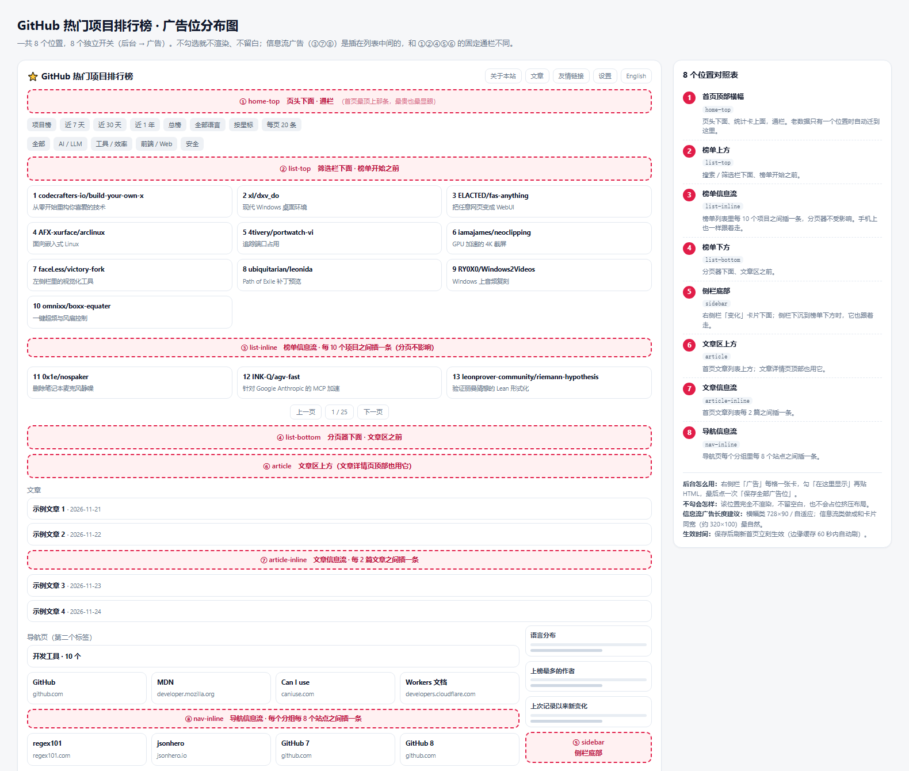

# GitHub 热门项目排行榜 · 操作手册

> 给维护者（站长）看的日常操作手册。面向对象：接手这个项目的人，或想改自己 Fork 的你。
> 配套阅读：[项目介绍.md](项目介绍.md)（功能与架构全景）、仓库根 [README.md](../README.md)（部署步骤）。

## 0. 快速定位

| 想做什么 | 去哪里 |
|---|---|
| 日常改站点配置（SEO/友链/广告/联系/备案/布局/GEO/文章） | `/admin` 可视化后台 |
| 改页面样式 / 逻辑 | `index.html`、`js/bundle.js` |
| 改数据抓取规则（分段、条数、翻译预算） | `scripts/fetch.js` 头部常量 |
| 改后端（API/代理/后台） | `worker.js`（改完必须重新部署到 Cloudflare） |
| 立刻更新数据 | GitHub Actions → Update data → Run workflow |
| 本地预览 | `node serve.js`（或双击 `启动网页.bat`）→ http://localhost:8080 |

## 1. 日常操作

### 1.1 后台 `/admin`

入口：`https://<worker域名>/admin`，用 `ADMIN_PASSWORD` 登录（存在 Cloudflare Secret；没设置则后台全部关闭）。登录态存 sessionStorage，关标签页即退出。

11 个标签页按 **常用 / 内容 / 站点信息 / 运维** 四组排，所有修改由 Worker 用 `GITHUB_TOKEN` 提交回仓库 `data/` 目录。**保存后立刻生效**：Worker 先 `purgeEdge()` 清掉成品缓存，再 `warmEdge()` 把刚保存的 JSON 直接写回边缘缓存，所以刷新首页马上能看到（只有极端情况下最多等 60 秒——`RAW_TTL` 内 Cloudflare 对 raw 子请求的缓存，见 §4「后台改了前台没变」）。

| 分组 | 标签 | 写到哪个文件 | 能做什么 |
|---|---|---|---|
| 常用 | 概览 | — | 保活状态（keepalive.txt 距今天数）+ 数据刷新状态 + 翻译链路是否就绪；按钮：立即保活 / 立即刷新 |
| 常用 | 榜单布局 | site.json layout | 三组单选：**列数** 自动/单列/双列/三列、**侧栏** 右侧/榜单下方、**开发者/组织榜** 自动/单列/双列 |
| 内容 | 文章 | `data/articles.json` | 独立面板：搜索框过滤、表格（日期/标题/摘要/操作）、写新文章。弹窗是 1120px 双栏——左边编辑（标题/日期/摘要/导入 .md/字数统计/正文），右边 KeeMd 实时预览，可一键放大到全屏（⤢）或隐藏预览 |
| 内容 | SEO 与 GEO | site.json seo + geo | SEO 字段（站点名/标题/描述/关键词/og:image/siteUrl）+ GEO 摘要 + FAQ 问答（≤20 条）都在这一个标签里 |
| 内容 | 友链 | `data/links.json` | 增删友链（≤50 条，名称 ≤40 字） |
| 内容 | 导航页 | `data/nav.json` | 前台「导航」标签的内容：分类卡（≤20 组）+ 每组的站点表格（≤400 个）。工具栏有**筛选框**和「5 个分类 · 23 个站点」实时统计；每行有**图标预览**、点「自动获取」把网页标题/描述/图标抓回来；「批量导入」一次粘多行（`名称 | 网址 | 描述 | 图标`，Tab 分隔也行） |
| 内容 | 广告 | site.json ad.slots + ad.ticker | **10 个广告位各自独立开关**（7 个固定位 + 3 个信息流位）：`home-top` 页头下通栏 / `list-top` 榜单上方 / `list-inline` **榜单信息流** / `list-bottom` 分页器下 / `sidebar` 侧栏底部 / `article` 文章区上方 / `article-side` 文章页侧栏 / `article-after` 正文之后 / `article-inline` **文章信息流** / `nav-inline` **导航信息流**。信息流位的间隔可自己填（1–50：每 N 个项目/文章/站点插一条）；每格可设**跳转链接**或**弹窗内容**（弹窗优先，没有弹窗才新窗口打开）；同一个面板顶部还有**站点顶部滚动条**（文字/速度/链接/弹窗 + 开关）。不勾就不渲染、不留空白；每格 HTML ≤2 万字符，script 会重建执行。位置示意图见 [`docs/shots/ad-slots.png`](shots/ad-slots.png) |
| 站点信息 | 联系方式 | site.json contact | 悬浮按钮内容：微信 / 二维码（必须 https）/ 邮箱 / 备注 |
| 站点信息 | 备案信息 | site.json beian | ICP / 公安备案号 + 链接，页脚显示 |
| 运维 | 收录提交 | — | 把站点推给搜索引擎与 AI 搜索：**立即提交** 走 IndexNow（Bing / Yandex / Seznam / Naver，一次提交全推）；配了 `BAIDU_TOKEN` 才推百度。面板上直接给出 key 文件地址、`/sitemap.xml`、`/llms.txt` 三条可复制链接 + Google/Bing/百度「手动提交入口」说明 |
| 运维 | 翻译与密钥 | — | **链路状态**（GitHub Token / Workers AI / MyMemory 三行，只显示配没配）+ **实测一次**：把一句话分别丢给 MyMemory 和 Workers AI，显示各自耗时与结果（失败会写清是网络、额度、HTTP 还是解析问题）+ 两个密钥怎么设的说明 |

### 1.1.1 榜单布局三档怎么选

- **列数**：`自动` = 窄屏单列、宽屏双列；`单列` = 竖排大卡；`双列` = ≥900px 两列；`三列` = ≥1280px 三列、≥900px 两列、更窄单列。
- **侧栏**（语言分布 / 开发者榜 / 变化）：`右侧` = 桌面端 sticky 在右侧；`榜单下方` = 通栏铺在榜单下面，三块并排（窄屏自动单列）。
- **开发者/组织榜**：`自动`/`单列`/`双列`，只影响「开发者榜」「组织榜」两个视图（项目榜永远是列数档位）。每张卡显示头像、名称、「组织 · 12.3 万 粉丝」、以及「主页 ↗」跳转。

### 1.1.2 前台两个视图（榜单 / 导航）

- 页头是三栏：**左边站点标题**（点它回首页）｜**中间胶囊导航**（榜单 / 导航 / 文章）｜**右边工具栏**（关于本站 / 友情链接 ｜ 设置 / 描述：中文 / 切换主题）。
- 窄屏（≤1023px）导航掉到第二行整宽居中；≤640px 时标题、工具栏、导航竖着排，工具栏按钮缩小。
- 筛选栏下面原来那两个标签已经搬到页头，正文里不再重复。
- 榜单的四个范围按钮：近 7 天 / 近 30 天 / 近 1 年（都按**创建时间**圈「新项目」再按星标排） / **总榜**（不分创建时间，GitHub 全站星标降序前 500）。旧链接里的 `?range=all` 会自动落到总榜。
- 直接打开导航页有三种写法，都认：`/nav`、`/?page=nav`、`/#nav`；切换标签时地址会自动同步成 `/?page=nav`，可以当书签。
- 切到导航视图后，榜单专属的筛选条、统计卡、文章区会自动收起来，避免两套 UI 打架。

### 1.1.3 抽屉里的 README

- README 现在是**渲染后的样子**（标题层级、表格、图片、代码块、任务清单、引用都能看），不再是 Markdown 源码。
- 渲染流程：浏览器拿 GitHub 原始 README（HTML）→ `sanitizeReadme()` 把 HTML 转成 Markdown（图片/链接补成绝对地址、锚点降级成纯文字、剥掉其余标签）→ `KeeMd.render()` 渲染成 HTML。因为 `KeeMd` 先转义再替换语法，README 里塞 `<script>` 也不会执行。
- 中文译文：有预翻译（`data/readme-zh.json`）就直接是中文；没有则实时翻译，**译文到了只替换 README 那一块**，不再整页重绘、也不再显示「（中文翻译中…）」。有译文时标题旁会有小字「机器翻译 · 仅供参考」。
- README 只渲染前 20000 字符，超长时底部给「在 GitHub 看完整 README」的按钮。

### 1.1.4 广告位放哪（带标注图）



- 图里红框就是 8 个位置，编号和后台 `data-ad-slot` 一一对应（示意图源文件 `scripts/ad-map.html`，改完用 Chrome headless 截一次即可）。
- **固定位**（通栏，宽度跟着容器）：① `home-top` 页头下 · ② `list-top` 榜单上方 · ④ `list-bottom` 分页器下 · ⑤ `sidebar` 侧栏底部 · ⑥ `article` 文章区上方（文章详情页顶部共用）。
- **信息流位**（插在列表中间，跟着数据走）：③ `list-inline` 榜单每 N 个项目之间 · ⑦ `article-inline` 文章每 N 篇之间 · ⑧ `nav-inline` 导航每组每 N 个站点之间。**N 在后台每格里填**（1–50，默认 10 / 2 / 8），改完保存前台立刻重排。
- **点击行为**（每格独立的两个输入）：填了「弹窗内容」→ 点广告弹窗显示那段 HTML；只填「跳转链接」→ 新窗口打开；两个都填优先弹窗。弹窗右上角有关闭，底部「去看看 →」按钮跳链接。
- **顶部滚动条**（`ad.ticker`，在广告面板最上面那张卡）：一条通栏滚动的文字/HTML，可设滚动文字（≤200 字）、速度（6–60 秒走完一遍，越小越快）、跳转链接、弹窗内容；访客点 × 关闭后会记住 7 天不再显示。
- 尺寸建议：通栏位用自适应（`width:100%`）或 728×90；信息流位做成和卡片同宽（约 320×100）最不突兀；导航信息流位高度接近站点卡（约 96px）。
- 不勾「在这里显示」= 该位置不渲染、不留白，也不会把布局撑开。
- 后台截图：[`docs/shots/admin-ad.png`](shots/admin-ad.png)；前台实拍见 `docs/shots/home-nav-tabs.png`、`docs/shots/nav-page.png`。

### 1.1.5 收录提交：这些 Token 在哪拿

| 要填的东西 | 去哪拿 | 备注 |
| --- | --- | --- |
| 百度推送 `BAIDU_TOKEN` | [百度搜索资源平台 → 普通收录 → API 提交](https://ziyuan.baidu.com/dailysubmit/index) | 先加站点+验证，再复制页面上的「准入密钥」；同页能看到当天剩余配额（普通账号几百条/天） |
| IndexNow key | **不用申请** | 本站自动生成，挂在 `/<key>.txt`（后台「收录提交 → 当前状态」直接给地址）；想换就在 Cloudflare 变量里加 `INDEXNOW_KEY`（32 位字母数字） |
| Google | [Search Console → 站点地图](https://search.google.com/search-console) | 填 `sitemap.xml` 提交；Google 已停用 ping 接口，没有 token 可填 |
| Bing / Yandex | [Bing Webmaster Tools → IndexNow](https://www.bing.com/webmasters/indexnow) | 推送记录在这里看；站点本身走 IndexNow 自动推，无需 token |
| 自动部署 `CLOUDFLARE_API_TOKEN` | [Cloudflare → My Profile → API Tokens](https://dash.cloudflare.com/profile/api-tokens) | 「创建令牌」→ 用「编辑 Cloudflare Workers」模板 → 权限保留 `Account · Workers Scripts · Edit` + `Zone · Workers Routes · Edit`；创建后只显示一次，立刻复制 |
| 自动部署 `CLOUDFLARE_ACCOUNT_ID` | [dash.cloudflare.com](https://dash.cloudflare.com/) 首页右侧「账户 ID」 | 或看地址栏 `dash.cloudflare.com/<这一串>/...` |
| 存在哪 | [仓库 Settings → Secrets and variables → Actions](https://github.com/xiaoh2018/github-rank/settings/secrets/actions) | New repository secret 依次加 `CLOUDFLARE_API_TOKEN`、`CLOUDFLARE_ACCOUNT_ID`（可选 `BAIDU_TOKEN`）；配好之后推 main 就自动部署，不用再手粘 worker.js |

- **豆包 / 通义千问 / DeepSeek / Kimi / 秘塔** 没有公开的提交入口。能做的是：`robots.txt` 明确放行它们的抓取器（含 GPTBot、ClaudeBot、PerplexityBot、Bytespider、Qwen-Bot 等 18 个）、提供 `/llms.txt` 站点说明、`sitemap.xml` 动态列出页面。抓取器来抓时拿到的就是最新榜单。
- 后台对应面板：`/admin` → 运维 → 收录提交（含「立即提交」按钮与上面这张表的可点链接版）。
- **`BAIDU_TOKEN` 到底在哪填**（这是 Worker 环境变量，不在后台页面里）：Cloudflare 控制台 → 左侧 **Workers & Pages** → 点站点用的 Worker → **Settings** → **Variables and Secrets** → **+ Add** → Type 选 **Secret** → Name `BAIDU_TOKEN` → Value 粘贴百度「准入密钥」→ **Deploy**。改完刷新后台「收录提交」，那一行会从「没配」变成「已配置」。注意 `CLOUDFLARE_API_TOKEN` / `CLOUDFLARE_ACCOUNT_ID` 不在这里，它们属于**仓库** Secrets（给 GitHub Actions 自动部署用）。
- **百度 HTML 验证**：`<meta name="baidu-site-verification" content="codeva-4YWBTyvKRg" />` 已写进 `index.html` 的 `<head>`（Worker 每次返回首页也会再注入一次，双保险），在百度资源平台点「验证」即可通过。
- **MyMemory 额度是按邮箱算的，不是按 IP**：多个邮箱（逗号分隔，例如 `a@x.com,b@y.com`）会依次轮换，一个用尽自动换下一个；都满了就走 Workers AI 兜底。
- **这些现在都不用去 Cloudflare 配了**：后台 → 运维 → **翻译与密钥** → 「运行设置」卡片里直接改，存在 `data/site.json` 的 `runtime` 分组，保存后即时生效：
  - **MyMemory 联系邮箱**（最多 20 个）：Gmail / Outlook 支持 `名字+1@gmail.com` 这种别名，都进同一个信箱；页面上的「按 +别名 生成 5 个」按钮会按第一个邮箱自动补 5 个。
  - **Workers AI 每天最多调用多少次**：留空 = 用环境变量 `AI_DAILY_CAP`，或默认 400；填 **0 = 不限制**；可填 1–100000 的整数。到上限这条链路自动停，只用 MyMemory + 译文缓存，不报错也不扣钱。
  - 环境变量同名的仍然有效，只是**优先级低于后台设置**（后台填了就以后台为准，后台留空才读变量）。
- **IndexNow 的三个状态码**：`200` / `202` = 受理成功（202 是「已接受，稍后处理」，就是成功）；`422` = key 文件里的内容和你提交的 key 不一致；`403` = key 文件打不开（Worker 版本太旧或路径不对）；`429` = 同一批地址推太频繁（本站已做 10 分钟冷却 + 同批自动跳过，勾「强制再推一次」可绕过）。
- **Bing 后台看不到记录 ≠ 失败**：Bing 只在「Bing 站长工具 → 添加并验证该站点」之后才统计 IndexNow 提交（[IndexNow 页](https://www.bing.com/webmasters/indexnow)），而且反馈要 24–72 小时；协议层返回 202 就代表收下了。后台「试推 1 条」按钮只推首页一条，用来排除「批量被限流」这种可能；「当前状态」里的「key 文件内容」一行会实拉 `/<key>.txt` 比对，显示一致才可能被 422 拒。
- **Workers AI 会不会超额度**：每天有 10,000 Neurons 免费额度，`m2m100-1.2b` 属于小模型，一次调用消耗很小，400 次大约只用到几百 Neuron。真想放开就把上限调到 2000–5000，仍远在免费线内。
- **`github.com/.../settings/secrets/actions` 打不开是正常的**：这个页面只有**登录状态下、且对该仓库有管理员权限**才可见，否则一律 404（也可能是打开的是别人的同名仓库）。正确路径：仓库首页 → **Settings** 标签 → 左侧 **Secrets and variables** → **Actions**。没有 Settings 标签就说明当前账号没有管理权。


### 1.2 数据更新链路

- **自动**：GitHub Action `Update data` 每 3 小时跑（cron `17 */3 * * *`）。
- **访客触发**：数据超过 6 小时（STALE_HOURS）且有访客打开首页 → Worker 自动 dispatch 一次工作流；两次触发间隔 ≥60 分钟（COOLDOWN_MINUTES）。
- **手动**：Actions 页面 Run workflow，或后台「立即刷新」按钮。

抓取脚本会分段搜索（近 7 天 / 30 天 / 1 年各 3-4 个星标区间，每段翻 3 页 ×100）、去重、最多留 500 个/榜；**总榜**单独走一条路径：单查询 `stars:>1000 sort=stars desc` 深翻 10 页（GitHub 搜索上限 1000 条），去重后按星标降序留前 500，写 `data/repos-total.js`。另外翻简介（预算 45000 字符/次）和 Top 40 高星 README（预算 15000 字符/次），原子写入 `data/repos-meta.js` + `data/repos-{week,month,year,total}.js`（旧的 `data/repos.js`、`data/repos-all.js` 已冻结，只作过渡兜底）。**失败时保留旧文件**（exit 1，不覆盖）。

### 1.3 保活

- Worker Cron `0 2 * * 1`（UTC 周一 02:00 = 北京周一 10:00）写 `keepalive.txt`。
- 后台概览显示状态：≤10 天绿色 / ≤30 天黄色 / >30 天红色（红色 = 接近 GitHub 60 天不活跃停用线）。
- Cron 失效时可手动点「立即保活一次」，或访问 `/keepalive`（跳后台）。

## 2. 本地开发与预览

```bash
node serve.js                 # http://localhost:8080：纯静态，无任何依赖
node scripts/dev-server.mjs   # http://localhost:8123：把 worker.js 真的跑起来（推荐）
```

`serve.js` 只有静态文件，所以后台、抽屉详情、翻译接口都用不了。`scripts/dev-server.mjs` 是**本地 Worker 模拟器**：
把 `worker.js` 复制成临时 `.mjs` 后 import，`caches` 用 Map 模拟、`fetch` 打桩（`raw.githubusercontent` 读本地文件、`api.github.com` 的 contents GET 返回本地内容、**PUT 会把内容写回本地文件**），后台密码 `dev`。
→ 在 `/admin` 里改布局、改 SEO、删友链，都能直接看到「保存成功 + 前台立刻变」的完整链路，不用部署。

看后台各个面板的静态图（脚本用 dev 密码自动登录，数据是真的）：

```bash
node scripts/preview-admin.mjs      # 输出到 %TEMP%\ghrank-preview\admin-*.html
```

> 预览页要放在仓库目录下才能被 `dev-server` 取到（`file://` 打开会缺接口）：复制到 `.preview\` 再访问 `http://127.0.0.1:8123/.preview/admin-nav.html`；`.preview/` 已在 `.gitignore` 里。

改前端文件后注意：

- `index.html` / `js/bundle.js` / `js/md.js` / `icon.svg` / `manifest.json` 属于 SW 外壳缓存 → **必须把 `sw.js` 里的 `CACHE` 版本号 +1**（当前值与 `sw.js` 第一行的 `CACHE` 一致，例如 `ghrank-shell-v259`；`scripts/bump-version.mjs` 发版时会一起改），否则老访客拿不到新代码。
- 数据文件（`data/*`）不在 SW 缓存范围；后台保存走 `warmEdge` 立刻生效，Action 推送则取决于边缘缓存 TTL（榜单 10 分钟、站点配置 60 秒）。
- 带 `?v=<版本号>` 访问 `/data/*`、`/js/*` 时会返回 `Cache-Control: public, max-age=31536000, immutable`（一年、永不回源）；不带 `?v=` 仍是短 TTL，方便手改后立刻看到效果。
- 首页响应带 `Link: </js/bundle.js>; rel=preload; as=script, </data/repos-meta.js>; rel=preload; as=script`，省掉「先拿 HTML 再发现脚本」一轮。

Worker 改动（`worker.js`）有两条路：

1. **手粘（现在就能用）**：Cloudflare 后台 Edit code → 全选粘贴 → Deploy。注意 Worker 与 raw 文件是两回事，改 worker.js **必须**重新部署，改前端文件只需 git push。
2. **自动部署（配一次就省事）**：仓库里有 `wrangler.toml` + `.github/workflows/deploy-worker.yml`。在 GitHub 仓库 Settings → Secrets and variables → Actions 里加两个 secret：
   - `CLOUDFLARE_API_TOKEN`：Cloudflare → My Profile → API Tokens → 模板「Edit Cloudflare Workers」
   - `CLOUDFLARE_ACCOUNT_ID`：Cloudflare 概览页右侧的 Account ID

   之后只要 push 改了 `worker.js`，Action 会先 `node --check` + `node scripts/check-worker.mjs`，全绿才 `wrangler deploy`。没配 secret 时这个 Action 自动跳过（不会红），继续手粘也没问题。

自检：`node scripts/check-worker.mjs`（断言条数以脚本输出为准，不在此写死；覆盖边缘缓存、ETag、HEAD、布局三档、翻译链路、后台页面结构、10 个广告位与信息流插入、导航页、收录提交、`/nav` 路由、总榜文件与 README 渲染、顶部导航与滚动条、广告点击弹窗与间隔可配、后台内联脚本语法）。

## 3. 所有变量 / 密钥（Cloudflare Worker Settings → Variables and Secrets）

| 名称 | 类型 | 必填 | 说明 |
|---|---|---|---|
| `REPO_OWNER` | Text | ✅ | GitHub 用户名 |
| `REPO_NAME` | Text | ✅ | 仓库名 |
| `ADMIN_PASSWORD` | Secret | ✅（要后台就必填） | 后台登录密码 |
| `GITHUB_TOKEN` | Secret | ✅ | fine-grained，权限 Contents+Actions 读写 |
| `RUN_PASSWORD` | Secret | 可选 | 手动保活 API 的密码（可留空） |
| `TRANSLATE_EMAIL` | Text | 可选 | MyMemory 提额邮箱 |
| `STALE_HOURS` | Text | 可选 | 访客触发刷新的数据陈旧阈值，默认 6 |
| `COOLDOWN_MINUTES` | Text | 可选 | 两次刷新最小间隔（分钟），默认 60 |
| `BRANCH` / `FILE_PATH` | Text | 可选 | 分支（默认 main）/ 保活文件（默认 keepalive.txt） |

另有可选绑定，按需加，不加也能跑：

### 3.1 Workers AI（变量名 `AI`，翻译兜底用）

它不是「变量」，是**绑定（Binding）**，所以在 Variables and Secrets 里找不到，要这样加：

1. Cloudflare 控制台 → **Workers & Pages** → 点你的 Worker（`github-rank`）
2. 上方切到 **Settings** → 左栏 **Bindings**（新版界面在 *Runtime / Bindings* 里，图标像插头）
3. **+ Add** → 选 **Workers AI** → *Variable name* 填 `AI`（必须叫这个，代码里读的是 `env.AI`）→ Save
4. 回到 **Deployments** 点 **Deploy**（绑定改完要重新部署才生效；用 `wrangler deploy` 的话在 `wrangler.toml` 加 `[ai]\nbinding = "AI"`）
5. 验证：`curl -s https://github.661026.xyz/api/status | grep -o '"ai":[a-z]*'`，或者打开后台「翻译」标签看是否提示 AI 可用

不绑也能用：翻译主链是 MyMemory（免 Key），AI 只是失败时的第二层兜底。绑定后不会多收钱，Workers AI 有免费额度。

### 3.2 其他可选绑定 / 触发器

- Cron Trigger `0 2 * * 1`（保活）、`17 */3 * * *` 由 GitHub Action 负责，不在 Worker 上。

## 4. 排查手册（症状 → 原因 → 处理）

| 症状 | 原因 | 处理 |
|---|---|---|
| 首页空白 / 没榜单 | Action 没跑成功或 REPO_OWNER/NAME 填错 | Actions 看日志；确认 `data/repos-meta.js` 和各 `data/repos-<range>.js` 存在且 Worker 变量正确 |
| 后台登录 401/403 | ADMIN_PASSWORD 未设或拼错 | Cloudflare 改 Secret 后需重新 Deploy Worker |
| 保存配置前台没变 | 三种可能：① 线上还是旧 Worker（没 `warmEdge`，要等 ready 的 5~15 分钟）；② 浏览器留着旧页面；③ 旧 SW | 依次查：`curl -s https://<域名>/api/status` 有 `"ok":true` 且 `curl -sI https://<域名>/data/site.json \| grep -i x-edge` 有 `x-edge` 头（有 = 新 Worker 已部署）；Ctrl+F5；最后让它自己换 SW（CACHE 号 +1 并 push） |
| Action 提交失败 | Workflow permissions 不是 read/write | Settings→Actions→General→Workflow permissions |
| 简介一直英文 | MyMemory 额度用完且没绑 AI | 等 24h 额度恢复 / 绑定 Workers AI / 后台看翻译状态 |
| 抽屉详情打不开 | Worker 的 GITHUB_TOKEN 无效/过期 | 换新 Token 重新配 Secret |
| 老访客看不到新前端 | sw.js CACHE 版本没升 | `sw.js` 里 CACHE 号 +1 并 push |
| 访客「立即刷新」无效 | 服务器 Token 额度用完或冷却中 | 看 60 分钟冷却；或让访客填自己 Token |
| keepalive 红色 | Cron 没跑或 Worker 被删 | 检查 Cron Trigger；后台点「立即保活」 |
| 本地 403 | serve.js 不含 Worker | 属预期，部署后测试 |

## 5. 文件地图（改什么动哪里）

```
index.html        页面结构+全部CSS+站点配置渲染脚本（友链/广告/联系/备案/GEO/文章）
articles.html     文章列表页
js/bundle.js      全部页面逻辑（config/state/api/cache/ui/app 六段合并，改完升 sw 版本）
js/md.js          安全 Markdown 渲染器（文章+README 共用）
sw.js             Service Worker（CACHE 版本号在这里）
worker.js         后端单文件（静态转发+API+后台HTML+保活；改完重新部署 Worker）
og-image.png      社交分享图 1200×630（scripts/make-og-image.ps1 生成，改文案后重跑）
scripts/make-og-image.ps1 用 Windows 自带 GDI+ 画分享图（必须存成 UTF-8 带 BOM）
scripts/check-worker.mjs  本地模拟 Workers 运行时：验证边缘缓存/HEAD/SEO 注入/status 缓存（node scripts/check-worker.mjs）
scripts/dev-server.mjs    本地预览服务器（node scripts/dev-server.mjs，8123 端口，/admin 密码 dev）
scripts/preview-admin.mjs 批量生成后台上线截图页面（配合 dev-server 用）
scripts/ad-map.html       广告位分布示意图源文件（Chrome headless 截图 → docs/shots/ad-slots.png）
docs/shots/               所有截图（前台/后台/广告位图），新增截图一律放这里
scripts/fetch.js  抓取/翻译脚本（Action 里跑）
serve.js          本地预览服务器
data/repos-meta.js  榜单元信息（generatedAt + 各范围条数）+ 开发者/组织榜（Action 生成，勿手改）
data/repos-week.js  近 7 天榜（Action 生成，勿手改）
data/repos-month.js 近 30 天榜（Action 生成，勿手改）
data/repos-year.js  近 1 年榜（Action 生成，勿手改）
data/repos-total.js  总榜（全站星标降序前 500，深翻 10 页抓取；Action 生成，勿手改）
data/repos-all.js   旧「全部」榜：每段只翻 3 页导致第 301 名以后错排，已停更，仅作旧链接兜底
data/repos.js       旧版合并文件：已冻结、不再更新，只在「新 Worker 还没部署」的过渡期给旧页面兜底；全员升级后可删（删的时候顺手去掉 index.html 里那个 onerror）
scripts/split-data.js 把旧的 data/repos.js 拆成上面几个文件（首次迁移 / Action 出问题时的应急手段，平时不用跑）
data/desc-zh.json 简介译文（Action 维护，勿手改）
data/readme-zh.json README 译文（Action 维护，勿手改）
data/site.json    站点配置（后台改，也可手改后 push）
data/links.json   友链（后台改）
data/articles.json 文章（后台改）
data/nav.json     导航页（后台「导航页」改：分类 + 站点卡片）
scripts/dev-server.mjs  本地 Worker 模拟器（真正跑 worker.js：node scripts/dev-server.mjs → http://127.0.0.1:8123，后台密码 dev）
scripts/preview-admin.mjs  生成后台各面板的预览页（自动用 dev 密码登录，输出到 %TEMP%\ghrank-preview\）
```

几个不是文件、但由 `worker.js` 动态生成、且对 SEO/AI 收录有用的地址：`/robots.txt`（明确放行 18 个 AI 爬虫）、`/sitemap.xml`（首页 + 文章页 + 每篇文章锚点）、`/llms.txt`（给大模型的站点说明书）、`/<IndexNow key>.txt`（IndexNow 校验文件）、`/nav`（导航视图）。

### 数据文件为什么拆开

页面只用到当前选中的时间范围，以前四个范围全塞在 `data/repos.js`（压缩后约 400KB，占首屏 93%）。现在首屏只下 `repos-meta.js`（约 16KB 原始 / 2KB 压缩）+ 当前范围那一个文件（压缩后约 85KB），切范围时再按需插入 `<script>` 拉对应文件。前端逻辑在 `js/bundle.js` 的 `ensureRange()`，加载失败会自动降级为实时调 GitHub API。

## 6. 安全要点

- 密码/Token 只存 Cloudflare Secret；仓库内无明文密钥。
- `/api/gh` 是白名单代理（只放行 repos详情/readme/releases/contributors 四类路径），不是通用代理。
- 后台所有写操作走常数时间密码比较（safeEqual），防时序攻击。
- Markdown 渲染前全量转义 HTML；链接只放行 http(s) 和站内路径。
- `/admin` 带 noindex + no-store，不进搜索引擎。

## 7. 已知待办与优化清单

逐条含实测依据与修法的完整版见 [优化建议.md](优化建议.md)；加速相关的实测数据见 [加速评估-github.661026.xyz.md](加速评估-github.661026.xyz.md)。速览：

**还没做的（要人动手）**

1. **重新部署 Worker**：把当前 `worker.js` 粘贴进 Cloudflare 再 Deploy。本轮新增的边缘缓存、HEAD 支持、按 range 数据路由、`/og-image.png` 路由、`/api/status` 缓存、5 个广告位、`/api/nav`、`/api/fetch-meta`、`/api/submit`、`/robots.txt`、`/llms.txt`、`/sitemap.xml`、`/nav` 全都只在 Worker 里，不重新部署等于没生效。
2. **作废旧 RUN_PASSWORD**（`147258hh` 已在历史对话中泄露）——去 Cloudflare 改掉或删除该 Secret。
3. 检查线上 `GITHUB_TOKEN` 是否具有 Contents+Actions 读写权限。
4. 过渡期结束后（新 Worker 上线几天、`/data/repos.js` 无人访问）删掉：那个冻结的旧数据文件、`worker.js` SITE 里的 `'/data/repos.js'` 映射、`index.html` 里 `data/repos-meta.js` 上的 `onerror` 兜底。

**已完成的（2026-11-24）**

- 删掉 index.html 里写死 v22 的 SW 自清理 IIFE（它让每位访客每会话白注销一次 SW 并清空缓存）。
- 「微软翻译 Key / MS_TRANSLATOR_KEY」残留文案 ×3 处清掉，删无调用的 `staticDescZh`。
- 修正 README 的范围/排序描述（实际：7天/30天/1年/全部；星标/增量/活跃度/Fork/更新）。
- 边缘缓存（P0-1）、长缓存/ETag/条件请求（P0-2）、数据按 range 拆分（P0-3）、HEAD 修复，均已落代码并本地验证。
- 分享图补齐：`og-image.png`（1200×630）+ `scripts/make-og-image.ps1` 生成脚本，`worker.js` 增加 `/og-image.png` 路由（长缓存），`applySeo` 顺带补 `og:url`、`twitter:image`，有图时 `twitter:card` 自动变 `summary_large_image`。
- 域名统一：`index.html` / `articles.html` 的 canonical、`og:url`、JSON-LD，以及 `data/site.json` 的 `seo.siteUrl`、`seo.ogImage` 全部改成 `https://github.661026.xyz`，旧 workers.dev 只留作备用地址。
- 测试友链「123」已从 `data/links.json` 删除（现为空数组 `[]`）。
- `/api/status` 加 60 秒边缘缓存（两个 GitHub 请求本来就并行）；保活与「立即刷新」成功后自动 purge，后台刷新不会看到旧状态；后台请求本身带 `cache: no-store`。

**已完成的（2026-11-25 第五批）**

- Markdown 渲染器支持表格（含对齐、表格里的 `|` 转义）、任务清单、删除线，标题支持到 `####` 六级；首页文章区和后台实时预览都有配套样式。
- 广告从「一个位置」变成 **5 个广告位**（`home-top` / `list-top` / `list-bottom` / `sidebar` / `article`），各自独立开关与 HTML，后台一格一卡；老数据自动迁移到 `home-top`，行为不变。
- 头部按钮上移：关于本站 / 文章 / 友情链接搬到页头右上角，与设置 / English / 切换主题同排（原来那排 topnav 已删）。
- 翻译链路改造：MyMemory 分段（450 字/段）+ Workers AI 兜底（900 字/段）+ **译文边缘缓存**（命中不产生调用）；失败原因分类（`network:` / `quota:` / `http:` / `status:` / `parse:` / `not-bound:` / `run:` / `empty:`）后台直接显示中文。
- 新增「导航页」：前台第二个标签（`/nav`、`/?page=nav`、`/#nav` 都能直接开），数据 `data/nav.json`；后台可加分类/站点，填网址点「自动获取」抓标题、描述、图标（后端 `/api/fetch-meta`，屏蔽内网地址）。
- 新增「收录提交」：IndexNow 一键推送（Bing/Yandex/Seznam/Naver）、百度推送（配 `BAIDU_TOKEN`）、`/robots.txt` 放行 18 个 AI 爬虫、`/llms.txt` 站点说明书、`/sitemap.xml` 含文章锚点。
- 修掉一个隐蔽的坑：`js/bundle.js` 初始化会重写地址栏，把 `#nav` / `?page=nav` 这类「意图」抹掉，导致直接打开导航页不生效。现在 `index.html` 在 `<head>` 里就把意图记到 `window.__wantNav`，并且 `bundle.js` 同步地址时会保留 `page=nav`。


## 1.1.6 翻译额度与收录排查（第 24 批）

### 翻译链路到底怎么走

1. **先查译文缓存**：同一段英文只翻一次，命中缓存 0 成本、0 调用。
2. **MyMemory**（免费、不需要 Key）：按「联系邮箱」算额度，不带邮箱每天 5 千字符、带邮箱 5 万字符；一个邮箱用尽自动换下一个。
3. **Workers AI**（需要绑定，变量名必须是 `AI`）：前一条挂了才兜底，每天最多调用次数由后台控制，到上限自动停，不会把你的额度打光。

后台「翻译与密钥 → 运行设置」里能改的：

| 字段 | 说明 |
| --- | --- |
| MyMemory 联系邮箱 | 可留空（留空就用内置默认邮箱）；多个用逗号分隔，最多 20 个；点「按 +别名 生成 5 个」可把额度乘 6 |
| Workers AI 每天最多调用多少次 | 0–100000，**0 = 不限制**，留空 = 用环境变量 `AI_DAILY_CAP` 或默认 400 |
| 百度准入密钥 BAIDU_TOKEN | 可留空；填这里就不必去 Cloudflare 配变量 |
| IndexNow Key | 可留空（自动用仓库信息生成 8–128 位） |

页面上「Workers AI 今日」那一行会显示 **已用 / 上限 / 还剩**，据此调上限即可。也可以直接访问 `/api/ai-usage` 拿到同样的 JSON。

> Workers AI 的免费额度是每天 10,000 Neurons。m2m100 这种小模型一次只消耗几十 neuron，400 次大约几百，远没到线；建议设 2000–5000，仍然在免费范围内。

### 收录提交：为什么一直失败

后台「收录提交」页现在有「key 文件自检」一行，先看它：

- **能访问** → key 没问题，失败就查域名：「SEO 与 GEO → 站点地址」必须是真实访问域名（`https://github.661026.xyz`），不能是 `workers.dev` 备用域名，否则 IndexNow 判 host 不一致。
- **打不开（404）** → Worker 还没部署到最新版，重新粘贴 `worker.js` 部署一次。
- **打不开（502 等）** → 边缘/回源一时抖动，过几分钟再点「刷新」。

手工入口：<https://www.bing.com/webmasters/indexnow>（Bing / Yandex / Seznam / Naver 共用），规范 <https://www.indexnow.org/documentation>。

### 百度准入密钥在哪拿

1. <https://ziyuan.baidu.com/site/index> → 确认 `github.661026.xyz` 已验证（HTML 验证的 meta 本站已内置）。
2. 左侧「普通收录 → API 提交」，页面上的「准入密钥」就是 `BAIDU_TOKEN`。
3. 粘到「翻译与密钥 → 运行设置 → 百度准入密钥」，保存后回「收录提交」点「立即提交」，结果里会显示百度返回的 `success` 与 `remain`。

### llms.txt 里写了什么

`/llms.txt` 现在是给大模型看的站点说明：核心页面（首页 / 导航 / 文章，含单篇地址规则）、数据来源与口径（时间范围、星标门槛、刷新频率、缓存）、机器可读接口清单（`/data/*.js`、`/api/status`、`/sitemap.xml`）、引用与抓取建议。改了站点名或简介会跟着变。

`/sitemap.xml` 覆盖首页、导航页、文章页与每篇文章（带 `lastmod`）。它本来就是合法 XML，浏览器直接打开是源码，看渲染效果请用「查看页面源代码」或在「收录提交」页点链接。


## 补充：2026-11-25 UI 统一与文章页改版

- **后台整体换回前台品牌色**（暖米白 + 金 #b07d10），侧栏深棕、按钮金色渐变、聚焦光环金色，和前台同一套 tokens，不再蓝白一套。
- **榜单布局新增两项**：开发者 / 组织榜列数多出「三列」（1280px 以上三栏）；新增「文章页侧栏」（右 / 左 / 不要），保存后刷新 `/articles` 立刻生效。
- **文章页 `/articles` 改成博客式**：页头与首页一致（品牌 + 胶囊导航 榜单/导航/文章），左列表 + 右侧栏（关于本站 / 分类 / 最新文章 / 导航），点卡片在页内阅读（`/articles#<id>` 可直链），不再弹窗；加密文章给密码框，正文走 `POST /api/article`。
- **广告位扩到 10 个**：新增 `article-side`（文章页侧栏）与 `article-after`（正文之后）；文章列表里的信息流按 `article-inline` 的「每 N 篇」间隔插入。
- 后台预览：`md.js?v=9` 带版本号，改完 md.js 记得把版本号 +1；导入 .md 后预览会自动刷新。


## 补充：文章加密（2026-11-25）

后台「文章」→ 写新文章 / 编辑，勾上 **加密这篇（读者要输密码才能看）** 并填一个 ≥4 位的访问密码，保存后：

- 仓库里的 `data/articles.json` 只有密文（AES-GCM + PBKDF2 10 万次），正文是 `""`，公开接口不返回 `lock`；
- 前台 `/articles` 卡片带 🔒，点开后要求输密码，走 `POST /api/article`，同一个 IP 每天最多试 30 次；
- 编辑时密码框**留空 = 沿用原密码**；取消勾选会提示「正文将以明文存进仓库」。


## 补充：文章密码改成弹窗 + 阅读页排版修正（2026-11-25）

- 加密文章在阅读页只显示一句提示 + 「输入密码解锁」按钮，点开后是**弹窗**输入密码（不是页内输入框）；密码错了在弹窗里提示，对了弹窗关闭、正文原地渲染。
- 阅读态不再把侧栏顶上去：正文留在主列，右侧栏仍在右边；窄屏时侧栏排在正文**下面**，不再是上面。
- 后台换成中性纸感配色（近黑侧栏 + 细线卡片 + 一种强调色），去掉渐变、光晕和彩色投影。


## 补充：前端资源版本化（2026-11-25）

前端「点了没反应 / 数据不刷新」多半不是数据坏了，而是浏览器抱着一周前的 `js/bundle.js`。现在 Worker 在输出 HTML 时会给 `/js/*.js` 自动加 `?v=<ASSET_V>`：

- 带 `?v=` 的响应是 `max-age=31536000, immutable`（一年，永不重验证），首屏更快；
- **改前端时要把 `worker.js` 里的 `ASSET_V` 加一**（例如 v48 → v49），否则老访客会继续用旧 JS；
- 未带版本的 shell 文件浏览器缓存从 7 天收到 5 分钟，防止再出现这种「代码更新了但页面没换」。


## 文章链接别名（slug）与「如何获取密码」提示

- **链接别名**：写文章弹窗里「链接别名」留空会自动生成——取标题里的英文/数字（`Blog Layout Test 2026` → `blog-layout-test-2026`）；纯中文标题会退化成 `p-xxxx`，建议手填一个英文别名。重名自动加 `-2`、`-3`。
  访问地址：`https://github.661026.xyz/articles/<别名>`；`/articles#<id>` 老链接仍然能用。
- **获取密码提示**：同一弹窗里的「怎么拿到密码？」填给读者看的话（≤300 字，可换行），比如「加微信 flyfish2026 回复「密码」」。加密文章打开时，密码弹窗和正文锁定区都会显示这段文字。留空则用站点默认提示（`data/site.json` 的 `article.unlockHint`）。
- **自检**：`node scripts/check-articles.mjs`（自动起 dev-server、建一篇测试文章、校验 slug/提示/路由/sitemap，跑完还原数据）。

## 问答板块（GEO）

前台地址：`https://github.661026.xyz/faq`（页头「问答」入口，另有 `/llms.txt`、sitemap 指向它）。

- **数据文件**：`data/qa.json`（`intro` + `items[{q,a,tag}]`），最多 200 条；答案支持 Markdown（段落 / 列表 / 表格 / 粗体 / 行内代码 / 链接）。
- **后台入口**：侧栏「内容 → 问答」；可以改导语、加问题、删除、按标签归类，保存后立刻生效（会同时刷新 `/data/qa.json` 与预热边缘缓存）。
- **为什么专门做一个板块**：页面服务端会把这些问答注入 `FAQPage` 结构化数据（JSON-LD）到 `<head>`，搜索引擎与 AI 检索器读源码就能拿到问答对——这是 GEO（生成式引擎优化）里命中率最高的一种做法。
- **写法建议**：问题写成用户真会搜的口语长句；答案第一句先给结论，再补数字和细节；超过 3 行的用列表。
- **自检**：`node scripts/check-worker.mjs` 里 §21 会验证 `/api/qa` 读写、`/faq` 的 FAQPage、sitemap 与 llms.txt 是否都带上了 `/faq`。


### 后台的分段标签（tab）

后台有两处内容太长，改成了页内分段标签，点标签切换，不跳页：

- **广告**：固定位（6 个，通栏）｜ 信息流位（3 个，插在列表中间，间隔 1–50 可调）｜ 顶部滚动条。三段的开关、代码、点击行为各自独立。
- **SEO 与 GEO**：SEO 基础（标题/描述/关键词/分享图/站点地址）｜ 问答（GEO，也就是原来的问答面板）｜ 收录与平台（提交入口 + GEO 平台清单 + 平台验证码）。

侧栏底部有三条快捷链接：打开前台首页、问答页 /faq、llms.txt；左上角「网站管理后台」点一下也能回首页。

### GEO 平台清单怎么用

「SEO 与 GEO → 收录与平台」里有一张表，逐个平台写了要做什么、要填什么、能不能一键：

| 平台 / 索引 | 要做什么 | 要填的参数 | 能否一键 |
| --- | --- | --- | --- |
| Bing / IndexNow | 点「立即提交」推 IndexNow；再到 Bing Webmaster 加站点、提交 sitemap | 无需额外参数（Key 自动生成） | 推送可一键 |
| 百度 / 文心 | 「设置与密钥」填准入密钥 → 「立即提交」 | 百度准入密钥 | 可一键 |
| 字节 / 豆包 | robots 已放行 Bytespider；字节搜索资源平台加站点 + sitemap；头条号发文回链 | 字节验证码 | 验证码自动注入 head |
| 搜狗 / 元宝 | 搜狗站长平台加站点 + sitemap；公众号发文回链 | 搜狗验证码 | 验证码自动注入 |
| 夸克 / 通义 | 神马站长平台（zhanzhang.sm.cn）加站点 + sitemap | 神马验证码 | 验证码自动注入 |
| Google | Search Console 加资源 + 提交 sitemap | 无 | 手动 |

验证码填在「设置与密钥 → 平台验证码」三个输入框里，保存后前台首页的 `<head>` 会自动带上 `bytedance-verification` / `sogou_site_verification` / `shenma-site-verification` 三个 meta，不用再手改 index.html。

## 文章链接别名（slug）与站点入口

- 链接形如 `/articles/blog-layout-test`，不再是 `/articles#1795584786860`。
- 老文章：读取时会自动补 slug（英文标题 → `my-post`；中文标题转写不出英文时落到 `p-<id>`）。
- 想好看：后台「文章 → 编辑」里填「链接别名」，或点「按标题生成」；只用小写字母、数字、连字符，2–60 位。
- 前台入口：页头导航「榜单 / 导航 / 文章 / 问答」，问答在 `/faq`，首页与文章页都有入口。

## 收录提交：两个坑的解释

- **百度 400 site init fail**：百度的 `site` 参数必须是**裸域名**（`github.661026.xyz`），带 `https://` 会 400。Worker 已自动去掉协议与路径。
- **IndexNow 429 TooManyRequests**：同一批地址短时间重复推会限流。现在有两道闸：①10 分钟冷却；②同一批地址（内容签名相同）1 小时内自动跳过（勾「强制再推一次」可绕过）。

### 文章链接：`/articles/分类词/序号`

- 默认按「分类词 + 该分类下的序号」自动生成，例如 `/articles/tech/3`、`/articles/技术/1`。
- 分类词默认取文章「分类」：英文分类直接转成小写连字符（`Web Dev` → `web-dev`）；中文分类原样使用（URL 里是百分号编码，地址栏仍显示中文）；都没填就是 `cat`。
- 序号自动 = 该分类现有最大号 + 1；想固定就自己填（后台写文章弹窗的「链接（分类词/序号）」两格，右格就是后缀）。
- 老文章会按日期顺序自动补号（`cat/1`、`cat/2`…）；想换成好看的就编辑那篇、把分类词改成 `tech` 这类英文，序号可留空自动。
- 前台 `/articles/<分类词>/<序号>`、sitemap、提交给搜索引擎的地址全部用这个格式。

## 主题（4 套配色）与分类标签

- 后台「外观与运维 → 主题」：暖纸白（默认）/ Linear 冷暗 / Stripe 亮白 / Notion 柔灰，四套只改 CSS 变量，不重载、不动数据。
- 「允许访客自己选」勾上后，前台「设置」里出现配色按钮、右上角按钮也能循环切换（存本浏览器 localStorage）；关掉则全站固定用后台选的。
- 前台主题取值的优先级：访客选过 → 访客的值；没选过 → 后台设的默认。站点默认主题不会写进访客的 localStorage。

## 分类只写英文，展示可切换

- 文章链接形如 `/articles/<分类词>/<序号>`，**分类词只用英文**（slug 化后为空则退回 `cat`）。
- 后台「文章」页上方有「前台把分类显示成英文」开关：关着显示你写的中文分类原文（默认），打开则显示链接里的英文分类词。
- 站内其它入口（列表、文章页、sitemap、收录提交）都用同一套 slug。

## 问答与收录提交在侧栏

- 侧栏「常用」下有独立的「问答」，不再只是 SEO 里的标签页；前台页头导航同样有「问答」（`/faq`）。
- 「收录提交」也在侧栏（外观与运维），含 IndexNow / 百度状态、冷却、原始返回。

## 文章地址与分类（2026-11-25 新增）

**规范地址**：`/articles/<英文分类词>/<序号>.html`，例如 `/articles/tech/3.html`。

- 不带 `.html` 的 `/articles/tech/3`、老式 `/articles/tech%2F3` 都会 **301** 跳到规范地址（带 600 秒缓存），不用手改旧链接。
- 站点地图、llms.txt、IndexNow / 百度推送里的地址统一用 `.html` 形式。

**分类管理**（后台 → 文章 → 分类管理）：

| 列 | 说明 |
| --- | --- |
| 英文词（进链接） | 只允许小写字母、数字、连字符，如 `tech`；最多 30 个分类；**改英文词会让老链接失效** |
| 显示名 | 给访客看的中文，如「技术」；打开「前台把分类显示成英文」后，前台标签改用英文词 |
| 说明 | 一句话讲这一类放什么，最长 80 字（可留空） |

写文章时「分类」一栏有下拉，选中已有分类就用它的英文词当链接第一段；序号在同分类下自增，也可以手填固定。
如果分类没在表里（或者写的是中文），链接会退化成 `/articles/cat/<序号>.html`。

**自检**：`node scripts/check-worker.mjs` 的「25. 分类管理 + 文章 .html 地址」会验证
分类保存/回读、重复英文词被拒、中文当英文词被拒、slug 用英文 key、301 → .html → 200、sitemap 用 .html。

### §1.1.7 改完之后怎么快速验收（三件套）

依次跑，全绿才算改完：

```powershell
node scripts/dev-server.mjs                      # 另一个窗口
node scripts/check-worker.mjs                    # 后台接口 + 前台 HTML 断言
node scripts/check-frontend-closure.mjs          # 后台保存 → 前台生效闭环
node scripts/check-pane-wiring.mjs               # 每个面板的保存/输入有没有接线
node scripts/check-admin-script.mjs              # 后台内联脚本能不能解析
node scripts/check-admin-refs.mjs                # 后台 id 引用有没有断
node scripts/check-articles.mjs                  # 文章地址 / sitemap
```

- `check-frontend-closure` 会临时改 `data/*.json`，跑完自动还原；如果中途 Ctrl+C，用 `git checkout -- data` 还原。
- 改完 `worker.js` 之后 **必须重启 dev-server**（它启动时拷贝一份 worker.js，不重启测的是旧代码）。
- 改完线上：`node scripts/deploy-worker.mjs`，脚本会自检 `/api/status` 的 `configured` 与 `ai`。
